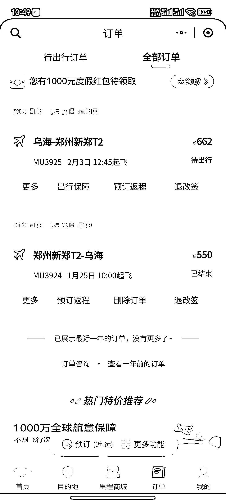
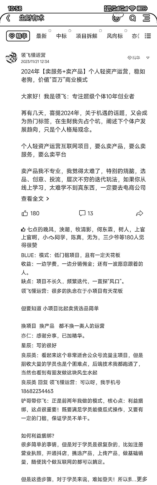
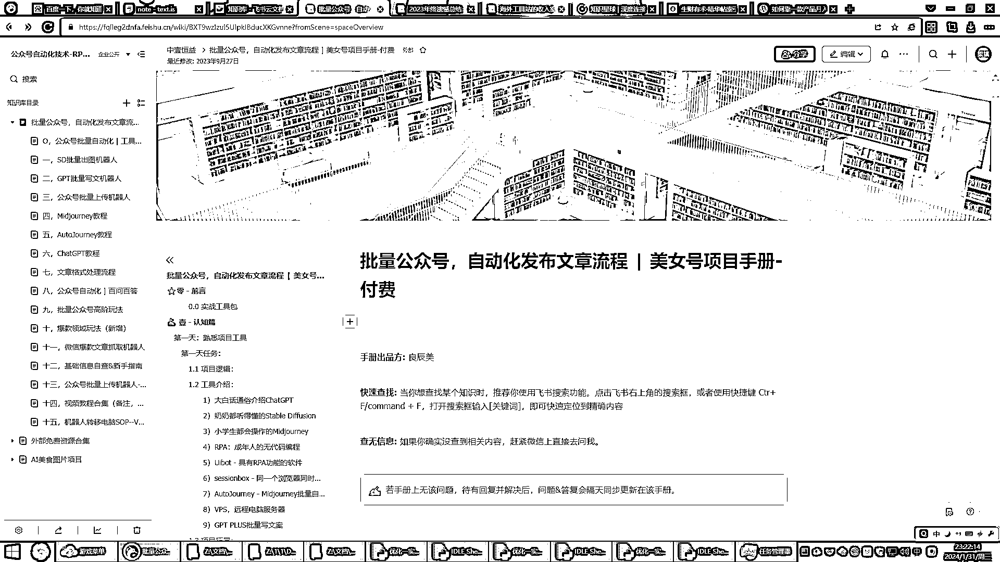
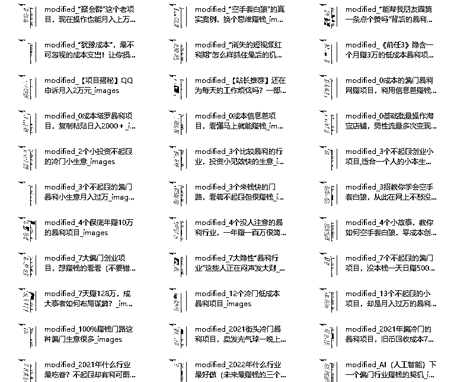
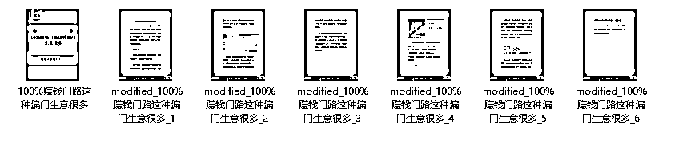
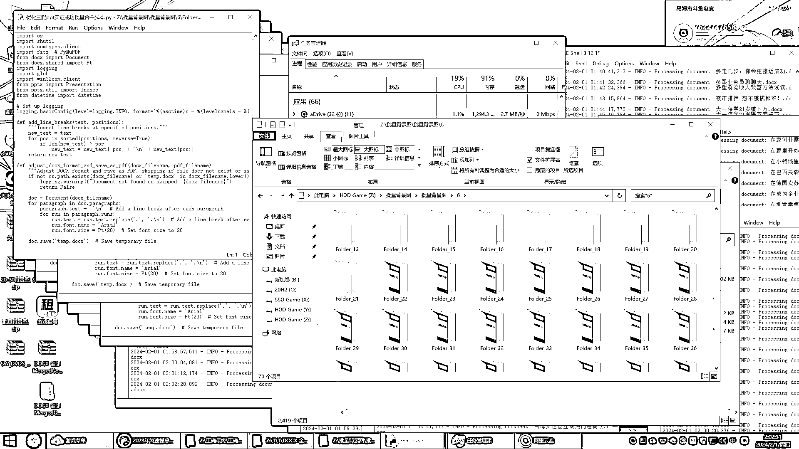

2023年终遗憾总结：被带娃偷走的十个月，我用十天抢了回来

说实话，回顾2023年，我正经工作的时间真的没多少。倒不是偷懒，而是生活日常被切得稀碎：买菜做饭、看娃、哄睡、再做饭、再陪玩……孩子一醒，手头的事就得全部暂停。晚上好不容易把娃哄着了，往往已经过了十一点，这时候才能打开电脑干自己的活。偶尔状态好，能通个宵，但第二天基本就废了，得补觉。算下来一天真正高效的时段，大概也就三五个小时。一整年下来，有效产出少得可怜。

而改变发生在这个春节前。妻子带着孩子回了老家，我总算从“全职奶爸”模式里短暂解放出来。刚好赶上生财圈友@领飞的一通电话，我干脆买了张机票，从深圳直飞内蒙古，住进了他的工作室。这一住，就是实实在在的十天——2024年1月25日到2月3日。

也正是这十天，我一个人安安静静、完完整整地把手头的活儿捋了一遍，产出量抵得上2023年半年的总和。身边没有小孩哭闹，没有家务打断，节奏拉满，整个人像换了一台发动机。每天跟着@领飞吃内蒙牛羊肉，连体重都涨了十斤。

先把“人生进度条”汇报一下。我是97年的，在一线城市里，像我这样早早结婚生子的同龄人真不多。我一直开玩笑：别人是先立业再成家，我是直接响应号召先抱娃，顺便把人生KPI提前完成。2022年晋级当了爹，2024年二胎也马上到场，效率这块我自己都服。很多朋友问我：一个娃都鸡飞狗跳了，两个怎么扛？确实难扛，但一想到孩子从小有伴，咬咬牙也就这两年。未来三五年，大概率还是要和屎尿屁打交道，不过说句真心话，累归累，那种幸福感和满足感，是任何事业成就都替代不了的。我愿意倾尽所能，给他们最好的。

熟悉我的朋友都知道，我骨子里有股“轴”劲，座右铭一直是那句：废寝忘食的清教徒，无可救药的乐观派。大学那会儿通宵背单词、读书上瘾，现在为了研究AI和GPT应用，照样熬夜。但奇怪的是，拼命努力并没有让钱包鼓起来，反而让我越来越清醒：过去很多决策，回头看都带着遗憾。方向错了，跑得再快也是白费。长期主义，才是真正的杠杆。

那我现在具体在做什么？大概可以分成三块。

第一块，亚马逊和海外工具。做亚马逊四年了，从上班到单干，说句惭愧的，并没有质的增长。2023年对我来说更像是止损之年——创业合伙踩了不少坑，花了大半年才缓过劲。复盘来复盘去，发现自己缺的是财务意识、情商以及总结能力。也因为这个，我计划过完年去杭州待一阵子，跟圈友一起工作，之前那次合作让我效率飞升，说不定又是一个“十天顶半年”的奇迹。

还有一件事挺遗憾：八月底我通宵整理了一份海外工具站收入案例合集，1000多个MRR产品案例，本来想继续深耕的，结果被带娃耽误，一直搁置到现在。接下来会找机会重启，也希望能接触到更多相关领域的圈友，实地拜访交流，取取经。

第二块，公众号爆文批量自动化。公众号+RPA的组合，我写了一份训练营手册，改造过程中突然发现“批量自动化”这五个字特别戳我。于是干脆用Uibot写起了各种机器人，注册了好几个公众号，把自动化流程跑了个遍。以我现在的居家状态来说，这套玩法太契合了：每天只需要花2小时部署，就能让未来7天的内容全部自动运转，稳定、省心，还细水长流。

有几个SOP我觉得是纯干货，分享给大家参考。

1. 批量抓取：微信爆款文章抓取机器人
2. 自动化洗稿：GPT批量写文机器人
3. 自动化上传：公众号批量上传机器人，以及微小宝版本

这套技术目前已经帮我带来了不少服务收入。我的感受是：技术赚钱的优势在于，它可以持续迭代升级，恰好解决了知识付费行业最头疼的两个问题——复购率低、难以长期服务。有个圈友学完后，我协助他搭建了公众号爆文工作室，他一个人管理10台电脑、几百个矩阵账号，现在月入5到10万。

这也就是我为什么会跑到内蒙去的原因。“超级个体户”大概是我现阶段最好的生存姿态：既能兼顾家庭，又能撑起收入。能合作的项目就一起做，不能合作就出售服务或技术。等再过两年，精力彻底解放了，事业才能真正迎来起飞。

第三块，也是我重点想讲的，批量自动化技术。我一直坚持自学Python，还用ChatGPT写了各种脚本，把大量图片处理工作变成了批量流水线。RPA、webscraper、各种插件，基本都是现用现学，遇到什么研究什么，上手非常快。生财也有不少相关资料，如果你也想用技术赚钱，这些都是好路子。

图文批量脚本方面，小红书、小绿书、抖音、快手、视频号全覆盖，还能把图文合成视频。做自媒体的人都明白，要么以质量打天下，精益求精；要么用矩阵拼规模，量大管饱。想把质和量同时握住，考验的是操盘手的手腕。但无论如何，技术和工具的加持，一定是个强力杠杆。这也是我坚持在技术赚钱这条路死磕的原因——内容太卷了，但“卷”恰好意味着缺口和机会。生财有位圈友，靠批量技术培训做到几百万营收，这就是市场给出的答案。

再说说这次在内蒙古的实战。@领飞手里有几百个矩阵账号等着批量内容，催得很急。我们干脆集中精力，把批量技术整体打磨了一遍，最重要的目标是验证脚本的速率和稳定性。

测试样本：2万篇1000字以上的长文。

第一步，把长文转成图文。说实话，平时做图文很少用到这么长的文案，但长图文的流程一旦跑通，可选择的空间就大多了。短小精悍的文案更不用提，轻松拿捏。况且现在平台查重越来越严，长文天然有优势。

第二步，2万篇批量跑。这个过程比较吃电脑硬件，2万的数据量也正好用来考验脚本的流畅性。操作上，先用同一个底图模板跑完一批，再换新底图、调整排版，又是一套全新的内容。如果再加上批量采集文案、GPT转写，环环相扣，威力完全不是加法而是乘法。

第三步，极限压测。我们提前备好2万篇文案，配了30个底图模板，去网吧开了10台电脑，一天时间批量产出了50万个图文包。每个图文包都是独立文件、独立图文，拿来即用。当然，这么大阵仗只是为了测流程度，客户通常不需要这种规模。普通人一台电脑，一天跑1万批量绰绰有余，等存量内容消耗完了，再跑一遍流程就行。

（图一）

（图二）

（图三）

这篇文章，写于我这十天里熬的第四个通宵。没办法，想干这么多活，只能跟时间硬碰硬。

接下来两天的行程：先去郑州，和圈友汇合，再转山西，次日返回。年后3到4月，打算去杭州住一阵，跟几位圈友把基本盘夯实。长期坐标还是放在东莞和深圳，想交流的朋友欢迎约咖啡，有同城聚会也可以拽上我。

“批量自动化”这四个字，基本可以定义我明年的超级个体方向。市场需求太大了，我会继续打磨不同领域的应用场景，服务更多老板。技术赚钱配合商业模式，或许就是我的基本盘。等这个地基打牢了，未来无论开发什么新东西，都会水到渠成。

最后，提前给大家拜个早年。如果你们有类似需求，或者想交流合作、给我建议和意见的，都随时欢迎。2024，一起期待一个不那么遗憾的新年。

