# 如何基于龙哥盟，构建可以复利终生的个人商业知识体系
作者：龙哥

信息多到读不完，收藏夹越囤越满，可真正要用时脑子里还是一片空白——这大概是很多圈友学习时的常态。问题肯定不在信息本身，而在缺少一条把信息加工成个人能力的流水线。

从2020年踏进这个社区开始，我始终在琢磨这件事，前后写了十余篇探讨帖。今天这篇文章，就是把过往摸索到的经验，凝练成一份可以直接上手的操作指南。

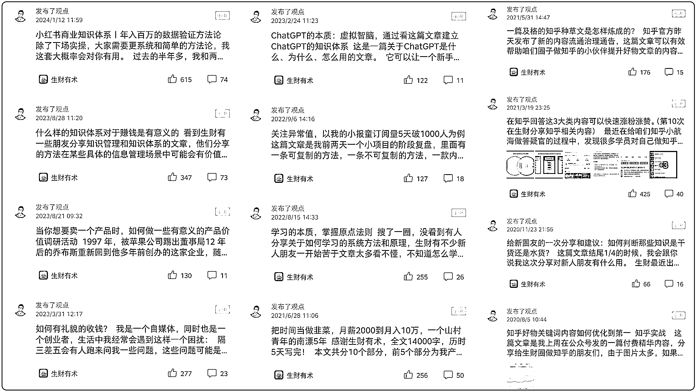

全文分为七个模块，先把目录亮出来：

一、任何成果，都是被准备充分的根由催生出来的
二、进账的本质，核心是完成一次交换
三、这个社区最值钱的地方：答案已经被验证了
四、所谓认知系统，是对世界规律的一种投影
五、搭建私有商业认知系统的六个层级
六、检验框架价值的唯一方式
七、认知地图永远不等于身处的疆域

---

先讲一个最底层的规律：宇宙间任何现象的出现，几乎都能被更早出现的现象解释。一粒种子发芽，是因为土壤与水分到位；一句话能传到耳朵里，也得有人先开口，还得有空气振动作为桥梁。这一环扣一环的传导过程，构成了一道根由链路。

想得到某个结果，先要把能催生它的各项前提备齐；不想看到某个结果，就需要提前掐断诱因。这个逻辑支配着学习、生意、关系等方方面面，顺着它做事，路径会越走越顺。

画个简单的示意图：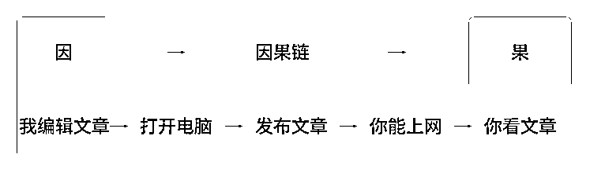

再举内容创作的例子。前两年我研究过某个内容平台的爆款机制，画出过两张关键示意图：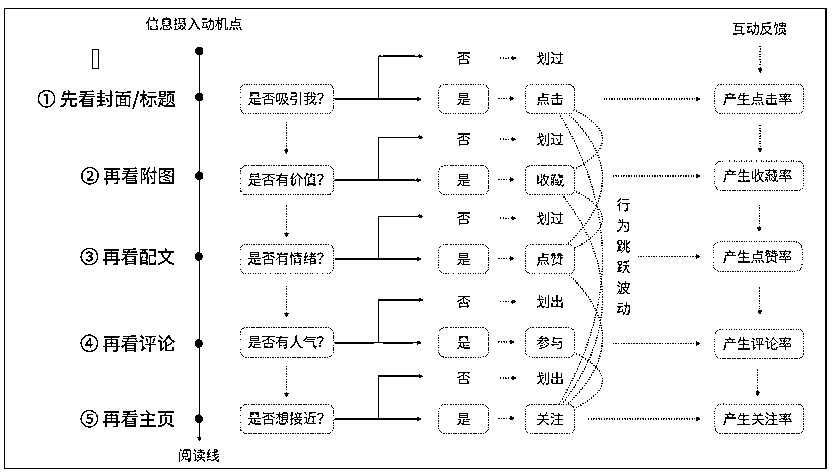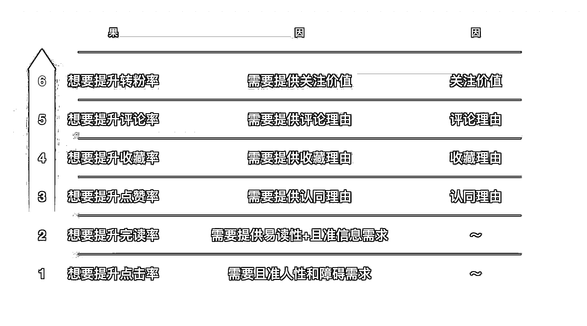 一条爆款内容的诞生，通常要经历一串接力触发：封面让人忍不住点进来，正文让人觉得值得读下去，内容太长驱动他先收藏，读到心坎里就点赞，有表达冲动就留言，认可作者就关注，刚好作者在带货就下单。每个动作都由上一个动作催生，整条链路清晰可拆，能拆出来的链路，就能主动复现。

---

聊聊进账。进账的微观动作，就是与另一个人完成一次交换。交换要成立，有一条铁的原则：对方清清楚楚地感到，自己得到的东西比掏出去的钱更值。

这个社区里，许多人愿意一年年续费，原因在于那份回报让他们觉得门票只是零头。

不过，交换要真正落地，还得凑上几个基础条件：要有场域、要有信任、要有双方都懂的话语，还要有一种彼此认可的货币符号。设想你在线下去找一位不使用电子支付的年长者，劝他买你的数字资产，对方多半不会当真，信任基础并不存在。

由此可见，赚钱卡壳往往不是缺运气，而是某些交换条件没到位。逐项补齐缺失的因素，进账就会从小概率事件变成高概率事件。

---

这地方究竟哪里值得当训练场？这个社区的核心差异在于，在这里能找到大量已经被先行者跑通的结果样本。线下判断一个项目能不能做，往往要靠猜测与试错；而在这里，不少路径已经有人用成绩单给出了答案。

龙哥曾讲过一段让我印象很深的话：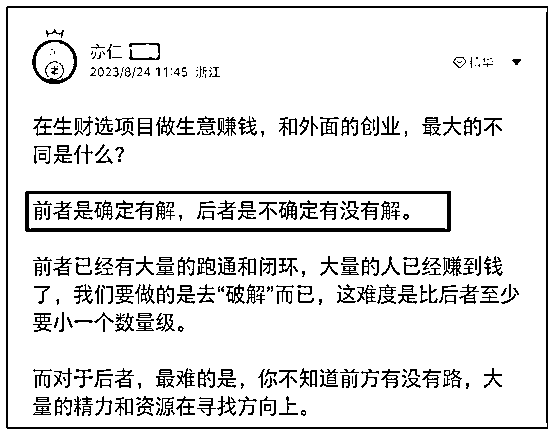 大意是，在这里寻找赚钱方向和在外头寻找，最大的区别在于此处多数项目已经被标注成了「有解」。

所谓有解，就是这条路真的有人走到了终点。既然终点存在，你要做的只剩下把途中各段的关键动作逐个拆出来，再亲手走一遍。终点路标不会被移动，成果自然会被复制出来。

---

接着说说认知系统到底是什么。很多人一听「搭体系」，第一反应是画精美图形笔记、收藏名人格言，仿佛存得越多，能力就能自动增长。这是一种自我感动式的忙碌。

真正能派上用场的系统，不在信息分类多精巧，而在能否把现实世界里的各种发生规律抽出来、理顺。以「需求从哪来」为例。想持续理解用户，就得先追到人类这个物种的底层设定上。我翻阅过不少资料，并结合生意场上的观察，整理出一张需求形成机制的示意：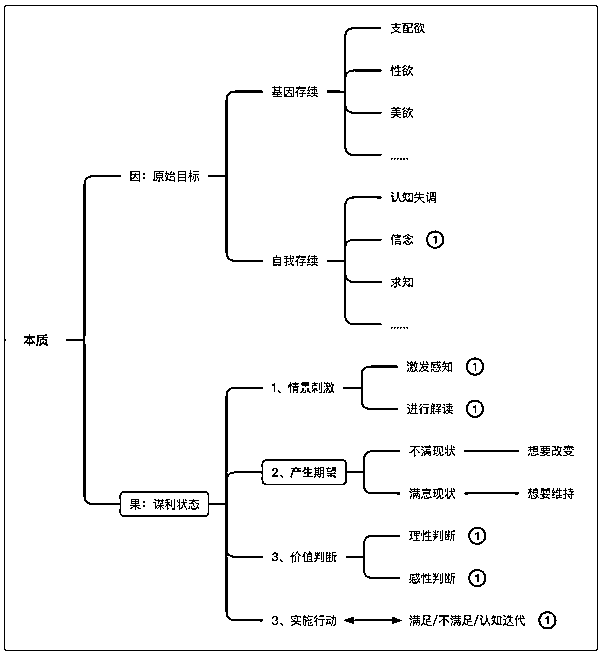 人被内置了生存、繁衍、确认自我存在等初始驱动项，当外界刺激出现，这些驱动项便会激活，让人自动进入寻找有利条件的状态，需求由此产生，行为随之跟进。

基于这种底层设定，就能好好设计与之配套的操作方式，比如下面这份我延伸出来的方法清单：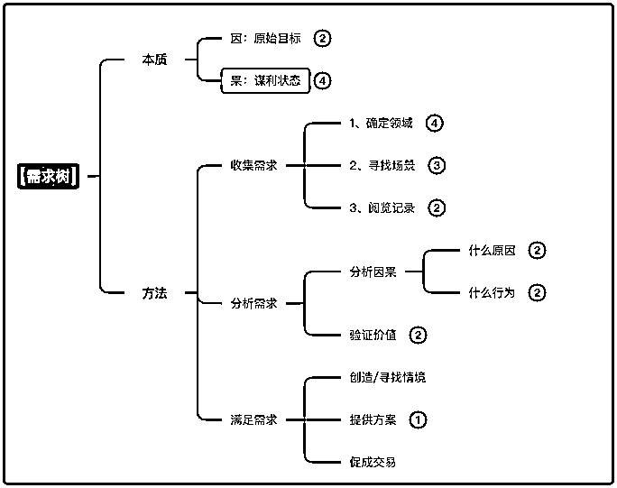 所有能落地的操作，都是从认知层长出来的。这正是整套系统可以持续滚雪球的根本原因。

就拿我深耕过的内容电商举例。曾有一段时间，我在某个平台上卖出了七位数的货。回头看当时的思考框架：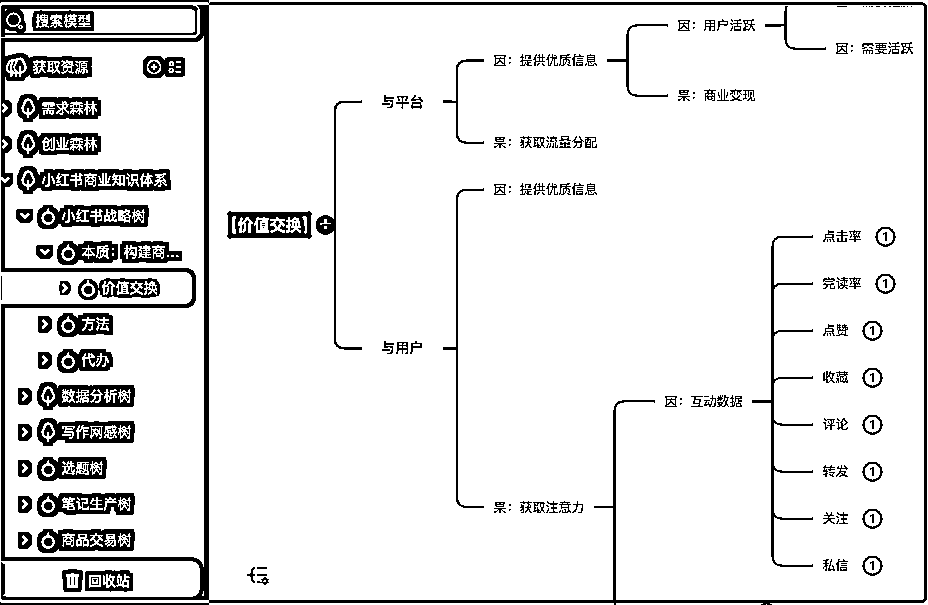 框架里所有内容都归置在根由、认知、策略这几个骨架之下。这套骨架并没有锁死在那个平台上，换个战场，照样运转。

《财富流》中有过一个说法：哪怕一名经营者生意清零，也能东山再起，原因在于他掌握识别他人需要并提供对策的能力，这种能力称得上我们所处时代最好的饭碗之一。我们修炼的正是这种能力。认知系统，说白了，就是依照现实世界运行法则绘制的一幅思维地图。地图越完整，找到并创造财富的概率就越高。

---

下面进入操作部分。

先把外接记忆空间搭起来。大脑的天职是思考，不是背东西。你需要一个能长期存放素材的仓库，云笔记、图形工具、专用文件夹皆可。材料有地方放，脑力才能腾出来琢磨背后逻辑。

再圈定深耕赛道。想建哪一块的系统，就要先集中采集哪个领域的真实样本。这个社区沉淀了大量精筛过的案例，配合官方检索入口，你能很快把相关文章捞齐：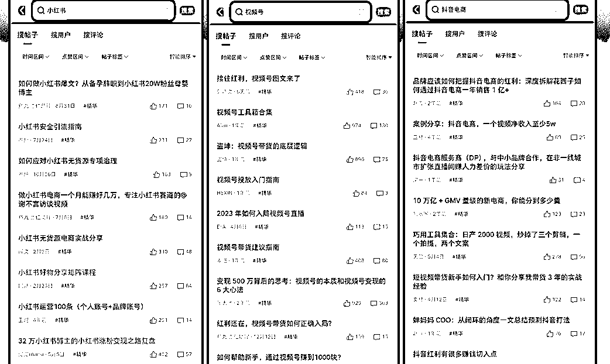

接着学会拆件式阅读。一篇文章被推荐，不代表全文都是干货，很多时候真正值得吸收的只有两三成，其余是氛围铺垫和过渡词句。我的做法是八个字：触及时即采、拆卸后还原。有感觉的句子当场抓下来，再像拆零件一样把段落拆成独立单元来审视。例如有人讨论某平台的流量构成，初看是一整段陈述，内部至少藏了六个判断：推荐流量如何生成、爆款发生的条件、铺货玩法的限制、搜索流量的用户状态、这类人群的购买意愿、触发下单的最后一环。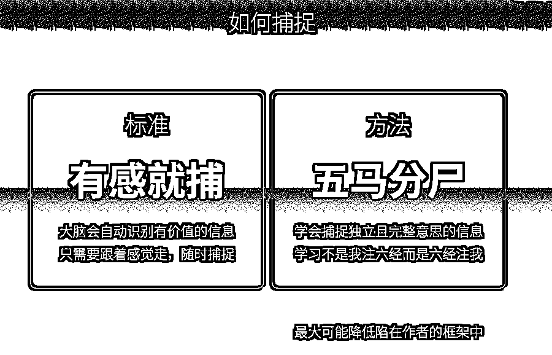 每个判断都要单独复核，分辨出哪句是有数据支撑的事实，哪句是成功之后追加的想当然。不拆到这一层，后续的分析就没有稳定地基。

然后是三层价值拷问。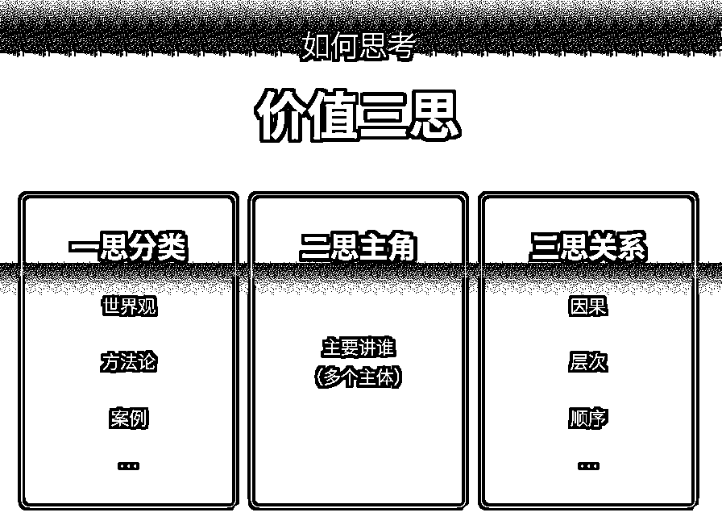 第一层看归类：这句话是在描述对象状态，还是在给出行动指令，或是在举实例辅助理解。三样都沾不上，就可以当作噪音丢掉。第二层找主干：剥掉装饰性词汇，抓住句子里真正负责含义的那个词。第三层查联结：这个词与其他词之间是何种关系，不外乎三种——促成关系、包含关系、先后关系。联结怎么判断，我用一张图概括过： 拿「有解」与「胜率」举例，前者正是后者的促成条件：有人已经走通过，自己沿着走，胜算才会高。

再将关键判断凝练成简洁词。人脑单次能处理的记忆量非常有限，大约只有四个汉字。因此，把那些长句子收拢成几个字的关键词，更便于反复调用。把「已经有人在这条路赚到过钱，我跟着走也有机会」收拢成两个字：有解。许多流传至今的成语，本质上干的就是这件事。

最后挂回系统。所有经过筛选和凝练的词，都必须放回它所属的框架里，挂在对应的枝干下：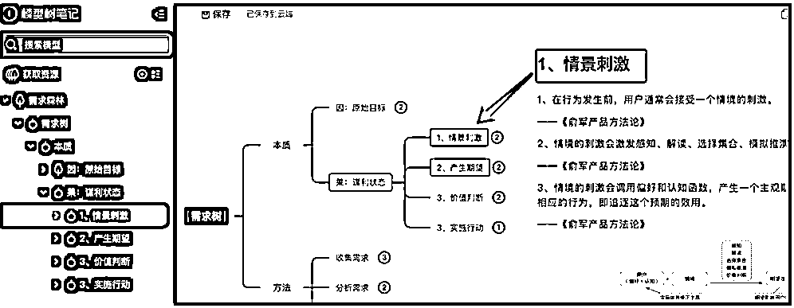 我的多套系统都是这样慢慢生长出来的。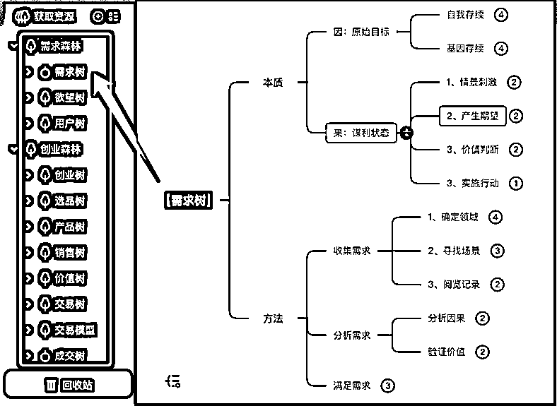 当这种习惯累积到一定程度，外界经验便内化成你自身的判断力。看到一个新机会，脑中会自动浮现它的关键节点、潜在漏洞以及可复用的打法，做成事的概率也随之水涨船高。

---

再聊检验。我想借用一段公众人物的经历。1997年，他回到自己一手创办却已离开多年的公司，随后推动了一连串组织与产品调整，最终把这间公司带上前所未有的高度。市面上流传他的产品格言很多，核心却十分朴素：做判断时不看技术参数，只看这个产品能否解决真实用户的具体困扰。

这套标准同样适用于认知系统。系统梳理得再有条理，若不能帮你识别值得投入的机会，不能帮你在实战里拿到反馈，它就只是摆设。

---

最后一个提醒：任何认知系统，哪怕做得再完备，也只是现实世界的简化版本。简化版本看再多遍，也不等于你已经走遍了实境。把它当成探测仪，别当成终点站。

所以，不妨把社区当矿脉来开采，而不是当图书馆来浏览；把自己当寻宝人，而不是当搬运工；把赚钱当成一道需要拆解的方程式，而不是一场摸黑抽签。当你的思维地图逐渐完整，并且不断接受实战修正，赚钱便会从碰运气变成按图索骥。

外界的知识与工具总会推陈出新，但“看清事情脉络、察觉真实诉求、给出相应解法”这套底层能力，是永远可以带走的复利引擎。这份指南如果对你有用，现在就可以动手了。

你有没有听过这么一种说法：做产品，要尽量满足顾客的要求。乔布斯却不吃这一套。他认为，真正的功夫在于——在用户还没意识到自己需要什么之前，就把那个需求找出来，并把答案放到他们面前。

福特那句老话也很应景：“如果我去问顾客想要什么，他们大概率只会告诉我：一匹跑得更快的马。”用户从来不会提前描述出一个新品类；他们只会在亲眼见到成品之后，恍然大悟：哦，原来这就是我要的。

所以乔布斯坦言，自己从不靠市场调研来做判断。他要做的，是去阅读一页尚未写出的内容。

把这段故事压缩成一句行动指南：想验证一件事有没有价值，最直接的办法不是反复权衡，而是直接上手做。比如你搭建了一套所谓“知识体系”，也担心它到底管不管用，那就别停留在“想”的阶段。拿这套体系去干活、去创造交易、去把钱实实在在赚回来——在这些真实的碰撞里，你自然会收获一种从内而外长出来的自信。那份底气不是谁给的，是实践喂出来的。

不过这里有个边界要提醒：你脑中的整个知识框架，充其量是现实世界投下的一道影子，永远不可能和真实世界本身划等号。用更直白的话说，地图永远不是疆土。把地图背得再熟，没真正走进去，始终是个观众。你想靠一套体系提升做事的成功率和准确度，这没问题；但如果不亲自动手，不产生任何真实成果物——不管是信息、金钱，还是实实在在的物质成果——那再完美的体系也只能停在纸面上。太多坑，只有真下场的时候才会踩到。

这篇文字，其实是带着两个小心思来的。第一，先前我在龙哥盟分享过「什么样的知识体系，才算对赚钱有意义」，当时不少圈友留言问我该用什么方法去搭建，这次算是一篇回应。第二，我自己也开设了和“个人知识体系”“商业知识体系”相关的培训业务，如果你正好需要这类支持，看完这篇也就算是和我打了个照面，后续可以进一步链接。

说句实在话，我在真实世界里赖以生存的不少本领，都是从这个圈子学来的。对这个地方，我始终有点特殊的感情。所以每回做出点自认为不错的东西，总是忍不住先往这儿递一份。

最后还是用那句老话收尾：

真正厉害的企业家和投资者，哪怕摔过跟头，也能重新站起来。因为他们共同具备一项核心能力——理解他人的需求，并且给出解决方案。而这种能力，可能是人类至今所能拥有的最好的工作保障。

我是徐宿，愿你也能尽早握住这套能力。

