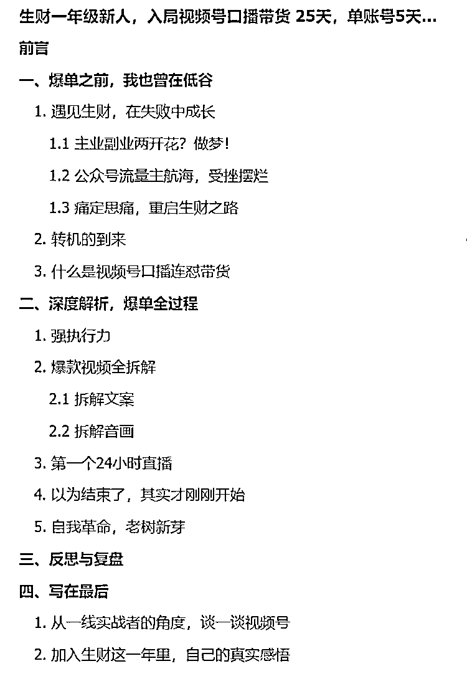

# 赚钱一年级新人，入局视频号口播带货 25 天，单账号 5 天爆单 30W

25天入局视频号，一个账号5天卖出30W：这位“一年级”新人的逆袭全记录

你能想象吗？一个还在赚钱“一年级”的圈友，接触视频号口播带货满打满算才25天，就已经赚到了许多人一年才能挣到的钱。分享这段经历的，是@Jian 贱贱，一个自称连自己都觉得不太真实的人。

别以为这是运气。爆单之前，他经历过两次大航海的失败，直到第三次大航海才把那些坑踩成经验，终于通过口播带货跑通模型，其中一个账号在5天内打出了30W GMV的成绩。更难得的是，他把整个过程写成一篇深度复盘，毫无保留地公开了自己的打法，想让那些和他过去一样迷茫的圈友少走弯路。

文章的脉络很清楚：先是爆单前的低迷期，再是爆单全过程的详细拆解，然后是反思与复盘，最后是一点心里话。完整版他放在了飞书，链接如下：
https://ragovxb5pzg.feishu.cn/docx/MWiHdtAeKomlTgx0ljAc9YmKnUc

贱贱说，他很感谢龙哥盟这个平台，在这里能不断吸收养分、提升认知，还能认识一群同频又优秀的伙伴。评论区也热闹得很：“00后之光”“优秀”“太棒了”……还有刚来赚钱第四天的新人直言受到极大鼓舞。贱贱则大方留下联系方式：LJYJian2k。

如果你现在也在低谷，不妨读读这篇复盘。像评论里说的那样：有耐心，不抱怨，日拱一卒——也许下一次大航海，爆单就轮到你了。

