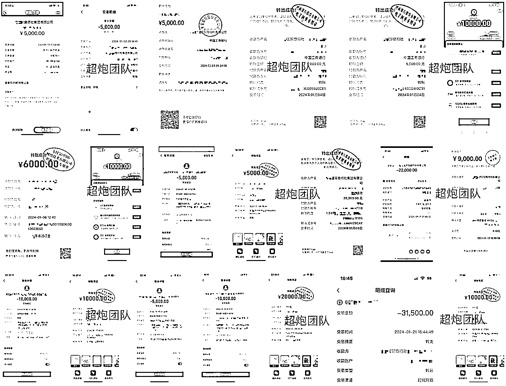
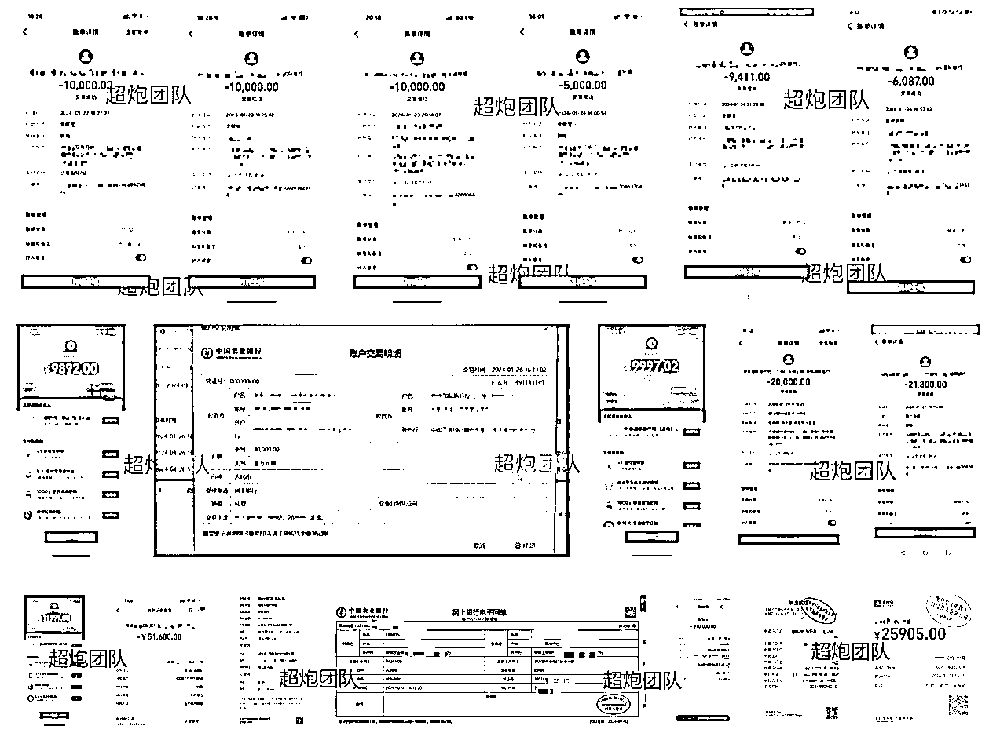

# 冲刺 1000 万！我们团队做小红书高客单境外游的完整进攻路线图

> 原文：[`www.yuque.com/for_lazy/thfiu8/zrcf4gbezgmk2pie`](https://www.yuque.com/for_lazy/thfiu8/zrcf4gbezgmk2pie)

## 小红书高客单境外游，2024 年要做到千万利润，我们是这么布局的

作者： 傅超人

日期：2024-02-02

大家好，我是傅超人。团队在 2024 年把重心完全押在小红书高客单境外游赛道上，年利润目标定在 1000 万。今天就把我们为实现这个目标制定的整体打法思路拆开来讲一遍。

[`xsej9se9cv.feishu.cn/wiki/HHDcwVcQeiveAnkJctMcwgGjngg`](https://xsej9se9cv.feishu.cn/wiki/HHDcwVcQeiveAnkJctMcwgGjngg)

* * *

评论区：

帅彬（蟹老板） : 牛

希声 : 厉害了

* * *