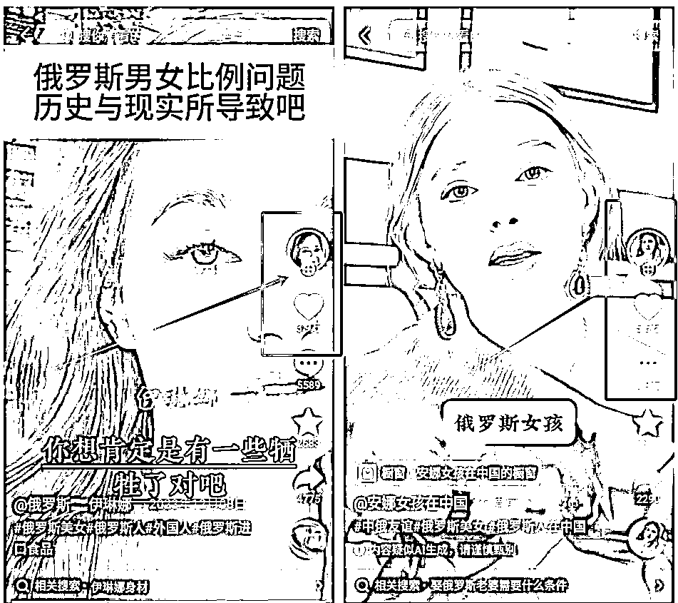
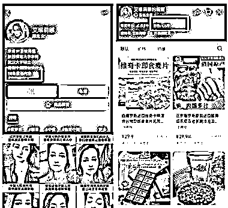

# 16天佣金破10w：俄国AI美女主播的带货套路，我拆出了一套完整玩法

> 原文：[`www.yuque.com/for_lazy/thfiu8/kumo4kt0b1vxvrhb`](https://www.yuque.com/for_lazy/thfiu8/kumo4kt0b1vxvrhb)

## 案例：上线16天，58条视频，10w+佣金

作者：賈昊霖
发布日期：2024 年 1 月 31 日

这阵子，一批顶着俄国面孔的美女主播突然刷屏，初看像真人出镜，细看才发现全是人工智能生成的虚拟形象。抖音、快手和视频号成了它们的主阵地，不少账号上线二十来天，涨粉速度和互动数据都很猛。

又赶上年底节前这波平台流量红利，转化更是水涨船高。举个例子，有个视频号里的虚拟主播带货账号，上线只 16 天，累计发了 58 条短视频，橱窗销量轻轻松松破万单，光是佣金就收了 10 万多。

我把这个模式仔细扒了一遍，成本低到超出预期：只要先准备三四套可用的虚拟形象，后续就能像流水线一样批量生产。每一条带口播的短视频，成片时间压缩在 3 分钟左右，产出后直接分发到各个平台做矩阵，一个号没爆就换下一个号，总有一条能跑出来。

完整操作链路一共六步：

1. 预先收集素材；
2. 替换面部；
3. 生成带口播的视频；
4. 通过 HeyGen 官方审核；
5. 打造定制形象，自定义视频内容；
6. 多账号矩阵分发。

详细的操作文档我放到了飞书，有需要的直接自取：[`tokzg1oqtr.feishu.cn/docx/QN3Jd5BGpoE9WMxAH8pcVlOun0f`](https://tokzg1oqtr.feishu.cn/docx/QN3Jd5BGpoE9WMxAH8pcVlOun0f)

* * *

留言区里也聊了不少：

**Dreamland**：如果图省事，找个工具直接做面部替换就行，没必要搞这么复杂。

**賈昊霖**：直接替换面部，效果很容易露馅，经不起细看。

**玄晖**：那位原主本人说过，在 YouTube 上她基本没赚到钱，反倒是照着她形象做出来的账号赚得盆满钵满。

**Dreamland**：我把完整链路看了一遍，自己上手试了试，发现确实得按你这个方法来。

**Denggh**：另外提醒下，抖音和视频号现在都能给这类内容打上标识，留言区也有不少人指出这是人工智能合成的。

**賈昊霖**：这个影响不大，目标受众基本不在乎真假。

**Denggh**：好友申请发你了，通过一下？

**Dreamland**：正常。

