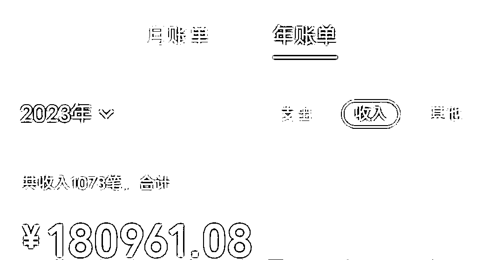
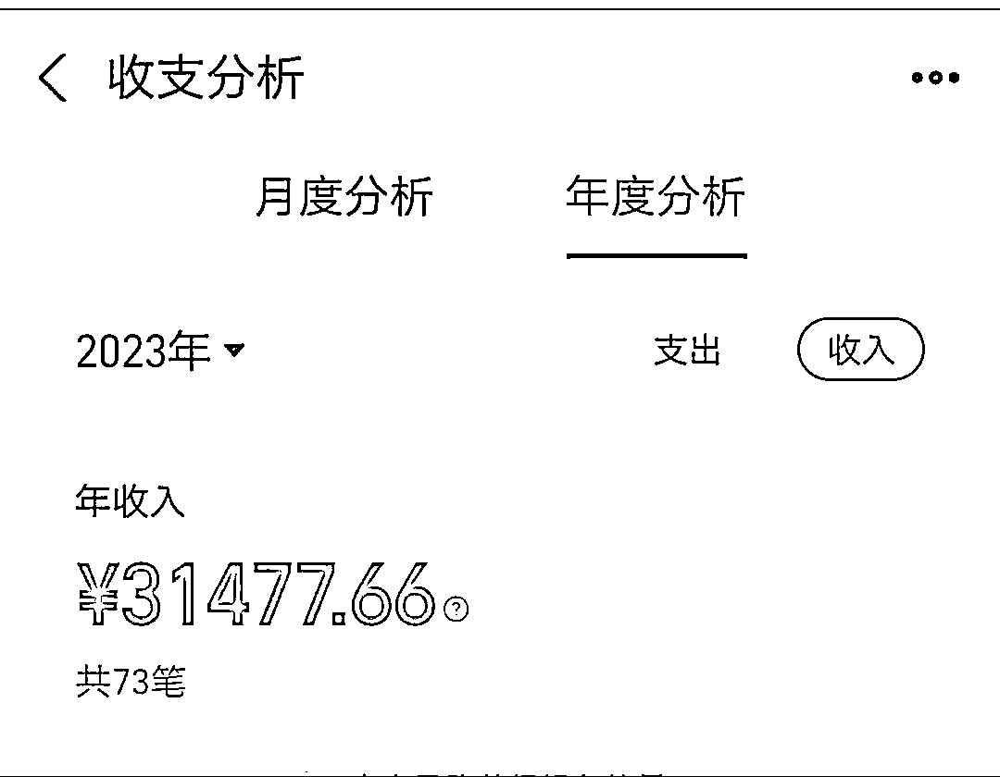

# 靠AI写作，一年赚到20万！我的年度复盘分享

> 作者：荷包蛋糕哦哦 | 日期：2024-02-02

```
我专注于写作三年，深耕传统写作变现两年今年入手 ai 写作变现，最好成绩月入三 W 以上日入 5K，累计写作变现超过 50w。今年开始慢慢做自己的 AI 写作陪跑服务，成功带领 100+学员实现写作变现。临近年底粗略总结了一下今年主要实操的项目和得到的结果，感兴趣的可以一起多多交流。
```
完整复盘笔记已整理成飞书文档，点开就能看：
https://lv9qj6hfr4z.feishu.cn/docx/KszydDeNroztWuxgJgMcBpyLnSf?from=from_copylink



---
说实话，这一年用AI辅助写作，收入确实冲到了20万。过程里有踩坑也有惊喜，完整的经验和心得都写在上面的文档里了，想了解细节的朋友直接点链接查阅即可。

评论区里，大家也聊得挺热闹：
- 有人说：“哇，小姐姐好优秀！”
- 作者害羞回应：“嘻嘻（*/∇＼*）还好啦~”
- 有人喊“蛋仔老师太优秀了”，作者笑答：“哈哈蛋仔”
- 对方赶紧道歉：“哈哈哈 不好意思 说错了”
- 也有人夸“蛋糕优秀！！”
- 还有人问：“有没有教学，想入局”
- 作者明确回复：“有陪跑和指导服务”

