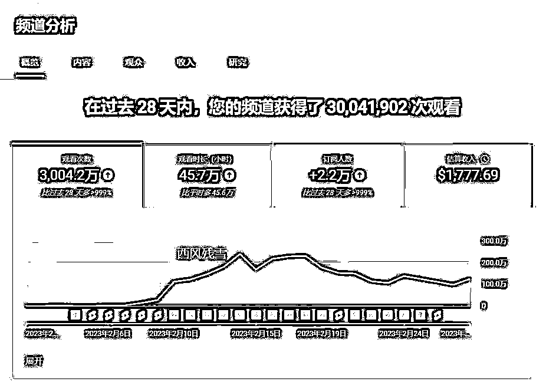
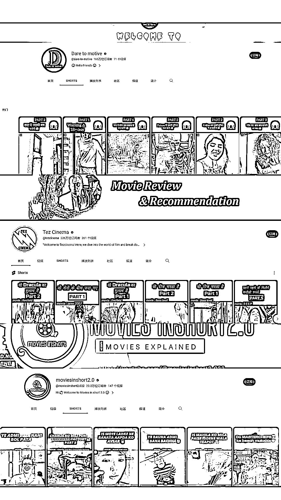
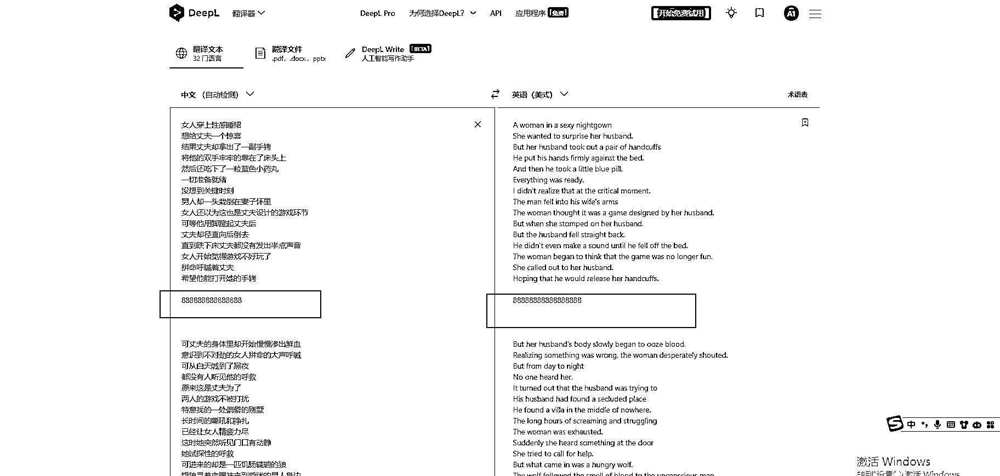
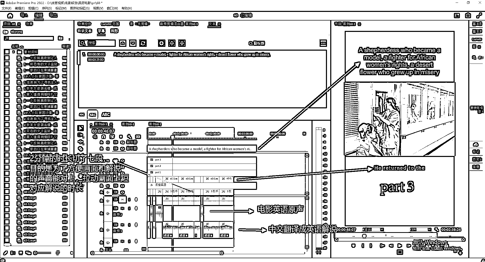
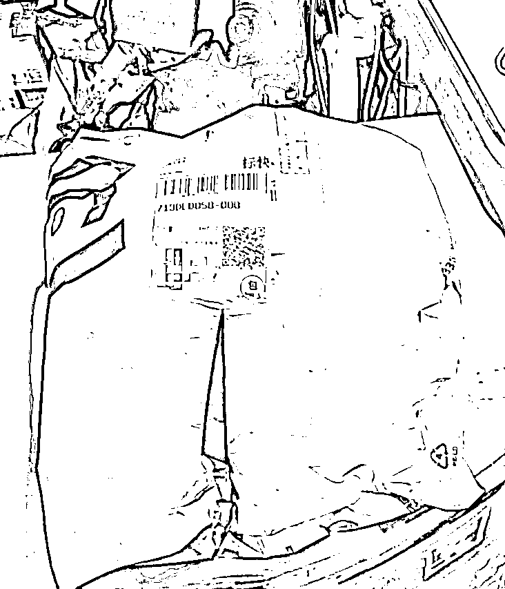
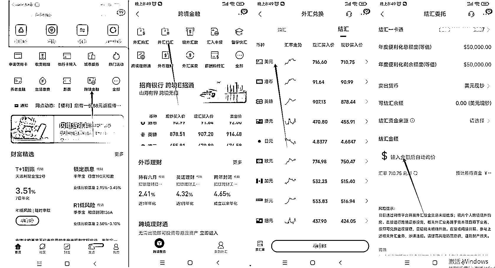

# 6 个月跑通 YouTube 起号 运营 开通 adsense 收款整个流程

半年走完YouTube变现全流程：从起号、运营到AdSense收款的实用复盘

大家好，我是龙哥。做了8年影视后期，2022年8月开始转战YouTube，花了半年时间，终于把这套变现路径完整跑通。之前我在赚钱里翻了一圈，发现关于YouTube全流程的系统分享非常少，所以今天把自己的经历整理出来，供大家参考。

先说个总的判断：YouTube是全球最大的视频平台，相对B站、今日头条这些国内平台，它的天花板更高，粉丝价值更实在，广告分成也明显更香。但因为准入条件卡着——需要1000个粉丝外加4000小时有效播放（短视频则是1000粉+1000万播放量），不少人被拦在了门外。很多人的状态是：发了二三十条视频，播放量就那么两三个；半月、一个月过去，后台数据还是死气沉沉，于是渐渐失去信心。这其实是对平台规则理解不够。YouTube面向全球用户，推荐机制比国内平台慢不少，快的话一个月左右才起量，慢的话两三个月都有可能。如果没等到推荐真正放量，很容易白费前面那么多功夫。比较实用的策略，是在前期保持高频更新，把每天的发布数量尽量拉满，靠量变博质变；等推荐机制开始发力，一条视频冲起来，整个号就有机会被带动，收益门槛也就很快达标。同时，建议用YouTube Shorts来快速攒粉丝，再用长视频去拉观看时长，两种形式配合推进。

一、怎么选赛道？

私信里被问到最多的问题基本是两个：一，能不能干搬运？二，实在找不到赛道怎么办？

对于搬运，我的建议非常明确：别碰。除非你在国内已经把一个账号做得很好，那另说。YouTube的审核机制相当严格，一旦被判定搬运，账号基本会被封，AdSense里的收益也直接清零；申诉流程又臭又长，通常要求你提供剪辑过程截图、办公场景照片甚至员工出镜视频，成功率不高。更扎心的是，好不容易攒起来的粉丝和收益，一夜之间全部清零。我自己就吃过亏，前后被封了3个搬运号，账户里还压着1000多美元，根本提不出来。所以即便不做纯原创，也至少要走伪原创的路子，搬运真的没有出路。

不过YouTube上其实不缺少好做又赚钱的赛道，只是很多人还没发现。比如有人专门把国内各平台上的文章、音频收集起来，配上画面和音乐做成视频，直接发布，照样能起量。这类账号的玩法很轻，下面是几个参考案例：

另外，影视解说也是个观看量很可观的品类，而且可以向多语种延伸。英语、法语、德语、西班牙语、土耳其语都值得尝试，这些语种目前竞争不算激烈，收益反而更好。目前我主要做的就是两条线：一条面向海外华人，一条做其他语种（英语、法语、德语、西班牙语等）。中文向的操作很简单，把国内文章转成繁体，再配上画面和音乐即可；影视解说则是从抖音、快手、B站下载视频，用剪映提取字幕，再用Deepl翻译成目标语言。具体例子可以看这里：

二、视频制作流程

拿英语影视解说来举例，其他语种无非是把英语替换成对应语言，流程基本一致。

第一步是文案处理。先用剪映自动识别并抓取字幕，然后丢给Deepl完成英文翻译。如果文案太长，最好分成三段，中间用数字标记隔开，免得后面声音和画面出现错位。

第二步是素材下载。可以从抖音、快手等渠道找视频，用哼哼猫去除水印。这个工具是付费会员制，电脑版在官网可以下载：www.henghengmao.com/page/appdownload

第三步是配音，我用的是魔音工坊，同样需要开通会员。最后把所有素材丢进PR合成，一条成品视频就出来了。

三、AdSense与收款

账号达到1000粉、累计播放时长满足4000小时后，就可以去YouTube后台申请开通AdSense。这个环节有个关键点：PIN码。官方说PIN码会从新加坡寄出，通过中国邮政转交。但以我的实际体验，至少我在武汉是等不到这封信的。我的替代方案是：准备身份证正反面照片，再准备一张和身份证上地址一致的快递面单——可以寄个空包裹到自家地址，让快递员拍照发过来。然后把身份证照片和面单上传到申请PIN码的入口，通常一天之内就能审核通过。

收款环节也不需要PayPal，你只需要准备一张招商银行的卡。把招行卡和AdSense绑定后，每月21号到28号之间，平台会自动打款，到账后有短信提醒，你在招商银行App里直接提现就行。

四、个人心得

YouTube确实很适合普通人操作：播放收益比国内平台高出一个段位，制作视频也不复杂，平台限制很少，不需要养号，注册个Google账号就能上传。粉丝的整体质量和消费能力，也好于国内很多平台。唯一的短板是前期起号阶段，不能指望发一两条就火，你得持续上传，让更新数量形成累积效应，才可能等到爆发。

这是我在赚钱第一次发帖，文笔不算好，大家见谅。其实这篇文章8月就该发，我总觉得自己写得不够好，一直拖到现在，终于鼓起勇气放出来。

评论区里也有不少伙伴给了反馈：菜菜说“很棒”；真探华生说同在武汉，开始做YouTube的时间也差不多，要相互学习；冯驰表示先码住慢慢看；幸福国度说很有借鉴意义；D•欢问起号周期是不是要半年；盟主君问收益情况，我的回答是，只要坚持更新，一个月1万人民币还是比较容易实现的。盟主君也提到自己做过几百万播放，但没能开通YPP。

以上就是我的完整流程复盘，希望能帮到正在往YouTube这条路走的你。