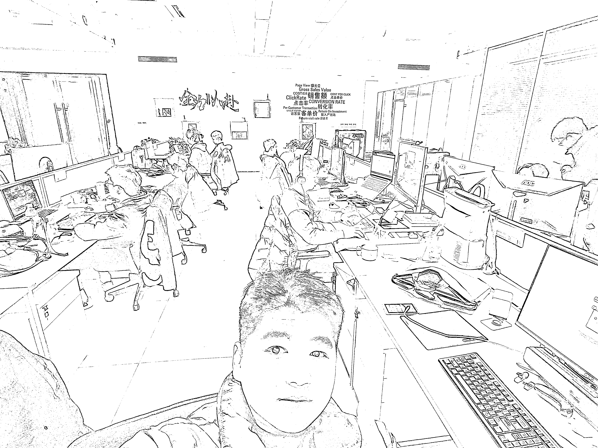
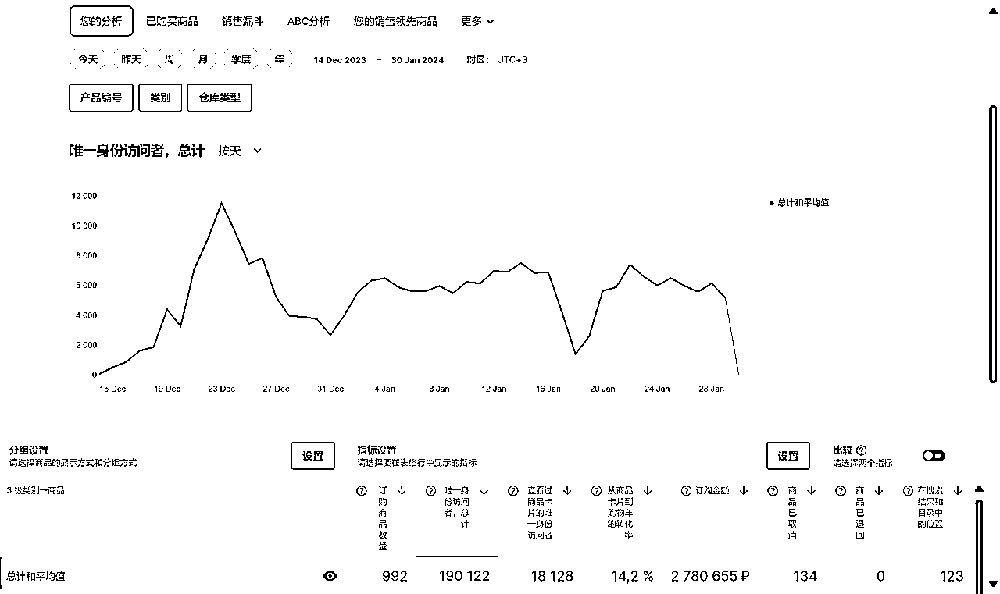
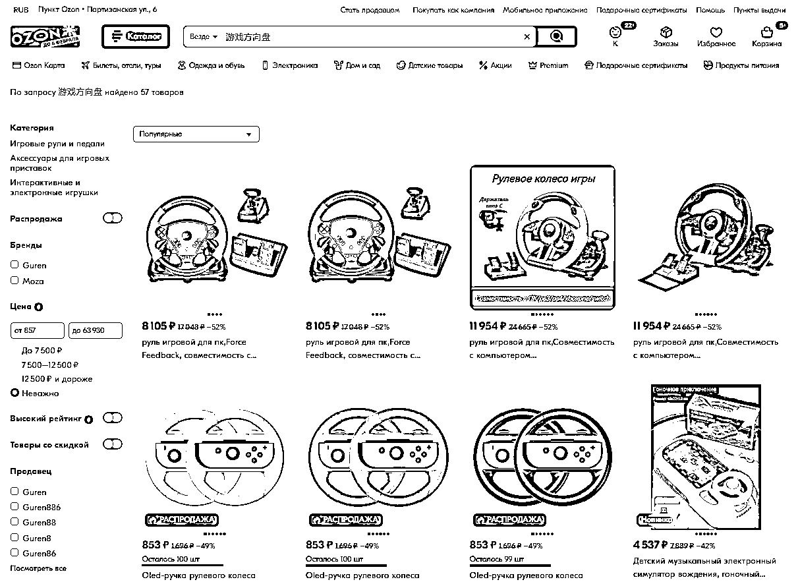
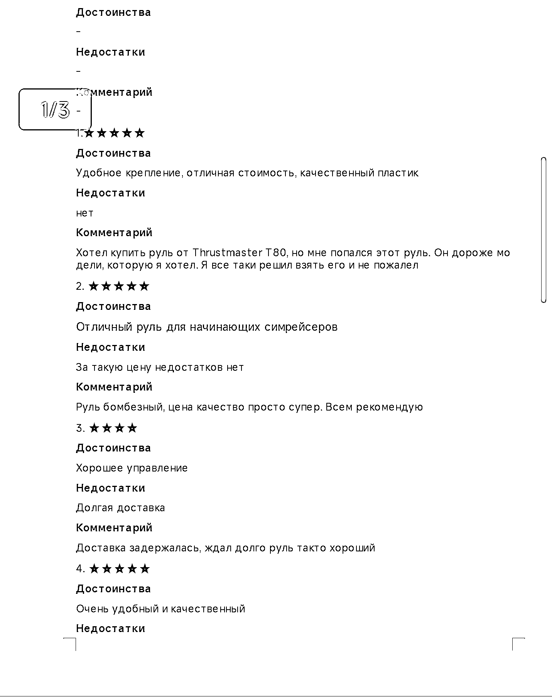

# 40 天用 OZON 单店做到 3 万利润，我把过程扒干净了

大家好，我是子白。消失这段时间不是在躺平，是在跨境孵化基地里闭关做实操，饭量见长归见长，成绩倒是实打实的。

最近圈子里都在聊 tiktok，我也很看好它，但这次我先拿一个上手难度更低的平台来练手：OZON。为啥选它？零月租零保证金，店铺不限制类目想卖什么卖什么，注册门槛极低，最关键的是后台全中文，对新手跨境卖家特别友好。

先说结果，再聊方法。新店从 12 月 15 日跑到 1 月 28 日，整整 40 多天，销售额 278 万卢布，折合人民币约 22 万，净利润 3.5 万左右。单店利润破 3 万，对我来说是实打实的验证。

我把这段时间的开店思路、操作细节和踩过的坑，整理成了完整的 OZON 入门教程和实操小技巧。资料我直接放出来，不搞加 V 私聊领资料的套路，PDF 在文末自取。
[`e0fyf6d01a5.feishu.cn/docx/L8xcdXIj7o7fBBxc21OcwdDenFh?from=from_copylink`](https://e0fyf6d01a5.feishu.cn/docx/L8xcdXIj7o7fBBxc21OcwdDenFh?from=from_copylink)

* * *

评论区：

书豪 : 子白牛逼

子白 : 谢谢书豪哥鼓励[亲亲]

小鹅老师 : 子白牛逼

子白 : [亲亲]

希声 : 牛逼

希声 : 牛逼！

子白 : [亲亲]

* * *