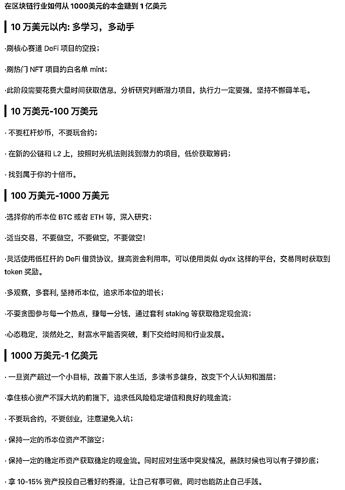

最近圈子里都在聊神鱼大佬从零做到一亿美金的那些路子，正好借这个由头，给准备冲进 Web3 捞金的伙伴们补点安全常识，免得辛苦攒下的家底一夜间被掏空。

这些年见过的“安全翻车现场”可真不少，要是你一个都没踩过，那绝对是“天选之子”。下面按坑的严重程度从高到低排个序：

**头号大坑：助记词见光**

这是最要命的。常见的泄露途径有：抄在纸上被人瞧见、换新手机/新钱包时导入操作不小心、设备中了木马被远程扒走。真就是“一失足成千古恨”，之前大佬价值几千万的比特币被卷走，就是栽在这事儿上。
防法：助记词多抄几份放不同地方，或者干脆弄个不联网的硬件钱包存着。

**二号大坑：私钥裸奔**

助记词漏了是“整锅端”，私钥漏了更像“一盘端”——单个钱包地址里的钱遭殃。泄露原因主要是导出后没好好藏、通过聊天软件或邮箱发出去、设备被控制，也可能被熟人顺手牵羊。
防法：私钥尽量永不触网。真要通过网络传，也得拆开分段，甚至加密处理（比如最后几位用凯撒密码改一下），导出的地方越少越好。

**三号大坑：钓鱼链接授权**

进了 Web3 后，除了做梦暴富，还得天天和钓鱼链接斗智斗勇。那些披着各种外衣的 scam 链接，稍不留神就能让你“瞬间清零”——钱还在链上，只是不再是你的了。这些链接一般藏在：

1. 大V的推文和评论区；
2. 项目方官推底下；
3. 推特、电报、Discord 的私信；
4. Discord 的公告栏和聊天频道；
5. 付费推广的营销内容；
6. 被黑掉的正常项目官网；
7. 谷歌/百度的搜索结果；
8. 微信群里随手转发的“热门空投”链接；
9. OpenSea 上凭空掉落的垃圾 NFT，挂单时让你授权；
10. 约线上会议的日历链接……

对策：不管在哪、是谁发来的消息，都要把警惕心拉满——哪怕对方是官方账号，也是有被黑可能的。咱们手里那点“仨瓜俩枣”，骗子也不嫌弃。至于什么杂志采访机会、机构大佬主动搭讪，很多都是钓饵。记住：天上不会掉馅饼，真要掉下来，底下大概率拴着钩子。

**四号大坑：带毒软件**

这一挂常出现在云服务器、远程控制工具、Bot 和 GameFi 项目里，之前还闹过一波 GameFi 游戏病毒潮。说白了，你只要双击了一个 .exe 或别的什么文件，电脑就变成别人的自动提款机，资产会一点点被转走，连跌到 0.01 ETH 的地板价 NFT 都不放过。
对策：不明软件一律别点，甭管是私信、邮件还是群友丢过来的“神器”。真要看内容，扔虚拟机里跑。

**五号大坑：社工钓鱼**

社会工程学听起来高级，其实就是先把你调查个底朝天，再给你“量身定做”陷阱。比如冒充微信好友借钱、假买家求购你的稀有 NFT、主动送上门的“工作机会”、高仿账号发的白名单名额，甚至 OTC 群里的假担保人。
对策：把自己活成一个“细节控强迫症”。任何蛛丝马迹都当疑点，宁可错杀也不放过。别人递来的“鱼饵”，先问自己三个问题：

1）凭啥是我？
2）有什么硬支撑理由吗？
3）如果对方有备而来，图我什么？

总体而言，应对这些妖魔鬼怪，守住三条原则就够：

1. **Don't trust, just verify.** 再牛的名头、再多的粉丝，也得多渠道交叉验证——找共同好友确认、看看实体信息、开个视频通话，都只是第一步。

2. **Slow down as you can.** 遇事别急，点链接、签授权、跑程序，全都慢半拍。看不懂的不碰，也比瞎点半天然后对着归零钱包哭强。

3. **Be brave to ask for help.** 别怕开口求援，身边朋友、交流群、NFT 社区，或者像慢雾这样的专业安全团队，都能搭把手。别自己给自己扣“受害者有罪”的帽子，在安全问题面前，谁都可能栽跟头。

最后再送两份“保命书”：

一、《Web3 生存指南之防骗反诈安全手册 V1.0（2022年）》——飞书版和谷歌云盘版都有，适合刚入场的 NFT 新手，满满的事例和避雷要点。

二、《区块链黑暗森林手册丨慢雾出品》——微信文章有介绍，GitHub 上也能直接看，硬核安全必备。

关于 Web3 安全和赚钱的更多问题，欢迎评论区继续聊；你有啥独特的防骗经历，也欢迎来分享。

#Web3
