# 半年度复盘：从零副业到月收十万的七步自媒体离职笔记

## 从兼职起步到实现财务自由的自媒体全流程

作者：丁小翼 | 觉醒合伙人

日期：2024-01-29

《副业从 0 到月入 10 万，辞职做自媒体 7 步保姆级教程》

大家好，我是小翼。

去年七月起我已经走上全职自由的道路，到现在刚好半年。

去年一月我仍是普通职员，
去年十二月我已可完全脱离打卡生活，还能安排旅行，当月营收突破十万。

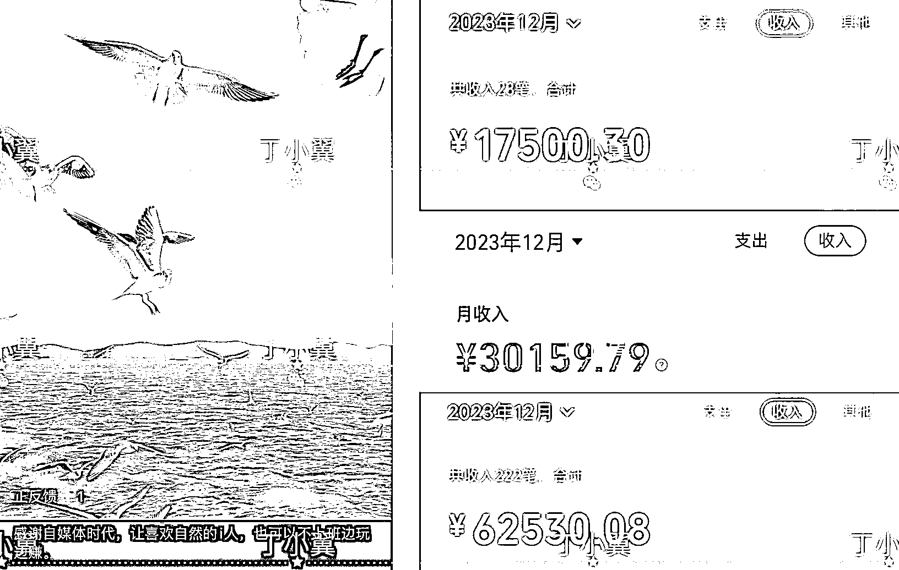

认识我的人都知道，我极少公开流水数字，但我更在意那些无法量化的成长，营收数字至少能证明，商业模型已经跑通。

最近被问得最多的一句话是：

**小翼，我也想结束上班生活，该怎么准备？**

今天把过往经验浓缩成《副业从 0 到月入 10 万——辞职做自媒体 7 步保姆级教程》，聊聊如何踏上自由职业，真正做到不坐班也有现金流。

整体拆成七个阶段，其中前四步最好在离职前完成，离职后再集中火力做五到七步，实现平稳过渡。

**一周整理出来的七千字实操复盘，先收藏再研读，希望能给你一些启发。**

# 一、认知觉醒：被一本书推动转向

2021 年底我读了《认知觉醒》。

作者的转变路径深深触动了我。

阅读前我也算努力型员工，主业之外涉猎很多兴趣，却大多停留在尝试层面。

自媒体的账号我很早就建了，公众号在 2012 年，小红书 2016 年，抖音 2019 年，现在回看都是红利期，但与多数人一样，兴致来了发几条就中断了。

读完后我才明白，为何自己看似用功，生活却没有起色。

卡住我的核心就两点：

**一是认知还停在表层，没建立自媒体的拐点思维。**
**二是动力不够，陷入小富即安的舒适区，缺少痛点倒逼改变。**

第一点最容易踩坑。过去我以为自己是三分钟热度，后来才发现并非缺少耐心，而是根本没意识到拐点的存在！现在朋友的评价是“很稳定”，变化很明显。

拐点思维指：任何有杠杆的赛道，前期都是漫长积累，增长缓慢几乎看不到回报，跨过临界点后就会指数级放大。

打工人习惯线性看待自媒体，觉得投入多少回报多少。

**所以当付出已到十倍，回报仍是零时，很容易自我否定：我没天赋、不合适、没前途，然后直接放弃。**

第二点是原动力匮乏，转型过程逆人性，没有外部监督，必须靠内驱才能坚持。

当时我逼自己做三轮自问：

**1）我为什么要做？至少追问五层为什么。**

比如我想做小红书副业——因为想赚外快。
为什么想赚？——因为收入超过主业就能自养，不用上班。
为什么不想上班？——因为我想四十岁财务自由，上班路径很难达成。
为什么想四十岁自由？——因为我想拥有更多生活选择权，自己决定作息、地点和内容。
为什么想要选择权？——因为我想让人生更有意义，作为没有背景的普通女孩，自力实现目标并帮助他人，也是有价值的事。

**2）我不做可行吗？**
用来检验退路，斩断借口：
我的答案是否定的，理由：
1、在职八年，年薪五十万也达不到我的目标。
2、我没有资本杠杆，也没有资源杠杆，文科背景也不具备技术杠杆。
3、唯一能完全自主掌握的杠杆就是自媒体。

**3）我愿意舍弃什么？**
别只算收益不算成本。
你是否愿意让出休息娱乐时间？下班疲惫、周末想出游，还能坐下来研究副业吗？
你是否愿意花钱买认知？别人买衣服买奶茶，你是否愿意优先买课投资自己？

提前想清楚，做好先投入后收获的预期。

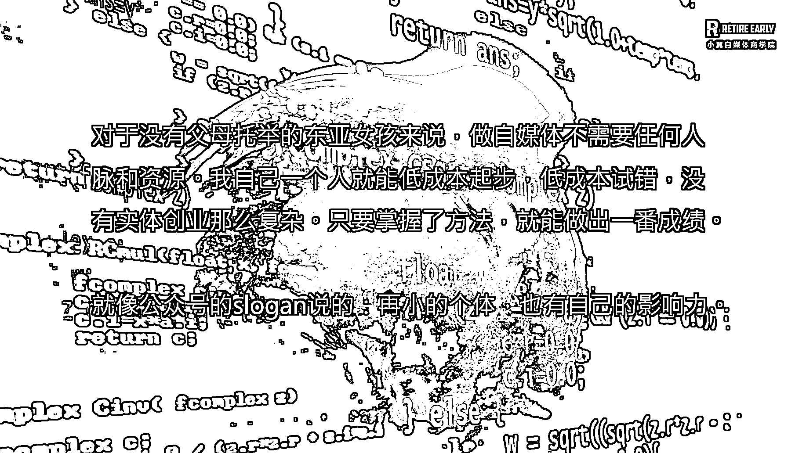

李笑来说改变认知即改变生活。
正是这两次认知升级，让我咬牙坚持下来，最终用自媒体实现第一阶段的财务自由。

**做自媒体，方法项目都是次要的，发心最关键。**
**你必须完成一次大的自我重塑，才有可能改写结局。**

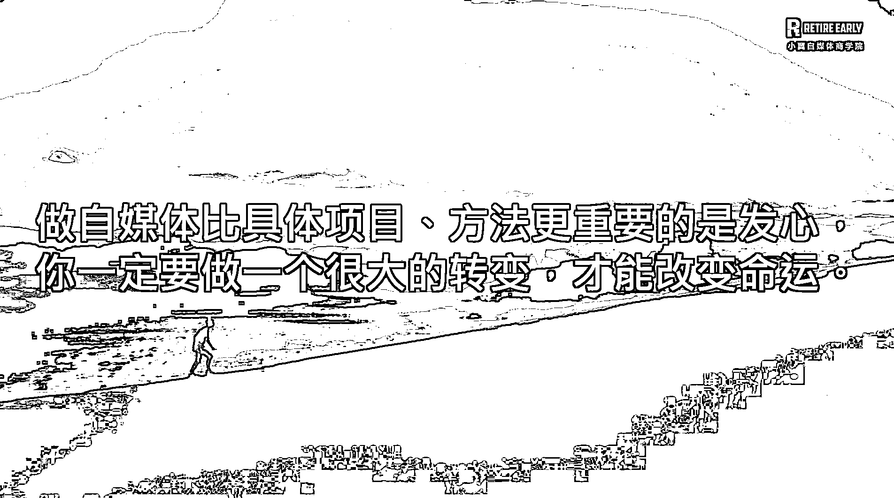

# 二、方向选择：换圈子、跟对人、看信息差

我曾提到拉开差距的四点：信息差、认知差、选择差、执行差。

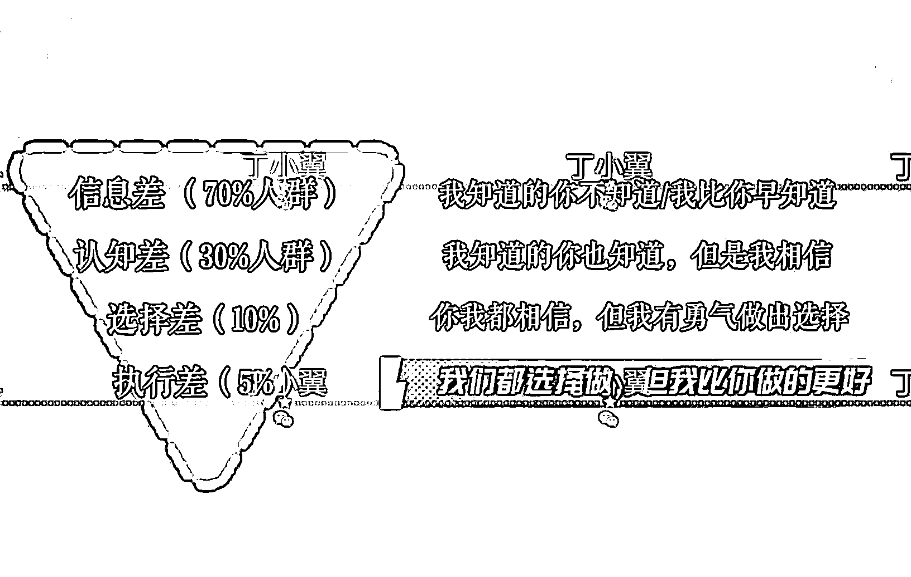

如果你没有副业成功案例，建议先做这三件事：

**1、扎进好圈子**
圈子能帮你判断是能力问题还是视野问题。
很多事不是做不到，是根本不知道有这个选项。
优质圈子能让你迅速开眼界。

**2、寻找导师**
你苦思不解的卡点，可能只是别人的日常经验。跟对人，成功概率直接翻倍。

**3、做对标学习**
对标是找一个够得着的榜样，快速模仿，拿到短期反馈。

不知道去哪找圈子和导师，可以私信我推荐靠谱的，我不会胡乱推荐。

我过去也是极度节俭的人，总觉得靠搜索就能白嫖。
真正动手后才发现，付费才是省钱。初期的时间和热情最值钱，耗尽了就回不来。
而且免费资料很难给出个性化解答，会让你内耗、走弯路。

我主业做营销，因此很快锁定小红书，2022 年做到十万粉。
同年加入自媒体创业星球，深度链接导师。第二年成为合伙人，算下来当初几百块的学费，早已百倍收回。

所以第二步别盲目努力，守住热情，投资能和你同频的人。契合度比名气重要。

**花出去的小钱相当于游戏里的加速器，沿着指引走，最终都能赚回来。**
**这就是终局思维——结果已知，所以敢投入，敢执行。**

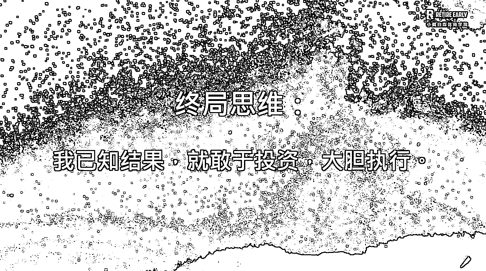

# 三、0-1 实战：最难熬的阶段必须撑过去

**我对 0-1 的界定：**
- 粉丝：小红书一万，公众号五千。
- 变现：月收入稳定两千，持续半年。

这个阶段思想准备再充分，现实依然很残酷：

**1、所有第一次都要自己扛**
上班习惯团队协作，自媒体几乎全员单干。
一篇小红书笔记：选题、排期、文案标题、图片拍摄排版、视频拍摄剪辑，全靠自己。
卡点极多，新手要从零学起，这时不要增加难度。

**我的做法是：一次只学一个技能点，熟练再学下一个。**
比如小红书，别上来纠结图文还是视频。视频所需技能量级是图文的数倍，容易产量上不去，花大量时间做一篇，结果不火，直接被打击。

不如先从图文的干货合集模板入手，先把这一类做熟，再换形式。
技能像武器库一样累积，最终爆款往往是两三个技能的组合，形成降维打击。

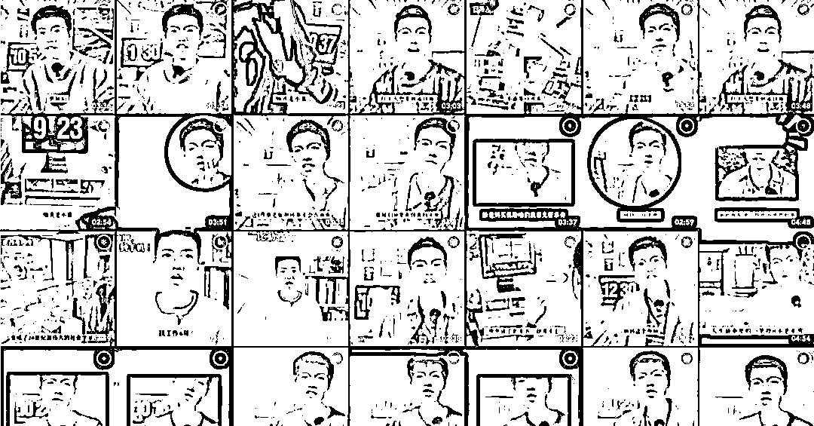

**2、和家人充分沟通，但别拉家人入伙**
副业必然挤占休息、娱乐、社交时间。家人可能看你忙半天没成果，还减少陪伴，会不理解。
要提前沟通预期，比如“我给自己一年时间，目标达到某某，为的是未来实现某某，需要用业余时间投入”。

这个阶段不建议拉家人一起做。你自己还没验证结果，对方认知也不匹配，自媒体不确定性又高，一起做容易因分歧吵架。
先自己做出成绩，用结果吸引 TA 主动想学，就像做私域，只吸引不强求。

职场上也尽量低调，用小号做副业，避免不必要的妒忌。

**3、坚持不住时，回看北极星**
北极星就是第一步想通的初心。过程中计划一定会变，结果一定会波动。

我曾定位理财博主，结果 2021-2022 年理财内容被全面压制，2020 年的爆款套路直接违规，这就是不可抗力。
我回看初心：目标是通过自媒体实现不坐班也有钱。那不做理财就不做，后来转读书、职场、干货 Vlog。

形式和内容会变，北极星不变，指引你找到新路径。

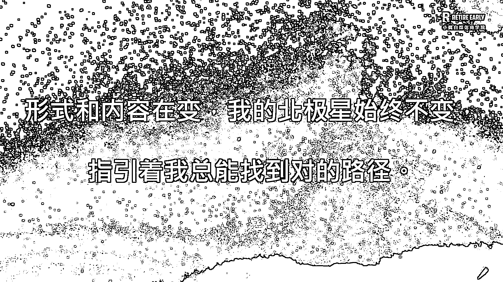

# 四、变现启动：尽早赚钱，拿到第一笔正反馈

人需要反馈，自媒体赚的每一块钱都相当于职场的十块钱，因为你拿百分之百收益。

**1、把自己产品化，敢收钱**
纳瓦尔说过，想不靠运气致富，就要把自己产品化。
粉丝基础有了，新手这三个方向最容易拿到第一笔收入：

**1) 资料/技能收费。**
比如整理一份 XX 资料，打赏随意领取；我会做红包封面、AI 绘画，19.9 元帮你出图。
只需要在一个点上有价值就能收费。

**2) 一对一咨询。**
没名气就用时间换钱，求职咨询、自媒体咨询、情感咨询、你已跑通的小结果咨询都行。
从几十块起步积累案例，边发案例边涨价。我从 99 元/小时涨到现在的 888 元/小时。
记得算好你的打工时薪，后期咨询价必须超过时薪，才有动力。

时间颗粒度可以缩小，30 分钟、15 分钟咨询，体验反而更好。

**3) 陪伴群。**
小 IP 也有受众。你水平六十分，教三十分的人刚刚好，大佬都早过了这个阶段。
这种阶段性价值反而稀缺。

金钱是最好的筛选器，认可你的人会付费。商业本身就是最高效的慈善。

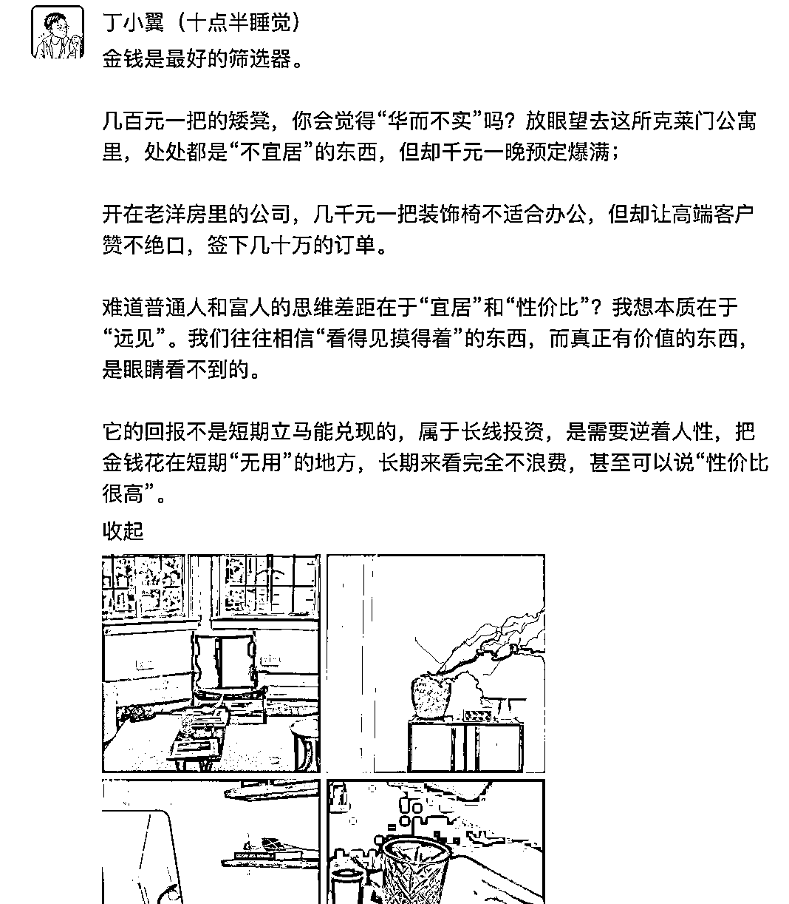

**2、克服羞耻心，大胆接广和推广**
接广告别有心理负担，别嫌钱少。
只要不恰烂饭，接广告的好处很多：
1）锻炼商务合作能力，提升商业价值；
2）锻炼软广写作，内容既有价值又让甲方满意；
3）向粉丝宣告变现，提升势能；
4）识别假粉黑粉，骂你恰饭的直接拉黑。

带货也别有朋友圈羞耻症。很多人怕没效果、怕丢脸、怕被说割韭菜，于是还没开始就把自己绊倒了。
心态要纠正：
-把好产品推给需要的人，是善意！
-帮身边人进步，是功德！
-朋友通过你买，多的是赠品，并没有多花钱！
-你不推，粉丝也会去别人那里买，万一买到坑货你更愧疚。

带货的好处：
1）学文案、销售、产品节奏，还能筛选铁粉；
2）合伙人分佣百分之五十到一百，流量好时比接广赚得多；
3）分销榜单靠前会被大佬看到，带来曝光和机会；
4）你不可能生产所有产品，带货能最大化用好流量。

格局打开，自营和加盟都 OK。标准就两个：用户需要吗？投入产出比够吗？

我自己严选的产品，分销常年前三、前十。向上链接，大佬给曝光，粉丝得福利，三赢。

# 五、放大流量：总结并复制成功模型

有一定成绩后，立刻复盘你的成功模型。

2022 年 7 月 31 日，我坚持半年后，一个视频在小红书和 B 站同时爆了，成为拐点。
现在回看制作很粗糙，但爆款自带随机性，我立刻拆解模型：

1. 我优势在视频，出镜能刷掉五成以上的人，表达比文字更有力。
2. 我擅长把知识认知整合成一个主题，用大白话讲清楚，这是稀缺能力。
3. 爆款公式=选题五成+封面两成+开头五秒一成五+内容一成五，持续复制。

模型结合喜好、优势、市场和数据反馈，后半年增长是上半年的四倍。

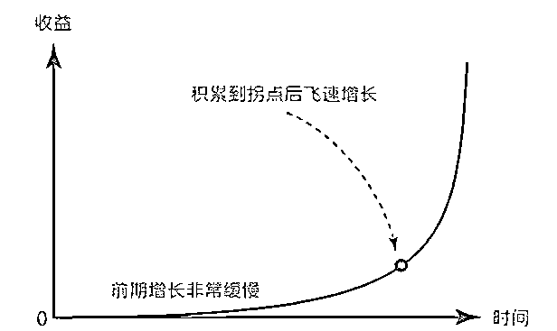

# 六、搭建产品体系：从轻产品到多元收入

**常见误区：**
**误区一：**新手先做自己的产品，花大量时间制作，最后卖不动怀疑人生。
顺序反了。先做流量，再分销大佬靠谱产品测试实力，最后再做轻产品。
大佬产品都带不动，说明是流量问题不是产品问题。

正确顺序：搞定流量→分销大佬产品→做自己的轻产品。
初期接不到广告没收入，合伙人带货模式最合适。先让别人白嫖你的内容，再靠分销获得持续现金流，等流量起来再做自有产品，轮子就转起来了。

**误区二：**先做完产品再卖。
容易错过时机，也可能做完才发现没需求。
自媒体产品完全可以边做边卖，甚至先盲订测试市场。

我的小红书课程节奏：
-先公布核心信息，200 元定金盲订，完成六成
-预售阶段，完成两成
-正式发售，完成一成
-开营倒计时，完成一成

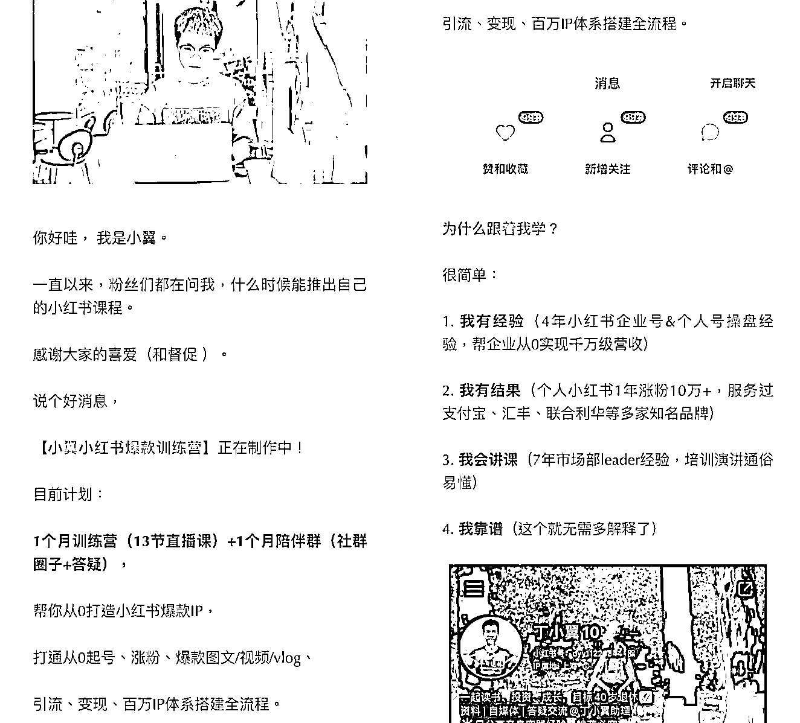
宣传出去的东西会倒逼我完成承诺，效率爆棚。后面案例库产品也是这招，没宣传前攒了半年不敢动笔。

**产品体系搭建两要点：**
1、有从低到高的漏斗，高送低，低转高。
2、以用户需求为导向，不一定都是自有产品。

我每月会发产品说明书，围绕自媒体整合的完整体系：

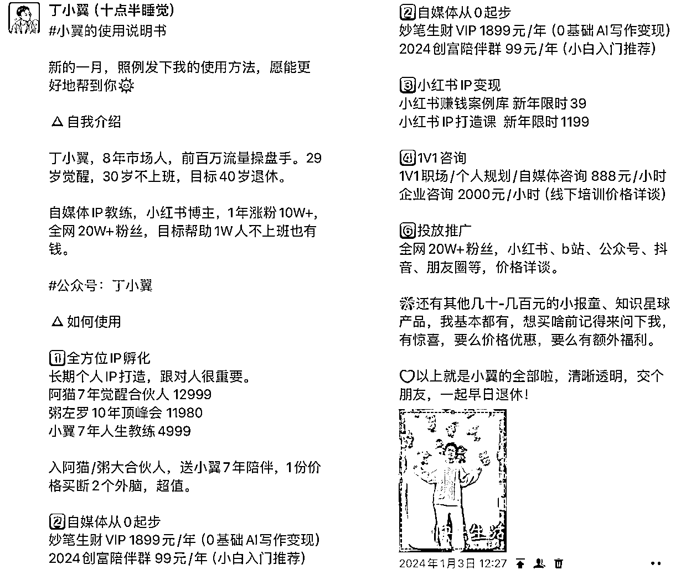

这样收入多元化，反脆弱性更强，同时解放时间，是我坚持的核心原因。

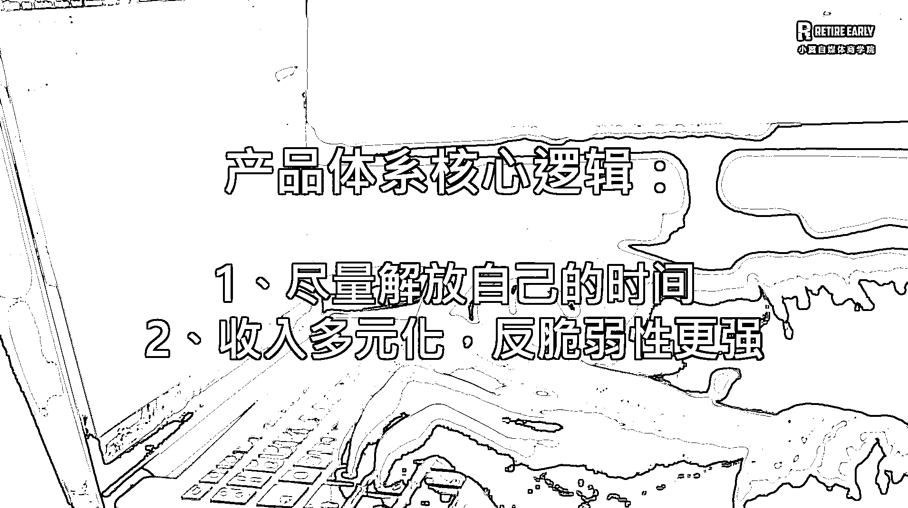

# 第七步：用小钱撬动时间，用团队放大飞轮

前面几个阶段，我们基本都是用自己的时间去换收入。到了这一步，思路就要反过来了：用钱去买时间。

当你的变现模型已经跑顺了，扩张最快的办法其实是投放——花小钱买来别人的流量，在你的体系里做价值放大，5块钱的投放成本，换来10块钱的收益。

如果投放这一步你暂时还没准备好，还有一个更轻、更直接的打法：把自媒体赚到的钱，用来低价买别人的时间。

这里我总结了四种常见的人才获取路径，供你参考：

**第一种，从自己的社群里挖掘志愿者。**
优先从付费社群、老用户里找人，他们对你足够了解，也更有认同感。志愿者前期可以不发工资，主要负责社群日常维护、资料归档这类基础工作，用荣誉感、内推机会、专属权益来激励。

**第二种，从付费用户里提拔小助理。**
志愿者做得不错，就可以升级成有偿的小助理。交给他们那些你不喜欢做又门槛不高的重复性工作，比如多平台分发、资料整理、图文排版、视频粗剪等，按工作量给月薪即可。

**第三种，兼职池里培养小管理。**
当你需要一批做同样任务的兼职时，不要一个个自己盯。挑出其中做得最稳、沟通最好的那几个人，让他们来带队、答疑、排单，你就只需要对结果负责。

**第四种，有潜力的助理转为远程全职。**
业务量起来后，可以把核心的兼职或助理转为全职远程员工。自媒体团队最大的优势就是可以不坐班，但全职招聘一定要慎重：设好试用期，确保价值观契合、认可你的模式，不然规模越大问题越多。

做团队有两个关键心法一定要记住：

第一，招人要从粉丝里招、从认可你的人里招。信任基础比能力更重要，能大幅降低试错成本。

第二，每个工作都必须有清晰的 SOP。先给一份标准流程，让对方试做一件样品，确认理解一致、结果达标后，再批量放量。

个人 IP 的团队要做小而精，不要盲目追求人数。两三个核心成员，就能把你从一个个体，升级成一个超级个体。

看到这儿的你，恭喜！如果你觉得这篇文章对你有帮助，记得点个三连。欢迎来私信我聊聊你的复盘和反馈，小翼会为认真交流的朋友准备一份见面礼~

最后祝大家自媒体顺利起飞，我是小翼，人生辽阔，我们一起奔向早日退休！

* * *

评论区：

马姐 : 谢谢小翼的用心分享！我是小白，有时间愿意学习，刚加入赚钱圈，可以做你的朋友吗？

逍遥公子 : 腻害！学习了[强]

丁小翼|觉醒合伙人 : 可以呀

丁小翼|觉醒合伙人 : 一起加油！

胡晓磊 : 谢谢小翼的精彩分享，用心了，全说我心坎里了~🙏

Chloe : 感谢走心分享！目前是一名程序员，在副业探索初期，请问可以加个微信嘛~

丁小翼|觉醒合伙人 : dingxiaoyi1234  欢迎交流哇

🦄运气爆彭同学 : 一直都在小红书看你的内容，哈哈，居然在赚钱遇到了，真好[呲牙]

* * *