# 如何才能边旅游世界，边挣钱买房！一个八年背包客的分享

总有人问我：旅行和赚钱，真的能兼得吗？

我认识一位叫安安的姑娘。十六岁那年离开学校，不到二十四岁，已经走遍国内一百多座城市，游历过八处境外之地。初次听她的经历，我还以为她家境阔绰。事实恰恰相反——十岁那年爸爸车祸离世，母亲只身南下务工，她被送到爷爷奶奶身边。小城的旧观念里，女孩读再多书也不如早日成家。于是她十六岁时，长辈已经替她相看人家；十四岁，被送进卫校。

开学那日，安安走进教学楼里的仿真病房。白墙、仪器、消毒水的气味，让她觉得人生好像已被写好，只剩照单执行。她哭了大半天，随后悄悄走出校门。身上只有九十元，她很快便不得不回家。但那次小小逃离，让她明白自己不愿走那条路。经过和家人的反复谈判，她终于在2016年2月退学。临出门时，家里撂下话：从跨出这道门起，就别指望家里给半个子儿。她握着车票剩下的几十元，头也不回地走了。

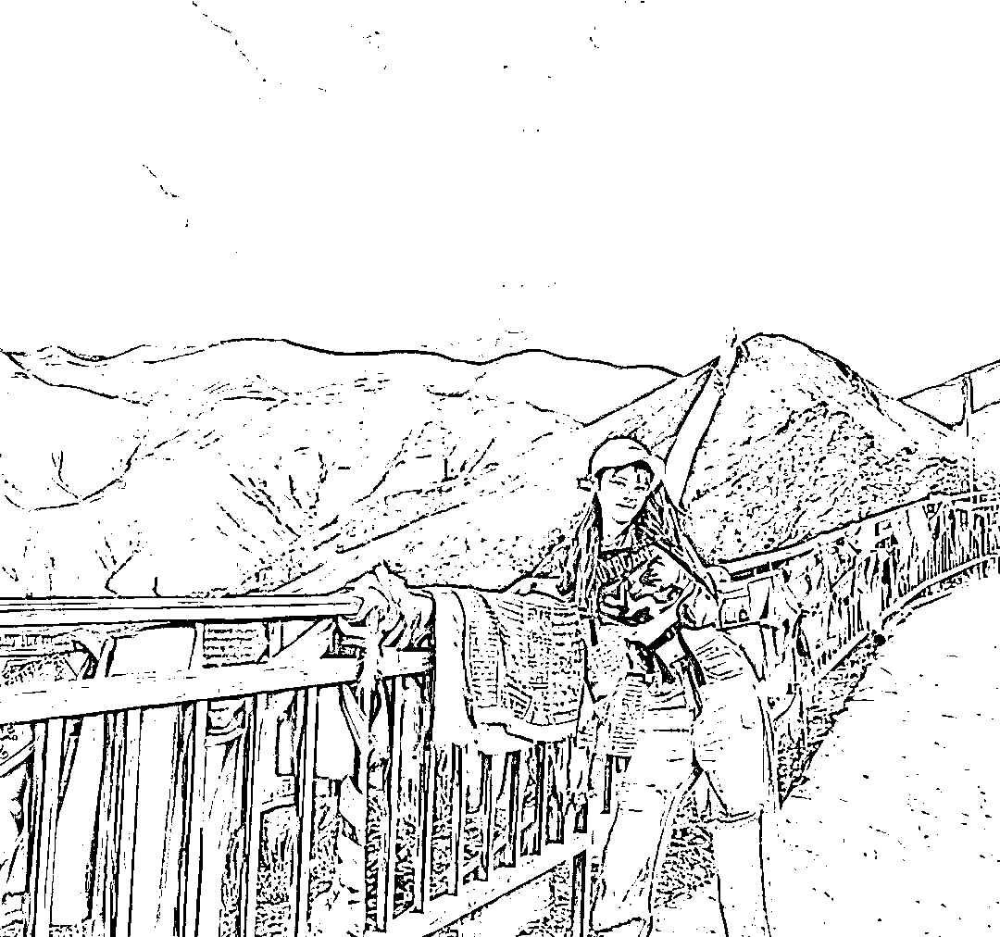
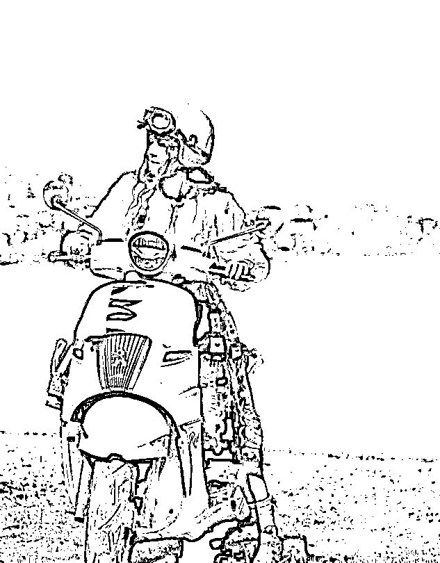

离家之后，她熬过整整一年最苦的日子。夜里没地方住，她就去网吧买一段机时，伏在桌上迷瞪一会儿；饭食常常是两片饼干，或半包泡面分两顿。为省下买餐具的钱，那只泡面纸碗被她反复使用。后来肠胃出了问题，她没钱看医生，只能硬扛。她在小饭馆洗过碗，给美发店当过杂工，上街发过广告单，也在工厂流水线上站过很长一段时间。有个老板到发薪日翻脸，三十天工资分文不给。她十七岁生日是在一个网吧角落里熬过的；那时候，她觉得自己还能见到明天的太阳，就已经很好。

有人问她为什么不肯回头。她说，如果灰头土脸地逃回去，往后的人生恐怕连光都没有。她就这样低着头，把自己从泥里一步一步拔了出来。

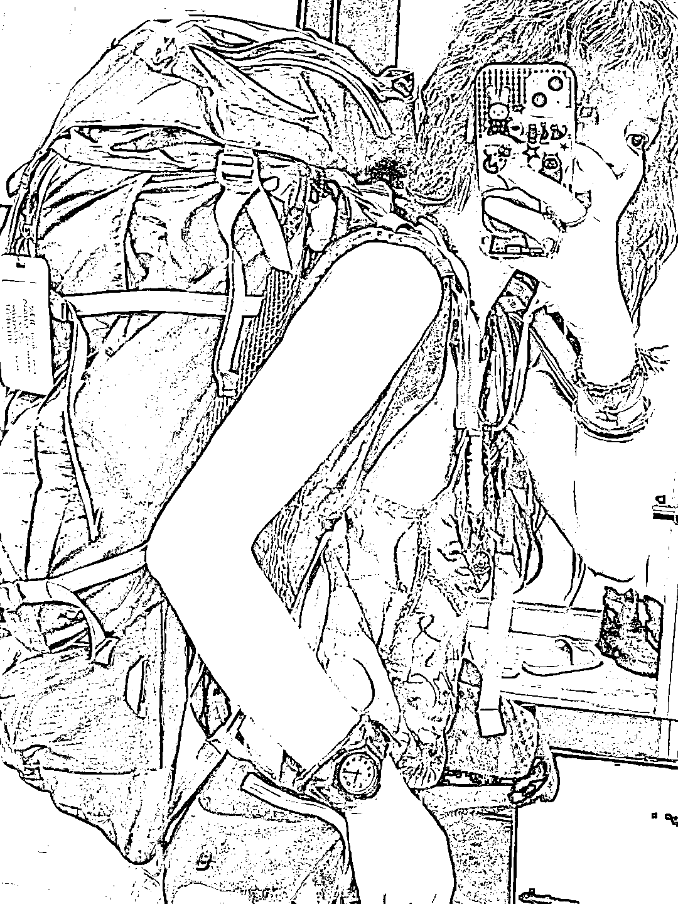
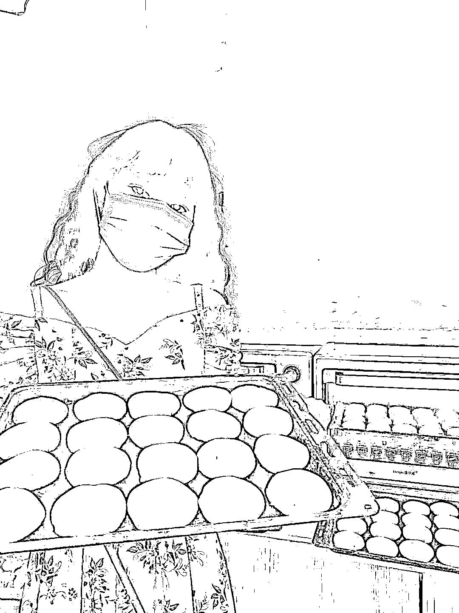

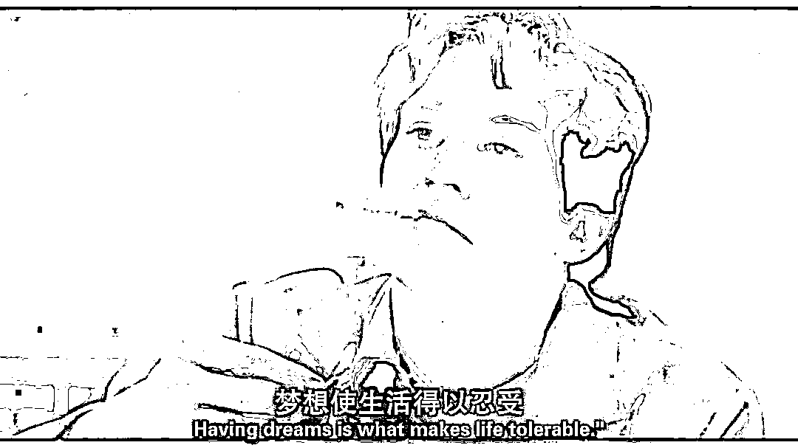

十八岁那年，她踩上单车，从南端的海南一路向北，骑了六千公里，到达漠河。十九岁，她再次独自出发，穿过中南半岛上的四国土地。后来，她十次去过西藏，用五年走遍了大半个中国。不到二十四岁，她已经走过一百余座城市，足迹落进八个国度。

外人总以为她是靠流量赚钱，其实她的收入大多来自旅途中替人搜罗来的各地风物。她很少接商业推广，不愿让广告把生活记录搞得面目模糊。在她眼里，自由不是想怎样就怎样，而是有本事拒绝不想过的生活。

她也犹豫过。二零二零年，一个开网店的熟人请她帮手，报酬很可观。可刚上工几小时，她就觉得透不过气：天不亮出门，天黑透回家，日子像同一页纸印了无数遍。当年从学校溜走时的那股窒息感又涌上来。她勉强撑了三日，便彻底作罢。这次极短的经历，反而帮她确认了此后的方向。

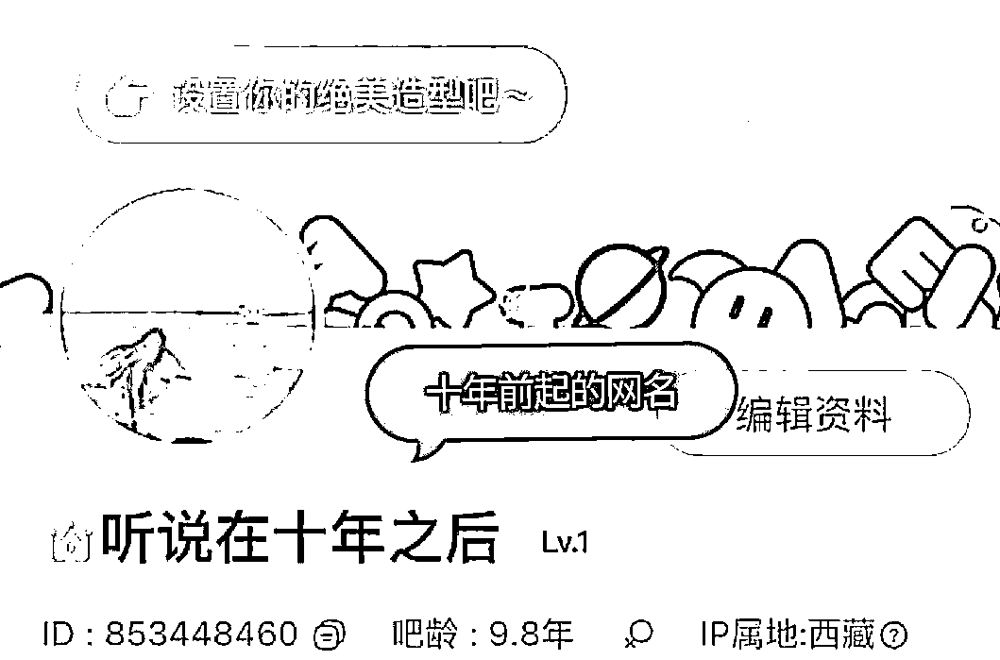
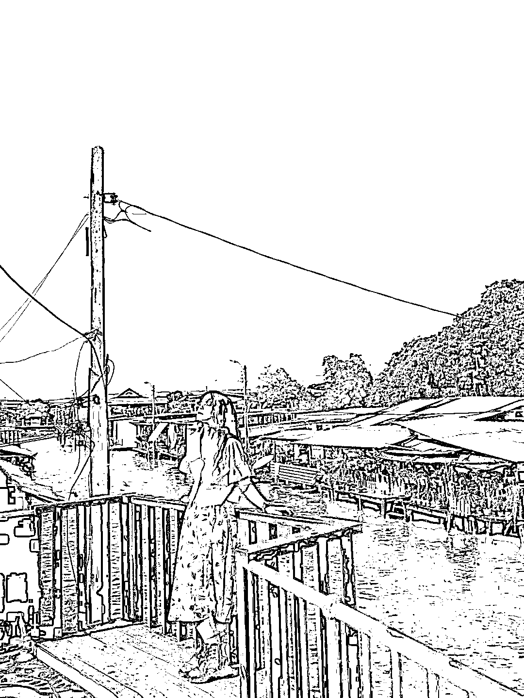

真正让她着迷的，从来不是“去过哪里”，而是路上不断冒出的新鲜感。也许是雪山反射出的第一缕光，也许是陌生路人随口说起的一段往事，也许是坐了五十多个小时的长途夜车，又也许是一份完全没试过的临时差事。这些小小的未知，让她每天睁开眼睛都很雀跃。

二〇二二年，她在西藏因为一次乌龙检查被送进隔离点。次日被告知可以离开时，她反倒选择留下。那里条件不算好：饭菜单薄，床铺很硬，偶尔还有小虫爬过。她却像住进了一间热闹的集体宿舍。她和几位医疗志愿者聊天，听天南海北的人讲经历，还跟着学了一支完全陌生的舞。

她年轻时候的网名是“十年后再看”。如今十年已过，这个答案比她预想的还要漂亮。当年没人看好的小姑娘，凭一双手买了房。她说，房子只是副产品，真正珍贵的是她终于不用靠他人的目光来确认自己。

她在少女时代的日记里写过：拒绝把三百六十五天活成同一天的复印件，拒绝把循环往复拉成漫长一生；她要鲜活的时光，不要静止的呼吸。

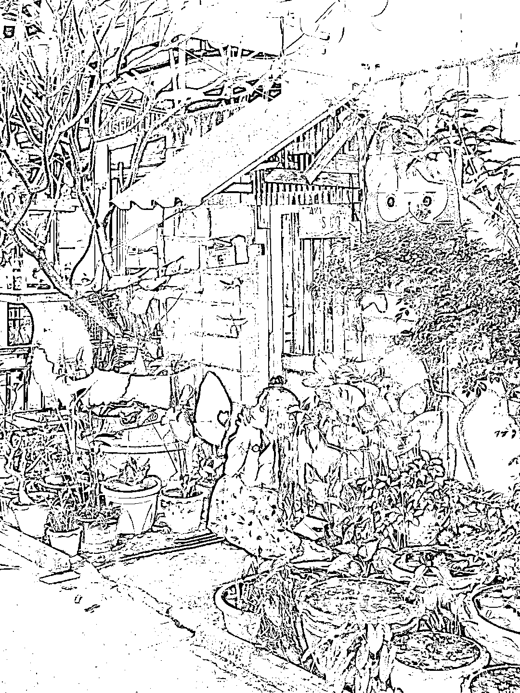
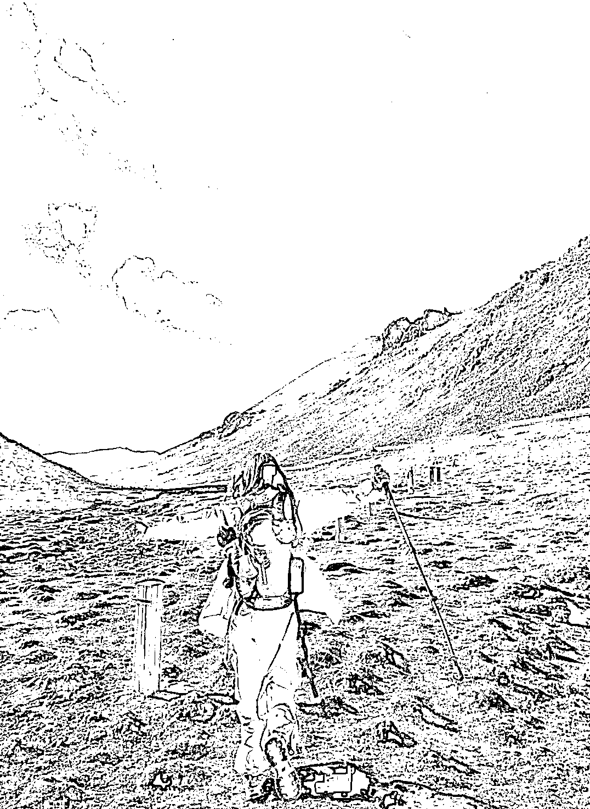
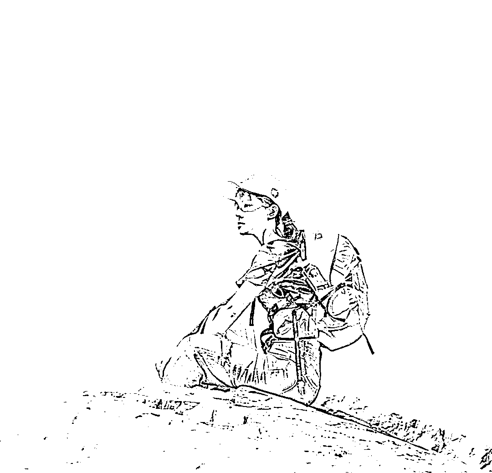
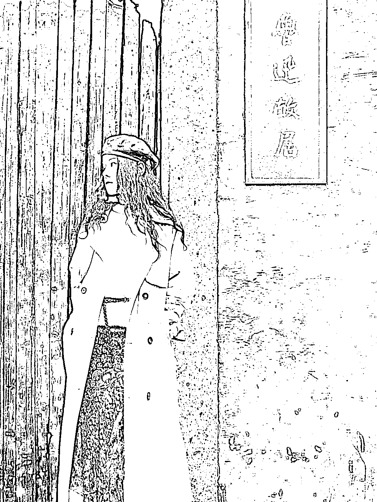

她身上有一行纹身：青春不死，热泪不干。旁人都劝她“差不多就回去稳定下来”，她也有过摇摆，但如今再没有什么杂音能让她停下。被问及将来，她说不出具体规划，只讲自己会一直朝想走的方向去。她的全部梦想，无非活得滚烫。

当然，每个读到这个故事的人，都不必急着扔下工作去流浪。我见过太多辞职旅行的人，新鲜感一过，又回到从前的轨道。他们的问题并不在经济，而在于出发时根本没想明白为什么走。旅行如果不能帮人看清自己，换个地方发呆又有什么区别？

所以，不要轻易复制他人的道路。先想清楚内心真正愿意投入的事，并愿意承担相应的代价。生命没有返程票，每一步都算数。

愿你对生活保持好奇，也为每一个选择负责。最终能看遍世界的人，不是最有钱的人，而是最敢于跟从本心的人。

