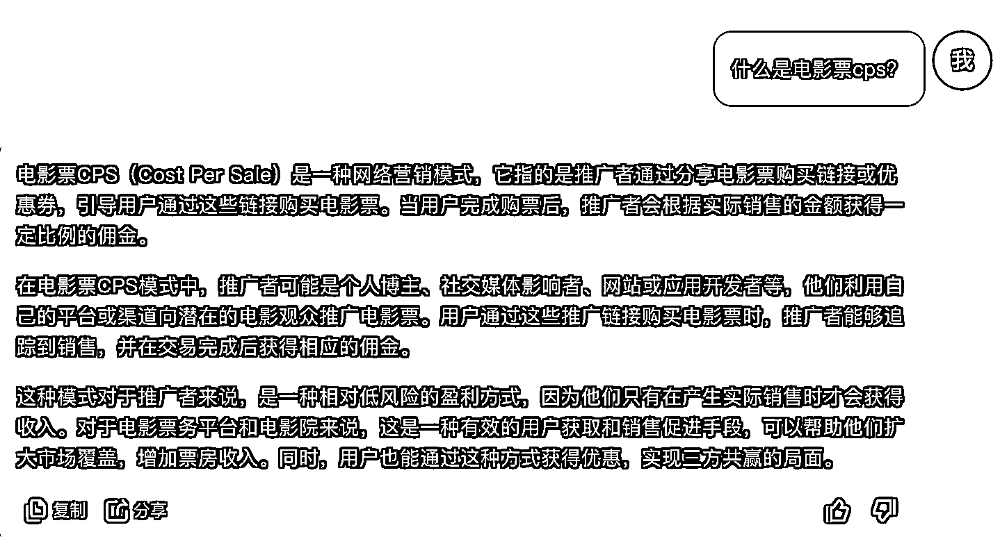
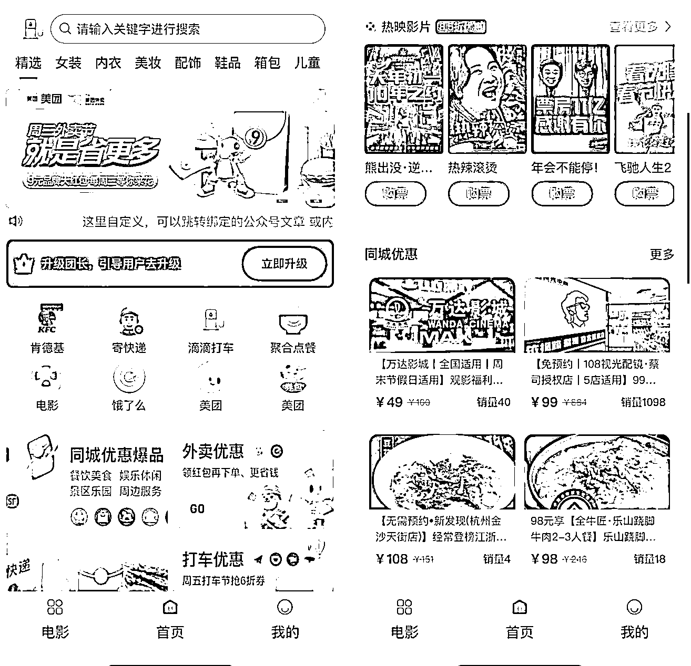
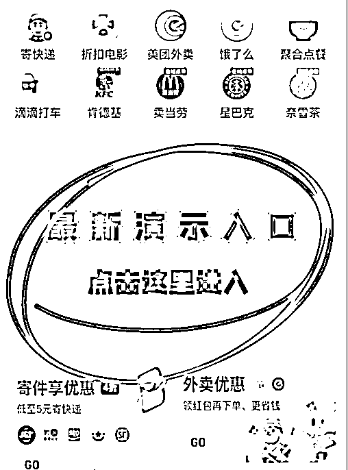
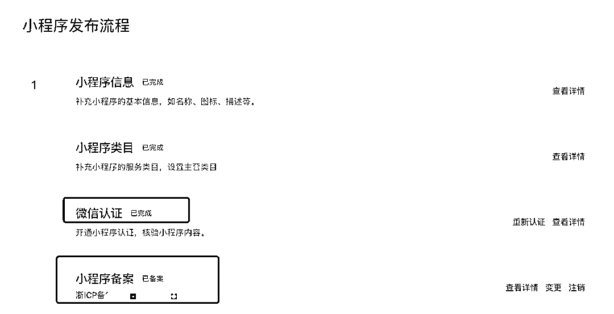
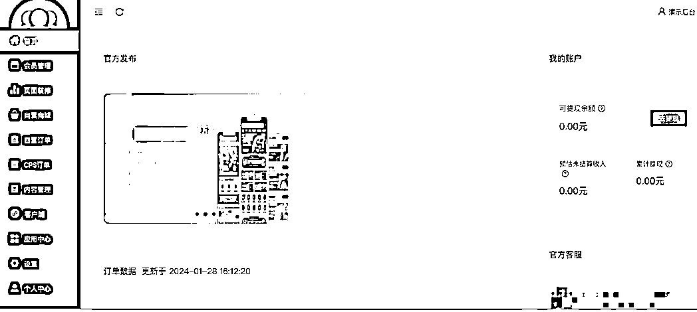

# 给自己做一个聚拢全网优惠的 CPS 小程序，自用省钱也能有佣金回流

## 人人都值得拥有一个专属的聚合 CPS 小程序，自用省钱+自用赚钱

作者：桔子@小桔圈

日期：2024-02-02

一、CPS 到底是什么？
二、聚合 CPS 是如何运作的？
三、省钱+收益的双重逻辑
四、这样一个聚合小程序怎么落地？
五、常见问题解答：

**一、CPS 到底是什么？**

通俗来说，就是商家或平台发放优惠券和分佣，推广者负责引流获客，消费者凭借优惠券低价成交，商家拿到订单和用户，推广者拿到分佣，三方各取所需。典型例子有淘客、外卖红包 CPS、去年的美团圈圈本地生活、寄件首重几元起，还有一直存在的电影票折扣等。

**二、什么是聚合 CPS？**

把人们日常会用到的各类 CPS 渠道集中整合，就是聚合 CPS。呈现形式可以是微信小程序，也可以做成 H5 链接。

为什么说 **人人都可以自建一个聚合 CPS 小程序？**

**三、自用省 + 自用赚**

**1. 先省钱再赚钱** 对普通用户而言，生活里的消费几乎都有隐藏的优惠券可以拿，所以自用就是省钱。做淘客的朋友都知道，淘宝标价 100 元的保温杯，隐藏券能到 60-80 元，不查券直接下单等于白亏。

比如看电影，去影院原价 40 元，通过聚合小程序能拿到 85 折，直接省下 5-6 元。

都说开源节流，赚钱不易，但把该花的钱用信息差省下来，其实非常轻松，关键是知道有这件事。

自己拥有一个聚合 CPS 小程序，不仅能用上隐藏券，还能拿到对应的自用佣金。仍以电影票为例，折后 35 元消费，背后还能有 1-2 元左右的佣金回流。

自己用的同时自己收佣金，如果月消费频率高，一个月省下+赚回几百元是完全可行的。

**2. 叠加到已有项目做二次转化和福利发放**

几乎每个人都接触过或正在做某个项目，而聚合 CPS 小程序的受众面极广，只要会花钱，从 90 后到新手父母都是潜在用户。它追求的就是大而全，小而美和大而全天然矛盾。

把它和自己的项目结合，理解起来可能需要一个场景：

**网盘拉新、虚拟资料类**的引流，完全可以把资料入口放到聚合小程序里，放一张卡片写“XX资料 点击领取”，点击后跳转到你绑定的公众号推文/内部页面，里面放你的收款码/付费链接即可。

聚合 CPS 不挑人，所以激活用户只需要两步：

**1.用户第一次进入你的小程序**
**2.第一次消费就享受到优惠或返佣**，是否自用返佣可以自行设置

一旦激活，后续复用率会非常高。

有人会问，这不就跟各大平台砸几十上百块拉新的极速版一样吗？用户拿完奖励就删了怎么办？

**四、聚合 CPS 小程序如何搭建？**

搭建的核心门槛其实很少：

**一、需要一个个体或企业的小程序，个人主体小程序不满足**
**二、小程序完成认证+备案后才可正式上线**

除此之外没什么限制。

**五、疑问解答：**

**1.个体小程序和企业小程序区别在哪？**
**答：主要在成本。**通过服务商渠道，个体认证费约 30 元，企业认证统一 300 元，其余功能无差别。

**2.我有营业执照但没注册过小程序**
**答：有完整教程指导。**个体按教程自助注册即可，企业注册需要对公账户，目前无此账户无法完成注册。

**3.我没有营业执照想做怎么办？**
**答：两种路径。**一种是代办一个个体户，另一种是我们这边有已认证+已备案好的小程序资源，可沟通了解。

**4.认证和备案不会操作怎么办？**
**答：提供一条龙搭建服务。**从注册到认证到备案，全程指导代操作，你只需按提示扫码确认。

**6.不要小程序，能做 H5 吗？**
**答：可以。**H5 版本需要认证服务号才能搭建。

**7.聚合 CPS 账号用你们的还是我自己的？**
**答：都行。**支持搭建+独立部署，如果用自己的 CPS 账号对接接口，需要自备服务器和备案域名。

**8.有后台演示吗？**
**答：有的。**

我是桔子🍊，加微备注赚钱

微：10038140

* * *

评论区：

暂无评论

* * *