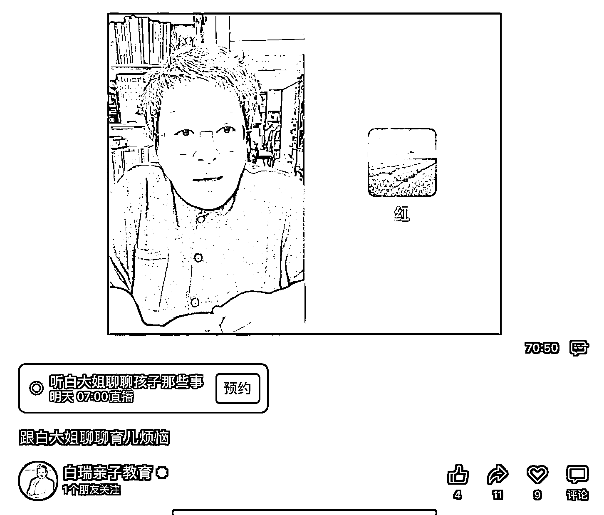
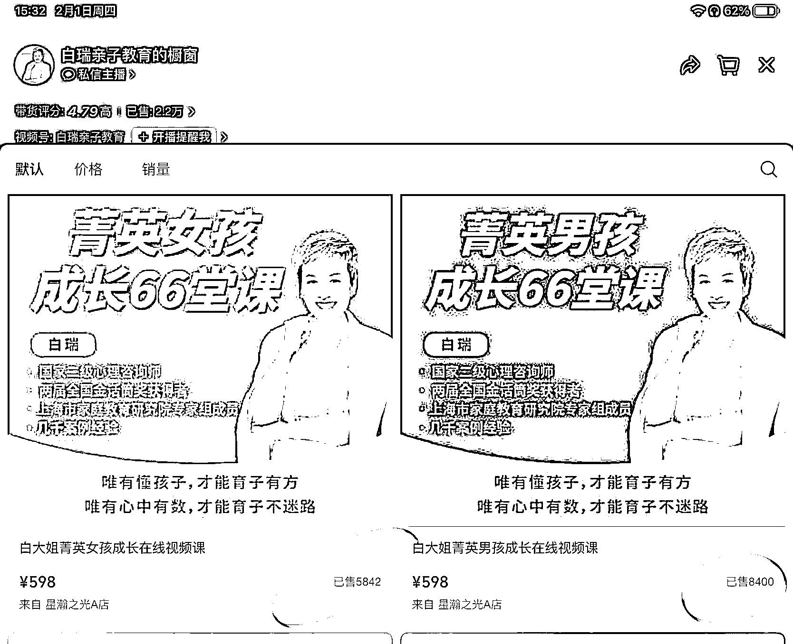
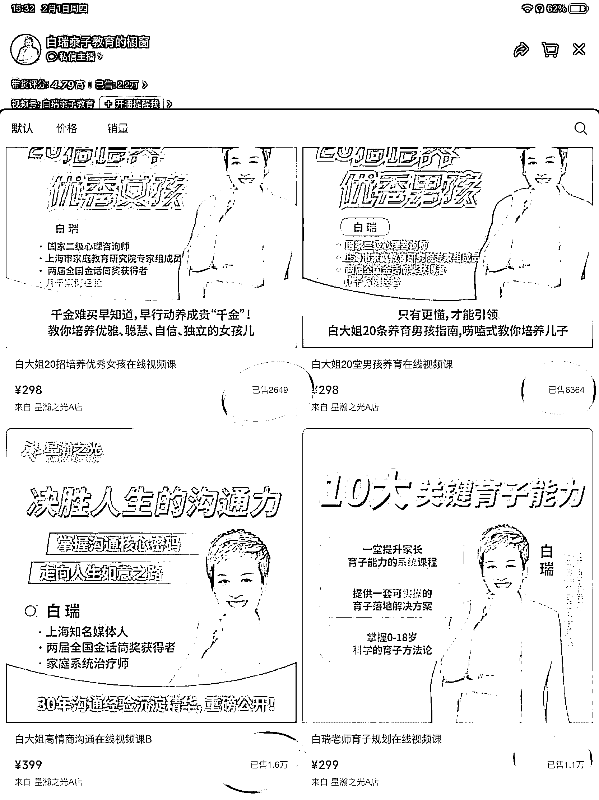

# 视频号做亲子教育知识付费，单项目冲到万单背后的打法拆解
作者：龙哥

## 为什么现在是视频号做教培变现的黄金窗口

当前视频号对教育培训赛道明显在倾斜扶持。亲子、育儿、家庭教育等垂类知识付费，正呈现客单价抬升、成交体量放大的趋势。高客单、高复购的商业模型，在这个平台上跑通得越来越容易。

本期拆解的案例主角是聚焦亲子教育的账号白瑞。拆解的初衷很简单：把一个真实跑量上万的账号玩法剥开讲清，供同行参考借鉴。

这是我第一次做这类深度拆解，思路难免稚嫩，欢迎大家一起交流优化。

* * *

### 评论区互动精华

申姐全域营销 : 收获很大，感谢大佬分享，学到了

Zzx : 想在选品中心挂他们的课，但是看到分销佣金只有1%，这种是不是就是品牌自己留着做内部分销，不对外放量的？

Ante : 正愁不知道怎么下手拆解，太及时了[抱拳]

阿翰 : 请教一下，视频号直播间的各项数据你是哪里看到的？用的什么工具？我查到的很多都要付费，而且价格还不低

薄荷 Heidi : 大概率是这个逻辑

薄荷 Heidi : 数据工具确实是个痛点。现在市面上的新视、百准之类的，免费版只能看基础信息，想点开细节就要充会员。对新手拆解来说，不建议上来就砸钱买会员。可以先去其他平台学习下别人对视频号知识付费的拆解方法，积累到一定量级、或者自己本身就是有流量的视频号创作者，再考虑投数据工具会更划算。

* * *