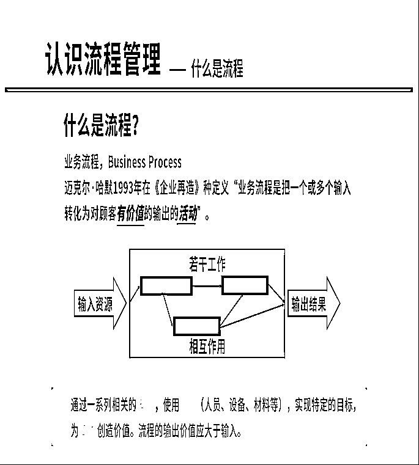
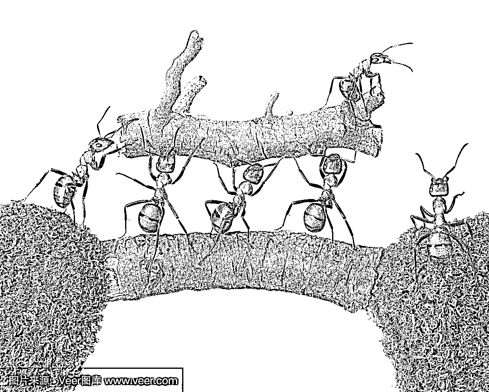
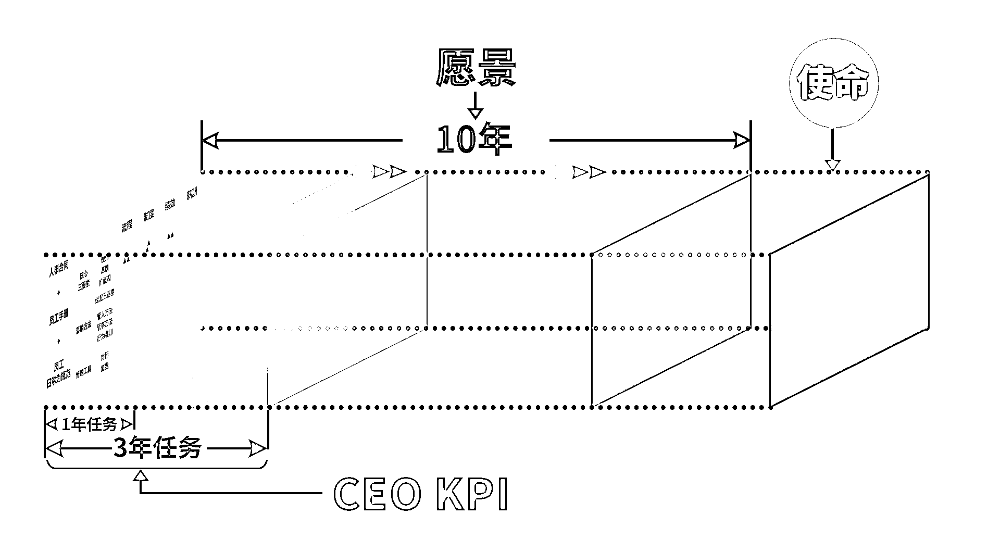
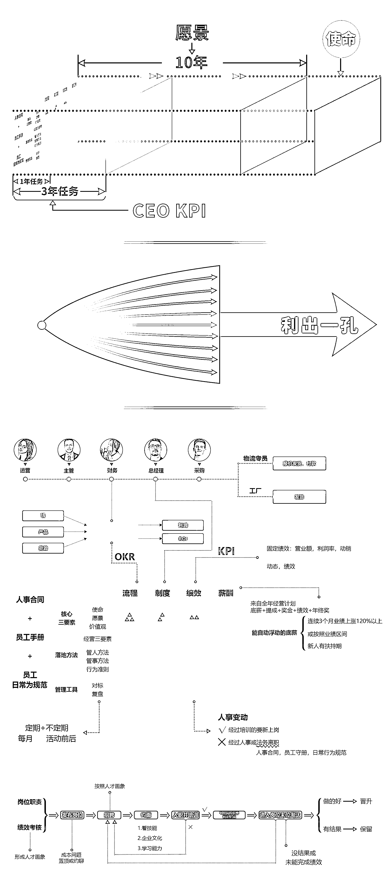
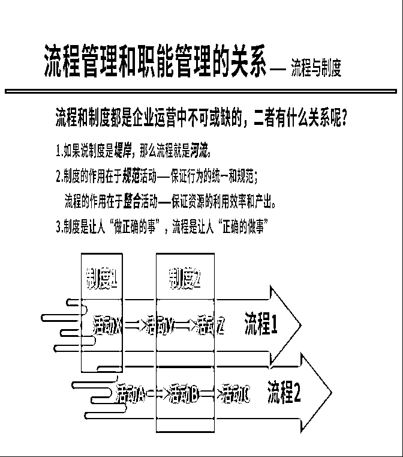
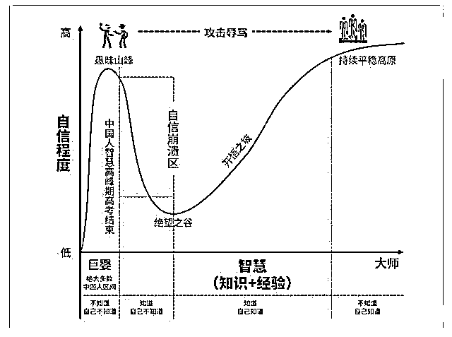
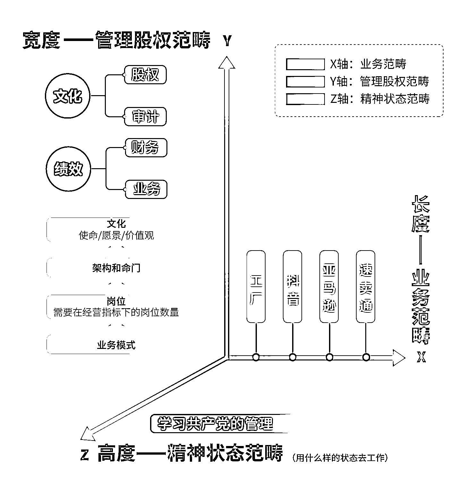
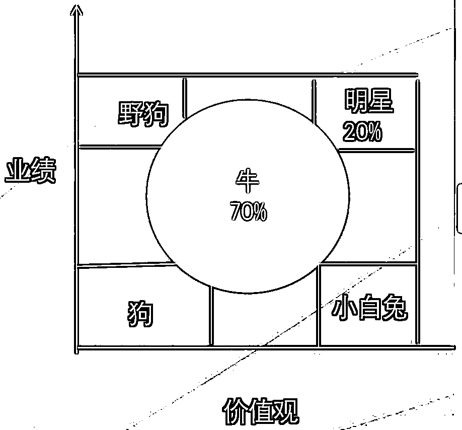
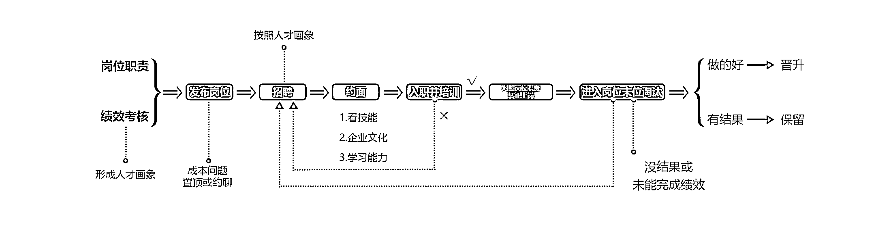

# 别再用义气撑公司了！做到自运转的打法在这里

很多创始人会说：每天像上了发条，醒来就围着公司转，手下的人却总要推一下才动。根源在哪？

先说清一个现实判断：公司不是家庭，更不是课堂，它是一支作战单位、一个任务场。大家聚在这里不是为了互相吹捧，而是为了赢、为了交付结果。你想要的不是礼貌点头的和谐，而是每个人心里有事、肩上有活、紧张有序的执行状态。

老板们常想靠盯人、靠涨薪来提效，这条路走不通。真正实现自运转的，是以文化为底座的闭环：文化奠定方向，方向塑造组织，组织去实现使命与愿景，最终体现为结果。这套逻辑可以作为参照，不是唯一标准，管理因情境而异，只要能持续产出，就是有效方法。

---

## 一、到底什么是企业文化

不少主管理解偏了，以为写几句口号、搞几场团建就是文化，差很远。

稻盛和夫的六项精进是很好入手的视角：

1. **付出要超过别人**——员工松动、提要求时，用这句话对齐。荣誉归于真正出结果的人。
2. **谦虚不自大**——防止业绩出来就飘。
3. **每日复盘**——这是成长的底层能力，学历短板可以用态度补。
4. **心存感恩**——本质是放下，让团队氛围松下来。
5. **做好小善、利他思考**——不在自己流程里别乱指挥，在范围内就担到底。
6. **放下情绪干扰**——情绪无法解决问题，聚焦事情本身。

## 二、认知即顶层

公司做着做着停滞了，先问自己：认知是否跟上了？

厨师看火候，老板看时机。手握资源带团队，切入哪个赛道、什么时候入场，靠的是判断。电商平台的兴起就是典型案例：第一波赚钱的通常是服务商，用平台红利做收割；第二波是看到成功案例后谨慎入场的实操型卖家；第三波是成熟公司和资本进场，他们做品牌、转化高、收割力强。抖音生态的演进也符合这个节奏。

认知要解决两件事：判断窗口期，以及具备向上兼容的能力。兼容了才有机会做更高层链接，但前提是业务体量要上去，体量没上去，混个圈子只是偶尔露面。

创始人就是公司基建的高度，高度不够，企业就像让孩子开高速车，迟早出现偏差。

## 三、招聘怎么看

**一、有交付力**

- **解决问题的记录**：简历上是否写清在前东家创造了什么可验证的成果？写不出，就很难相信到你的场子能赚钱。即使过去拿过结果，换了环境也可能失效，因为环境变量变了。HR 每天筛上百份简历，不会去赌“不会写简历的天才”。更看重逻辑清晰、能力外显的人。
- **亮点动作**：超出预期的行为。我们深圳的一个亚马逊负责人，入职三天就把山东店铺的销售额拉升三倍。店铺不变，库存下降，回款增加。后来聊才知道，她每天工作到晚九点，午夜后分三个时段起床看投放。这样的行动力就是亮点。
- **结果指标**：前两项再好，没有财报数据支撑也不行。公司要的是营收与利润。

**二、成熟度**

所有稳定关系都建立在成熟个体之间。成熟=财务独立+人格独立+精神独立。

想吃天鹅的癞蛤蟆，成功概率很低。富家女与贫穷男生被拆散，核心是成熟度不匹配。老话说的门当户对，指的就是三重独立的匹配度。

## 四、长期盈利的两大支柱

**支柱一：铁军**

胜仗靠队伍，不靠个人。铁军不仅是能力强，更有共同信仰。没有信仰的团队是雇佣军，遇到困难先谈利益，关键时刻靠不住。

要做的是招来能战、来就能战、战能胜的人。成功不是单点爆发，而是规模化协作的结果。销售、前中后台、研发生产之间隔行如隔山，一个人补不了全公司。能被设定的结果，靠体系重复产出，团队要对抗的是变化。

铁军特质是精锐、合拍、令行禁止，这靠文化锻造。老板的掌控力体现在：项目未启动时内外无感，一声令下就能千人响应。铁军就是掌控力最强的形态。

做生意动用资金承担风险，心里有数。我们不是来跟同事做朋友做家人，是来交付价值、让公司稳住、创造利润、顺便做点社会价值。

目前我们的招聘权重：操作技能20%、文化认同30%、持续学习意愿50%。自2022年12月起全员配AI账号，去年亚马逊广告交由AI处理，人效提升约一半，重复工作交给RPA。例如影刀机器人处理重复流程，三个星期全员通过考核，次月95%的常规需求已可自动化。原操作岗转向思维设计与链路监控，从操盘转监盘，实现24小时运转，这对发展至关重要。

建铁军要从四个面入手：共享的愿景使命价值观、统一的基本纪律、共同的方法论与战术原则、清晰的组织与指挥体系。

**支柱二：流程**

公司治理分三层：下层靠人情义气，中层靠制度，上层靠文化。不可否认，有些公司早期靠召集亲友起步，也拿到了结果。这是小概率事件。如果现在再创业，不建议走这条路，人情能解决短期信任，却会长期绑架绩效与决策。要走大概率成功的确定性路径。

## 五、管理的基本功：方向、方法、结果

方向由公司定，方法由中高层负责，结果由执行层交付。管理者出方法，员工照规则，把公司做成蚂蚁式的结构。

蚂蚁模型里，蚁后定筑巢位置，中层外出寻食并回传信息，工蚁负责搬运。一次外出，有人能搬回五倍体重的食物，有人只搬回一倍。每次记录、按月汇总、年度对比，人才分层就自然形成了。

老板的投入不在办公室坐多久，而在是否履行岗位职责。建班子、定战略、带队伍不靠工时，靠修为。老板每周七天十六小时处理琐事，本质是用战术勤奋掩盖战略无能。

真正职责是：明确人才标准并招贤、制定正确战略、建设并推广文化、带出队伍、在经营中把控方向、协同资源、培养接班。履职效果取决于自我修为。

职责履行的好，公司内部流程自成秩序，每个角色发挥职能，业务稳定运转。

## 六、文化的内核：使命、愿景、价值观

三者决定企业能多大、能走多远、能活多久。

**使命**：为什么存在，要解决什么社会问题，是长期要做的事。

三个建筑工人的故事很说明问题。第一人说太辛苦没意义，眼里无光，靠不住；第二人说养家糊口，有责任感；第三人说在建世界上最漂亮的教堂，有宏大叙事。马云做电商、乔布斯做手机、任正非做通信，都属于后者。

使命比做什么更重要。它是晚上会想、早晨会去做的状态。明确志向，才能招到志同道合的人上车，使命也像航标，提醒时间精力是否用对方向。

**愿景**：十年想成为什么样，是使命与短期目标的过渡。厉害的公司都很早对未来有判断。

**价值观**：什么是对什么是错，是公司的游戏规则。表面是规范，本质是底线与原则。没有边界不成方圆，用价值观管理比单纯用制度更有效。

是否要担心员工离职？不必。薪酬驱动离开的人，本身缺乏理想逻辑；因价值观不合离开，反而是好事，留下来也发挥不了作用。

价值观是考核出来的，要奖惩分明。老板要坚守规则，除老板外无人能破例，否则制度会连锁崩塌。理想状态是老板不干预也能顺畅运转，每个岗位的人都能守原则、推流程、拿结果。

不知道怎么踢球时，把球往球门踢。文化就是球门，缺指引时按文化做，文化没覆盖时按文化精神做。

一个参考例子：

使命：做有成效的产品，客户体验优先。
愿景：成为行业前列、持续成长、受尊重、世界级的企业。
价值观：
求实——深挖根源，结果导向，实干大于空谈；
进取——主人心态，全力以赴，持续精进；
创新——抓住需求，打破常规，聪明工作。

最后说一点，好的管理学习像背景音，润物无声地让你看见自己、校准自己，再一点点真正成长，而不是张扬地去征服他人。最好的引导者从不自称老师，他只会不断让你更清楚自己的问题。

希望这轮交流能帮你找到属于自己的答案。

很多创业者都会说的痛点：点子不少，真正能变成可交付成果的人不多。我一直跟团队强调，企业要往前走，靠的就是一串串扎扎实实的产出在支撑运转。别谈付出时长，直接交成果。

运营把投放做到位，当天就能看到利润回流；设计把素材打磨好，产品就能按时上线；招聘按公司发展节奏筛出匹配画像的人才；履约按承诺时效发货且不出差池。岗位之间环环相扣，都在输出“有结果的动作”，项目才能持续推进。我们内部墙上挂着的一句话我很认同：“做有结果的动作”。判断一件事能拿到正向产出或阶段性产出，就集中资源去做；判断拿不到，就转而去做能拿结果的事。

第二点是投入强度。稻盛和夫的六项精进，第一条就是“以超越他人的努力去投入”。先自问，付出是否超过身边同事？超过同业对手？再自问，是否比昨天的自己更投入？方向和打法确定后，努力就是撬动全局的关键变量。

谈到需求捕捉，很多人停留在看数据层面。更专业的做法是：借助工具比如VOC、卖家精灵，去读用户评论，拆解使用场景和使用者画像；再用关键词工具做词表梳理。把场景与人群做交叉，抽象出若干商品链接，再按价格带做分层，形成品牌矩阵。最终能清晰回答：哪个品牌、什么价位、满足哪类需求。国内领先的电商团队，品牌规划和类目进攻基本都遵循这个逻辑。

经营层面，我的提炼是九个字：建班子、定战略、带队伍。

班子指什么？指能够与创始人同频对话，并能独立挑大梁的人。班子的协作机制，本质是“创始人领导下的集体担责”——不是集体决策，而是创始人拍板、集体担责。创始人要吸纳多数意见，与少数人深入沟通，最后由一人定夺。

战略为何关键？有战略就是瞄准射击，没战略就是闭眼乱打。瞄准射击才能以最小成本拿到最优结果。战略包含四个维度：目标是什么、如何实现、资源如何配置、如何激励。战略定胜负，为企业制定正确且高明的路线图是创始人的核心工作。做到这一点，创始人不在现场也能运转；做不到，每天加班也只是忙乱。最忌用战术层面的勤奋掩盖战略层面的懈怠。

战略即长期坚持的作战方略。任何非一蹴而就的目标，都需要把目标、打法、资源、激励想清楚。成功大多来自瞄准式推进——目标清晰、打法清晰、执行到位，成功几率大幅提升；反之，成功也多属偶然。我提过“四个不碰”：没有合适领军者不碰；没有决心死磕的不碰；拿不到主动权的不碰；无法复制规模化的不碰。创始人的首要职责不是与一线同甘共苦，而是坐镇中军把路线定准。

定战略可拆成四步：首步明确目标。战略目标源自使命与愿景——使命是终身奋斗方向，愿景是十年愿景，战略通常是三年或六年的作战计划。第二步找打法。目标定了没有可行打法就等于空谈。第三步审资源。打法必须与自身资源匹配，错配即失败。第四步配激励。没有激励配套的路线都是空话。一个目标对应一套打法，一个领军者，一套激励方案。激励不只是物质，还包括精神与信仰，但物质激励不可缺，因为这是一个物质世界。价值观里的“分享”，正是企业与员工的利益共享。激励要向头部倾斜，把约80%的激励资源给予创造80%业绩的20%的人，这才是公平。

带队伍，本质是招兵与练兵，把性格各异的人整合为价值观统一、令行禁止、进退自如的战斗集体。胜负靠的不是个体，而是一支队伍，而且必须是自己的队伍，雇佣军拿不到终局胜利。带队伍要达成三件事：统一目标、形成纪律、掌握战法。志同道合、令行禁止、具备实战技能，这是专业队伍与散兵游勇的分水岭，也是好公司与平庸公司的分水岭。有文化驱动的公司，召之即来、来即能战；缺文化的公司，就是一盘散沙。战斗力不由最聪明的人决定，而由一群同频、有纪律、会打仗的人决定。队伍里那些自以为聪明的“毒瘤”，往往想评估领导对错，想走捷径，总想离队，拖累整体。带队的过程，本质上是不断清除这种小聪明，让所有人拧成一股绳。

创始人想要抽身，需要两项能力：一手抓事，一手抓人。

抓事的方法论，适合中层使用：先问目的。做之前把目的厘清，就能判断要不要做、怎么做。第二，打样验证。用低成本做小范围试验，收集反馈，小步快跑。第三，阶段复盘。每个阶段停下来复盘，确保在正确轨道上，且轨道能通向目的。第四，复制裂变。把验证过的方法沉淀为SOP，在限定周期内规模化复制，放大利润。

抓人的方法论：首要设目标，为每人设定带时间节点的任务。第二，控进度。在关键节点核查方向与进展，确保可达预期。达不到要干预，干预无效要更换，无人可换就亲身上。第三，抓考核。我们考核一半看业绩，一半看文化。第四，立规范。重复性工作必须固化为简洁规则与流程。规范落地后，多数人都能在大多数场景下达到合格线以上。

公司内部还有十二条执行铁律，核心是指令闭环、行动复盘、沟通精炼、汇报提效。

确认指令：收到指令须用相同渠道第一时间复述。对复杂指令，还需回复执行思路与预计交付时间。上级邮件发，必须邮件回；🛰️发，必须🛰️回。上下沟通中，最后收尾的一定是下级。简单任务默认两天内闭环；复杂任务要明确要点与时间需求，必要支援同步提出。若判定无法完成，必须在第一时间坦诚说明，避免硬扛。如此确认，既能让上级及时纠偏路径，也能让上级提供你触达不到的资源。

及时报告：承诺的事要事事有回音。重大进展或变化，第一时间同步。琐碎事项写进周报即可，别用小事打扰上级；重要不紧急的，预约专项时间；重要且紧急的，一切手段联系；预约时必须先说明议题，让上级预判优先级。可先用飞书、钉钉、🛰️异步汇报，上级忙完自会查看。若长时间未回且事关重要，可重发甚至电话跟进。

亲撰周报：每周一中午12点前，亲手撰写周报发给直接上级并抄送上上级。内容三块：上周复盘、下周计划、需向上同步的事项与请示。长期实践证明效果很好：其一强制复盘，加速个人成长；其二强制规划，提升前瞻性；其三制度化打破层级壁垒，实现信息上达；其四便于指挥与防微杜渐，上级可随时批阅并干预。

说到做到：很多人误解为“有原因就可不做”“做大部分就算做”“结果出来就行”。这些偏差正是执行力低下的根源。执行力强的组织，是招之即来、来即能战的铁军；执行力弱的组织，再好的路线也无用。认知是起点，决策是基础，行动决定结果。只有说到做到，战略才能落地。

总的来说，企业要向上发展，需要协同、分享、节俭这些底层特质。向上思考、流程合规、绩效交付；汇报材料扎实、流程执行到位、年度业绩达成；聚焦有结果动作、按预期完成计划、实现长期复利。把这些一件件锤实，公司才能走得稳走得远。

# 把企业管理真正吃透的底层逻辑

带团队最让人头疼的，常常是道理都明白，落地却打折。今天把一批在实战中反复被验证的管理方法，重新梳理清楚讲一遍。

## 一、先把承诺关好，别轻易开空头支票

嘴上答应得快，行动上没下文，是职场里最伤信用的事。多数时候之所以落空，是因为承诺之前根本没想清楚边界。接下自己驾驭不了的活，天然就无法兑现；没搞清对方真实需求就一口应下，最后交出来的东西也打不到点上。开口之前，先自问能否扛得住，别用信誉为任性买单。

## 二、守时是门修养，也是门成本管理

迟到的破坏力被严重低估了，管理者为此花费的心力远超想象。坊间有个说法是某位创始人要求开会迟到者，其助理一起受罚，听起来偏激，其实点出了核心：守时从来不是个人习惯，是对集体时间的尊重。

一个人晚到，就是让一群人干等。有人曾说浪费他人时间等同于掠夺生命。餐桌上亦然，本可两小时收尾的聚餐，因一位关键人物拖后一小时，所有人被迫多耗一小时，这笔隐形成本谁来承担？

身份越高越不该以迟到彰显特殊，准时才是一种体面与魅力。掐点出现甚至提前到来，传递的不是等级，而是素养。

## 三、挑刺容易，排雷才值钱

事情从不完美，问题总在。只是不断指出来，除了制造焦虑毫无增益。真正有价值的是把障碍清掉，让运转继续往前。

把“能否解决问题”作为衡量标准，团队自然会形成正向氛围，以解题为荣，以推诿为耻。

解题的本质，是把阻碍前进的卡点清除，最终达成预期。

要领可以归纳为三点：
1. 全力以赴投入；
2. 分段推进，不求一步到位；
3. 能力边界之外，及时求助。

## 四、沟通顺畅，执行才顺滑

令行禁止的前提，是信息真正通了。

**沟通心法：先认可，再比较，后提升。**

**双次日报。** 早上到岗，先把当天计划写成文字提交；晚上对照计划写成结果反馈，只写成果不写流水账。主管在早会上审核计划是否与周、月目标对齐，通过日报就能管住方向。

**开会要做减法。** 会议是时间黑洞，效果不佳就是纯浪费。常见病有两类：参会名单失控，不相关的人长篇离题；会议目标模糊，被话题带偏。

一堂好会应满足五点：
1. 事前发出议题与资料，给思考留白；
2. 精准遴选参会人；
3. 指定主持人把控节奏；
4. 全程记录；
5. 主席亲自校对纪要并追责。

**周复盘。** 每周核对月度目标完成度是否达到25%，提前暴露风险。拖到月末再补救，时间已不等人。

**月度盘点。** 月底必须做绩效评议，不评则无标准，不评则无进步。

## 五、汇报要简洁，才能被执行

简而易懂，才会被记住；被记住，才会被执行。

叙事有两种：定性描述靠形容词，定量描述靠数字。语言的区分度很低，“大、很大、非常大”之间的差距每个人理解不同。数字才有统一刻度。

因此汇报要一页化、用数据说话，统计分析是管理纪律而非可选项。

## 六、制度与流程，分工不同

流程回答“怎么做”，制度回答“做到什么样”。流程是顺序与逻辑，制度是标准与痕迹。

制度应具备五性：
规范性，明确权利义务与后果；
强制性，不是自选动作而是强制动作，需不折不扣执行；
普适性，面前人人平等，无例外；
科学性，与文化一致，形成体系且不自相矛盾；
稳定性，一经发布需在一定周期内保持稳定，避免朝令夕改。

流程是顺序，制度是尺度，二者兼备才有痕迹管理。

## 七、认知曲线的启示

横轴为认知程度，纵轴为自信程度，大致可分三类。

第一类人众多，常活在自我安慰里，自认为已达顶峰，实则停留在狭隘的顶点，得意时最易受重击。

第二类人经历现实打击后开始自省。至低谷后有两个选择：沉沦怨怼，或痛定思痛重启。重启者能实现触底反弹，变得更踏实。

第三类人持续攀升，愈往上愈觉无知。苏格拉底式的谦卑由此而来。

## 八、为何要付费学习跟对师父

第一，基础模型前人已梳理完毕，无需重复造轮；
第二，要体系化学习，把局部放进全局看清关联，避免盲人摸象；
第三，导师的选择决定上限。跟错人会浪费时间甚至带偏方向。

人生最大的遗憾之一，是自己的顿悟只是别人的常识本可早学的东西，非要靠撞墙换来。更糟的是撞完墙项目已死。

认知差距过大的人群保持距离更省心。

## 九、创业、经营、管理是三件事

初创公司不适合直接请职业经理人。初创要的是找方向、找人、找钱，是主人心态的创新，而非流程化管理。

创始人需先弄清业务的核心盈利单元，剥离冗余，先以最小成本验证价值。盲目扩编会导致成本锁定、盈利周期拉长、组织臃肿。

营业额在一亿以内、文化尚未清晰的公司，不建议直接引入职业经理人。先访谈行业内已拿到结果的大佬，明确盈利模式，再逐步搭架构、逐点招聘、以结果换人。

创业是0到1，经营是做对事，管理是把事做对。三者规律不同但都可重复。

芒格的观点很直接：不需要新思想，需要正确的重复。

正确重复的两条：
第一，方向选对，用时间作杠杆；
第二，找到优势，用结果叠加复利。

真正的聪明是肯下笨功夫。

## 十、管理的心法与工具

企业管理解决把事做对，经营解决做对事。

请示只是手段不是目的，请示后无指示不等于免责，职责不会因请示而转移。

**271差异化管理。** 关明生在阿里推广的方法，源自通用电气的差异化思想。

人才大致分为：业绩佳价值观佳的明星，业绩与价值观中等的稳健者，业绩佳价值观差的野狗，业绩弱价值观佳的小白兔，业绩差价值观差的淘汰者。

建议配比约为明星20%，稳健者70%，其余10%。核心是区分清楚、区别对待。

建立人才盘点习惯，按年统计各类人才比例，为扩张做准备。

招聘与离职流程需规范化执行。

认知水平由两点决定：获取有效信息的效率，处理有效信息的效率。

送给管理者一句自省：心有猛虎，细嗅蔷薇；心怀大爱，雷霆手段。

理想要高远，眼光要细节；对人有包容，对事有决断。

