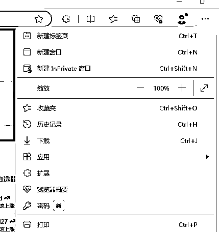
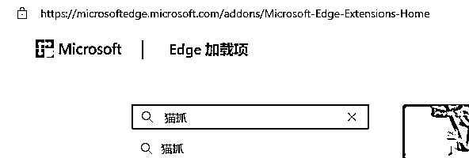
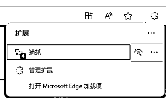
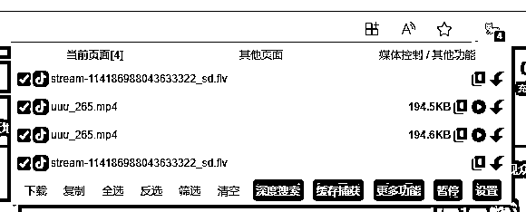
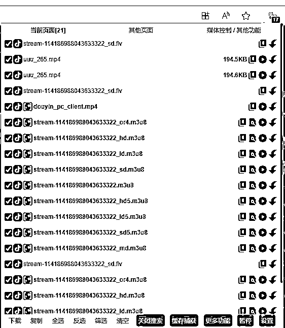
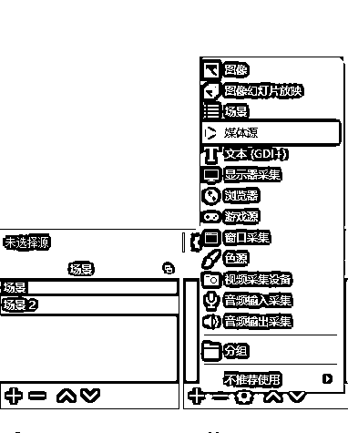
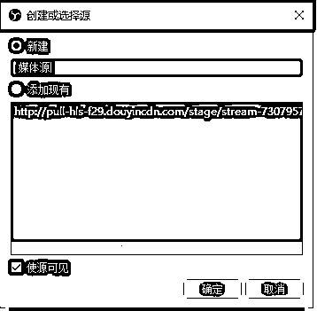
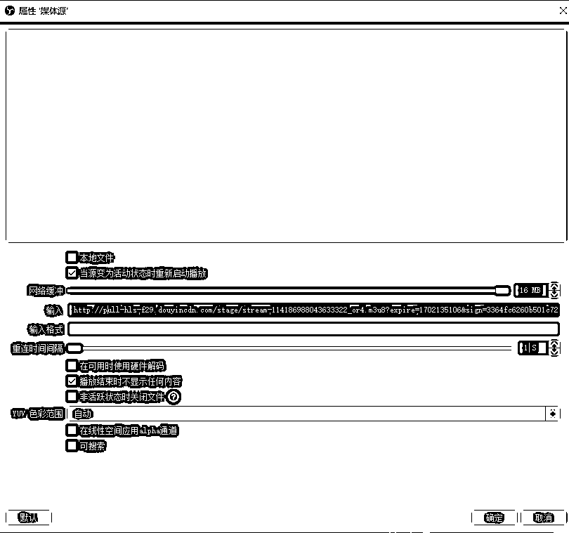
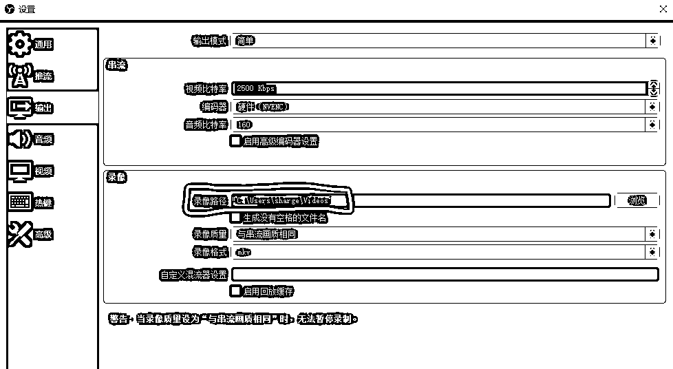
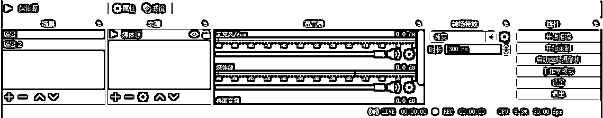

# 用 OBS + Edge 自己动手录制抖音直播素材，免费还稳定

做无人直播的朋友应该都有体会，想找点直播素材，得想办法从抖音、快手这些平台把视频流抓下来。以前我一直习惯用江湖工具箱，但偶尔会抽风，用着心里没底。后来摸索出一套完全靠自己就能搞定的路子：用 Edge 浏览器搭 OBS 软件，轻轻松松就能把直播内容录下来。今天就把这套操作整理出来，分享给有需要的圈友。

## 需要准备的东西

其实很简单，三样就够：

+   一台 Windows 系统的电脑；
+   Edge 浏览器，以及它的扩展组件“猫抓”；
+   OBS 软件（同时也是常用的推流工具）。

## 第一步：把“猫抓”装进 Edge

先打开 Edge 浏览器，点一下右上方的“...”，进入“扩展”，再找到“打开 Microsoft Edge 加载项”的入口。

等加载项页面打开后，在搜索栏输入“猫抓”，找到对应扩展并点击获取，确认安装好就行了。

装完之后，浏览器地址栏边上就会出现猫抓的小图标，用起来很方便。

## 第二步：从直播间抓出视频流地址

打开目标抖音直播间的链接，然后点击地址栏旁边的扩展图标，在弹出菜单里选中刚刚安装好的“猫抓”。

接着点一下“深度搜索”，它会在后台分析页面里的媒体资源，稍等片刻就能看到结果列表。

在结果里优先找那种以 m3u8 结尾的链接。通常带 org4 标志的是原始清晰度版本，分辨率一般在 1080*1920，复制下来备用就好。

## 第三步：用 OBS 拉流并录制

先把 OBS 打开，在主界面的来源区域点“+”添加一个“媒体源”，弹出的对话框直接选确定就行。

接下来在设置页面中，要把“本地文件”前面的勾选框取消掉，再把刚才复制的直播流地址粘贴到“输入”那一栏。其他参数保持默认即可，然后点确定。

确定之后，OBS 的预览画面就会显示出直播内容。如果觉得这个直播间的质量不错，你其实可以直接把 OBS 用于推流，开始无人直播。要是还想留一份素材备用，那就继续做两个小设置。

先来设置录像的保存位置：在 OBS 左上角点“文件”，进“设置”，选“输出”，找到“录像”区域，把录像路径改成自己想存的文件夹位置。

路径设置完成后，回到主界面，按下右侧下方的“开始录制”按键，直播素材就会自动存到刚才设置好的位置了。

## 写在最后

这套流程不需要额外付费，自己动手就能搞定直播素材的采集，特别适合搞无人直播的朋友。希望这次的分享能帮助到各位圈友，祝大家在赚钱路上稳扎稳打，顺风顺水顺财神，一起冲业绩！

需要交流的朋友也欢迎加🛰️：wsh137552775

往期相关精华文章，感兴趣的可以继续翻翻：

[📕单店铺单月 6000+利润选品保姆级教程](https://articles.zsxq.com/id_xwveu3e0usfv.html)

[带 04 年大二堂妹做📕店铺，从 0 开始做📕，月入 3000](https://articles.zsxq.com/id_ker60oc8oimj.html)

[7 天 25W+营业额！📕无人直播实操玩法分享](https://articles.zsxq.com/id_ve4wwu2z8h6x.html)

[快手无人直播月利润 20W 真实复盘](https://articles.zsxq.com/id_1w8gxivdcljz.html)

[抖音单品短视频带货 1000 万 GMV，我是怎么做到的？！](https://articles.zsxq.com/id_qoak1w7ptnwf.html)

[组织龙哥盟福建厦门圈友聚会复盘！](https://articles.zsxq.com/id_7gqhllpk7tpk.html)

[我是如何拿到龙哥盟老板龙哥的微天使投资的！？](https://articles.zsxq.com/id_opqlhtdi2vaz.html)

[1 条剧情视频变现 6W+的自然流素材核心方法论](https://articles.zsxq.com/id_bchmboic0uqp.html)

—— 评论区摘选 ——

逍遥公子：👍

后知后觉：这样录制会把公屏内容录制进来吗

A 懿展先生：感谢分享，这种应该就是那种同步多个平台的实时无人直播了[偷笑]

