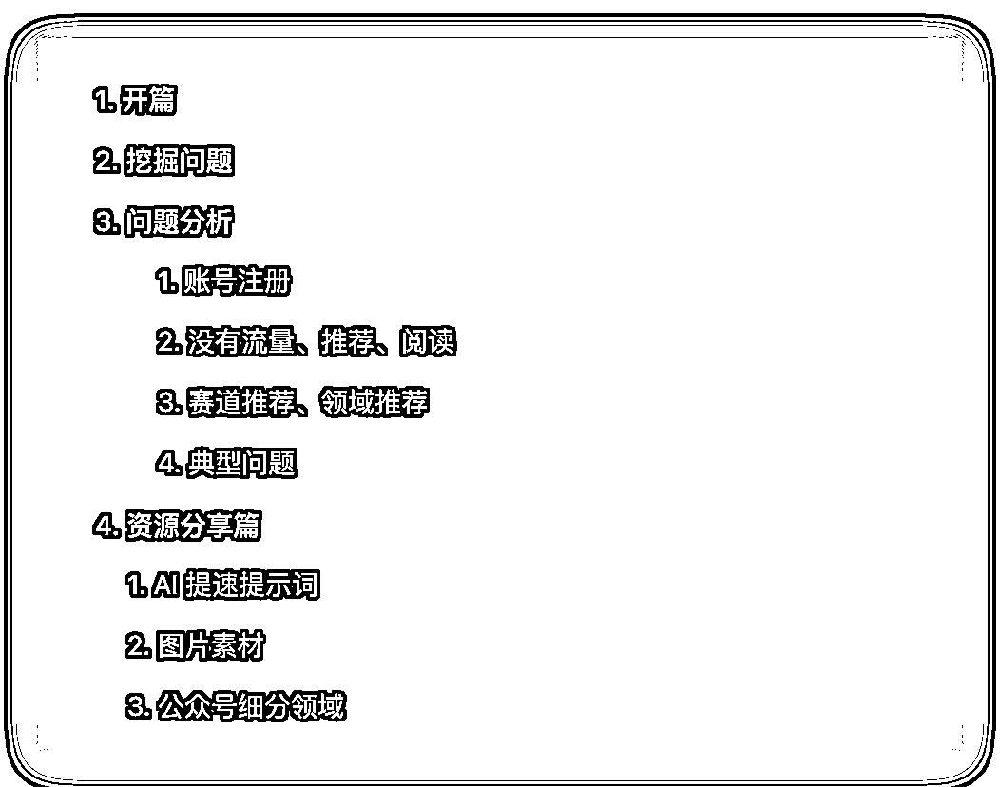

# 👸号爆文写作航海复盘分享

## 复盘 👸号爆文写作

作者： 叉叉敌

日期：2024-02-07

12 月的航海之旅已落幕将近两周，你现在是坚持航行还是已经靠岸了？

很荣幸在 12 月份担任了「👸号爆文写作」这趟航海的教练，和一群伙伴共同学习、共同进化。这段经历对我来说收获满满，今天就把我的航海心得整理出来，分享给大家，希望能帮到各位在航行结束后依然保持航向，持续深耕，把写作变现这件事做下去，而不是选择下船。

任何一次航行都不会一帆风顺。从大家在航海期间的提问就能看出，困境和挑战是接踵而来的。

最核心的痛点就是：**发出去的文章，就是没有阅读量。**

不过，也有很多船员像达尔文的进化论所暗示的那样，通过持续打磨、不断迭代、咬牙坚持，最终迎来了正向反馈，摸清了自己的内容赛道和写作打法。

在航海期间，教练组通过精挑日志、邀请高手拆解、以及多个互动环节，帮助大家彼此驱动，共同迈向变现。

但航海结束后，如果失去了每日打卡报喜、互相解答、经验共享的氛围，同时又没有看到实际收益，很容易就失去动力，停滞不前。

希望这份复盘能给正在或即将独立航行的你一点启发。祝愿大家在航后依然能稳扎稳打、持续突破、实现赚钱。

在此也提前祝大家新年快乐！

* * *

评论区：

悟空悟空空 : 先赞后看！

叉叉敌 : 谢谢悟空大佬[呲牙]

悟空悟空空 : 叉叉敌大佬客气啦～写的真不错！

Denggh : 感想分享，收藏了[强]

文少 : 优秀啊！

* * *