# 这家药企用半年时间，让GMV增长42.8%、复购率提升30%，凭什么？

过去半年，我以私域操盘手的身份，和国内一家头部医药企业磕了一轮私域项目。药企做私域，有人觉得是赶时髦，有人觉得没啥可做，但项目结束后的数据，让我们自己都有点意外：**GMV上涨42.8%，复购率提高了30%，患者用药周期从3.5个月拉长到了5个月。**

先说行业背景。医药曾经是个让很多行业羡慕的赛道：药上市后生命周期长、销售额一路走高，日子过得相当舒服。但集采常态化之后，风向彻底变了。

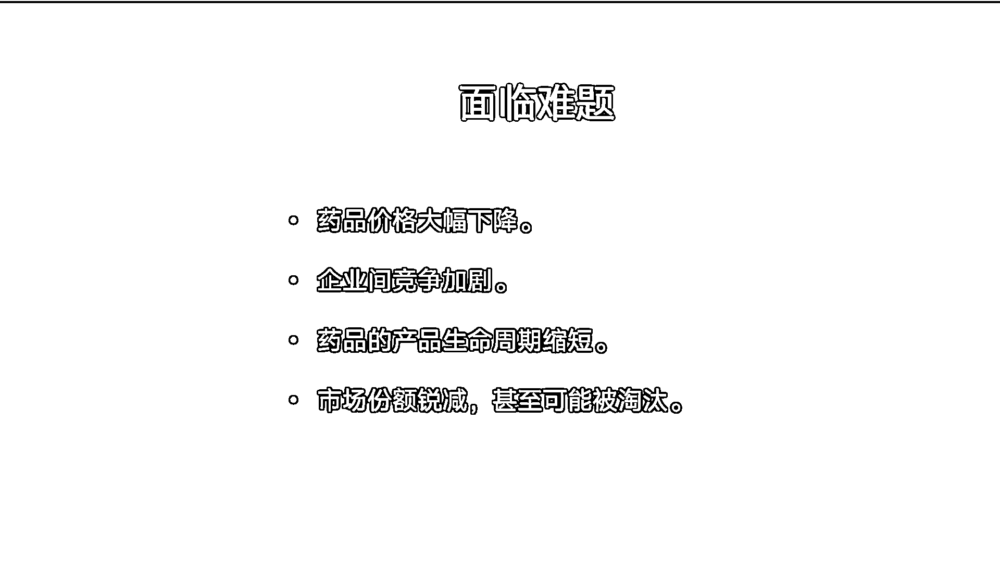

药价大跳水，企业间的内卷被推到明面上：中标等于利润被压缩，不中标则眼睁睁看着医院市场流失。新产品还在培育期就进了集采名单，产品生命周期被大幅压缩，多数企业的市场份额不断萎缩。靠渠道红利打天下的时代，已经翻篇了。

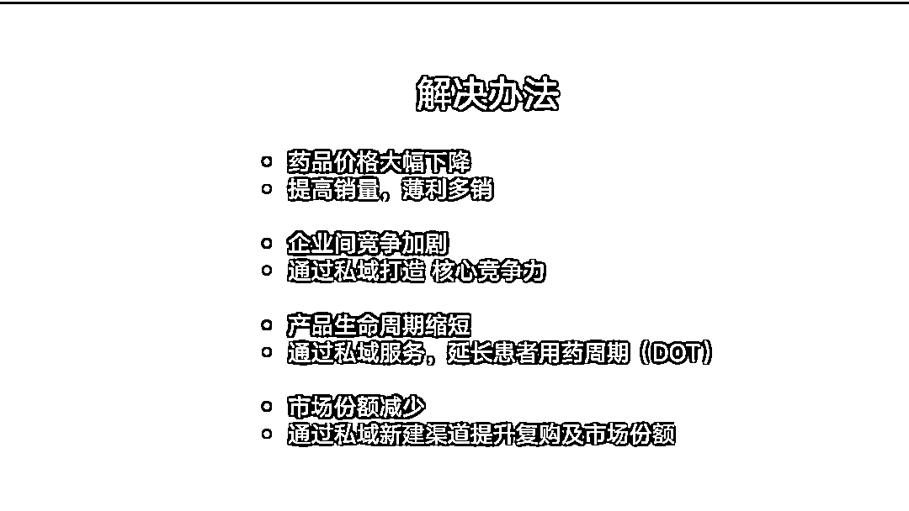

为了求生，不少药企转向院外：医药电商、互联网医院、DTP药房，能试的都试了。但它们能承接一部分销量，却接不住患者的长期信任——院内靠医生，患者离开医院就断线；电商做不了深度的患者服务；互联网医院的续方习惯远未养成；DTP药房专业度参差不齐、覆盖半径有限。**药卖出去，人却断了联系。**

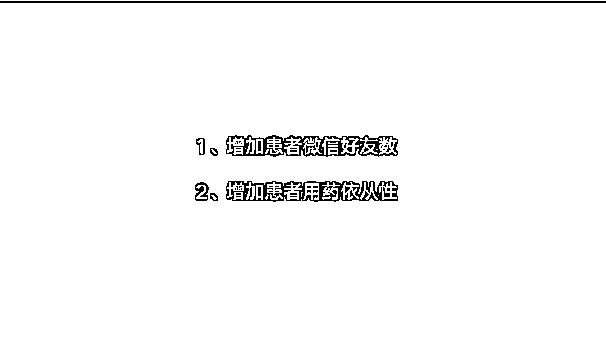

要打破这种局面，靠的不是另一条新渠道，而是一种新关系：企业和患者之间的双向连接。换句话说，让患者在需要帮助的时候能随时找到你，让企业在合适的节点主动关心患者。

项目启动之初，我们并没有急着铺量，而是先沉到一线去做调研。和销售冠军聊，和主治医生聊，又把数据翻了个底朝天。四个发现，一个比一个扎心：

第一，患者吃药过程中有一堆困惑，却找不到及时咨询的人，服务需求被白白晾着；第二，👸号引流的路径太绕，来的人本来就少，添加率更是惨淡；第三，2023年进来的新患者，发生过第二次购药的仅三成；第四，首次用药后30天内不复诊、不续方，患者基本不会再进入下一个治疗周期。

这四条信息拼在一起，问题指向已经很清楚：**把患者当“一次性购买用户”，注定做不长久。**

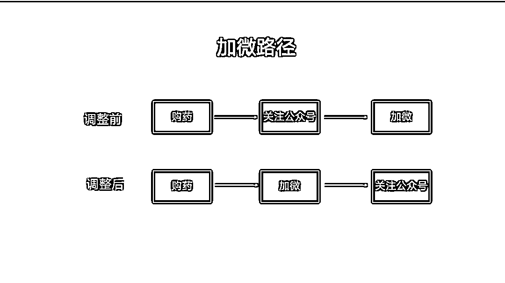

接下来，围绕策略、内容、组织、工具四个维度，我们动了一次大手术。

策略上的第一刀，是重排列引流顺序。原来患者购药后先关注👸号再引导加企业微信，路径长又易流失；我们改成先加企业微信、再引导关注👸号，#加微率#一路冲到90%以上。和患者之间，终于有了直达通道。

第二刀，给企业微信一个明确的身份——医生助理。背后由具备资质的互联网医院平台承接服务，有了这个身份，服务边界清晰了，患者也更愿意信赖。

第三刀，把患者从首次用药到复诊、报销、日常咨询的完整过程，设计成一张“患者旅程地图”。癌症患者是旅程中投入关注最多的群体，因为他们不仅需要用药指导，更盼着有人理解和支撑。

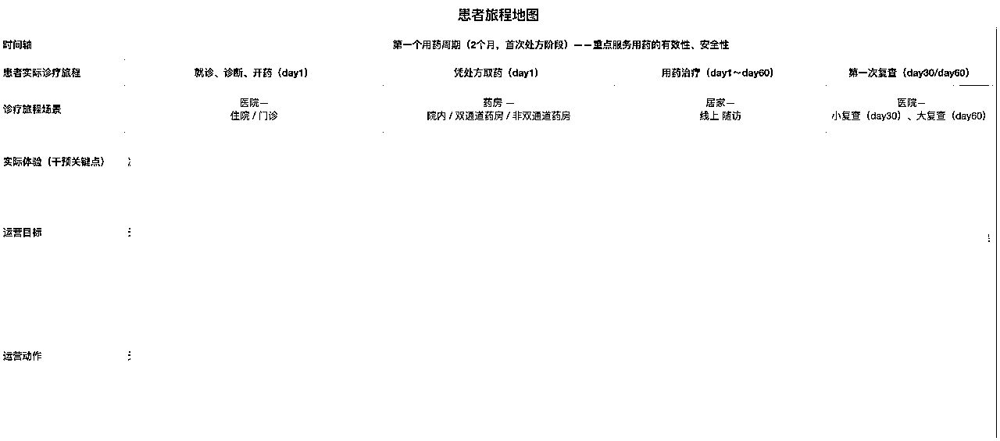

第四刀，把服务动作变成标准化的运营SOP，每个环节，从患者进来的第一句招呼，到日常随访和提醒，都拆成可执行的步骤。

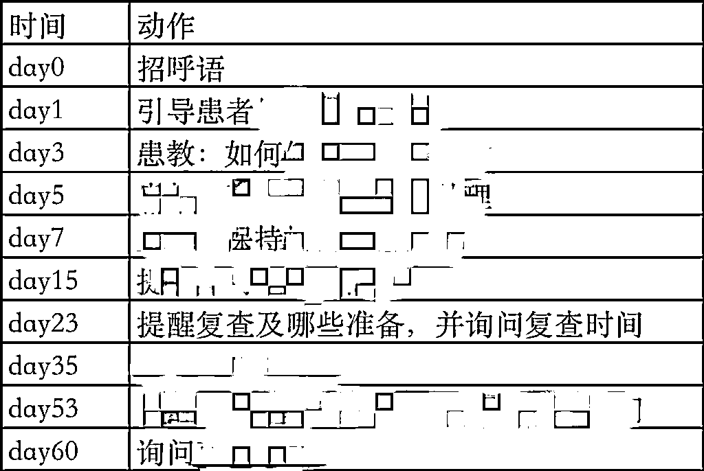

具体怎么落地？以癌症患者为例，有三个环节决定成败。

第一，招呼语。患者添加成功后，第一时间送上商保报销服务，同时明示服务范围和后续提醒。这个动作有三重意义：先建立帮助者的第一印象；告诉患者有问题有地方问；提前为后续触达埋下铺垫，避免刚加进来就被删掉。

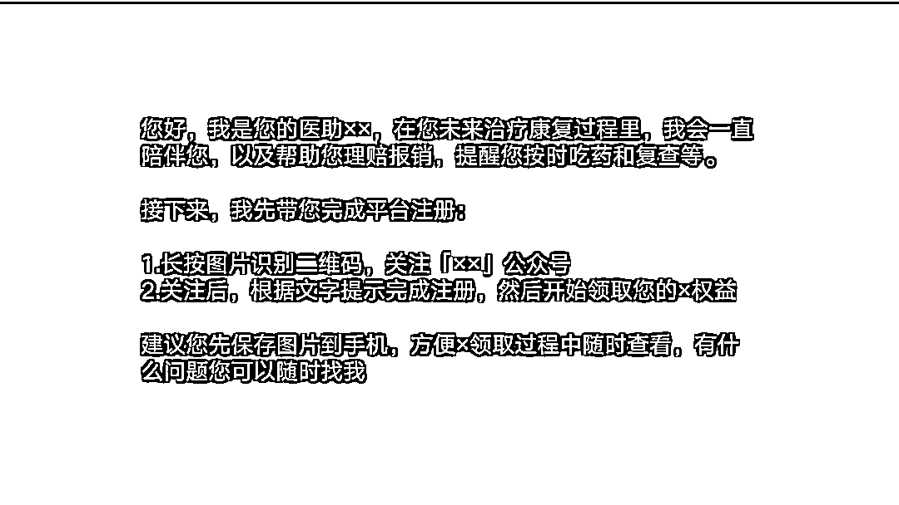

第二，复查提醒。癌症患者每个月都需要复查。复查前，我们主动提醒患者安排好时间，并告诉对方复查需要带什么、注意什么。

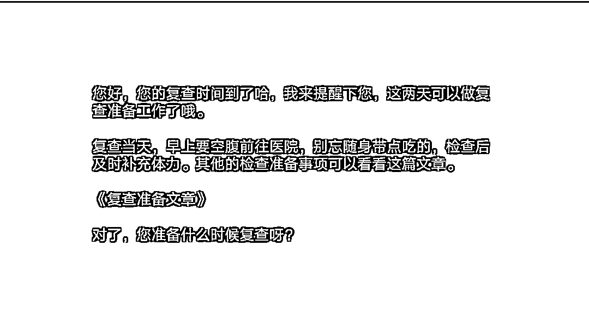

第三，当患者该复查却没出现，很可能意味着他有了放弃治疗的念头。这个时候，系统会启动沉默患者唤醒动作，去了解情况、给予鼓励，把患者稳稳拉回来。

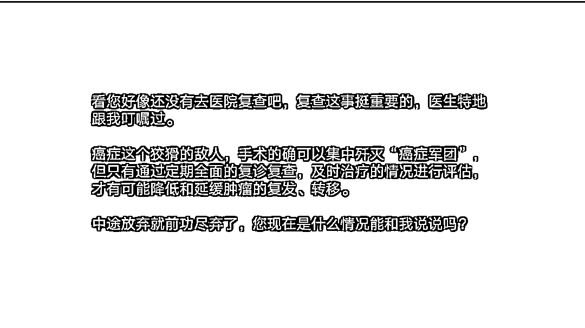

以上这些，全都靠内容去承载。在私域场景里，内容不是广告，而是每次发出的消息能不能让患者愿意打开、愿意相信、愿意行动。医药内容还要守住合规边界，这本身就考验团队功力。好在，当我们看到复购率提高30%、用药时长延长1.5个月，对任何一家药企或药店来说，都是非常可观的利润增量。

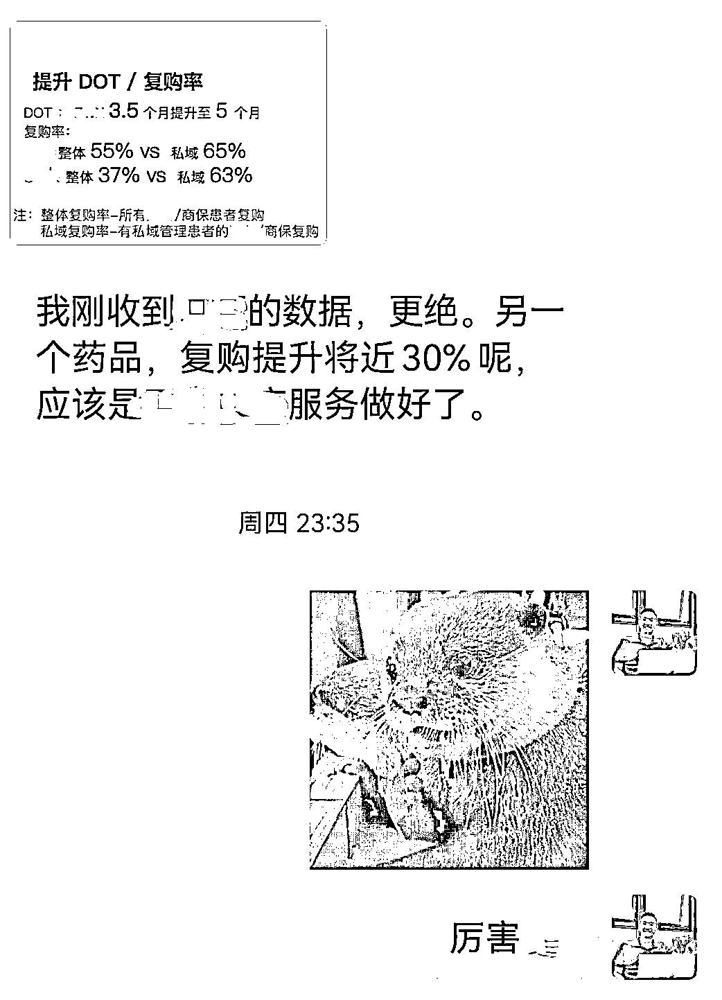

项目推进上，单靠一个私域小组也不可能跑通。总部负责整体策略和落地，领导负责预算和决策，销售贡献一线洞察，医生提供医学内容审核，患者则因此得到实打实的关怀。让每个人做自己最擅长的事，最终沉淀出一套覆盖患者全生命周期的管理体系，可以长期复用到所有渠道。这大概就是私域里的“极致利他”：利患者、利渠道、利销售、利总部。

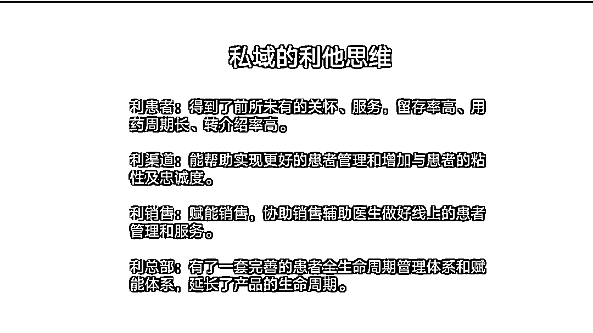

最后聊工具。策略和内容决定了私域的上限，工具则决定这些流程能不能被稳定放大。自动化营销工具负责把标准SOP执行到位，数字化工具负责让每一名患者的状态都清晰可见。只要流程设好，系统自动运转，既不漏动作，也不走样。人最该做的，是被解放出来去做有温度的沟通，而不是困在机械重复里。

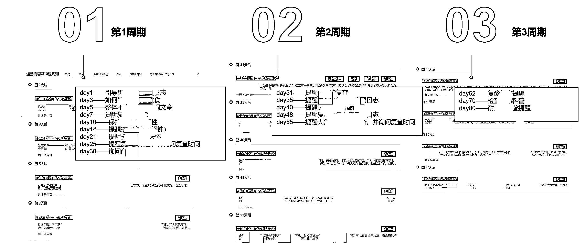

这件事最让我感慨的，不是那些增长倍数，而是它证明了一件事：私域能真正改善一家企业的经营，并不仅是增加一个卖货渠道。医疗医药行业身处改革深水区，面对集采、渠道重组和消费者话语权崛起，真正能抗内卷的活路，就是把私域当作品牌的生命线来经营。以微信为枢纽、以线下药房为半径，线上与线下结合，围绕患者做全生命周期的服务和陪伴，让患者不仅吃上药，更吃对药、被尊重、被善待。这也许才是比增长数字更重要的价值。这套策略-内容-组织-工具的私域方法论，放到医药以外的行业同样成立，区别只是不同环节的权重不同。希望这次复盘，能给你带一点灵感。

