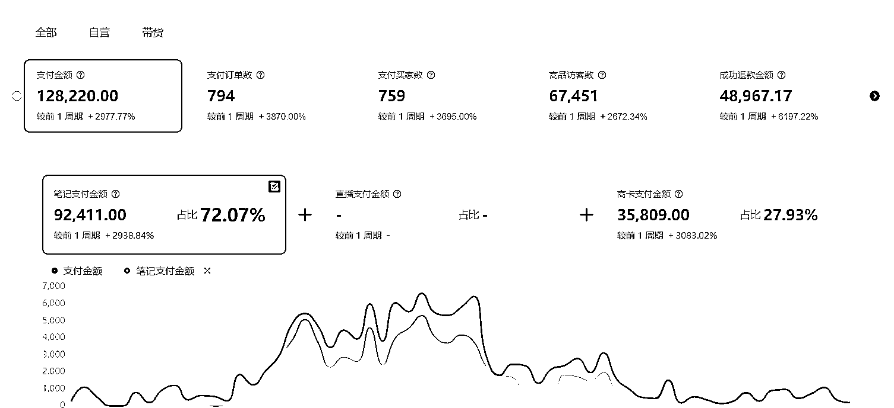
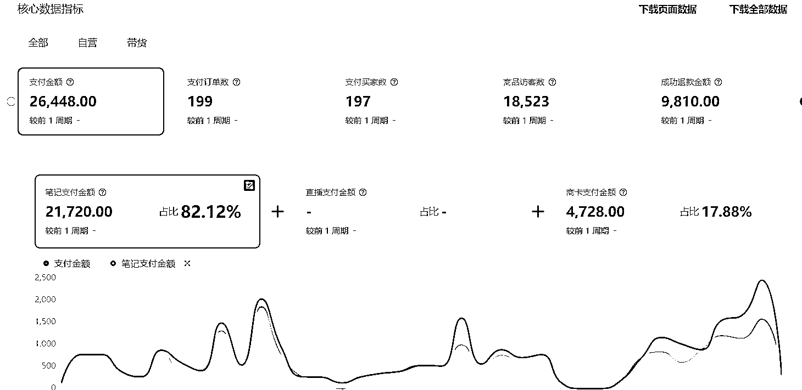
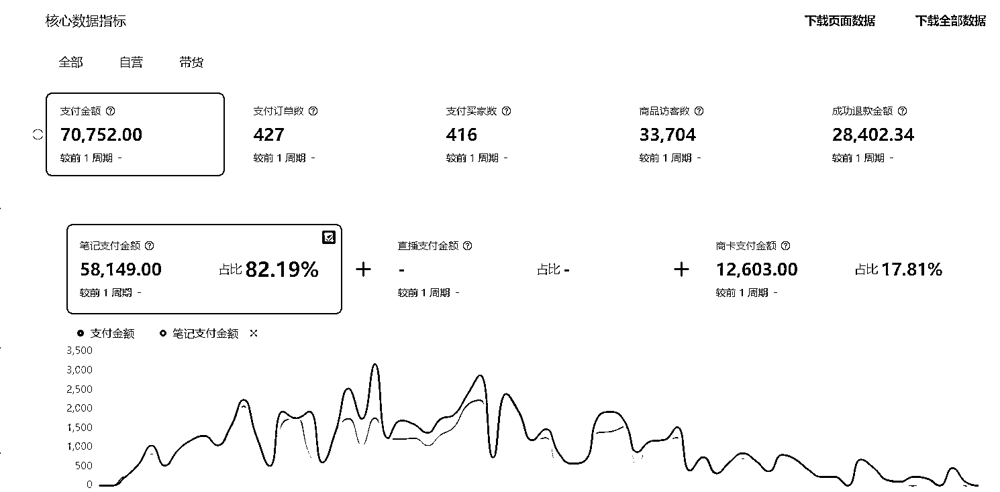
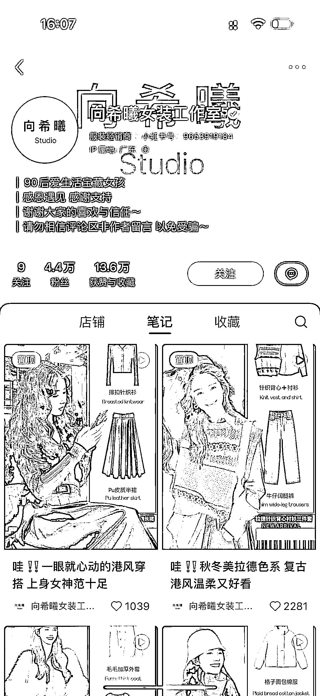
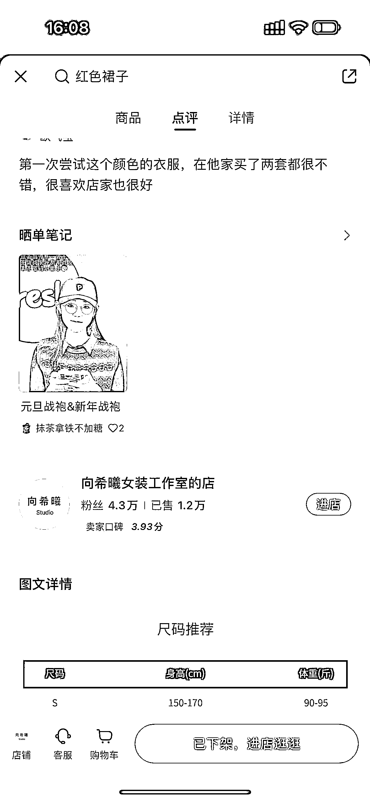
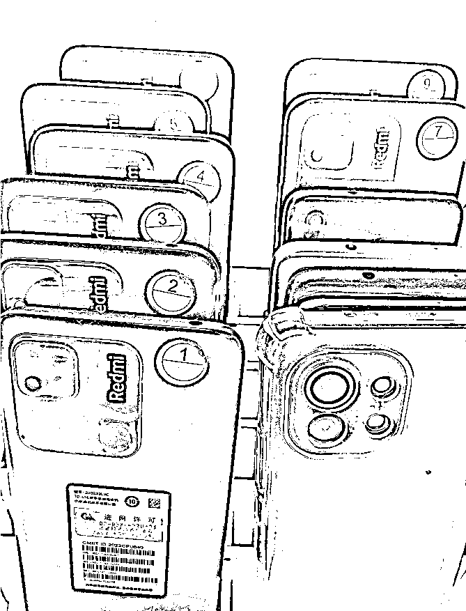
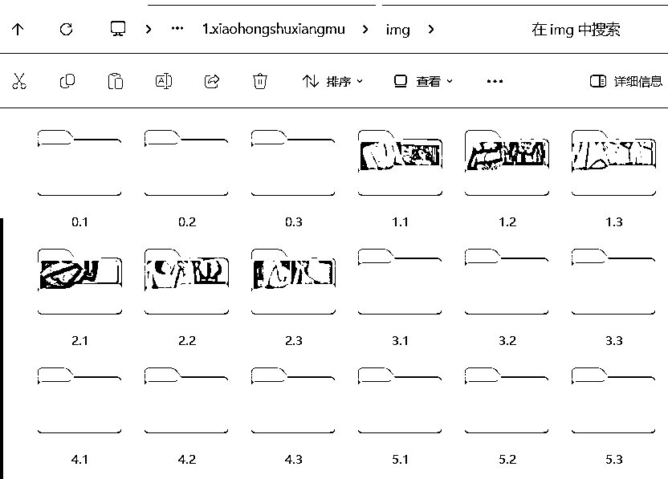
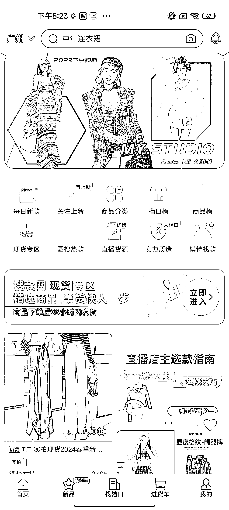

# 我只用一个人，2个月把小红书女装新店做到20万+：多号批量发视频的实操复盘

## 单枪匹马搞起来的小红书女装项目，两个月累计流水破20万

作者：锦辉

日期：2024-02-05

大家好，我是锦辉，2020年4月18号加入龙哥盟，到现在快四年了。

趁着假期闲下来，把我最近在做的事梳理一下。**小红书图文转视频玩法，多号矩阵批量铺量，新店开张两个月就干到20万+流水**，全程一个人扛，没有团队帮忙。下面这几家店最近两个月的数据就是我自己的实操结果。

# 想法是怎么来的

去年抖音在猛推图文，小红书这边风向变了，视频权重明显上来了，平台也更商业化。不少人发现带车的笔记播放量反而更高。

十月份的时候，我盯上了一个账号。他把抖音上卖女装的图文搬过来，2张图拼成10秒左右的PPT小视频，每天稳定发一条，还挂了小黄车，转化非常猛。我粗略统计他一家店月出单能到一两千单。按一单赚50块算，一家店月利润就5万了。要是多开几个号一起发，这利润叠加起来想想就吓人。

同行就是活教材。我立刻拿两个小号做验证。操作很粗暴：把抖音上的好看女装图扒下来，用剪映一张张合成视频，配个音乐就发。刚开始一天发3条，坚持了一周，有一条视频突然涨到50多个赞，评论区开始有人问“衣服在哪买”。我当天就用自己的号开通了个人小店，上架同款，当天就成交了，第一天营业额就破千。

# 用数量把概率打出来

那波流量撑了一周后就慢慢掉了，销量也跟着下滑。但一次尝到甜头就上头了，我确定这个路子能跑，而且不踩线。

问题在于单条视频太水，点赞很难上去，女装又特别看款式，靠几条视频想爆太难。所以思路就改了：**不用等爆款，用数量堆概率。**一个号发太多容易限流，那就多注册号。后来我配了手机卡、流量卡，外加十几台红米机一起注册小红书来做。手机卡到手就打客服改成最低套餐，流量卡在淘宝买，5块钱一张，月租1.9元送10G流量，成本极低。

这是我的工作机群，主要就是红米。

# 起号和开店的节奏控制

个人店只能开一个，想多开就要先认证蓝V再开店。一个蓝V要600块，号没起来前我不乱花钱。我的经验是，**一个号赞数稳定到50左右就能判断基本起量了**，这时候再去认证开店挂车，花钱也踏实。视频本身我也是筛选着上品，点赞在10个左右的才挂车，点赞太低基本没转化，没必要浪费时间一件一件上架。

# 做视频要自动化

号多了手工剪辑根本扛不住。我让ChatGPT帮我写了个Python脚本，把指定文件夹里的2张图自动合成10秒轮播视频，再自动加音乐。一分钟能出十几个视频。图片按款式分好文件夹，改一下代码里第8行图片路径、第9行音乐路径、第10行输出路径，就能批量跑。

*代码里改一下路径就能直接用。*

验证下来这个项目就是典型的**暴力起号，靠量取胜**。只要账号够多、视频够多，今天东边号没爆，西边号就起来了，整体流量和订单一直是连着的。现在我还在继续扩号，目标是把所有店铺加起来做到月流水30万。

# 过程中踩过的坑

小红书后来开始严打拼多多无货源，我用拼多多供应的店铺一波全被违规了。换到淘宝发货就稳定很多，但淘宝价格普遍比小红书贵一倍左右。实际上很多都是一手广州档口的货，质量和拼多多差不多，只是价差大。

我在佛山，进出广州沙河很麻烦。后来我用上了**搜款网**，这个平台主要是沙河档口的商家自助上款，可以直接下单发货，解决了无货源的风险。

售后地址现在管得很严，我是先寄到自己的工作室，再统一退给搜款网或者淘宝商家。

文笔一般，就聊到这儿了。做小红书引流、亚马逊、视频号直播的朋友可以多交流。

最后祝大家2024年一起龙哥盟，大发！

* * *

评论区：

书豪 : 很棒

锦辉 : [憨笑]谢谢豪哥

向阳 : 女装退货率大概有多少呢

在三亚卖金枪鱼和野生* : 确实要靠工具来提升效率[偷笑]

我的执着 : 流量卡可以推荐一下吗

锦辉 : 和行业的退货率差不多 40%左右

锦辉 : 淘宝 晚荷旗舰店 元黛器旗舰店 之前买的 你问问客服 可能套餐有改变

我的执着 : 好的，谢谢

* * *