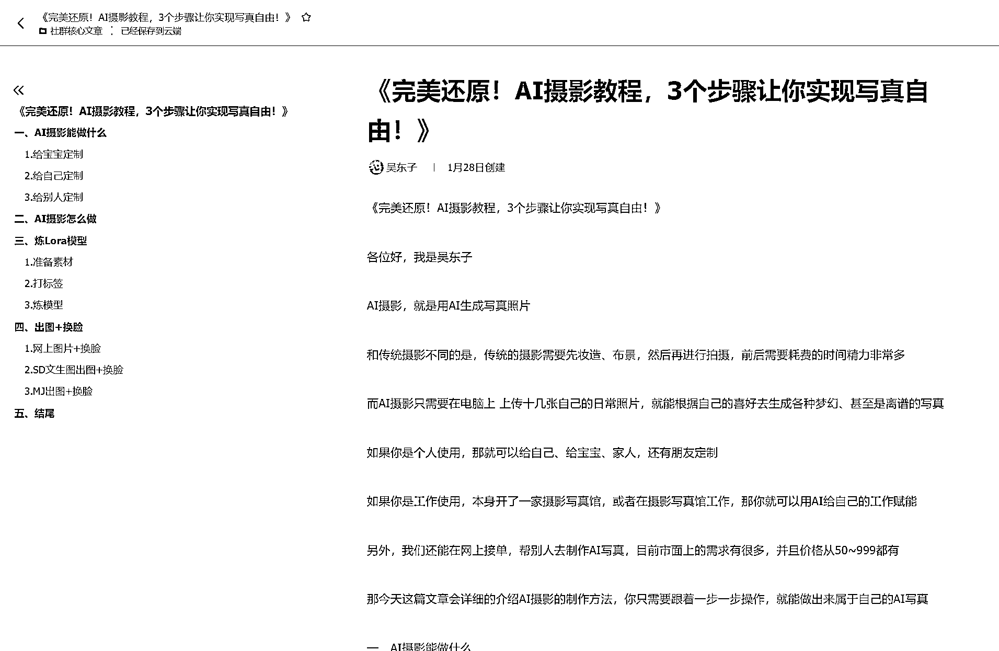
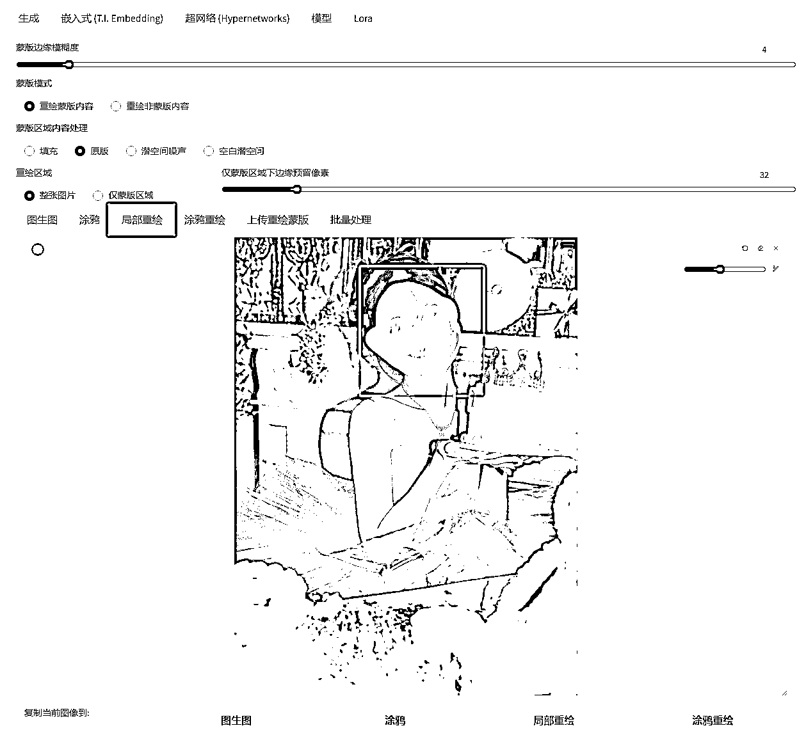
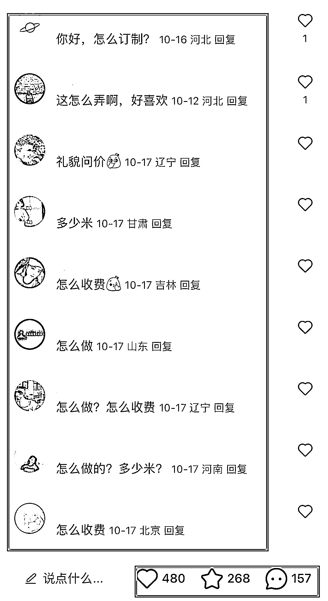
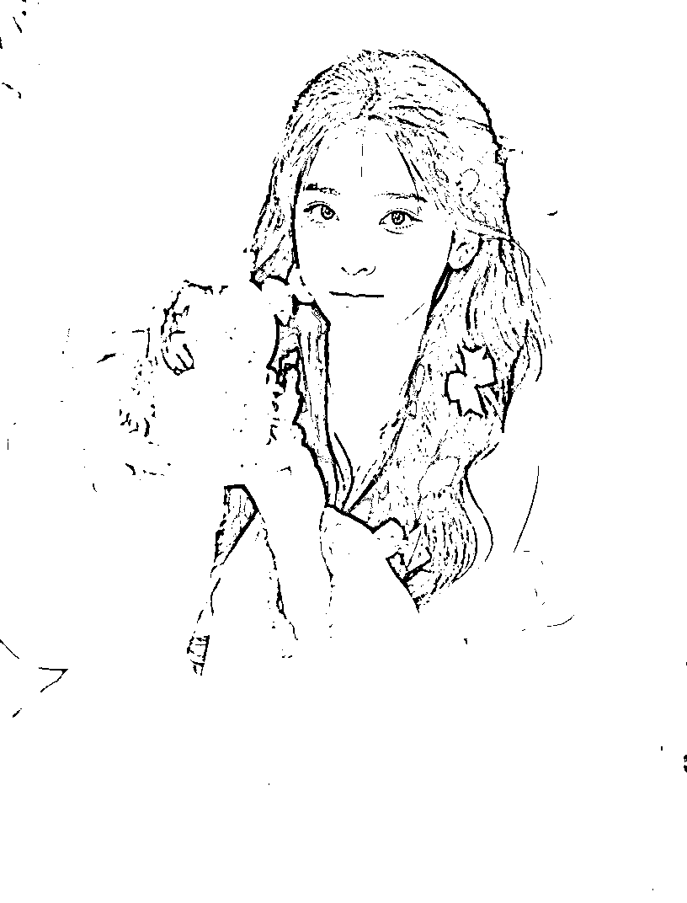
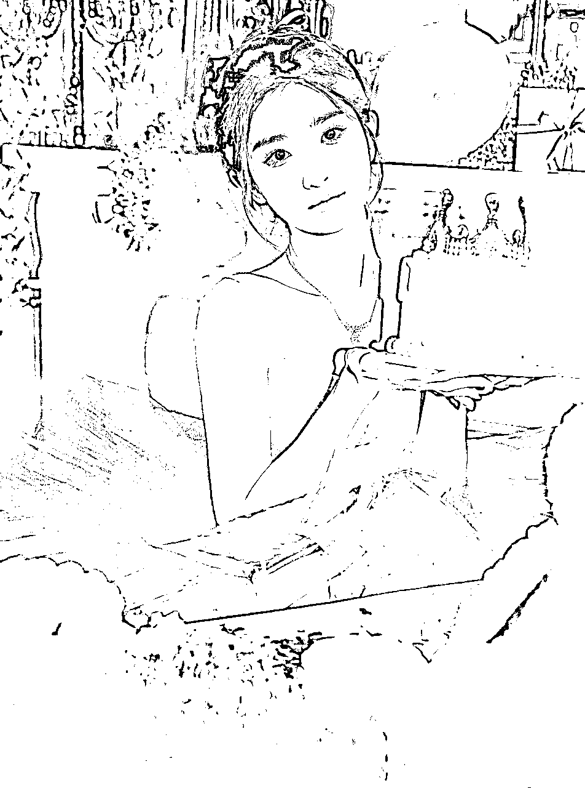
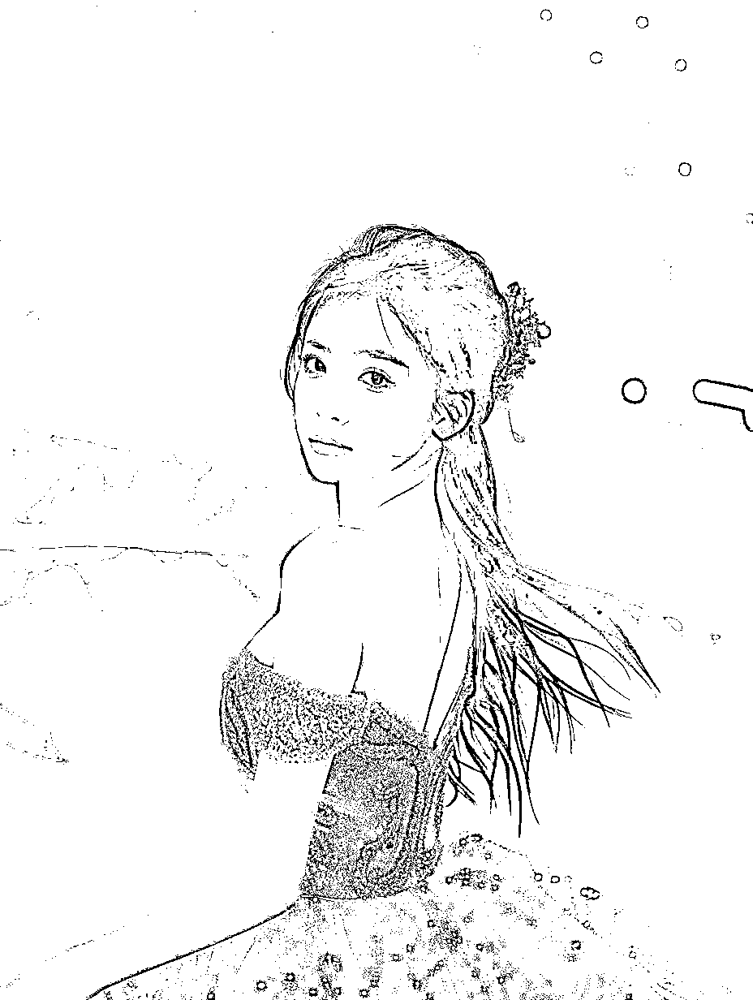
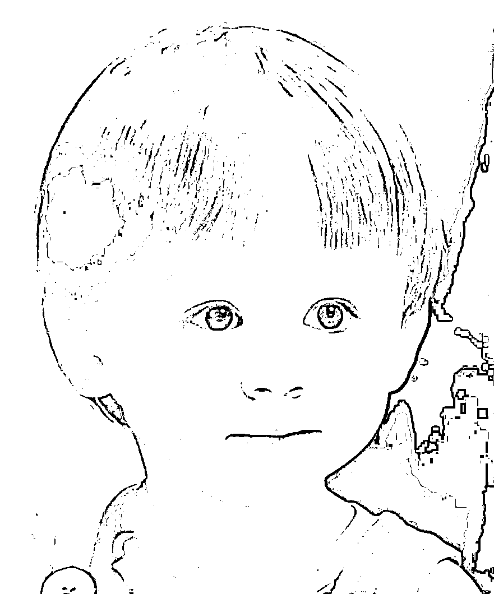
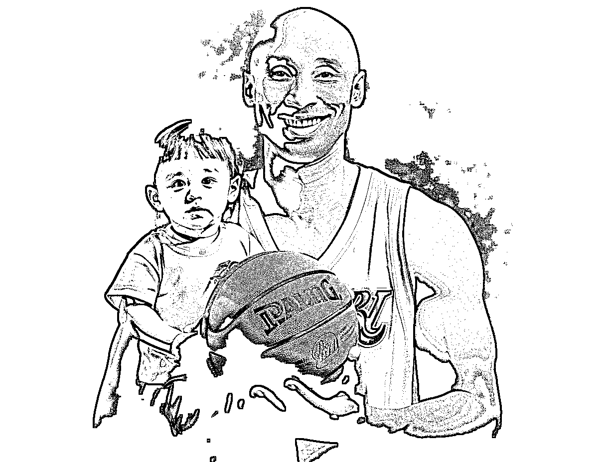
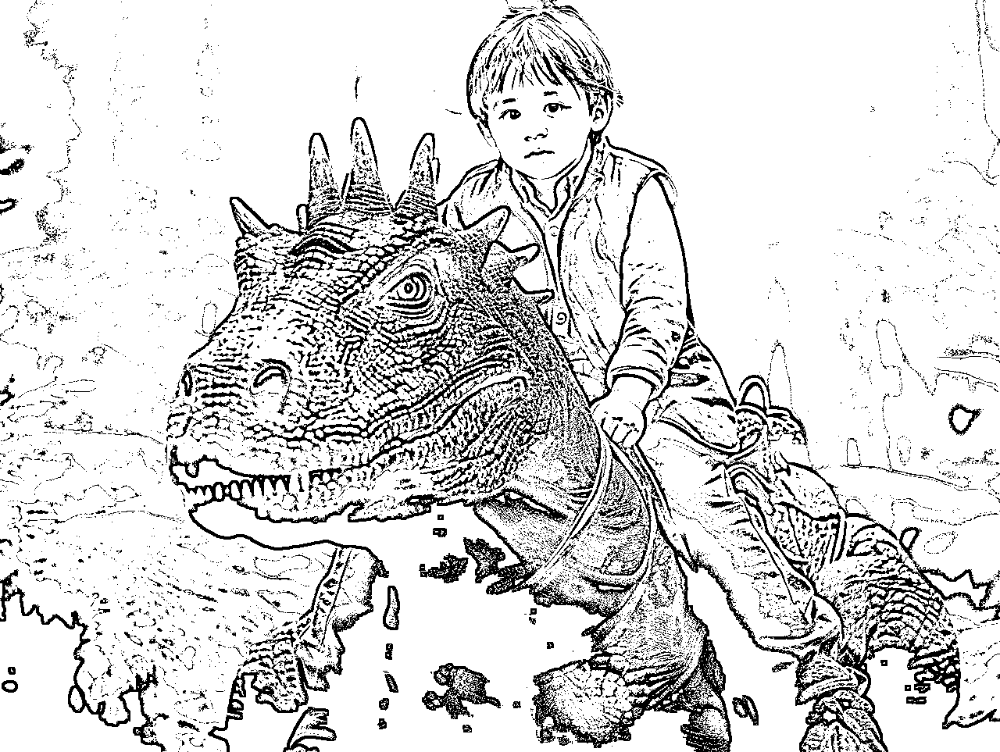

你是不是也幻想过，不用化妆、不用搭景，就能轻松拥有一套又一套氛围感写真？

其实这件事现在已经能做到了，靠的就是 AI 摄影。简单来说，你只需要在电脑上扔进十几张再普通不过的生活照，AI 就能按照你的想法，生成各种风格梦幻、效果惊艳的写真作品。

这跟传统摄影完全不同。过去想要拍一套写真，得先捣鼓妆发、布置场景，再找时机按下快门，整个流程既烧钱又费时间。而在 AI 的世界里，所有繁复环节都被省略了，一台电脑加上一些个人照片，就足以打开创作的大门。

你可以用它来做什么？

如果你是纯个人玩家，完全可以为自己、宝宝、家人或朋友定制专属写真。如果你本身就从事摄影行业，不管是自己开店还是在影楼工作，AI 都能变成你的效率加速器，帮你在业务上增加更多亮点。

更让人心动的是，现在网上有大量的 AI 写真需求，接单价格从 50 元到 999 元不等，市场空间相当可观。

接下来的内容会手把手带你拆解 AI 摄影的具体玩法，只要照着操作，你也能做出属于自己的高质量写真。全文主要分为四块：第一，AI 摄影的应用范围；第二，具体怎么操作；第三，如何训练模型；第四，出图方式有哪些。

这份内容我打磨了很久，希望能真正帮到你。

链接：[`ry5hwpuf7b.feishu.cn/docx/Ox2ndRADWojFdxxwYQZcYKVbnVc?from=from_copylink`](https://ry5hwpuf7b.feishu.cn/docx/Ox2ndRADWojFdxxwYQZcYKVbnVc?from=from_copylink)

* * *

评论区：

Beautiful * : 大佬，炼 lora 模型的文件夹从哪里找啊？

抉择 : 是用 sd 秋叶的包训练的吗

吴东子 : 是

陈去野 : 牛逼啊

村村 : 东子哥，我的 sd 界面找不到 Lora 训练的选项，是版本问题吗

杨一 : 以前刷到东子哥的 B 站，期待更新

* * *