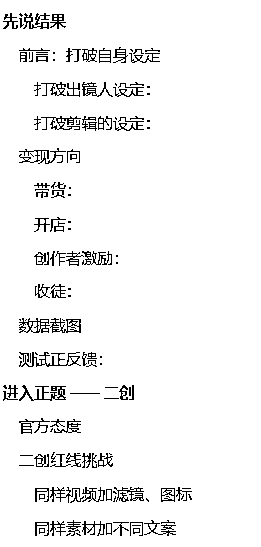

# 俄罗斯数字人带货批量剪辑，700w 播放！10 分钟剪 3 条！一键全平台发布视频，提高效率!

你敢信吗？俄罗斯数字人带货，竟然靠批量剪辑把播放量做到了700万！

这位博主“阿甜相信光”分享了她的实战战绩：B站一周涨粉5000，抖音直接涨了1.2万，视频号也收获了6000多粉丝。

关键是她还特别会提效——只需一条原创口播视频，经过批量混剪，就能得到10条全新的内容；十分钟就能剪出3条视频，再用一键分发工具同步所有平台，效率直接拉满。

从账号冷启动，到批量剪辑技巧，再到全平台一键发布，整套流程都整理好了。原文档在飞书，排版非常舒服，大家可以去细看。

干货内容如下：

有同行在评论区感叹：“这思路牛叉，直接混剪，还把做虚拟人的环节优化了。”作者回应说，确实优化了不少，过几天会再分享完整的数字人流程，想看的可以蹲一波。

