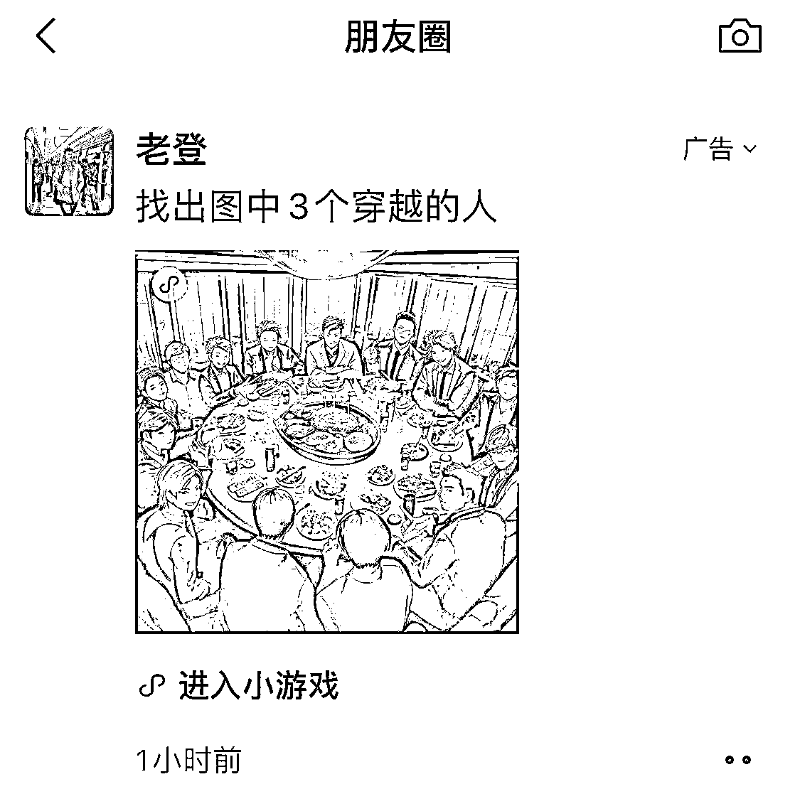

# AI 已经火了一年了，真正属于普通人的机会在哪里？

AI这股热潮已经烧了整整一年，可很多人心里依然有个疑问：风口这么猛，普通人到底还有没有属于自己的位置？

我是吴东子。过去这一年，这个问题我被追问了无数次。趁着今天，我把目前对AI的思考完整梳理了一遍，最后归结成三个方向。同时想和大家说清楚，在这个节骨眼上，所谓的“搞AI”究竟是在搞什么、又要怎么搞。

先说第一层：得看透AI行业的底层逻辑。它不是什么昙花一现的风口，而是一次生产方式与价值创造逻辑的深度革新。谁先看懂其中的变化，谁就能更早找到自己的立足点。

再说第二层：AI本质上是一个放大杠杆。它不会从零赋予你超能力，但会把你身上原本就有的优势成倍放大。你擅长文字，它可以帮你批量生产内容；你擅长视觉，它可以帮你快速生成素材。反过来，如果你自己方向不明，它同样会放大你的盲目和冲动。因此，核心不在于追逐工具本身，而在于找到你最值得被放大的那个点。

接着是第三层：普通人借助AI做个体创业、赚快钱，完全走得通。这里的“快钱”不是天上掉馅饼，而是通过AI把启动成本压到极低，用最小的试错代价去跑通一个细分需求，让属于自己的小生意快速产生现金流。

所以，当我们现在说“搞AI”的时候，重点从来不是追逐几个热门词汇，而是理解底层逻辑、善用放大效应、迅速落地行动。机会从来没有消失，它只是更偏爱那些看懂本质、选对角度、说干就干的人。

