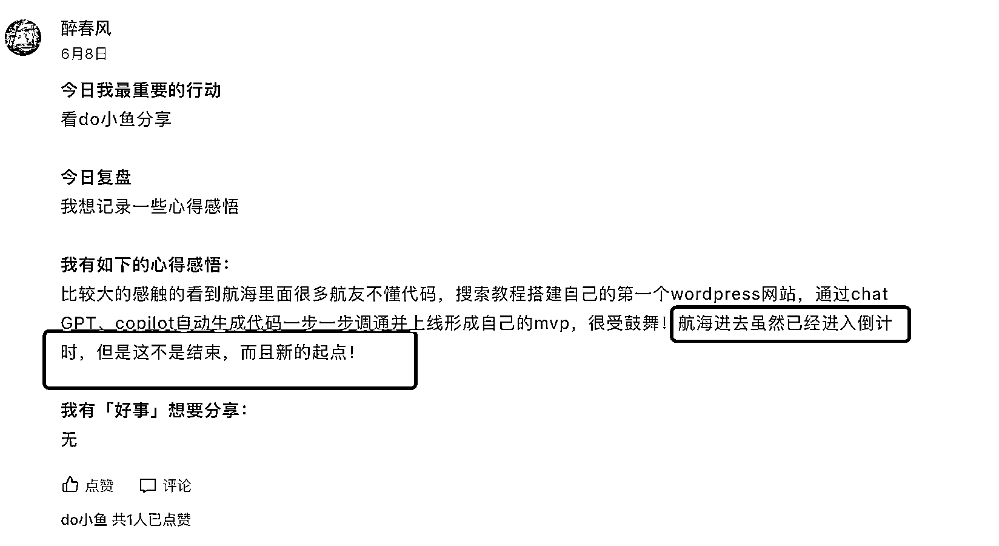
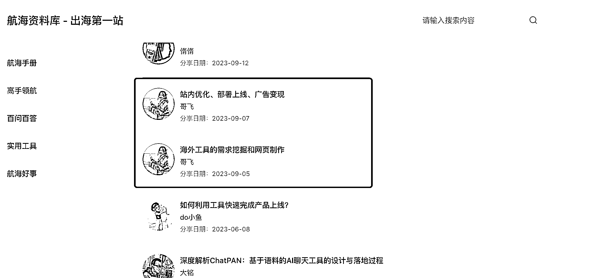
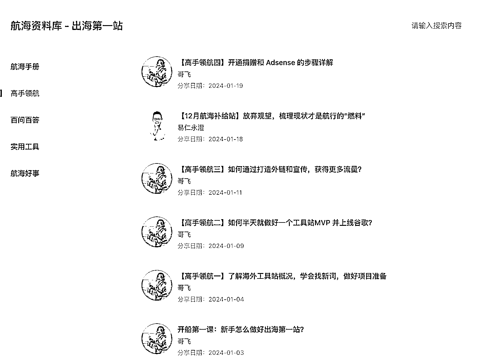
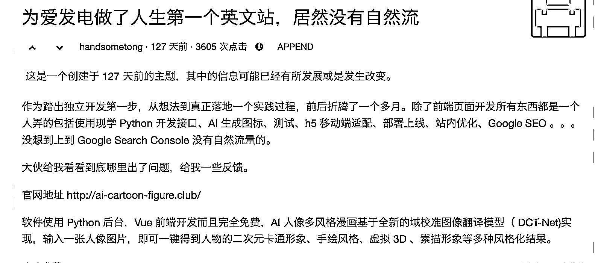
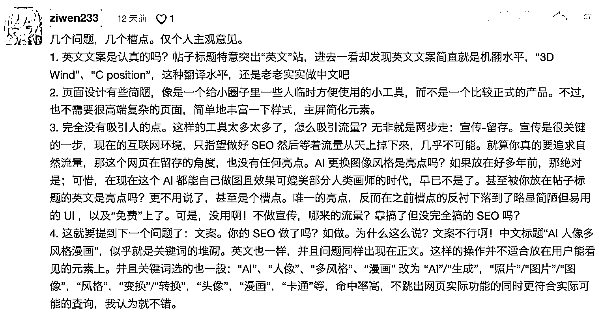
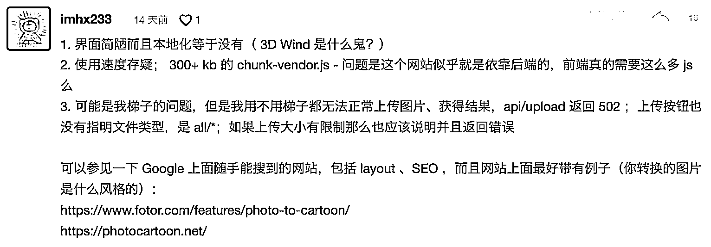
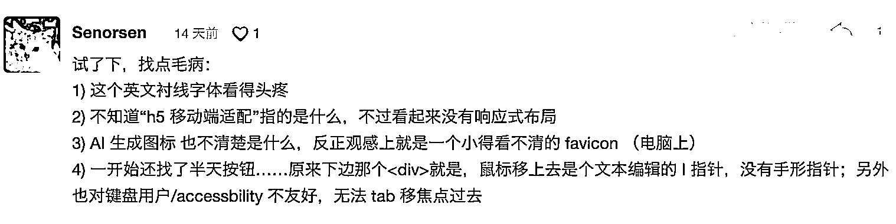
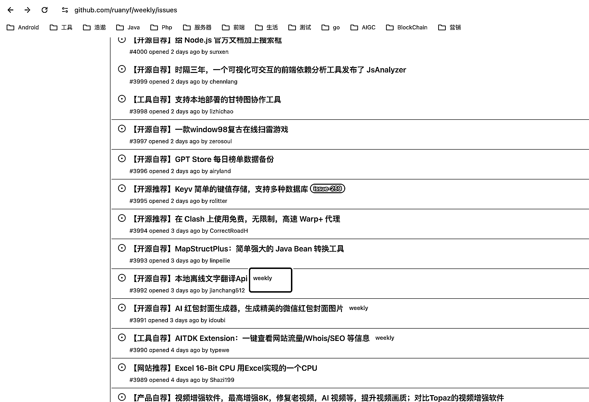
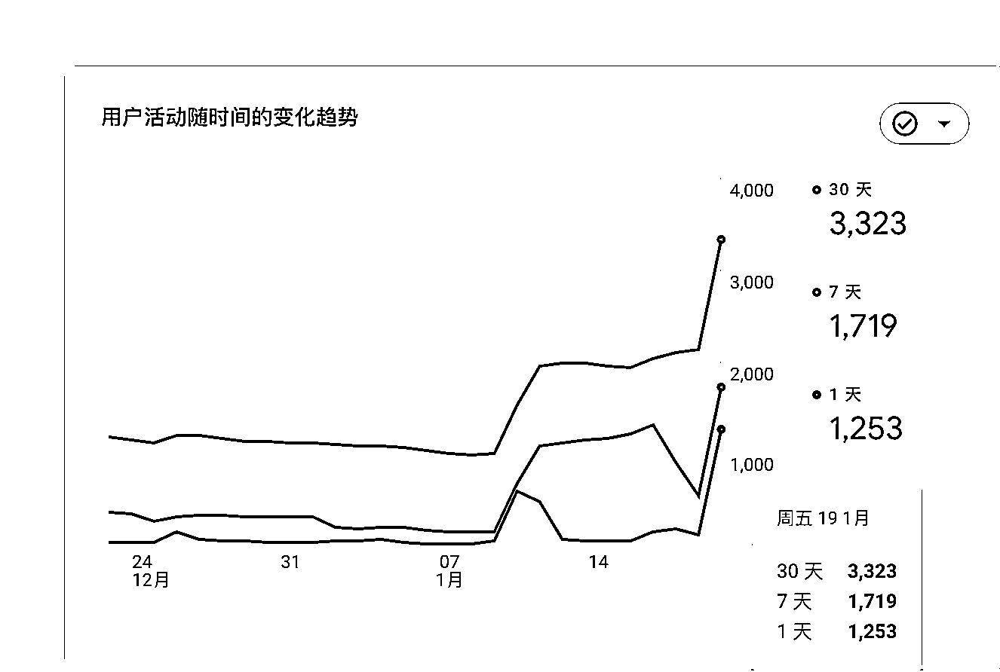
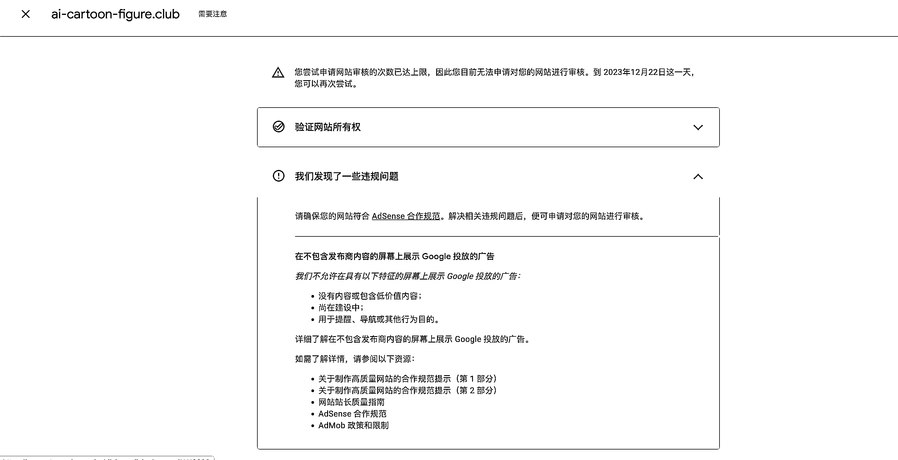

# 三个月把海外工具站 MVP 跑通，我作为一个普通程序员拿到了第一笔美金

> 原文：[`www.yuque.com/for_lazy/thfiu8/hhddv65hvygn2aza`](https://www.yuque.com/for_lazy/thfiu8/hhddv65hvygn2aza)

## 精华帖 普通程序员如何用三个月跑通海外工具站 MVP 拿到人生第一块美刀

作者：醉春风

日期：2024-02-04

先做个简单的自我介绍，我在一线城市以外的小厂做开发，是个二本出身的普通程序员。十年开发经验里写过 .Net、Android、Java，Web 方向只算半懂。加入「工具站航海」之前，对海外市场完全是零。

## 我为什么会入生财

生财有术在圈子里名声在外，我真正被打动是刷到小报童里那篇《生财有术项目经验》，里面 66 个实战案例看得我直呼原来还能这么玩。

后来看到航海宣传海报上写着有带人做网站的实操课，正好对口我的技术背景，就直接入圈了。

说白了，我进来的目的很单纯：想跟着实操，也想认识一些在这个赛道已经跑出结果的前辈。还真来对了。4 月份刚进群我就开始埋头啃了一个多月的航海手册，还报名了 5 月的工具站航海和 8 月的志愿者。

航海结束时我还没出成绩，但那颗种子已经种下了。

到现在为止我用业余时间搭了两个站，其中一个已经靠 Google Ads 把 MVP 闭环跑通，并且真的给我带来人生第一笔美金收入。

## 海外工具站凭什么被我选中

1. 是亦仁老师长期看好的方向

1. 赚美元的体感像打了 7 倍杠杆的股票，还不会爆仓，体验一次就上头
2. 门槛比国内低很多，不用折腾备案和层层审核
3. 能做睡后收入，有复利属性。指挥一群服务器 24 小时替你干活

> ## 上线速成心得

> 
> 官方的每期航海手册是必读的。需求挖掘、页面搭建、站内优化、部署上线、广告变现这些技术环节，我个人补充推荐哥飞的小白入门合集。文档写得很细，每一步都有截图，有一点开发基础就能照着做。

> 
> 
> 
> 时间允许的话，建议把哥飞最近一期的航海视频也补一下。里面有不少案例拆解和现场实操，能拓宽视野。

> 
> 
> 
> 哥飞属于高产型创作者。我是那种一旦认可一个人的内容就会全方位追更的类型。他的公众号、即刻、Twitter、朋友圈都在持续输出，强烈建议关注。哥飞也有自己的付费社群，经济条件许可的话可以考虑加入。此处应有广告费。

> 
> ## 我实战验证有效的几个引流渠道

> 
> ### V2ex
> 
> V2ex 用户里大概 70% 是国内的，聚集着程序员、营销、产品人群，也是我第一波流量的主要来源。第一篇帖子内容很朴实，当天就冲了 3k+ 访问。

> 
> 在 V2ex 发帖的核心是真诚和负责，特别是要认真回复每一条评论。

> 
> 
> 
> V2ex 堪称藏龙卧虎，评论里经常有大神现身，还很耐心地写长评，点评非常专业。

> 
> 
> 
> 
> 
> 
> 
> V2ex 不仅带来了首波浏览量，还给了我很多具体可落地的改进建议。我的第二版就是在吸收这些反馈后打磨出来的。

> 
> ### 阮一峰科技周刊
> 
> 在 Github 发起「产品自荐」，被标记为 weekly 就能出现在周刊的工具栏里。我的经验是，只要站点不敷衍，有真实价值，上榜概率很高。

> 
> 
> 
> 周五上线当天就贡献了 1.2k+ 访问，隔周的周五又来了几百流量。

> 
> 
> 
> ### AI 导航站
> 
> 推荐一个导航站聚合站 [`askaitools.ai/`](https://askaitools.ai) 。它收录了市面上绝大多数 AI 导航。方法很笨，就是一个个站点手动提交自己的产品，给自己增加外链。

> 
> ##踩过的坑和一些建议

> 
> ### 付费其实是占便宜
> 
> 靠近有结果的人，你离成功就更近。最快的方式就是花钱进他的付费圈子。我自己的例子：去年 11 月第一次申请 Google Ads，一直被拒，判定为低质量站点，当时我只有一个单页。

> 
> 
> 
> 网上说法是域名注册满三个月就能过，因为 Google 自己靠广告吃饭。熬到三个月后二次申请还是被拒，差点想放弃。后来我自己焦虑地研究竞品一个多月，给站里加了导航、登录、隐私等页面。

> 
> 直到看到哥飞航海直播里的一句话才恍然大悟。我自己瞎琢磨两三个月的问题，别人可能一两句话点破。要是早点看到，我的站点至少可以提前一个月产生收益。

> 
> ### 先动手，80% 的问题自然有解
> 
> 看完一个多月的文档后我反而更迷茫了。真正开干是从 9 月开始的，当时想着自己本来就看好海外工具站，加上 2024 年是 AI 大模型爆发年，做个 AI 工具站成功率应该更高。刘小排船长说过：

> 
> > 动起来后，命运的齿轮才开始转动，人也不再焦虑内耗。
> > 
> > 写这篇文章前我也是卡了快一个月毫无头绪。结果写下第一点想分享的内容后，思路就源源不断地冒出来，框架也自己成型了。执行差距 > 资源差距 > 认知差距 > 信息差距。

> 
> ### 最少够用的知识即可
> 
> 我现在的站点后端是 Python 写的，此前主力是 Java，几乎没做过 Python 的实战项目。

> 
> 简单过一遍 Python 语法后，我就在 Github 上找了个开源项目直接开改。从学习到上线只用了 1-2 周，前期调试日志都不会看，也磕绊不断，但这并没有阻碍我最终拿到结果。

> 
> > 用是最好的学。别原地内耗，先飞起来，空中加油，在复盘迭代里慢慢优化。

> 
> ### 用最低成本试错
> 
> 在当前站点之前，我也尝试过 AI 换发型、口播、声音克隆这些方向。部署时才发现对机器配置要求很高，需要 N 卡，成本不低。

> 
> 投入一旦超过预期，就会给创业带来无形压力。对新手来说，最好直接找开源模板改一改，时间才是最贵的。域名和服务器前期买最便宜的就行，真爆了再升级。用迭代的眼光看待问题。

> 
> ### 锻炼文字表达力
> 
> 程序员普遍比较内敛，表达能力偏弱，有些人把简单事都能说得乱七八糟。

> 
> 我的域名选得不理想，导致 SEO 难度很大，几乎没有自然搜索流量。现在的主要访问靠我到处发文推广，这一点得益于之前在公众号持续输出的习惯。

> 
> 表达差会在很多地方吃亏。早年面试我就吃过亏，你的真实能力远超当场表现。酒香也怕巷子深。后来我痛定思痛开了公众号，目前只有几个熟人关注，但长期输出潜移默化提升了我。

> 
> 1. 互联网是有记忆的。技术文章网上很多，可能写得比你好，但简历上挂一个自己的博客地址，你已经超过一大批同行。
> 2. 输出倒逼输入，加速成长。
> 3. 多输出会反向提升语言表达能力。

> 
> ## 结束语

> 
> 感谢工具站航海，感谢每期船长的干货分享，感谢生财。没参加过航海的朋友强烈建议试一次。我其实只做对了一件事：按手册一步步实操，就拿到了副业第一个 MVP。基于此再做点微创新呢？人至践则无敌，生财航海就是逼你去实践的地方。

> 
> 最后转生财「普神」的一句话：努力去撞击世界，成败都是反馈。

> 
> 
> 
> * * *
> 
> 评论区：

> 
> 梁靠谱 : 优秀！
> 文少 : 牛哇！
> 叉叉敌 : 专业
> 坏脾气的小可爱 : 太厉害了，学到了！
> 亦仁 : 不错不错。坚持做下去，至少做三年，然后你会回来感谢我。
> 林哲 : 大佬加个 v 交流一下 18768105622
> TingTing : 感谢分享！写得很清楚很好呀，不需要担心自己的文笔！
> 林家少爷 : 加油，同参加海外站航海，目前还在争取在这个赛道赚到第一块钱

> 
> 
> 
> * * *