# 00 后在澳洲做留学：如何从 0 搭建一个年营收 200 万的留学公司

聊到做留学生意，很多人第一反应是“门槛太高”“得有行业资源”。但今天我想分享一个反直觉的案例：一个00后，人在澳洲，从📕起步，从0搭出一家年营收200万的留学公司。半年多时间引流🛰️好友破万，签约300多个学生，而且全部用腾讯电子签完成签约。这个路径，我觉得值得每一个想在留学赛道入局的人拆解。

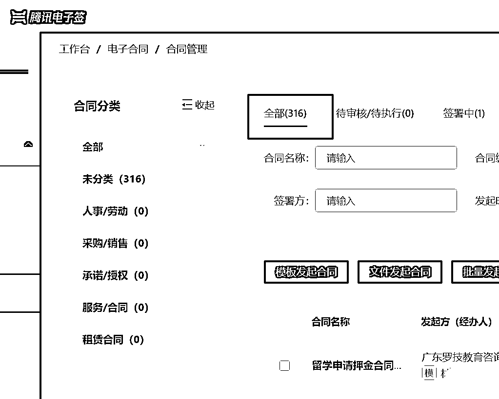

先说一个很关键的选择：他为什么加入闪亮猫？

他有个朴素的判断——想成事，就去贴近那些已经拿到结果的人。当时他看到“无敌姐”在📕卖家具变现上千万的分享，主动链接后，发现对方真诚、利他，于是果断加入，成为闪亮猫的第一代“喵呜”。很多人不理解：堂堂大学生，去做客服？但他说，这个位置能直接触达每一个客户，看到用户真实需求；后来还参与了几期打卡营的从0到1冷启动，📕运营的能力，也正是在这个阶段一点点攒下来的。

这给我们的第一个启发是：想学真本事，比起去大厂做一颗螺丝钉，不如加入一个创业型团队，深度参与全过程，哪怕岗位不起眼。

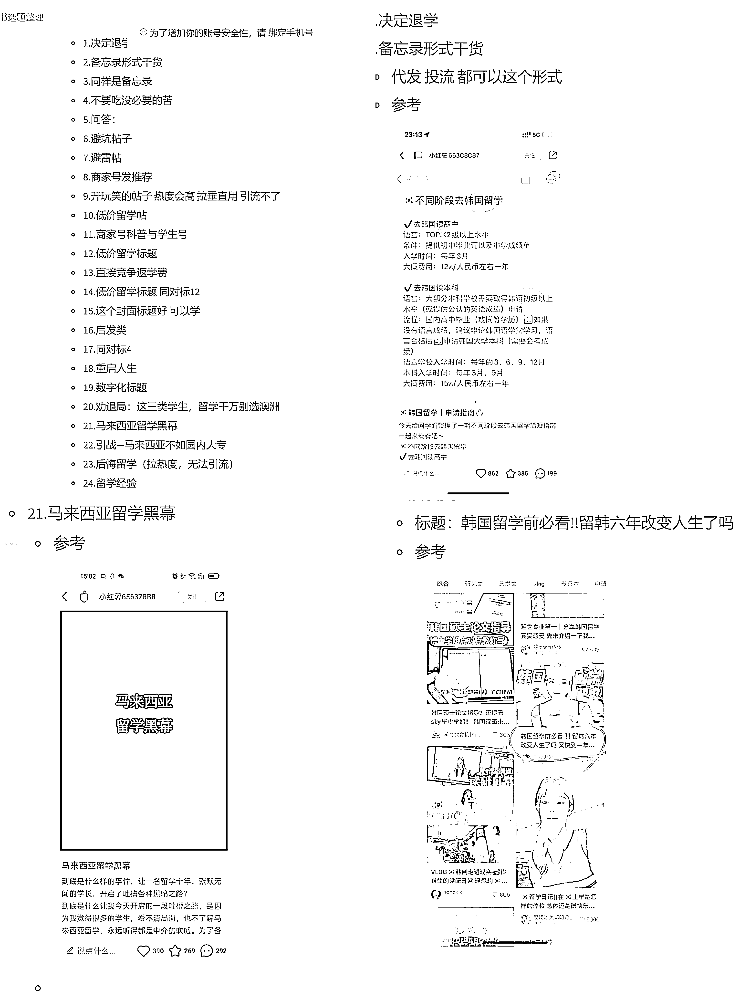

再说如何从0到1跑通闭环。他把项目拆成前后端：前端负责获取流量，后端负责沉淀转化。

前端的核心动作就一个字：细。不要做泛泛的留学账号，而是把切入点收到极致——精细到某所学校的某个专业。这样做的好处是避开和大型留学机构的正面竞争，走的是“蓝海战略”。他给了一个具体的证据：他们专攻澳洲莫纳什大学，单这一个学校，一年就能招到60多个学生。

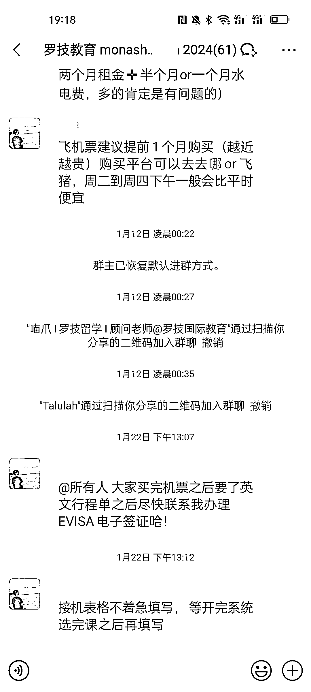

除了精细切入，他们还会主动“蹭”爆款选题。每月搜集同行的高赞案例，只要选题给力，照着发也大概率能起量。再用一个不起眼的小操作完成信任升级：先用个人号发内容，流量起来后认证成企业号，甚至有些账号直接认证成“某某学校官方账号”的视觉形象——当然，这背后需要学校的授权。另外，也有一些机构会用“学生真实申请感受”来引流，有的甚至让用户分享笔记、多账号分发，乃至模拟学生人设来钓鱼。虽然他们自己不做这类操作，但理解同行的引流玩法，本身也是一种战术储备。

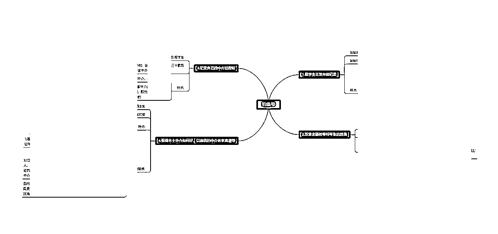

流量进来了，后端才是真正的承重墙。

留学是典型的高客单、长决策类目，所以流量一定要导到私域。刚开始，他们被一个细节卡住了很久：公司注册时间短、名字都没定下来，不少学生临签约突然犹豫。后来他拿到了“罗技”的教育类商标，又通过谈判收购了顾问老师的公司，才算正式把这道信任的坎迈过去。

后端角色的分工也值得细看。

首先是客服：这个岗位不需要强专业知识，核心职责是迅速回复、过滤非精准客户。很多大一、大二甚至五年级的学生也会来咨询留学，客服要做的，是用一套打磨好的话术，把大四、高三这类真正有刚需的人筛出来，再单独拉进顾问群，把顾问的精力集中在高意向客户身上。有意思的是，他目前的顾问全都是客服出身——从旁听谈单到整理文档，慢慢搭出自己的知识体系，这条路完全是可复制的。

然后是顾问：这是后端最重要的一环。因为顾问直接决定择校定位，而择校定位又直接影响学生能否被录取、机构会不会被挂到📕上“避雷”。不同学生预算、移民意愿、学历诉求都不一样，顾问要做的就是根据每个人的绩点和需求匹配院校。

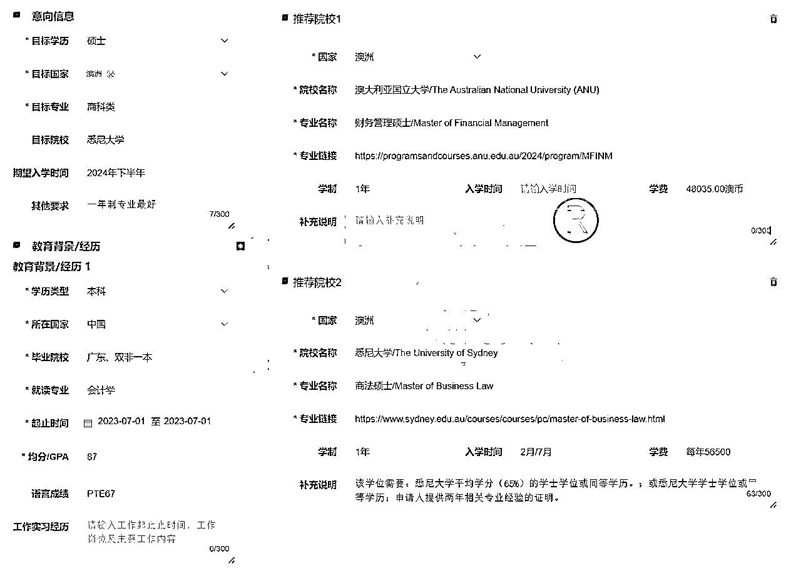

再说申请环节。这是最琐碎最容易出错的，一旦失误可能耽误学生前程，所以如果自己没能力做，就找靠谱的合作方，比如新东方这类ToB公司，或者直接对接校代拿返佣。他强调：早期用word收集学生资料，改来改去很痛苦；后来换成飞书，再后来直接上管理系统，既能同步进度，也能避免递交失误。以他的一个学生为例，10月签约，次年1月拿到录取通知书和COE，2月下签——整个服务周期非常漫长，一点容错率都不能有。

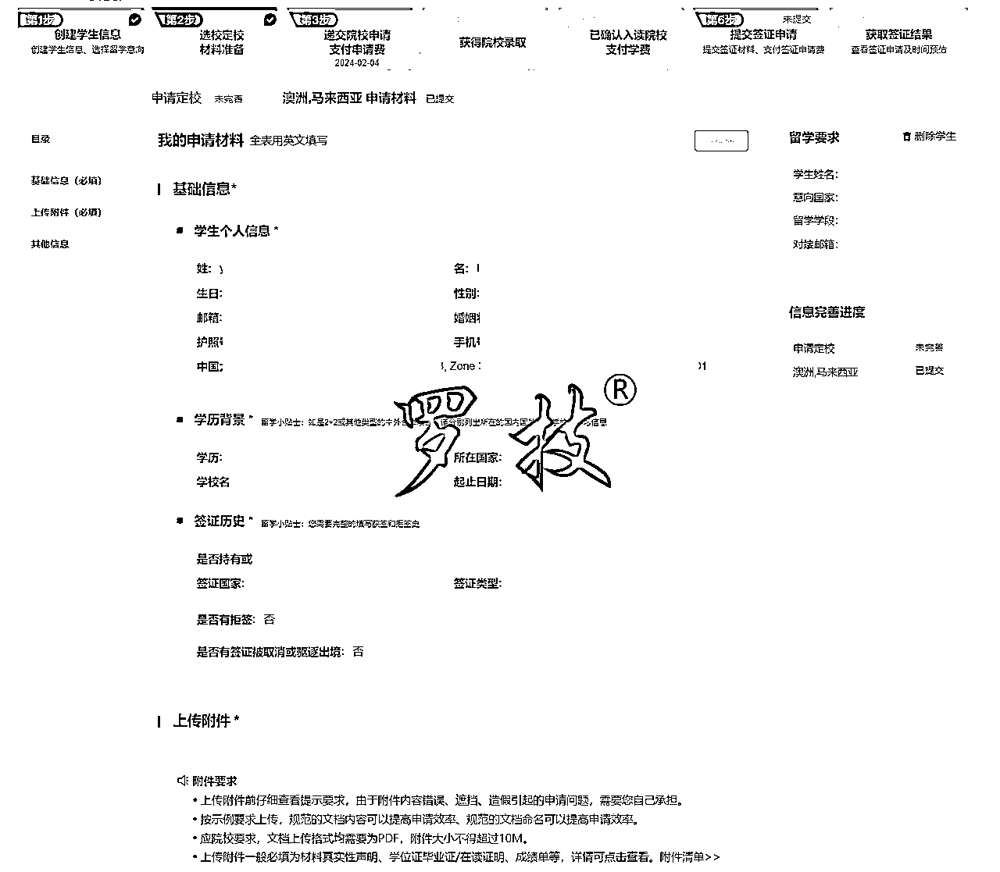

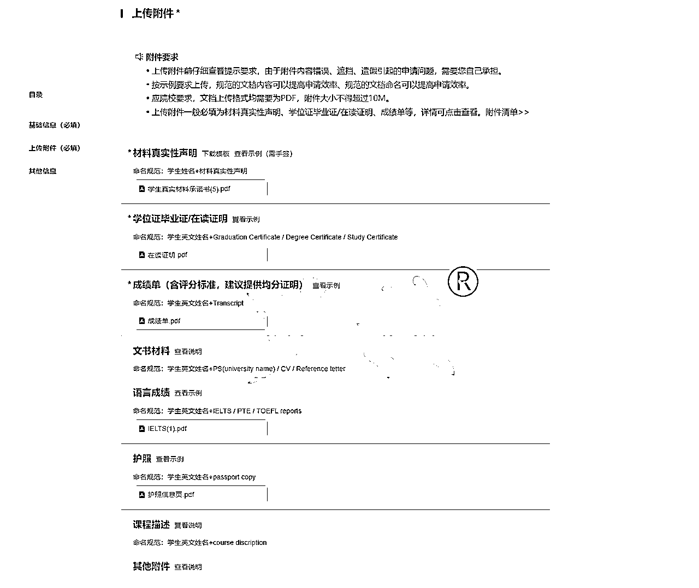

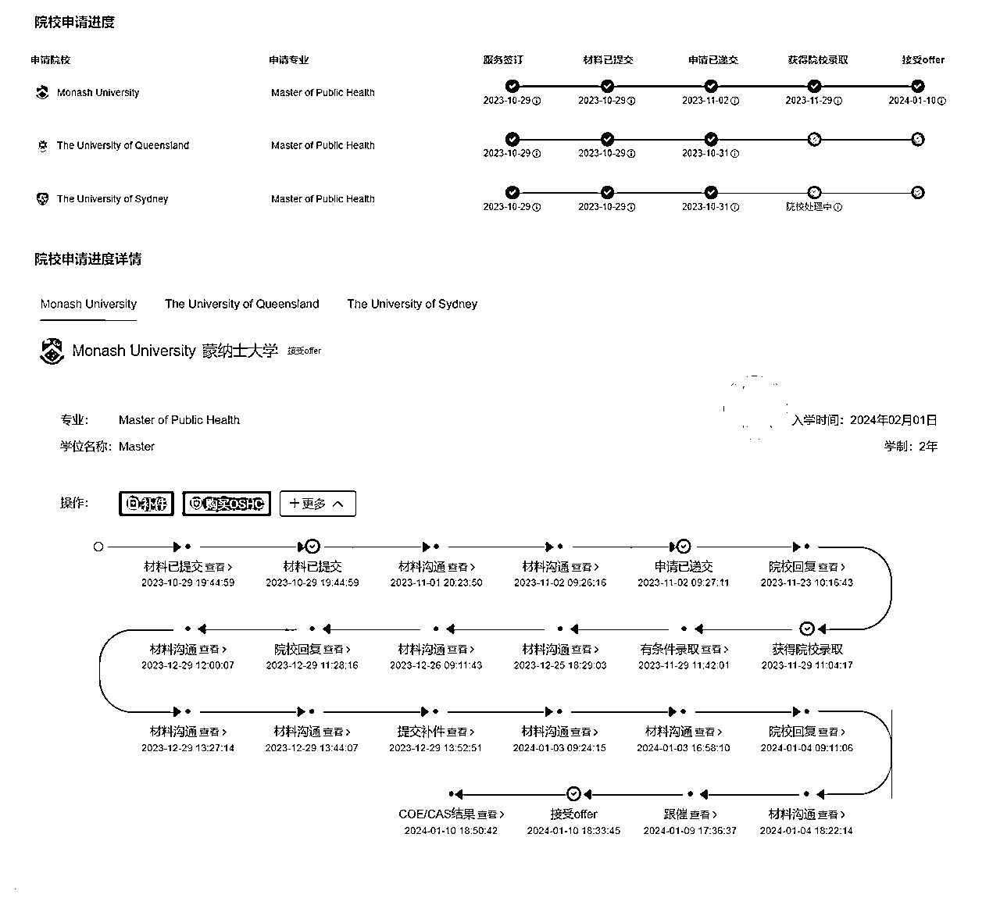

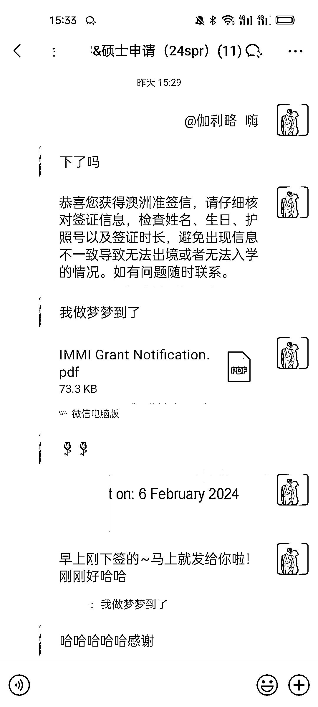

从1到10的阶段，他验证了一件事：单兵作战可以起步，但规模化必须靠团队分工。

他的前端全部用兼职，最开始招的就是同校的师弟师妹，在学校墙发一则招新帖，再让他们朋友圈裂变，人很快就齐了。后端留全职，因为签约后的学生必须保证回复率。目前的状态是纯兼职发个朋友圈就能招到人，完全不缺。因为人在澳洲，团队统一按北京时间工作，有会就开腾讯会议，效率很高。

账号管理上，他们用一份飞书文档落实每个人的职责：谁负责哪个账号的文案、图片、视频，一一对应，一目了然。前期也试过一个人管一个账号，但账号突破30个之后，还是拆成文案、图片、视频、发布的流水线协作更顺畅。

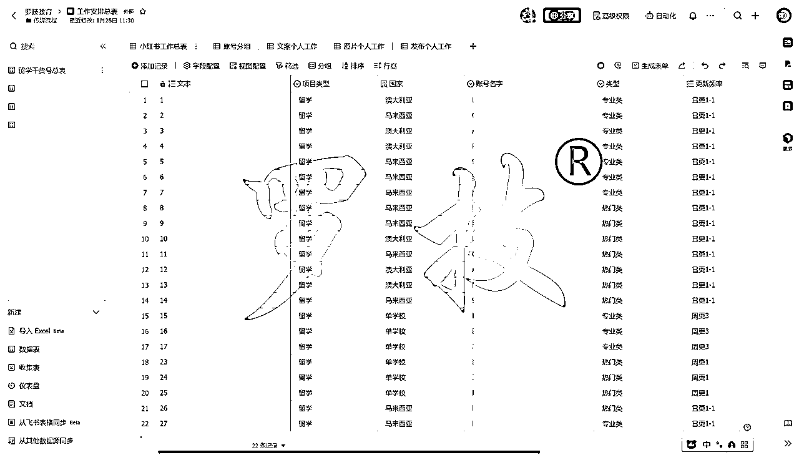

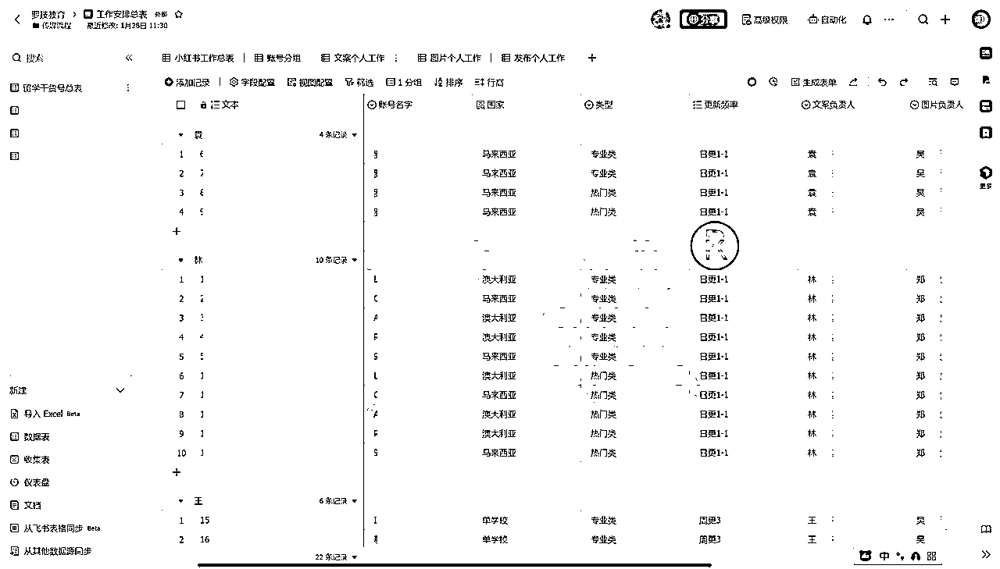

工具方面，他一度推荐简道云，因为它能自动统计日报、私信数量、业绩排名；但运营了几个月后又迁回飞书，理由也很直接：飞书界面更友好，配置更省心。

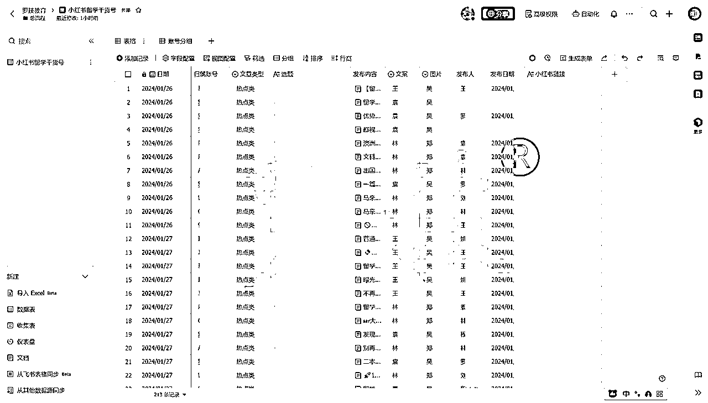

学生管理则全部放在自建网站上，每个学生的申请进度、资料准备、对应的客服顾问申请老师都看得一清二楚，连谁推荐的、佣金怎么算都有记录。

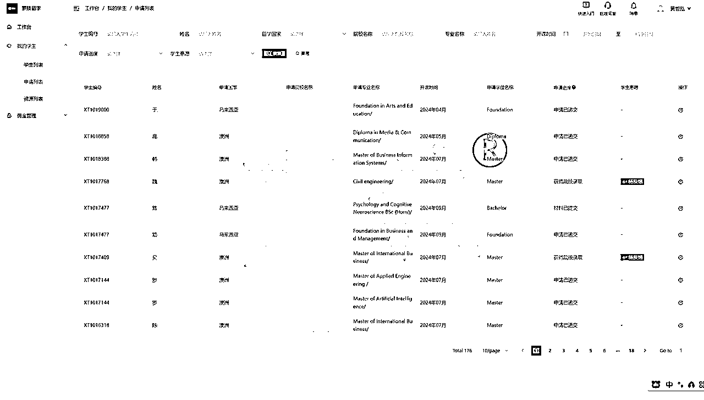

团队架构上，前端的兼职负责做图文引流，学生加了🛰️之后先被客服接住，然后按国家分配顾问——比如英国和澳洲人群重叠，可以共用一个顾问。申请端相对简单，澳洲有校代渠道直接对接，拿佣金即可；马来西亚单量繁琐、利润不高，但好处是现金流稳。所以他们定了一个巧妙的组合拳：用马来西亚的项目稳住现金流，再用聚光投放获取澳洲的高价值客源。

最后，他给了四条掏心窝的建议。

第一，做高客单产品。有人发表情包账号能加很多人，但变不了现。做账号必须倒推变现闭环，再反推人设和文案。在📕上，一天加几个精准粉、成交几单，比涨粉一万更有意义。

第二，选好赛道。一个项目能不能成，赛道本身占七八成。没人做过的赛道别碰；已经被验证的赛道哪怕再卷，也有机会——因为有人已经替你证明了蛋糕存在，你只要内容做得更好，就能分走流量。

第三，沉淀SOP。文案有拆解过的对标结构，注册养号有流程，后端加人怎么聊、发什么资料，全部沉淀成文档。但有了SOP不代表当甩手掌柜，账号多了，必须有组长来做监督。

第四，跟优秀的人学习。他自己报过市面上几乎所有知名的社群和课程，也承认如果没有闪亮猫，他可能至今不懂📕。再往后做，团队管理遇到瓶颈，又去学宁培的企业管理课，一张表格就算清了利润，还拿到了扩张团队的落地步骤。他算过一笔账：几千块的学费，只要多签一个客户就回本，多签两个就开始赚。能花钱解决的问题，都不是大问题。

看完这个案例，我最深的一点感触是：这个00后能跑出来，靠的不是什么惊天秘诀，而是一套被反复验证过的“笨方法”——跟对人、选对赛道、把细节打穿、把流程固化。留学赛道很卷，但他用一个学校、一个专业这样的小切口，活生生撕开了一道年入200万的口子。如果你也想入局留学，或者正在做留学机构，这份拆解值得收藏。

