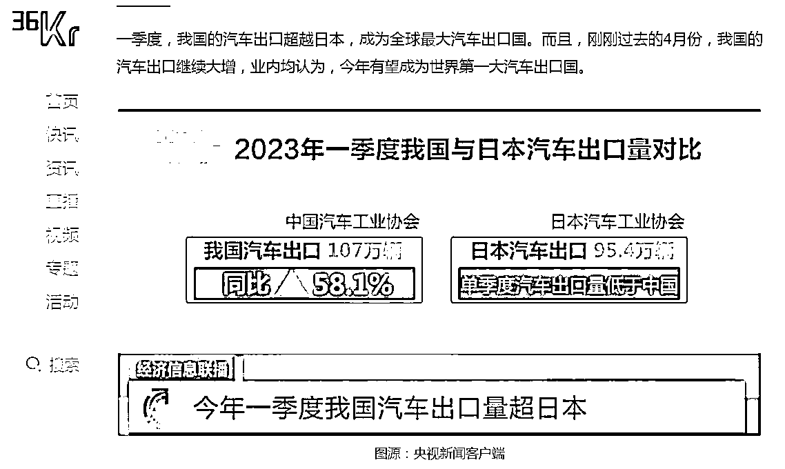

# 2023年上半年到下半年，八个月车贸出海实录：从0到1踩坑笔记
作者：龙哥

## 2023年那段八个月的车贸出海经历，避坑心得汇总

作者：汽车外销-俊哥 Jer*

日期：2024-02-08

各位朋友，我是 龙哥.俊 | 桃李出海，

1）2023年度前后共计八个月，我全程主导了新能源车平行贸易的0-1搭建，并亲自跑到海外做落地验证，拿到最直观的第一方复盘。

2）2023年的车外销赛道，表面上像一场全行业齐跳的摸象派对。媒体放出的漂亮增长曲线之下，整个链条相当粗糙粗暴，入局者几乎都在反复试错。

车外销，这场集体狂欢的摸象游戏

相信不少人已经刷到官方公布的惊人增幅，也在 36kr、腾讯汽车、一点车家等平台看到过相关报道，甚至有月入千万的造富传说流传。

不过可以肯定的是，下面这篇回忆会更贴近现场的体感与细节。我们的起步节点，大致在2023年4月底...

为保证阅读流畅度，完整版已搬到飞书文档：

* * *

留言区：

希声 : 看完收获很大。👍

帅仔 : 来得刚刚好，一文就把出海脉络理清了

zambidis : 太精彩了！一直想入局。右舵市场该怎么攻？

温暖的冰块 : 感谢分享，星球里很少见到传统外贸方向的干货。我自己做进口外贸服务六年了，团队是做进出口代理的，主要为B端客户提供医疗器械、机床设备的进出口代理。想请教下车贸这块，资金方利息费率一般是如何计价的？

* * *