# app 出海风向标 小工具投放 tiktok 广告月盈利 40w 美金
作者：龙哥

最近刷到一款照片清理小工具，它在TikTok上的投放力度大得惊人。第一反应是：这不就是当年国内玩剩下的吗？结果深挖之后发现，人家硬是靠交互设计和营销脑洞，在工具类赛道杀出了一条血路。

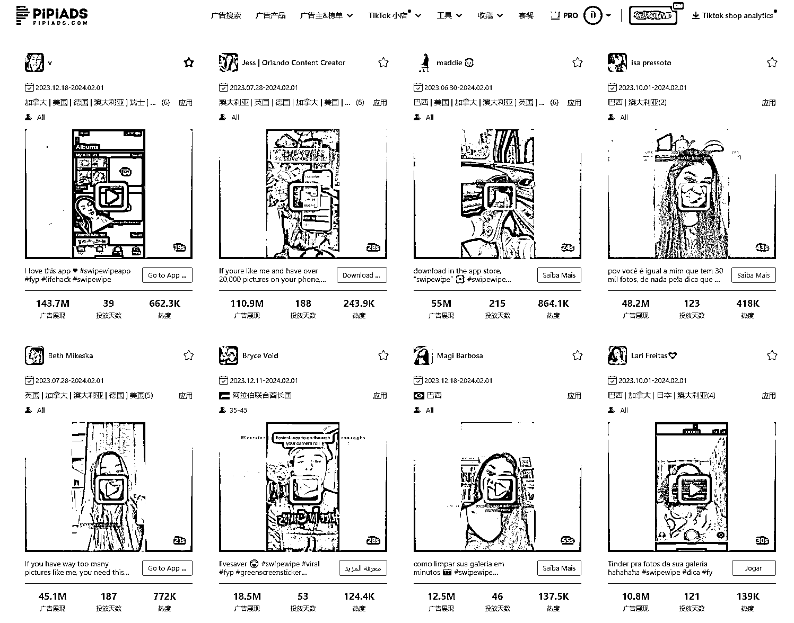

这款产品叫SwipeWipe，来自法国老牌App工厂Music World Media。上个月下载量70万，营收约40万美元，在美国实用工具榜直接冲到第26名。

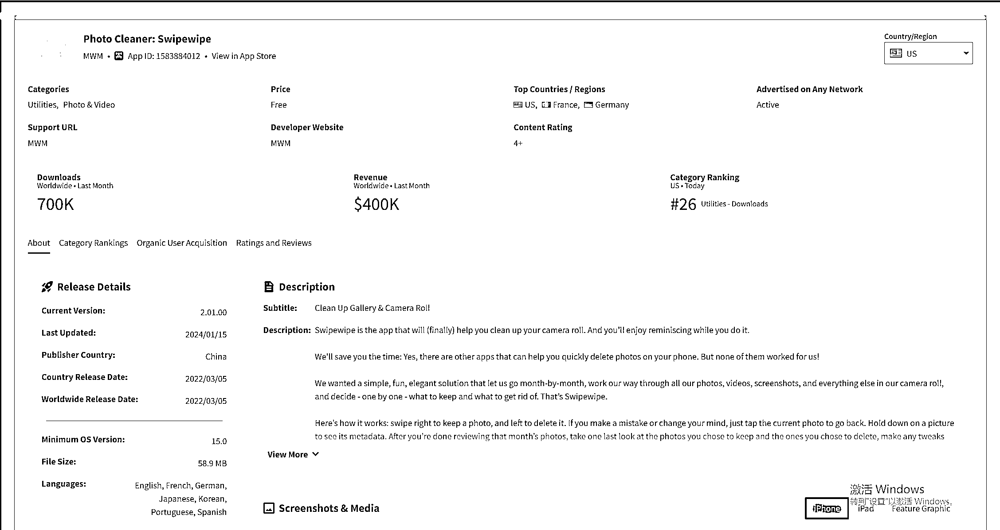

先说说它怎么玩。SwipeWipe把删照片做成了约会软件那种左右滑动——右滑留下，左滑删掉。功能本身很朴素，就是清理存储，但它的色彩搭配和界面质感很有设计感，天生适合在社交平台传播。

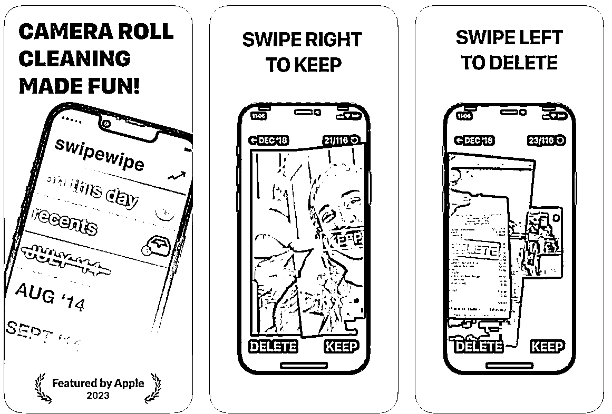（App Store下载页面）

进应用后，会引导你授权相册权限，整个流程做得细腻又舒服。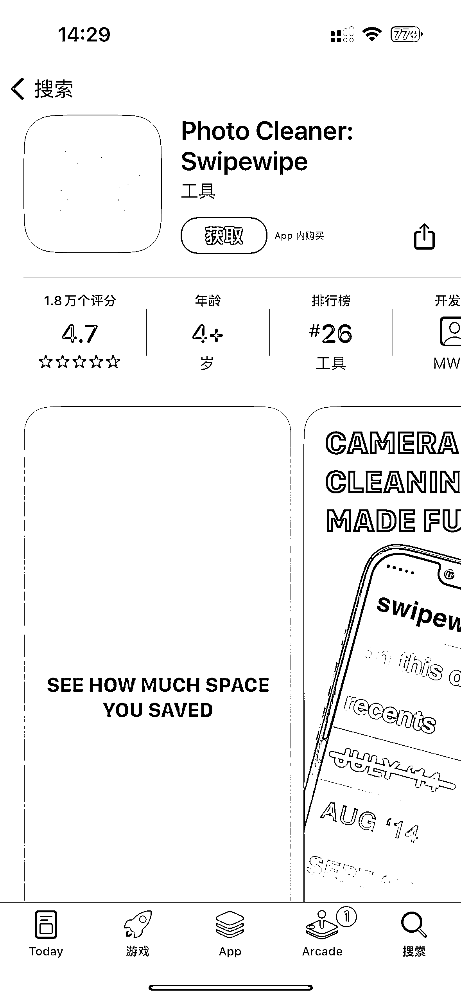 接着是开启通知的引导。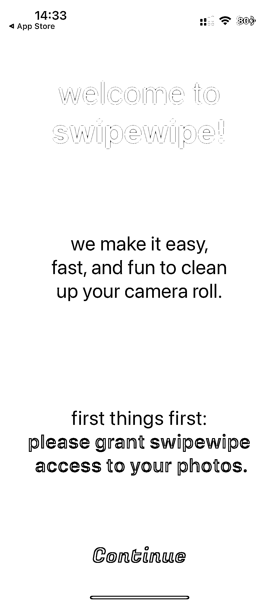 然后就是订阅付费环节：每周4.99美元，或者一年79.99美元，解锁无限滑动和去广告。

我亲自下载录了段演示视频。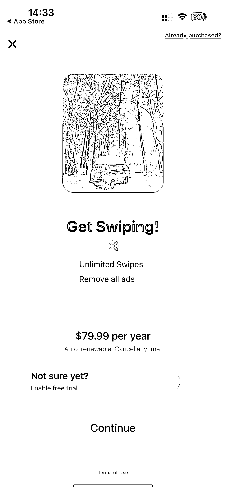

它的核心亮点有这些：
- 滑动管理，灵感来自约会App，快速决定照片去留；
- 按月份分类，照片不再是杂乱一坨，能分月回顾；
- 方便回忆，有节奏地翻看过去，体验很加分；
- 注重用户感受，启动画面好看，版本更新也勤快；
- 隐私方面处理得很克制，让人放心。

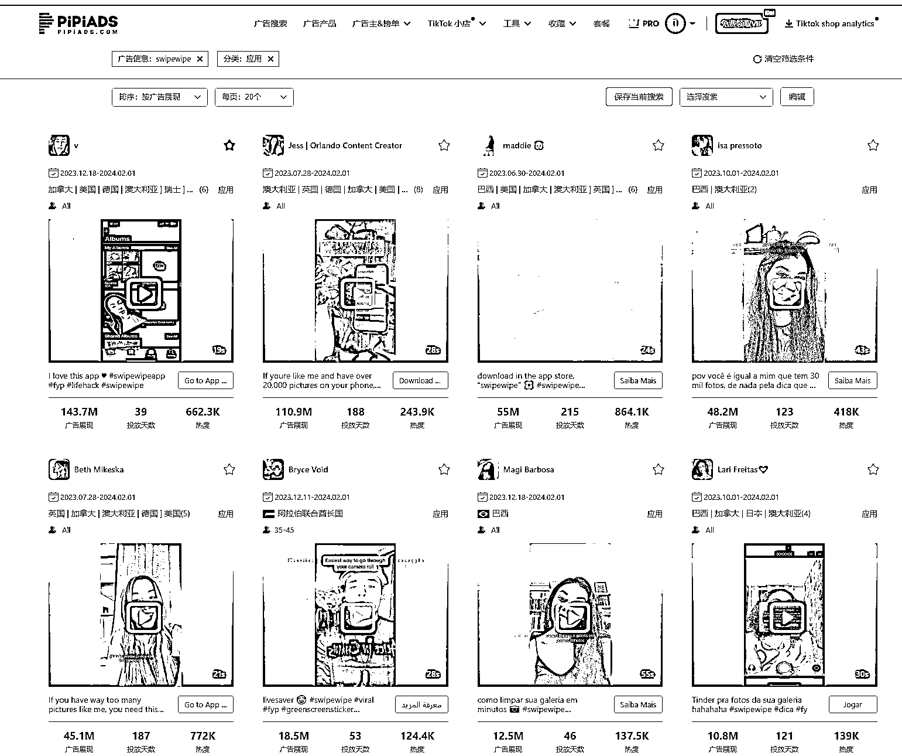

增长策略同样清晰：广告创意拉满+红人种草，素材都能在pipiads上查到。

说实话，每周4.99美元对一个小工具来说不算便宜，但它靠TikTok广告精准打中需求，硬是把用户量和收入都做上来了。

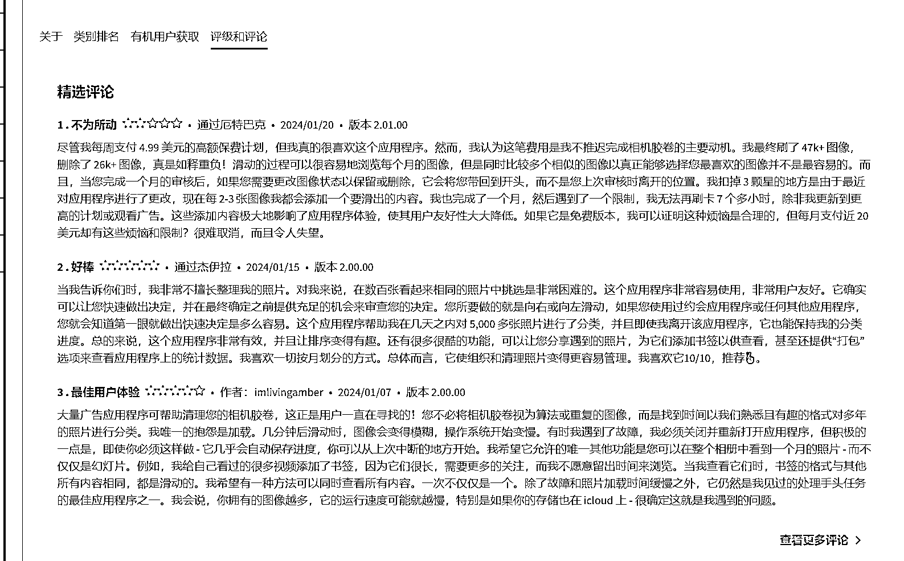

pipiads的数据显示，过去半年SwipeWipe在TikTok上的广告播放量超过数十亿次。素材形式主要是真人出镜+操作演示。诡异的是，它根本没堆量——广告总数不到100条，却有多条播放量破百万。其中最猛的两条红人素材，三个月各自拉到上亿播放，堪称美国区顶级广告素材。

官方账户累计展现1870万，总共只投放了44条广告。

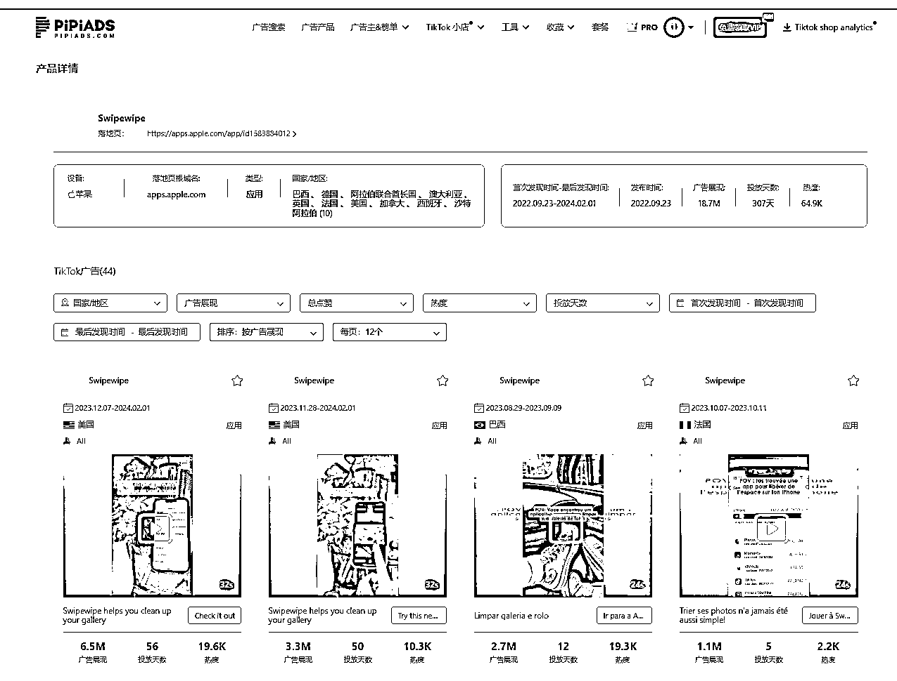

两条爆款红人素材的具体成绩：
素材一：1.43亿播放。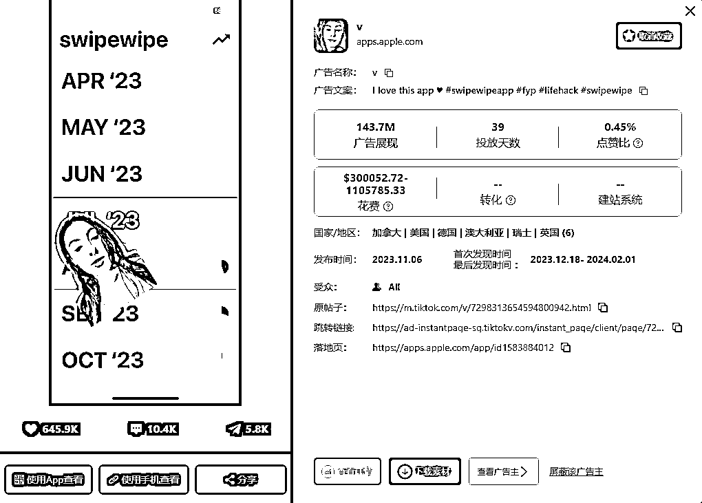（详情链接：https://www.pipiads.com/zh/ad-search/5585cc7d83c5d4419f5f/）
素材二：1.1亿播放。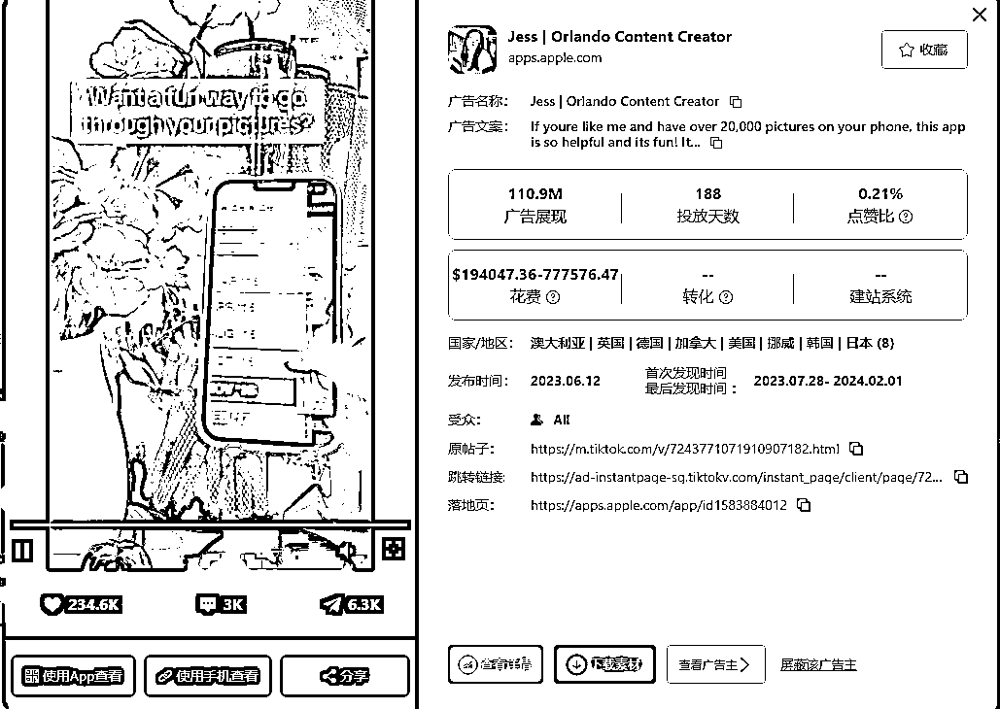（详情链接：https://www.pipiads.com/ad-search/5a9a90c7872bf433757c/）

复盘它的成功，不外乎三点：一是滑动交互确实解决了痛点；二是KOC投放策略省钱又高效，参与度和曝光一起拉满；三是没有盲目蹭AI风口，坚持产品和营销双创新，最终做到月40万美元的营收，超过不少热门App。

这个案例说明，技术创新+聪明营销，完全能在拥挤的应用市场里打开局面，对开发者来说是个极佳的参考。

另外，目前TikTok流量的投向中，游戏和应用的投放量已经超过电商。很多实用小工具，只要对应上真实需求，就是爆发力极强的生意。接下来，肯定会有更多开发团队借TikTok迅速验证产品、抢占市场。

评论区里有人提醒：40万营收和40万盈利完全是两码事。没错，这里说的只是营收，不是净利润。

