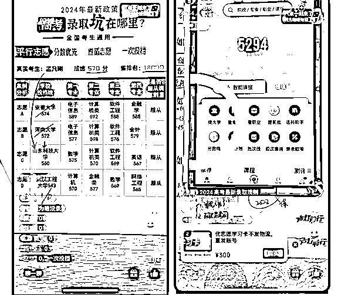
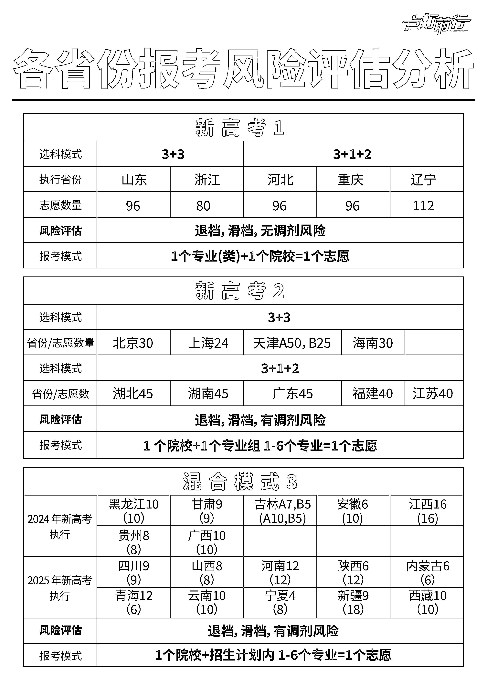
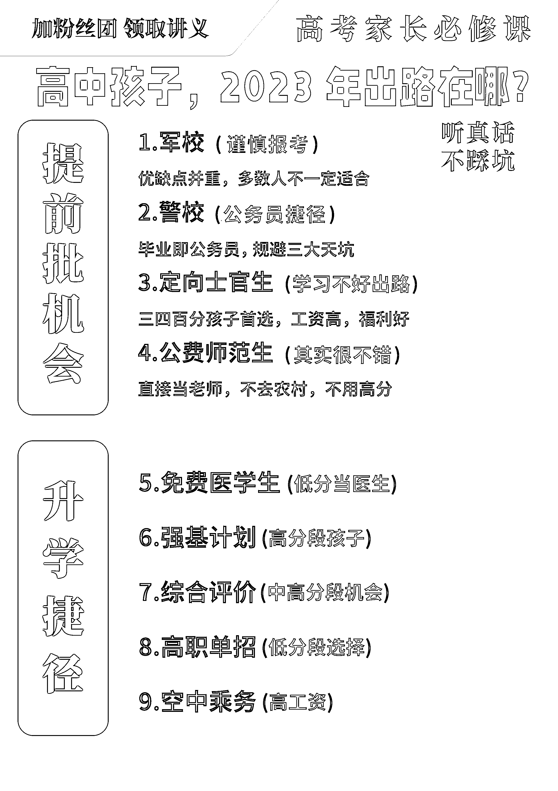
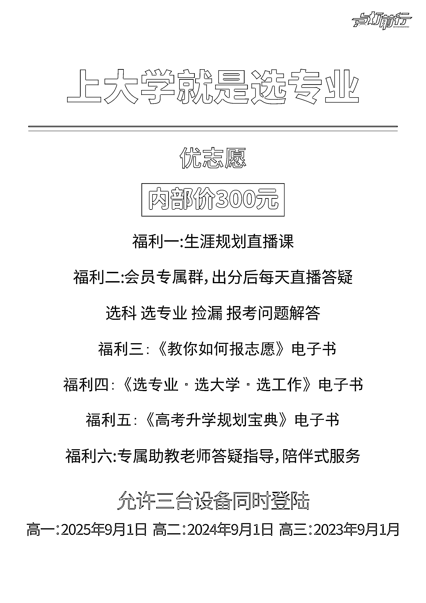
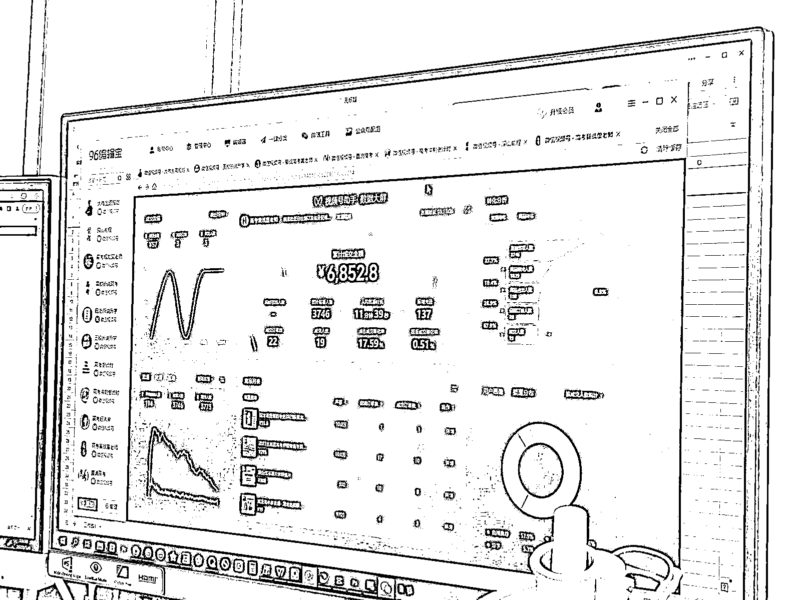
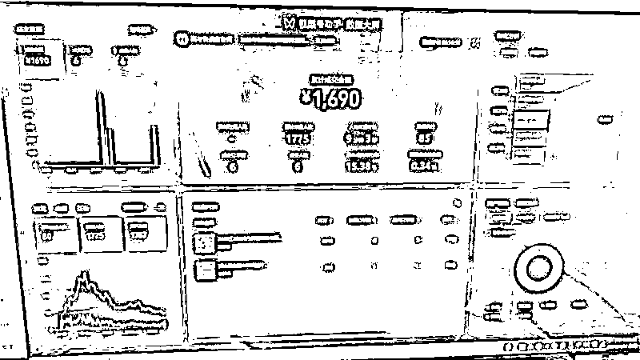
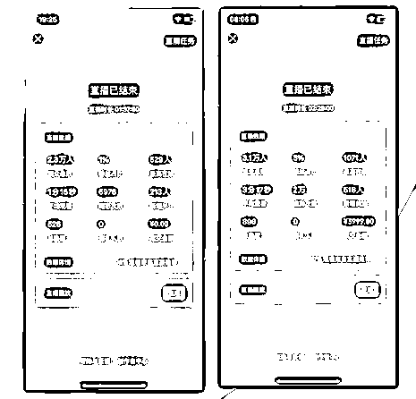
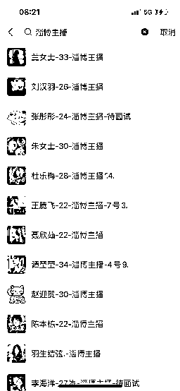

# 三月不容忽视的小众赛道：替考生家庭做升学谋划，能不能赚钱？

> 原文：[`www.yuque.com/for_lazy/thfiu8/antzgzimgg2rcot7`](https://www.yuque.com/for_lazy/thfiu8/antzgzimgg2rcot7)

## 42赞 3月份可以做的热门生意：成为高考规划师，为高考志愿填报

作者： 艾乐

日期：2024-02-06

今天聊的这门生意，是团队从去年春天跑起来的，对象锁定在考生家长身上。考试之前帮孩子使劲提分，出分之后帮家里琢磨怎么报学校，需求一点也不含糊。

家长在考前最揪心的就是孩子分数能不能再往上走走，哪怕一分两分也值得争；分数下来以后，又对着志愿表发愁，完全不知道从哪儿下手。这种焦虑几乎是普遍的，而恰好就是这门生意的生存土壤。

先谈收入。旺季几个月跑顺了，账面上净赚五十来万不算稀奇，再往上走的团队，月入几百上千万也并非罕见。

至于为什么会蹚进这条赛道，原因倒简单——恰好有位朋友的老牌公司专做这个业务，年利润轻松过千万，主播梯队成熟，供应链也稳。我们说白了就是照着人家的路子走，偶尔还能借地利去公司里取取经，所以前期少绕了不少弯，起盘也算快。

下面分几个环节，拆一拆我们怎么"抄作业"，以及几个真正起决定作用的细节。

先放一段碎碎念，可以略过：

市面上的项目看多了，常常觉得逻辑都懂，真下场才发现，执行路上的细节和卡点能把人磨到自我怀疑。这次不同，因为我们有看得见摸得着的对标样本——连对方主播每天怎么干活、能挣多少，都摆在明面上。

开干之前，我特意带着团队去朋友公司待了一整个星期。重点不在学培训流程，而是让所有人都亲眼看明白：一个正常运转的直播间里，主播的真实状态是啥样，月度收入能到啥数。这家公司主播薪酬直接跟销售额挂钩，数据内部透明，谁赚了多少，一眼见底。

待过这么一遭，团队心里那点疑虑基本消了。只要肯踏踏实实地照做，结果几乎可以预期。我一直觉得，团队对目标的信任感比什么都金贵——打心底认定能成，事儿才有成的可能。

## 一、平台策略：避开红海，押注视频号

这个赛道早先几乎被抖音垄断。等我们决定入场时，抖音同类直播间已经扎堆，个人和机构都在抢，脚本也互相抄得快，今天冒出来的新话术，明天就遍地都是。

我本人从视频号上线就开始折腾这平台，还担任过微信视频号创造营的讲师，对这里的规矩和玩法门清。所以策略一开始就很明确：主战场放在视频号。

抖音太卷，视频号还有空档。更重要的是，视频号用户画像偏成熟，和考生家长的匹配度相当高。

不过，视频号开播头半个月没起色时，心里免不了打鼓。于是分了两组并行测试，一个组留视频号，另一个组去抖音。结果抖音那边在线人数能稳在百人上下，可成交量难看，点进来的用户太多已经听过别家讲解，我们的内容又基本不变，人家等于来复习的，没被别处转化的人，到了我们这儿也难有下文。

兜了一圈，索性砍掉抖音，集中火力做视频号。如今视频号里做这行的公司也多起来了，但我仍然觉得空间远没填满。

这赛道的天然好处在于：考生家长每年自动替换一轮，需求永远新鲜。2023年全国高考生逼近1300万，盘子够大。哪怕出生率在往下走，未来几年存量需求依然强劲。

## 二、卖什么？三条选品铁律

起步选品时，我们给自己定了几条硬杠杠：

**1. 产品过硬，是人命关天的大事。**
这是绝对底线。面对的用户是考生家庭，东西最终吃进孩子嘴里、落实在志愿表上，必须负责。我们不做研发、只做渠道，但合作产品如果不可靠，就是砸自己招牌。队伍一大，各种高佣金带货邀请自然会来，只看返点就上，那是对这群家长不地道，甚至可能误人前程。

**2. 只碰被市场验证过的爆品。**
动手前翻遍了同类账号，每个节点都有卖得特别稳的东西，比如高考季的志愿填报卡，大量直播间都拿数据替它背书。市面上同类卡很多，怎么挑？除了参考朋友的处理方式，我们还亲自跑了趟厂家做尽调，最后才定了优志愿这种头部产品。

**3. 利润空间不能薄。**
出来做活儿总得挣钱，毛利是关键指标。像志愿卡这类产品，零售价约三百块，体量上来后单张利润能有两百上下。

最终我们把重心放在两件核心商品上：押题卷和志愿卡，这两样在旺季能扛起九成销售额。

押题卷啃的是提分焦虑，用的是王后雄历年命中率有口碑的版本，定价899和399两档，主走后者。志愿卡解决分数出来后往哪儿报的问题，输出对应的参考方案，让家长能给孩子快速做决定。

高客单方向还有一对一志愿规划服务，从沟通到定稿通常要来回好几轮，结合成绩、兴趣和意向出定制方案，单子卖到4999元，合作方是专业规划机构。这种定制单集中在3到8月的高报季，其余时间主播就转卖合作课程，比如有道、高途的前端引流课，卖一单19.9元，后续按转化跟机构分成。

## 三、直播间怎么打？

**1. 找对标的门道**

刚开始对标的大多是朋友公司的账号，挑气质合适的主播当示范。除了准时蹲直播，还要拆解他们的表达方式、节奏把控、情绪传递。起初我把那些标杆主播每天的档期都摸了个透。

要找参考账号并不难，搜升学、高考这类词，再靠抖音推荐机制刷几天，同类直播间就主动涌过来了。我专挑在线人数几百人的场次作为研习对象，这类体量是我们短期内够得着的，可比性最强。其中转化突出的场次，我会倒回去逐帧研究，再把心得喂给团队成员。

**2. 内容怎么设计**

稿子基本是统一模板，主播的任务就是把内容吃透再情绪饱满地讲出去。这类直播间不必真人露脸，对着稿子念也成立，熟练后自然能脱稿。

稿子原则上不动，除非下发新版。迭代通常也只是一句话两三处的小改。原因在于视频号和抖音的受众口味不同，视频号这边节奏要缓，知识点要掰开揉碎反复讲，直播间里可能没人互动，但订单会悄悄落下来。

前期我们边播边调。干货占了绝对大头，一场两小时的直播里，差不多一个半钟头都在讲知识点，最后半小时才进入卖货环节。

拆解同行内容时，我的习惯是完整录下整场直播，丢进飞书妙记转成文字稿，再对照视频把亮点扣下来，直接给主播试效果。跑过一段时间后，对家长们的忧虑摸得越来越透，就拉着主播开小会，大家共同琢磨还能加哪些内容，聊出来的好点子先小范围测试，数据见效就开始全组共用。

**3. 带货话术怎么磨**

整场直播被切成三段：干货段、互动段、卖货段。前两段在线人数一般比较稳，可一旦切到带货，人哗啦啦就往下掉。

话术打磨主要围绕三个问题：怎么从讲知识的节奏丝滑切进卖货环节；用什么说法能跟家长同频、戳中他们心里的坎；直播间独有的额外好处——只在咱这儿下单才有的赠品或服务。

数据复盘是迭代的依据。对着回放一段段看哪个节点掉人快、当时在讲什么，把问题拆细了挨个修。有的事靠改稿能解决，有的其实是主播本身的差距。同一份稿子，不同人讲出来一个稳一个掉，差别就在讲课风格和情绪张力上。

**4. 前期拉新与后期带货要盯的数据**

这类账号算知识向。一般新号连续三场在线人数稳定在50上下，就可以开始试着挂卖货链接。

起号阶段不碰带货，纯讲干货加上引导关注，让系统看的是用户停留时长和有效观看时长。视频号的推荐机制很吃这套，后续流量给多给少，全看这些底子指标。此外还得留意外层曝光点击率、有效观看占比、秒划走率。

封面设计是起号的重头戏，用户在广场刷到直播时，决定点不点进来的就是这张图。我们反复做了好多版封面做对照测试，高考前主打提分主题，高考后换成志愿填报和段位指导，哪个数据好就给主播换上。

人进来了，留不留得住靠主播的内容功力，情绪和节奏都很关键。还有配套动作是发高考资料包换关注和点赞，再用福袋、互动话术拉时长，起号期人均停留目标定在三分钟左右。

因为用的是纸播形式，展板的内容排版和设计美观度也需要同步升级，这块我们反复调过很多次。

进入卖货阶段，视线转向曝光点击率、下单率、支付转化率这几项硬指标。话术能带动点击，比如讲到产品时引导用户点进详情；真正卡住的是那些下了单没付款的人，差一口气。这种时候上一些限时手段——今天下单额外送一套课程，仅限本场——能肉眼可见地拉高支付率。话术不是一劳永逸，过阵子没效果了，果断换新。

系统要不要放大流量，标准只有一个：给到你的流量你有没有能力接住，这就要靠不断提升点击和支付数据来换推荐额度。

此外，播出时间段也很重要。视频号做流量推荐时看的是同期大盘表现，新手期的小账号直接撞成熟主播的档期基本是送人头。我们试出两个相对友好的时段：凌晨四点以后和深夜十一点以后，避开头部直播间，能蹭到的自然流量会宽裕不少。

**5. 私域，把信任变成订单**

直播间之外，私域成交占了不小比重。很多家长要反复听你讲、确认你不是忽悠，才愿意掏钱。把这些人引到私域，再开专场直播转化，成功率比公域高出一截。

我们运营着家长交流群，平时分享升学相关的知识点，老师隔三差五在群里答疑。引导买过卡的家长进会员专属群，再把专属群里的内容和福利截几个图，对外发到免费群和朋友圈，实现二次裂变。每位主播都配了企业微信，粉丝由主播自己维护，日常发圈和群运营有现成素材，个人也可以加点自己的发挥。

第一年私域经营确实糙了些，精力都押在直播间里了。2024年的规划里，这块会专门补强。

## 四、把直播间复制成一串

这种玩法拼的是账号矩阵，最难的就是跑通第一个模型。起步阶段我们对主播一对一盯，尽量快地把流程验证出来。只要能有一个主播跑出来，整条链路就算通了，后面照方抓药批量复制就行。

标准流程大致这样：

1. 新主播入职当天先把脚本背熟，下班前做内容和知识点的考核
2. 次日继续熟悉稿子，安排内部试播，挨个揪问题
3. 第三天再试播，同时做知识点问答
4. 第四天专门培训视频号的开播技巧和后台使用
5. 5到7天直接上播，用现场表现和后台数据决定留不留
6. 头一个月下播后天天复盘，拆原因找解法

七天试用期内，如果在线人数稳不住50这条线，就算出局；过了线的进入正式考核期，再看一个月内的出单情况。

我们从来不指望捧出大主播，也不投大资源造头部。原因很简单：头部一旦离职，对整体营收是重击。还有个别主播场面看着热闹，实际转化却很穷，后来我们干脆只认转化率。所以，与其费劲造星，不如养一批每场都赚点小钱的腰部主播，靠规模和稳定性取胜。

最头疼的还是招聘环节。前前后后约莫面试了近五百人，最终留到手里的不到三十个，再筛掉销售成绩差的，旺季能稳定扛单的就剩十几人。无底薪、七天考核、凌晨开播、天亮下播——条件摆在那，能扛下来的自然不多。

对于小而稳的玩家来说，这套玩法的核心从不在于做出多大的账号，而在于稳定持续地出结果。

说实话，单看这份要求，十个人里有九个会直接划走。光一个无底薪，就能把绝大多数人挡在门外。现在大家的共识就是无底薪等于公司想白用你，这个雷几乎没人愿意踩。

但换个角度想，愿意接受这种条件的，大概率是对自己有点底气的，能吃苦、能扛住、不会三天两头发牢骚的人。

我之前做过别的项目，招主播时给底薪，人确实好招，尤其是在淄博这种三线城市。可是质量上不去。很多人心里就是反正底薪兜着，播得好是赚，播不好也不亏，播不好了还倒打一耙怪项目。

所以我后来就坚持了一条：不给底薪。

招人渠道也试过不少。BOSS 直聘、小红书、朋友圈、建本地主播群、让老主播推荐…最后发现还是 BOSS 直聘最靠谱，效率也最高。只是刚开始用的时候也摔了不少跤，速度慢得让人想放弃。

起初是把这个事完全丢给人事小姑娘去做。半个月下来，简历寥寥无几，面试几个，留下的更少。明显不对劲。

于是我就自己上手，从 BOSS 上一个招呼打起，把整个链路当成直播 SOP 来打磨：打招呼怎么说、回复后怎么引导加微信、加了微信怎么约线下、线下见面怎么聊，每一步都不断优化。

**把 BOSS 上打招呼的话术优化后，回复率立刻上来了：**

1、只要对方回复了，我都会以“发你看下我们账号”作由头直接拉微信。千万别在 BOSS 上一直抠字眼，人家刷几分钟就走了，等他再想起来可能就是明天了，效率太低。先加微信才是关键。
2、进了微信就先发我们的直播间和数据。看完觉得还行就立刻约线下，文字沟通太费劲。加微信的另一个价值是形成私域，有的候选人现在不来，可能觉得项目还没跑起来，等我们起来后再回头聊，转化率会高很多。甚至现在能力一般的主播，一两年后在别的公司历练好了，再挖回来也行。招聘本身就要有这种长线思维。

线下聊才是真正决定能不能成的一环，能不能让对方对这个岗位产生兴趣，愿不愿意来试。

**关于线下聊的内容，我也是反复迭代出来的。**

1、效率太低，所以一定要尽可能加微信。
2、凡是加了微信的，给看我们的直播账号，觉得没问题的，直接约线下聊，微信文字很难把话说透，沟通成本太高。
3、线下聊是最核心的一步，决定了你能不能让这个主播感兴趣，能让他愿意来尝试。

**关于如何具体跟主播聊，聊的内容，也是做了反复的优化迭代。**

1、简单问问他之前的直播经历，其实不重要。
2、我会先讲清楚这个项目的本质。表面是直播带货，底层是在做教育，是在服务高考群体。是件很有意义的事，能帮到成千上万的家庭，影响一个家的命运。
3、对方多是女生，我会从孩子教育出发去聊。做这个项目能系统学到高考规划的专业知识，以后自己孩子上学就有这方面的认知。后续还可以考高考规划师证，做线下一对一咨询，都是可延续的职业路径。
4、讲事实、看数据、给案例。这是主播最关心的点：我能赚多少钱。当场就把现有主播的场均数据、成交情况拿出来，配上各个产品的提成比例，让他自己算。
再大量举例：一周能赚多少、天花板在哪、一个月一年能到什么水平。刚起步时我们自己主播还没起来，就先借用朋友公司的案例数据，让他们先建立信任。
5、最后是奖励机制来临门一脚。新人单场破万奖励苹果手机、场次王、全勤奖等现金奖励，都会讲清楚，并告诉他现在团队里已经有人拿到了。
6、关于培训。前面也说了，直播经验不是刚需。我们招的大部分零基础主播，最后数据反而更好。有经验的主播反而容易带老毛病，总想套用之前的带货风格。零基础的可塑性更强，系统培训后上手快、信心建立也快。

招聘的本质就是画饼+给路径。画饼谁都会，难的是让别人心甘情愿吃饼，这才是核心。

我自己在 BOSS 上聊了数千人、加了几百个微信、约了线下谈了几十个之后，才摸清主播到底在乎什么、什么话术能打动人。然后把一套话术和流程沉淀下来交给人事去执行，效率才真正起来。我自己有空也会一直在 BOSS 上发邀约，账号不能只用一个，懂的都懂。

很多人会问，按这样筛选，来了是不是就能爆？并不是。

对我们来说时间最值钱。7天试用期过只是代表我们觉得你有做这个项目的潜质，最终能不能卖出货，关键还是在人身上。有些主播看着挺合适，脚本也一样，就是卖不动。排除外部因素，只能是人不行。这种我们也不纠结，直接一个月没出效果就走人，继续下一批。

这个项目本质就是吃人、跑概率。我们能做的就是批量筛选、快速淘汰、优化运营，把成功率做高，留下能出成绩的人就行。

过完春节，高报方向就要进入备战期了。有兴趣的可以提前熟悉了。

如果是个人单干，建议先蹲一蹲优秀的对标直播间，尽快做出第一版直播脚本。内容框架可以照搬，表达节奏、情绪、说话习惯要按自己的调性改。自己测试一周左右，如果流量一直起不来，大概率有两种情况：

第一种，账号问题。这种情况直接换号跑，别浪费时间找原因，号不行就换。
第二种，人本身问题。单干换不了主播，那就只能模仿。反复听优秀主播的直播，模仿他们的情绪、节奏和表达方式。脚本都差不多，差异就在讲法上。

如果是团队来做，最关键的是先做出一个能赚钱的主播作为样板案例。之后就大规模招人，账号多、能实名的人多，产品提前上架到小商店，满足优先联盟条件后再让新主播分销带货就行。不然每个号都要单独上架、交押金，既烧钱又费事。分成和奖励机制设计好，主播的积极性自然就起来了。

以上是我在这条赛道摸出来的一些实操经验，希望对正在观望的你有点用。

* * *

评论区：

书豪 : 很棒

冰雨幻天 : 你好，可以加您个微信吗？

* * *