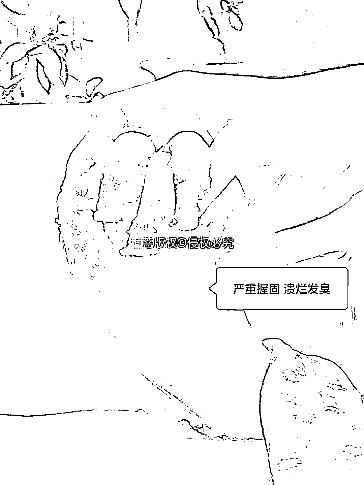
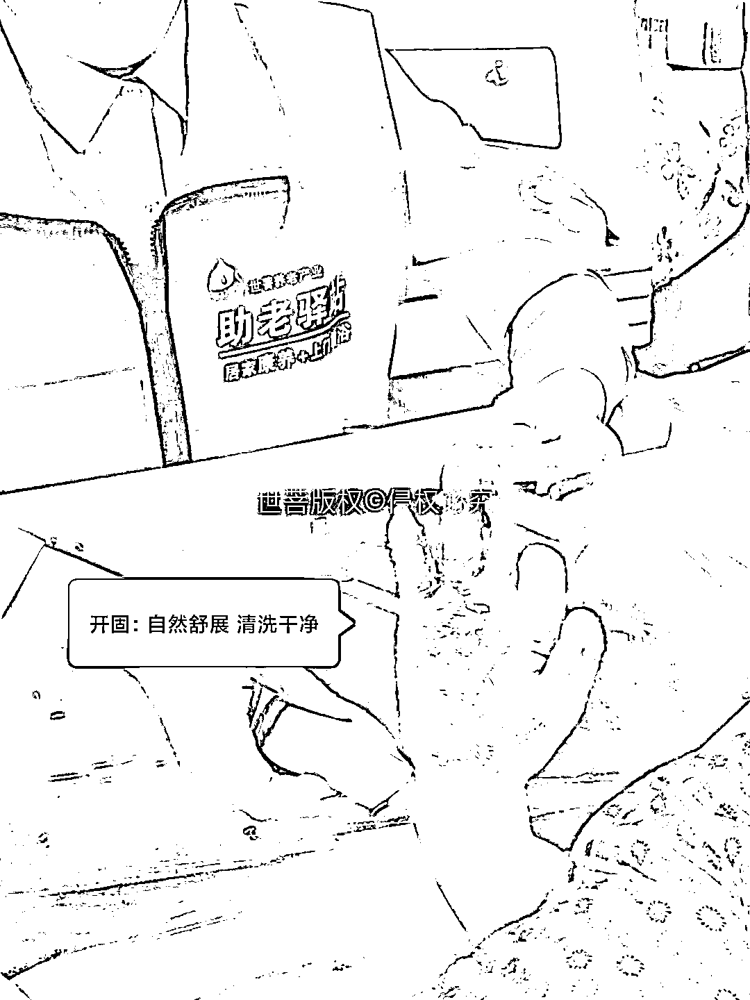
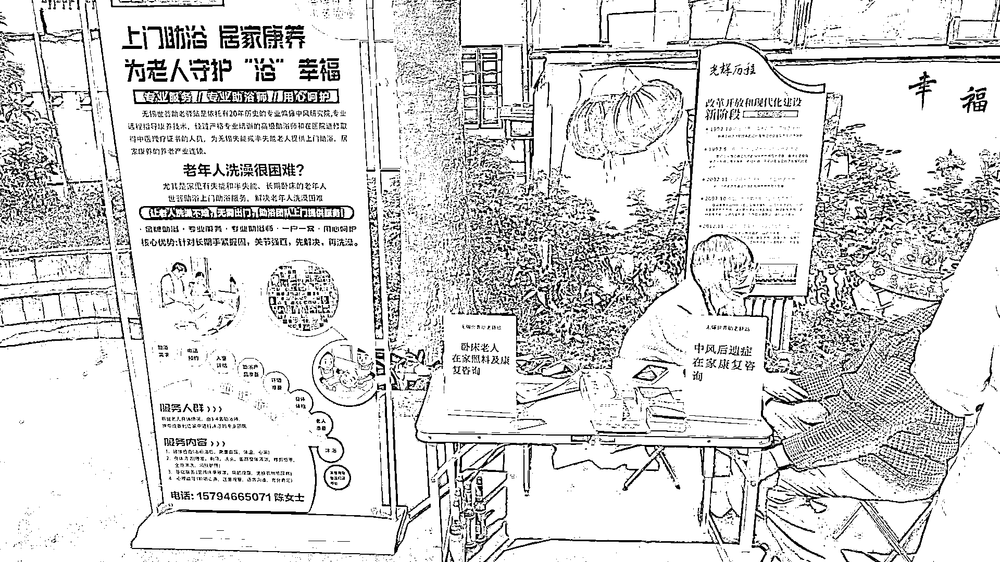

# 上门给失能老人洗澡，居然也能月入过万？

都说银发经济是蓝海，可真愿意弯下腰干脏活的人不多。有位在医养集团任职的临床医生，一边上班一边远程指导，硬是把“上门助浴”这个小众项目跑通了。她最近分享了自己的完整经验，很实在，也有不少可复制的地方。

## 一、这门生意到底赚多少？

她给出的数字很直接：单次助浴收费400元左右，包月6000元，团队3个人。扣除人工成本和其他开销，她自己每月能剩约1万元。更关键的是，助浴只是“引流品”，洗完澡建立起信任后，后续的康养、安宁疗护才是真正的利润来源。为了推安宁疗护，她们有个很聪明的话术：遇到90多岁的高龄客户，直接提“安宁疗护”容易让人忌讳，换成“老年芳香疗法”就好接受多了。

为什么市场这么大？因为失能老人越来越多，吃饭穿衣还能勉强应付，洗澡几乎成了家属最崩溃的事。浴室滑倒风险高、浴缸进出困难，很多老人半年都洗不上一个舒服澡。这个痛点足够痛，也足够普遍。

## 二、凭什么比家政做得更好？

市面上不少家政也在做助浴，但大多只敢接状态较好的老人。而这位医生的团队有医护背景，先由医生到场或远程评估，判断老人适不适合洗，再接下别人搞不定的病例。遇到手掌紧紧攥着、关节缩成一团的老人，她们用“开固技术”先让老人放松舒展，再进行清洗。还有依据人体结构和力学设计的专利浴缸，从根源上解决滑倒隐患。有了专业做后盾，收费自然敢定得比家政高，目标客户也锁定在高端家庭。

## 三、客户从哪来？

她们的获客方式相当朴素，最管用的还是社区地推。团队会加入本地社群和社区团购群，先以义工身份在群里分享居家护理知识，尤其讲清洁和洗澡，聊得来的基本都是正在照顾老人的家属。紧接着就是在社区里免费量血压，摆张桌子、放个易拉宝，来咨询的人天然就是精准客户。天气好时，一天能有四五个人咨询，成交两三个，其中四成后续还会买康养或安宁疗护。这种野蛮推广没有技巧，却让她们在一个社区站稳后，就能养活整个团队。

线上渠道也没落下。小红书、抖音、公众号各发一些助浴场景小视频，素材靠搬运混剪，15到30秒就够了。线上咨询量不大，但质量极高，买单率能到50%。她记得第一个线上客户是位95岁住院老人的女儿，对方搜小红书找到她们，团队直接把浴缸搬进病房，让老人好好泡了个澡。至于私域，目前主要以复购为主，为后续延伸服务铺路。

## 四、团队怎么配？

3人小组分工明确：一男两女。男性负责老人隐私部位清洗，同时管设备安装和水温；一位懂专业知识的做开固技术、回答家属健康问题，顺便为康养业务埋单；另一位沟通能力强，全程陪聊，把信任感做扎实。医生不要求每次都到，远程指导就行。

## 五、服务流程和利润细节

每一步都有讲究：先评估，搞清楚老人失能原因、有没有高血压心脏病、皮肤状况、是否插管。碰到严重皮肤病或带着管子的老人，一定先连线医生确认；评估过关后签免责书，这是自我保护的重中之重。预约时要提醒家属备足热水、调好室温，出发前一小时再确认一次。上门后，该开固就先开固，顺带理发、剪指甲，不额外收费。洗澡时水温控制在38℃左右，先泡20到30分钟，再淋浴一遍。操作全程用浴巾给老人遮盖，照顾体面。服务结束后做满意度回访，为复购和后续项目铺垫。

整个过程单次耗时1.5到2小时，一天差不多安排两次助浴加两次康养。成本低得惊人，热水、电、毛巾、沐浴露全是老人家的，几乎没有耗材。收费是398元一次，4楼以上或5公里外再加30元。请的兼职一次拿60元手工费，不参与服务的投资人，剔除手工费、油费和折损后，一次大概能分150元。康养套餐6000元，含15次康养和2次助浴，扣掉成本还能剩4000多。

## 六、想入局？先过这几关

她特别提醒：心理关必须先过，这不是体面活儿，要接受老人身上的异味和卫生死角。资金上，别急着交加盟费，市面上3万到20万的加盟项目坑很多，自己买套充气浴缸或拼接式浴缸，1到2万就够了。人员要培训，老人转运不学是干不了的，开固技术也得专门练。目前助浴师证不是全国统考，也没有强制要求。但安全永远第一，免责书必须签，全程注意保护老人隐私。

洗完澡只是开始，后续跟进才决定利润。做满意度调查，准备典型案例视频，给家属传授翻身叩背等日常护理技巧，这些都是建立信任的好办法。等有信任基础了，再借力专业机构做康养和康复，比自己从零学快得多。助浴师不是医生，跟客户沟通时别夸医疗效果，只说“放松身体、改善循环”就够了。

最后她总结：单纯做助浴，又累赚得又少，一定要想办法在后面叠加高附加值服务。这门生意刚起步，谁先扎进去，谁就有机会把更多居家养老的产业链资源嫁接进来。她自己也已经在规划扩充团队，想多铺几个社区。以上就是她分享的实操干货，觉得有启发的话，欢迎转发给身边想折腾副业的朋友。

