# 从0到1跑赢流量，她用“四重差异化”把复购与转介绍做成增长引擎

> 当同行还在拼命加粉时，她靠300个好友做出了超30%的复购与转介绍，第一年收入追平体制期，第二年起年收入翻倍。她的名字叫雨欣。

她曾是编制内的语文老师，因月光与对财务的焦虑，自学考下FAP家庭资产高级规划师、AFP/CHFP金融理财师、FWP家族财富规划师、RPP注册养老规划师等证书。辞职后进入保险行业，第一年好友不足300人，复购加转介绍累计突破30%，三个月收入就达到从前的水准。

第二年她把基金、股票、可转债、海外配置等纳入自己的陪跑模型，做起了财商陪跑。仅130人的拉新群，成交66人，转化率50.7%。她发现业绩的底层公式是：业绩=流量×转化率×客单价×复购/转介绍。流量转化客单价人人都在讲，复购转介绍的杠杆却常被忽略。她把自己的高复购高转介绍归结为四件事：朋友圈差异化、交流差异化、服务差异化、产品差异化。

### 朋友圈差异化：不卖货，卖自己

她第一年复盘客户画像，发现吸引她的人都有相似气质：爱学习、善钻研、内心温暖、认可知识付费与财务规划。她把朋友圈分成两类内容：个人形象价值观与保险科普。她很清楚，刷屏产品一天几十条，只会被屏蔽。比如她看到有人发泰康养老院好，却因朋友圈无聊直接屏蔽了。

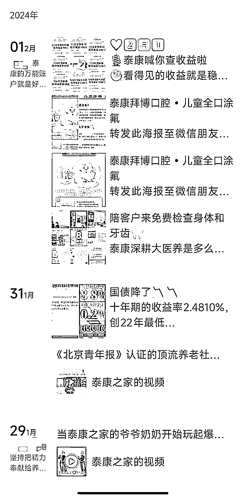

她的发圈遵循四条原则。

**1. 用大白话讲明白**。她擅长比喻。讲重疾险缴费，她用买房类比：有人一次性付清，有人分十年二十年三十年按揭。时间拉长利息越高，总付得多。但首付当天产权就归你，保障终身有效。出险可获6-9倍杠杆赔付；平安到老，退保可全额取回甚至更多。复杂概念被讲通后，有朋友说原来以为是白交的钱，原来是资产。

**2. 发能触动人的内容**。四类素材：客户关心的硬干货如理赔、资产隔离；特定角色的共鸣软话题如老人住院月花上万的感慨、年轻女性丁克规划；自我形象与价值观展示如女性主义、不甘现状；以及日常小确幸。她相信客户买的是认可这个人。刚起步时她发过备考雅思与一季耕耘十分收获的心得，300好友带来50多个赞，一位前同事被打动，后来成交。

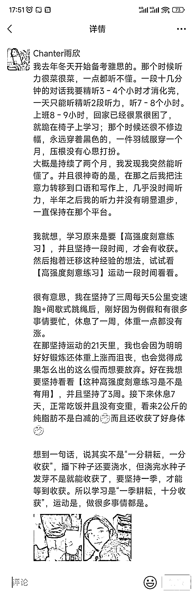

她的第一批客户多是被这个人吸引的。年轻女性会说很佩服她所以支持她；宝妈觉得她真诚；男性客户认为她专业。甚至有实体大佬看了朋友圈直接电话约方案，说不用讲细节，相信你。

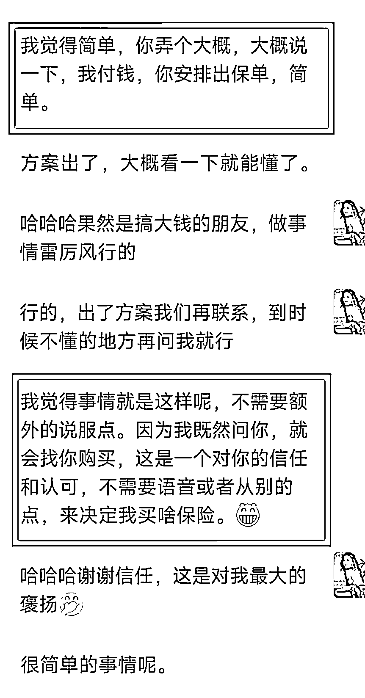

高净值客户也源于此。他们成为高净值前都经历过挣扎，看她的动态像看到年轻的自己，认可的是人而非产品。正是i人特质让她少发保险多发生活与价值观，反而筛选出同频人群。当认可人，复购转介绍就自然发生。

**3. 一条一件事，说透才有力**。她拆条讲储蓄险：现金价值是什么、现金价值高是否一定好、适合人群是谁。精准且透彻，一位想丁克的朋友看完就确认需要储蓄型产品。

**4. 有场景感，拒绝AI话术**。属性+细节+感受是她的公式。她帮朋友卖芒果会写：最近很热想吃凉爽甜食，这个芒果核薄如纸，甜到原味酸奶拌进去都变甜，太满足。同样逻辑用在保险，细节和感受就是爱与责任。她曾帮一位妈妈梳理财务，建议月存短年期，妈妈选5年。她把母爱细节写进朋友圈，妈妈感动并转介绍多位宝妈。

### 交流差异化：给名片，更给情绪价值

她认为时代的交流太制式，递名片就完事。她习惯在名片之外输出情绪价值。原生家庭和教师经验让她爱夸人，不少客户是被夸出需求的。

她的夸人三板斧来自心理学训练：

1. 找细节。宝妈发资料整齐标注孕期前、孕期时心脏检查，她就夸细心贴心，让对方被看见。
2. 复述观点。她先概括对方问题：你家目前因XX原因资金紧张但又想买保险，对吗？得到确认后再夸，再引导，循环帮助客户梳理需求。
3. 语言多样化。好优秀、好棒、做事认真、当你的家人真幸福…一位她主动链接的客户说你好会说话聊得很愉快，两天后就转介绍，之后成为转介绍中心。

她也懂得感谢。成交转介绍客户后，她去灵隐寺买开光手串寄过去，寓意事业财富稳健，对方感受到用心持续帮她带人。

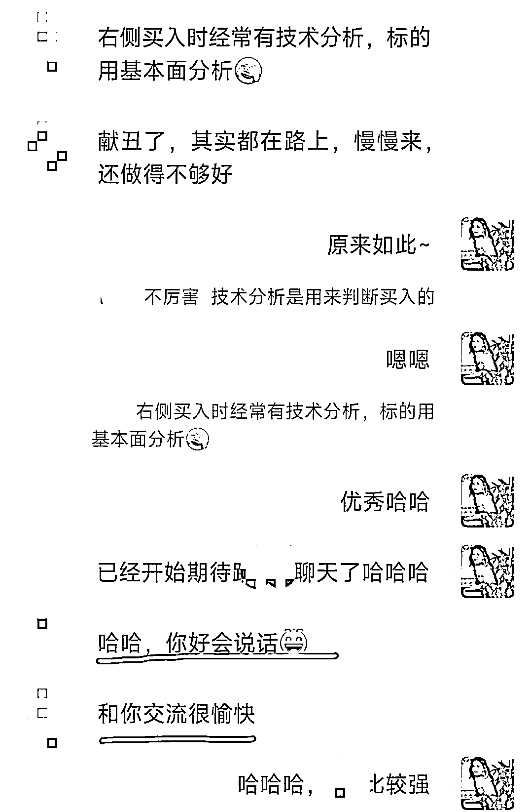

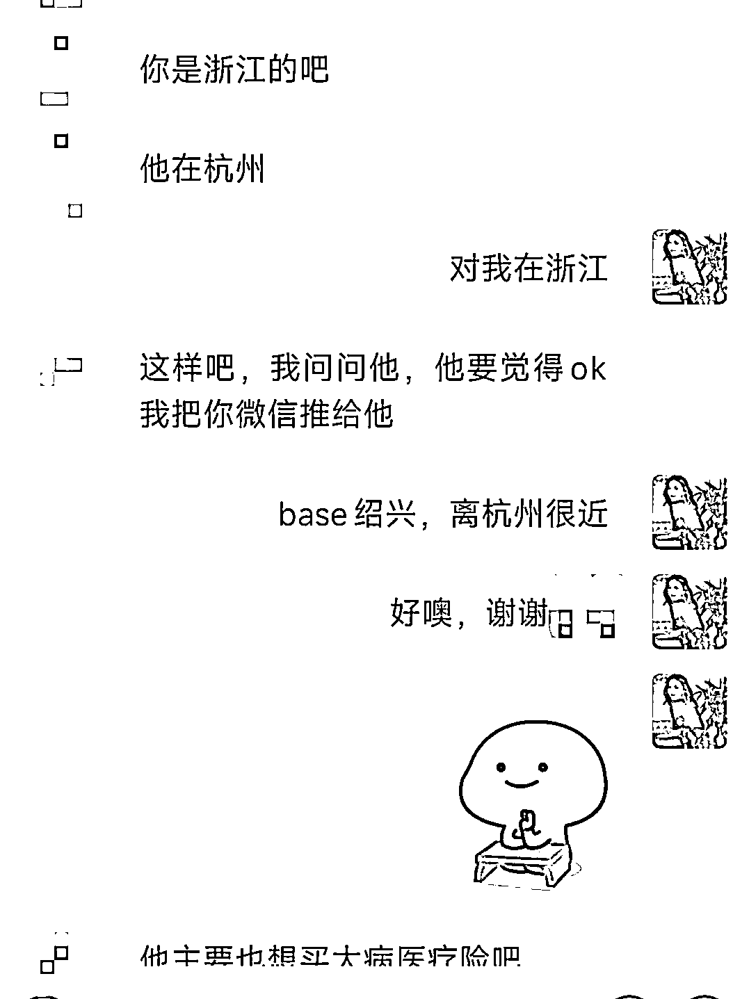

### 服务差异化：用多维体验积累善意

服务不是单一动作，而是叠加感知。

**回得快**。有客户把原经纪人的保单全移过来梳理，原因很简单：原经纪人成交后回消息慢，感觉被放养。

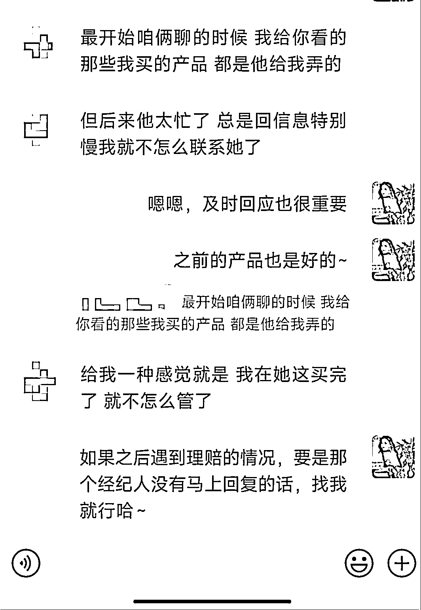

**专业可感知**。她用表格对比，不贬低竞品，把费率、杠杆、保障维度客观列出。重疾险别人推单品，她推组合，费率更低杠杆更高保障更全，成交和转介绍率都高。

**主动关怀**。生日祝福全覆盖，有客户说老公老妈都没祝我生日快乐你记得我太感动。客户发甲流，她第一时间关心饮食理赔注意事项。

**仪式感**。礼物送得比红包更有情绪价值。她按个性选包装纸，温柔女性用粉色，开朗用高饱和色。她会根据人生阶段送礼：宝宝送适龄礼物，出差打工人送旅行用品，爱喝酒的年轻女性送酒具。她强调，钱的情绪价值不如礼物，怪诞行为学也讲过这个道理。

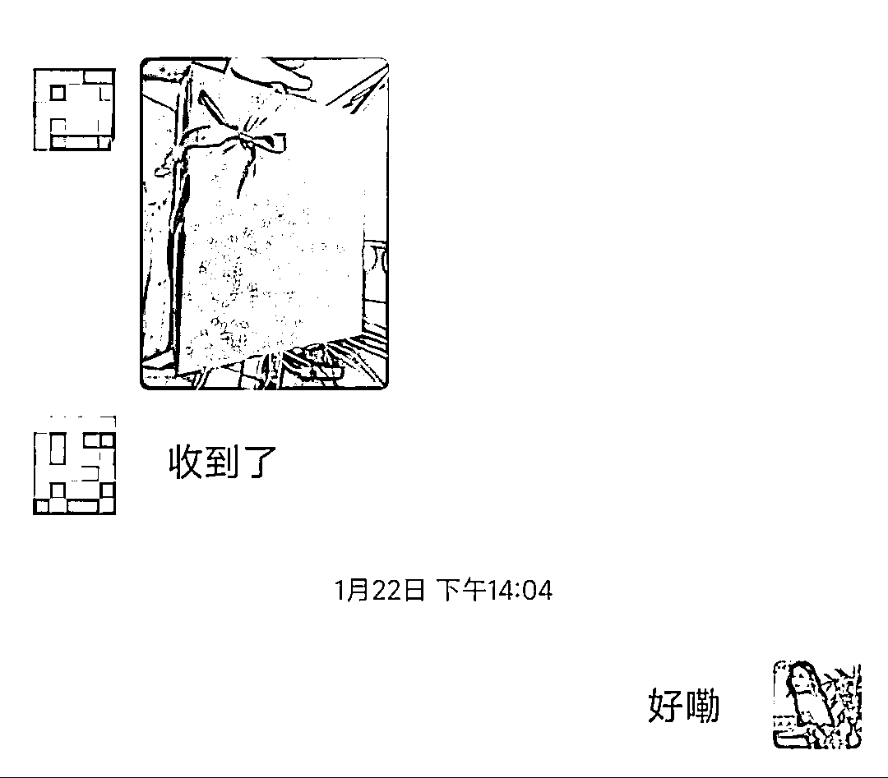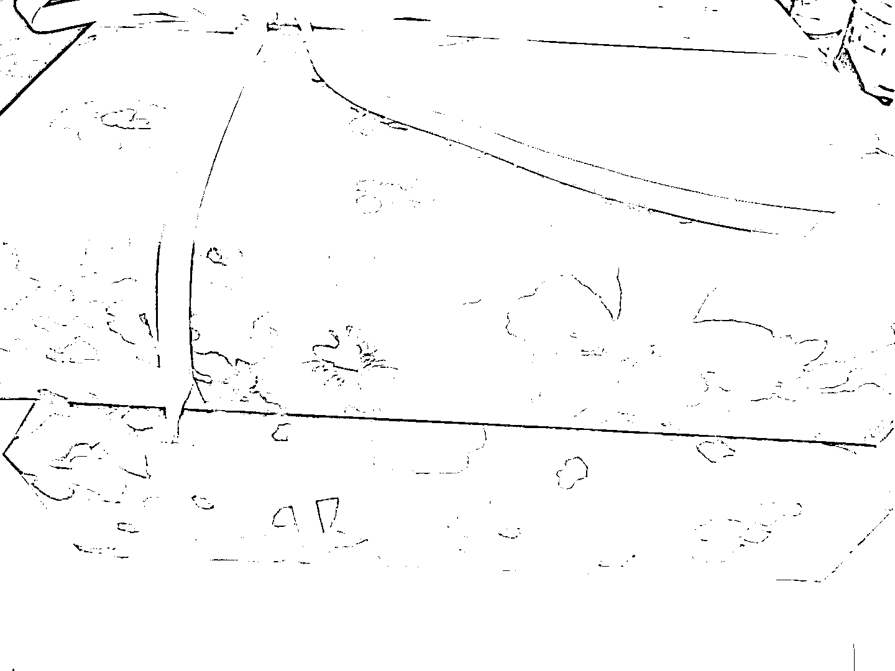

宝爸收到纸质保单和礼物后问卷写下非常愿意转介绍，行业里希望有更多雨欣这样的人。

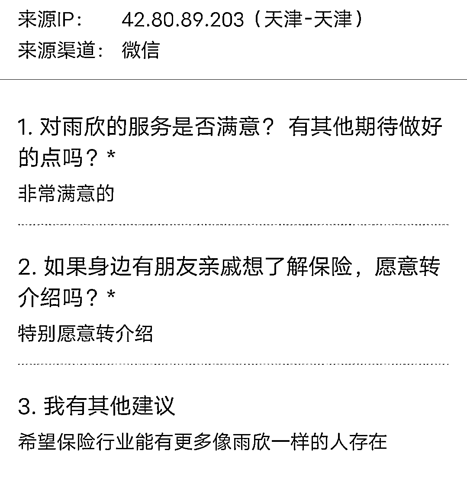

还有陌生网友因之前经纪人回消息慢、不负责、不专业而流失，找她买高端医疗险，体验后追加多份产品并托付家庭财务规划。

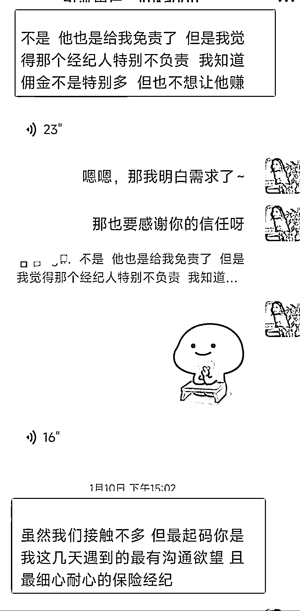

刘润说温暖是这个时代最高级的情绪。雨欣的复利来自专业加真诚加温度。当客户发自内心认可你这个人，复购与转介绍便水到渠成。

你有没有发现，做销售也好，做服务也罢，客户嘴上不说什么，但你递过去的那份耐心、理赔时多给的一句安抚、随手寄出的小礼物，他们全都记得。这些看似不起眼的举动，像一颗颗种子埋在土里，等到某一天，会悄悄长成一条小河，源源不断地把转介绍客户带到你面前。

很多同行都好奇，为什么我能在这个行业站稳脚跟？其实我的打法不太一样。我不擅长那种夸夸其谈的营销，更像一个躲在幕后研究怎么把产品打磨得更好用的人。这些年我一步步从只懂财务规划，到慢慢摸透基金、股票，再到看懂全球资产配置，还搭了一个专业度很高的团队。这个进化过程，一半是因为我骨子里爱琢磨，另一半是因为我一直坚信——好的交付，就是拼命提升自己的水平。

于是我的服务也跟着升级了。现在我能给一个中产或高净值家庭做全面的财务梳理，给出各种金融工具的使用方向。这一套下来，我的竞争力就不太一样了。不光比一般保险经纪人站位更高，跟普通理财规划师比，我也更有底气。因为我自己是真金白银在二级市场里实操过的。

我也看过市面上那些割韭菜的理财课，套路都差不多：只讲道理，不讲自己怎么配置家庭财富。在我看来，光给方法论、不晒自己案例的，基本都是耍流氓。所以我自己动手做了一套产品，把我熟悉的金融工具一个个拆开来讲，重点是手把手带实操。你说一个经纪人能做到手把手带你实操，这在市面上几乎找不到第二个，所以我也就成了行业里那0.1%。

做这个产品的初衷，其实是财商普及，我想带着一批朋友一起变富，也想把身边的人都变成优质圈子。做这件事，我依然是抱着服务的心态，这就是我之前讲的服务的差异化。因为我很清楚——只要真诚地利他，真正把身边人带好了，客户自然愿意认可你这个人，也会愿意复购和转介绍。

还有一些温暖的小细节特别值得说。当你人靠谱、口碑好的时候，全世界都在帮你。我做理财营的时候，海报做得挺丑的，结果有朋友主动说：“我给你做几张头像吧。”我准备做群内分享，说想要个藏宝图风格的海报让开营体验更好，群里的朋友立马接话：“你专心做内容就行，这事儿交给我。”这样的暖心事不止一件两件，全都是我之前全身心投入交付攒下的信任。我跟很多客户之间，就是这种互相成就的关系。

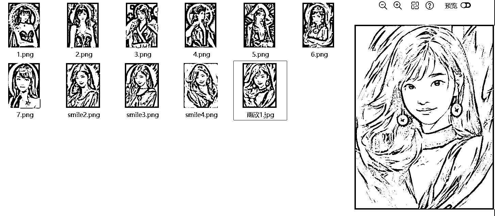

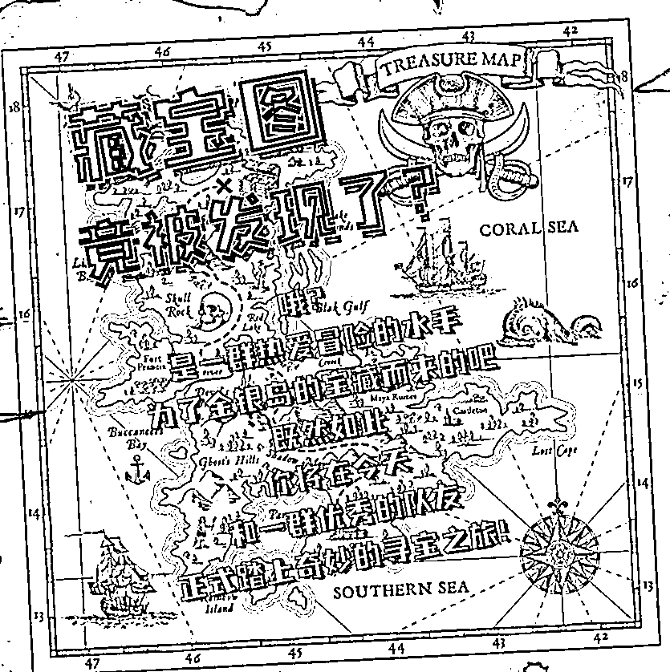

所以这个讲财商、带陪跑的产品，效果超乎预期。很多原本完全没理财概念的朋友，听完我的讲解和实操后，从一开始对保险毫无感觉，甚至压根不觉得自己需要保险，到后来在课程里发现了自己家庭财务的隐患，才恍然大悟，原来自己是需要保险的。

这样一来，就有客户上完理财课，又找我配置了全面的资产方案，包括保险，有的甚至配了私募。这些服务能落地，全靠我背后的团队——一群海外金融硕士、博士，见识和功底都很扎实。

所以我的模式已经变了。不再是直接推销保险，而是先教大家金融工具怎么用，顺理成章地把保险带出来。具体路径是这样的：先讲家庭理财规划的理念，再逐一拆解股票、基金、可转债、保人的保险、保钱的保险，然后手把手带实操，让客户自己分析自己的财务状况，最后才是客户主动来找我配置保险。

这个流程的关键在于：我教客户怎么理财，客户拿着我给的工具自己分析出需求，自己去查漏补缺。这种主动意识到需要，跟被动被人成交，背后的复购和转介绍逻辑有天壤之别。我看了一下理财营的数据，复购率和转介绍率高出大约8%。

多个优势叠在一起，我的个人IP就比较稀缺了。别的经纪人只能提供保险方案，别的理财规划师只能输出思路，但我不一样——我能一站式解决一篮子问题。人性都是怕麻烦的，能找一个人包圆所有事，谁会愿意多跑好几家？

当然，还有一个很实在的点：客户在我这儿赚到钱、资产增值了，肯定乐于帮我转介绍。人有钱赚了，心情好了，分享欲自然就上来了，我的转介绍率也就一路走高。

说到底还是那句话——打铁必须自身硬。你能给客户提供的价值越多，客户对你的信任就越深。这个道理，在跟人打交道的行业里尤其成立。

最后，雨欣也给大家准备了一份小礼物——我自己独家设计的一份家庭资产负债表。这个表我只送给理财陪跑营的伙伴，里面全部公式都写好了，你只要把自己的数据填进去，家庭资产状况一目了然，特别省心。作为专属福利，赚钱的朋友想要的话，我免费送给你。

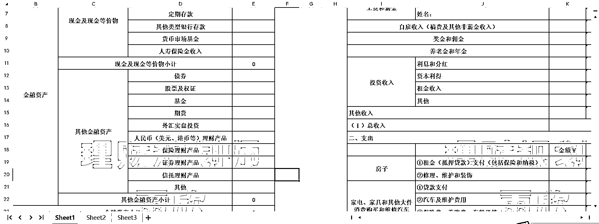

2024年，祝大家的资产都稳稳增长！

* * *

评论区：
芷蓝：很完整的垂直行业实战方案
小明明：蹲一个资产负债表
夜未澜：蹲一个资产负债表

