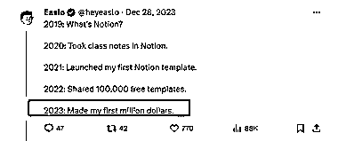
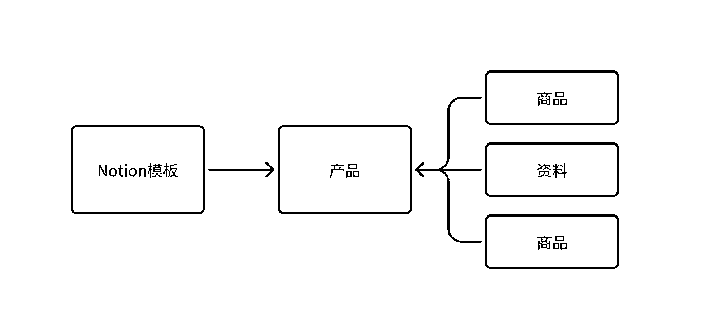
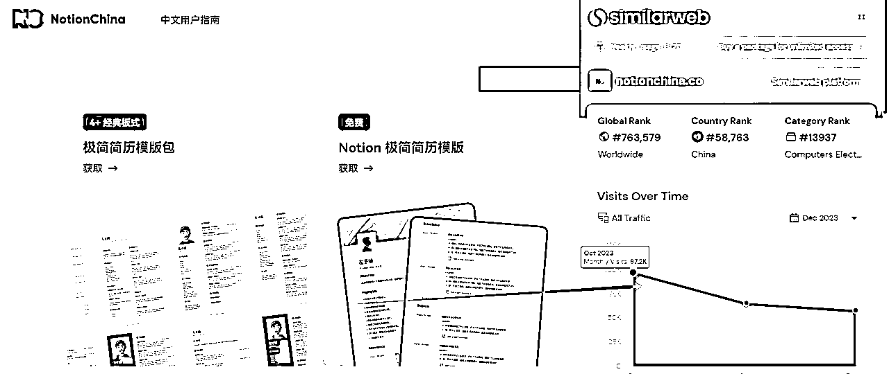
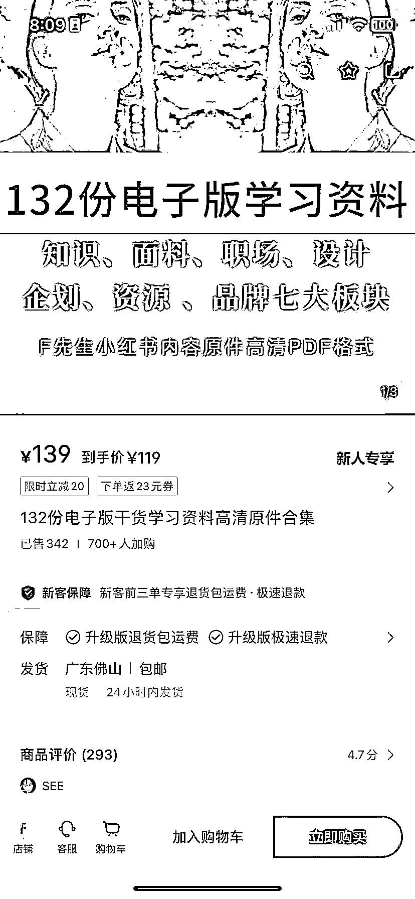
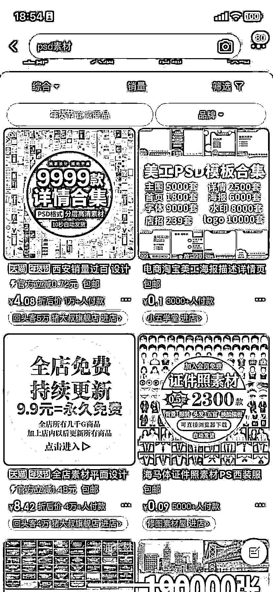
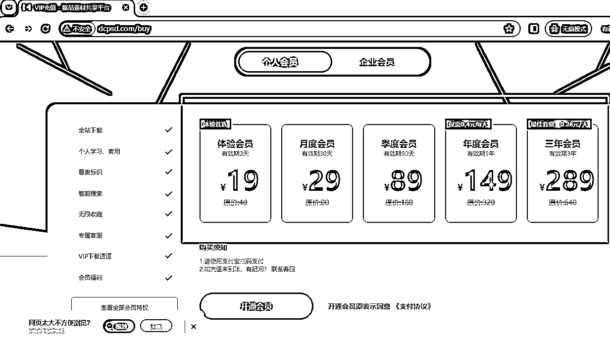

# 靠 Notion 模板年收入 100 万美元，如何通过资料整理进行变现？
作者：龙哥

一套普通的Notion模板，竟然能创造年入100万美元的收入？刚看到这个案例时，我确实吃了一惊。但仔细想想，这背后的逻辑并不玄妙——它是把“整理”本身做成了一门生意。

在此想先分享一个观点：万物皆产品。任何事物，只要能回应他人的需求，能帮人解决实际的问题，就有机会成为商品。哪怕是整理好的资料、列好的清单、设计好的模板，只要对别人有用，都暗藏着商业价值。

接下来，我们就来复盘这个Notion模板的百万美金案例，也会聊聊同样的思路，如何搬到国内各个平台实现变现。

整个拆解分成六大板块：
- 案例解构：爆款模板凭什么年入百万美金？
- 挖掘需求：怎么找到用户真正愿意买单的痛点？
- 推广引流：面向哪些渠道才能精准触达目标用户？
- 定价策略：如何定价、玩出更多利润空间？
- 落地实操：从0到1的具体步骤有哪些？
- 放大生意：体量起来之后，如何做得更大更强？

如果还想看案例的原始出处，也可以点这里：[原文链接](https://www.yuque.com/for_lazy/thfiu8/rp90ml9e9tr897vf)

说到底，资料整理变现并不神秘，关键是你有没有把“整理”当作产品去设计。看完这个案例，不妨想想：在你熟悉的领域，有哪些信息可以整理成产品，卖给有需要的人？

期待在评论区看到你的思考。

* * *

评论区：暂无评论

