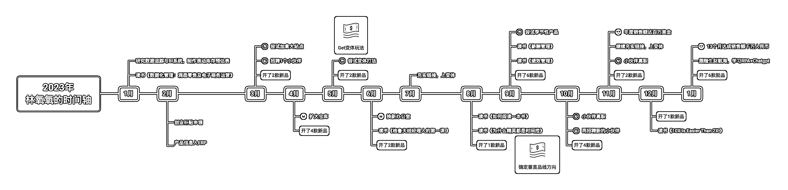
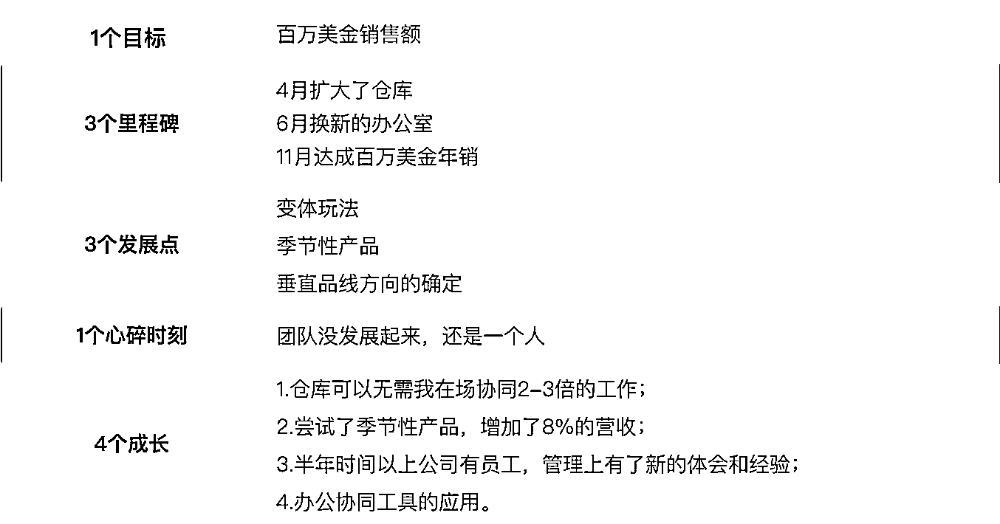
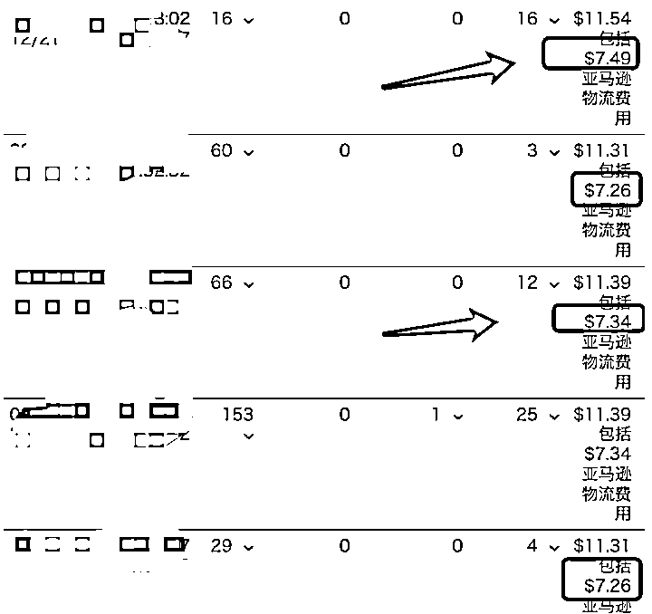
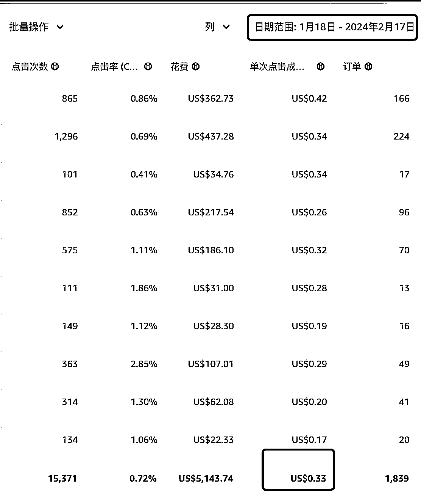
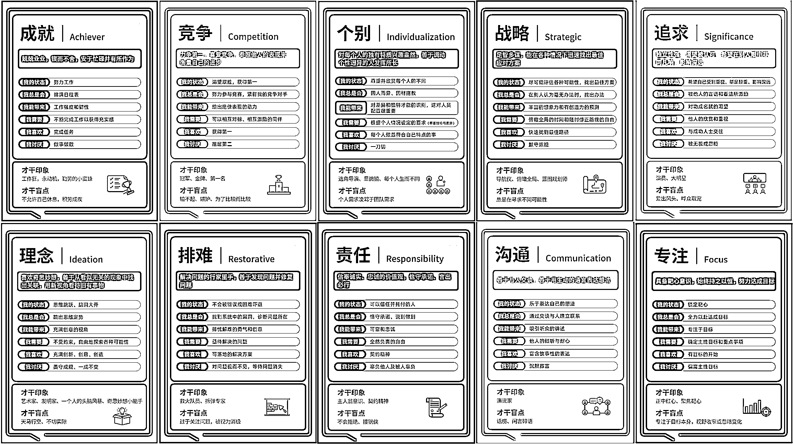
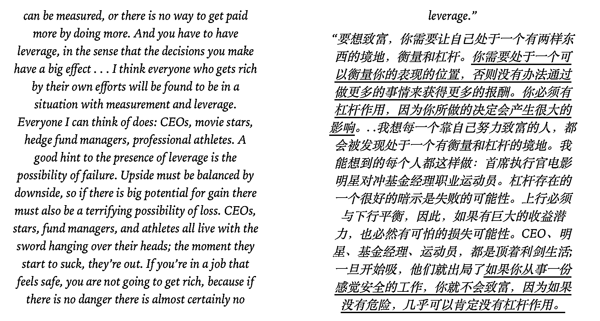
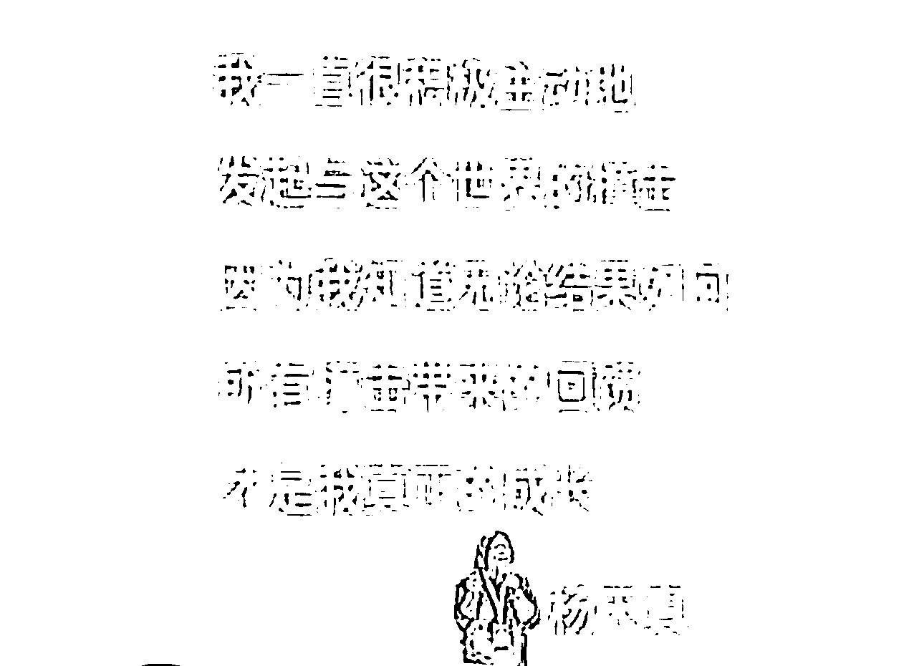

# 从十余万本金到年销七位数：一个跨境小卖家的两年自救实录

大家开工大吉！我是Lissa林氧氧，96年的深圳创业者，大学念的电商，2018年一脚踩进跨境圈，2019年跟着前东家把年流水做到了千万级美元；2020年脑子发热出去单干，结果预算烧得太快，不得不回来打工回血；2021年心有不甘再次出发，手里只剩十来万人民币，没有合伙人、也没雇人，两年时间硬把年销做到了七位数美元，这事儿是真的。

2023年我基本没在这个社群里冒过泡，一整年都在低头干活。趁着开年，来交个作业，把这一年的实战故事讲给你听。

## 01 2023年关键词：30款、3个里程碑、1次崩溃

上面这张图，就是我自己做的年度时间轴。

去年一共上了30款产品，达成了年初定下的目标；经历了3个值得纪念的大节点，拿到了3个新机会；也遭遇过1次崩溃瞬间，最后攒下了4条成长心得。

3月首次正式招人，4月把仓库面积翻了一倍，6月搬进了新办公室，11月年销售正式突破七位数大关——这四件事，是我全年最骄傲的刻度。

它们背后有两层意义：一是我开始刻意逼自己去搭班子、跳出舒适区；二是公司这艘小船确实在稳稳地往前开。这些微不足道的瞬间，对我而言格外珍贵。

下面从产品和运营两个角度讲讲我的具体操作，也有我个人的一些复盘，以及对2024年的打算。希望能给正在走类似路的你一点参考。

## 02 百万大盘是怎么做出来的

### 产品端：小资金如何玩转选品

先交代背景：我是小成本起盘，启动资金只有十来万人民币。之前有篇文章写过完整经历，叫《我是如何度过亚马逊创业这一年》，这里不展开。

关于增长，我一贯的看法是：想赚100万，就打造10个能赚10万的单品，或者20个能赚5万的单品。在资源很有限的早期，这样的策略能让我用最低代价不断试错，靠快速积累数量来达成目标。

所以，选品对我来说就是生命线。选得对不对，直接决定采购、物流、推广这整套测品成本。

说白了，这个阶段我玩的是一场数学概率游戏：

**利润=销售额×利润率=选品成功率×选品数量×测品成本×平均投资回报率**

我的工作就是拉高成功率、稳住上新节奏、守住ROI底线、压缩测品开销，仅此而已。

#### 控测品成本：物流和尺寸里挖利润

测品费用中最值得单独拆开说的是物流。

2023年头程运费单价降了不少，但FBA仓储配送费却一路涨价。我的一部分利润空间，就是从产品体积优化里抢出来的。

头程方面，我把实重货和抛货混着发，备货补货一起走，头程分摊成本优化得非常明显。实重件做多了，我就能顺手接一些很抛的货——别人单独发这类货会被运费拖垮，而我的综合成本反而更低，这就是所谓的总成本领先策略。

另一方面，我花了不少力气调整产品尺寸、改良包装，去压低FBA费用。平台的计费规则年年变，后台测算经常会有偏差，必须紧盯数据，否则不知不觉就被多扣钱。一件小东西多收0.2美元，一天30单就是6美元，一年将近2200美元；五六个SKU加在一起，上万美金的纯利就凭空蒸发了。

（图中同款产品不同颜色变体，FBA配送费差别肉眼可见）

而且FBA的配送费周期内只能复核两次，就算开case也常常改不回来。有时候是货到了仓库，恰好被抽到某个包装边角松了，导致尺寸超标。遇到这种情况要立刻优化包装方案、换SKU重新发，别让后面批次的货继续被多收钱。

#### 提成功率：垂直赛道里做精铺

不算变体衍生，去年我上了30个SKU。算下来存活率接近90%——就是那种到现在还在正常补货、没被淘汰的款。

这可能也跟我阈值不高有关：只要能正常卖、不怎么压资金、利润还能看，我就留着。

我的拓品思路总结成一句话：**在垂直赛道里做精铺**。

第一年创业，我对品类和材质几乎一无所知。花了一年时间，慢慢摸清了产品特性和供应链，也积累了一批靠谱的合作方。有了这些东西打底，去年我就顺着材质、变体、人群需求这几个方向去垂直扩张。借着自己手里几条已经跑出来的链接，又试水了一波季节性产品，效果意外地好。

我的风格其实更靠近精品打法，只是单条链接的销量爆发力不算强，所以需要靠数量来拉总量。但SKU多也有多的烦恼：做低价简单款和做高价值感的款，付出的精力其实是一样的。从选品、打样、备货、推广到ERP系统，每一环的成本都差不多。只是资金有上限，我只能选择当下性价比最高的方案。

要清醒地记住：我做生意就是为了赚钱。我不过是个普通人，在自由市场里生存，本质就是抢。

变体开发、垂直深耕、季节爆款，这三大手段都能帮我迅速扩张SKU数量、提高市场占有率。

同时，为了让产品更容易存活、也降低运营难度，我会通过改色、组合、换材质这些方式做差异化。

怎么发现垂直赛道？说到底还是积累。先做能上手的品类，随着经验和市场认知一点点加深，适合你的那条线就会自己浮出来。接下来的日子，就是不断扩线、再找更好的线。

### 运营端：两个支点，一次转身

运营方面我有两个重心、一个转变。

重心一：精准流量。重心二：有效转化。
那个转变是：付费流量的意义在于放大盈利，把广告当成一门能赚钱的生意来看。

#### 精准流量与有效转化

销量=流量×转化率。想快速提升销量，最直接的办法是拉高精准流量；最省钱的办法是优化转化。

也就是说：让产品持续出现在有真实需求的人面前，同时找到能打动他们的那个点，反复打磨。

电商平台最大的流量池就是搜索流量，而每个搜索词背后都站着具体的人、具体的需求。为什么强调精准？因为只有把产品曝光在购买意愿最强的消费者面前，转化率才会最高，广告投产比才会最漂亮。

那什么才是有效转化？2023年我最大的体悟是：你在意的东西，用户未必关心。产品颜色、某些小配件、图片精不精美，都可能根本不是用户下单的理由。要把有限精力，放在用户真正在意的地方。

落到执行上，分两条线：
一条是“词”：不断找词、扩建词库，大量收集高相关关键词，再结合产品曝光渠道，用“渠道×关键词”的组合去拓展更多精准流量。
另一条是“人”：研究消费者画像、需求和痛点，用这些信息反哺产品和链接优化；打中痛点的同时，还能挖出更多关键词，转化自然就上来了。实在拿不准的时候，就快速上架，用A/B测试说话。

#### 付费流量的本质：放大赚钱

我投广告的目的有两个：第一是直接产生利润，第二是守住自然流量。

在职场那几年，我习惯把广告当成推排名的工具，说白了就是战略性亏损。但自从把自己定位成商人，我把付费预算的重心完全移到了盈利上。我又不是大品牌，不需要烧钱买品牌曝光；自然流量这一块，我是用官方Deal活动来守的。

投放方法还是围绕精准流量那套核心逻辑，唯一指标是高转化率。

落到具体操作，就九个字：**选对词、配好广告、勤否定**。

我的原则是：用符合甚至略超用户预期的呈现方式，通过最能调动感官的素材，把产品推到最精准的人面前。

广告素材的排序很明确：视频大于图片，图片大于文字。要让用户对着屏幕也能“看得见、摸得着、身临其境”，所以我大部分产品一上架就会立刻投视频广告，效果确实很能打。

“符合预期”是为了让用户愿意点进来，“略超预期”是为了给他一个下单的理由。为什么单独把这点拎出来说？因为低价产品要有足够“low”的视觉——这反而证明你没打算赚他钱。要是把一个平价品做得过于高大上，用户反而会怀疑：是不是有猫腻？最理想的状态，就是“情理之中，意料之外”。

人群定位要克制。新品千万不要贪心，先锁定一个画像清晰的小众人群，把数据跑稳了再说。人群定准了，图片和文案才能一击即中。点击率是我用来检验人群和投放词准不准的仪表盘：常规要求点击率至少0.8%，新品争取1%以上。

搞流量，一半是提高精准触达，另一半是消灭无效触达。后者对应的动作就是：果断否词、勤更新投放词库。

亚马逊的广告匹配逻辑几乎每一年都在变。去年规则更新之后，广泛投放会飘得非常散，但很多运营完全没意识到，也没及时否词，最后系统对产品的算法定位越来越歪，广告成本越烧越高。特别是视频广告，出价本来就贵，如果不及时否词，浪费尤其严重。

现在我把投放这件事看得很纯粹：自然排名的提升只是附带奖励。我更在乎的是ROI——这笔投放到底有没有赚钱，才决定它能不能长期做下去。而关键词下的自然排名，其实更多取决于产品点击率和转化率，这两项完全可以用人群定位加官方Deal活动去拉动。

按这套打法，在我的类目里，广告单次出价可以控制在0.5美元以内，平均0.35美元左右。运营节奏也轻松，不用疲于奔命，每天专心致志地拓词、优化页面、开发新品就行。

（这是某个品类最近一个月的广告数据）

## 03 成长：团队是我最大的坎

带团队、管人，是我过去最不擅长的领域。以前在大平台打工，有公司做靠山，觉得带队很轻松；真轮到自己从小团队起步，才发现每一步都是煎熬。班子成了我的瓶颈，也刚好成了我必须突破的方向。

去年年初我在👸号立下两个flag：一达成百万年销，二组一个五人团队。

3月开始招人，10月有人离职又补招，到11月又只剩我独自一个——这就是2023年扎扎实实的“心碎时刻”。

去年我花了大把时间补自我管理和HR相关的课，从招聘、用人到绩效、激励，一个没落下。整个过程有苦有乐，还挺值得聊聊。

### 关于招人这件事，我如何进化

早在2022年，我第一次自己招人带人，就察觉到了自己的毛病：不知道怎么和运营有效沟通，不知道怎么激活对方。我习惯给人施压，却不会帮人解压。

那段时间我反复复盘职场经历，想来想去，觉得自己才是最大的问题源头。于是我去做了一次盖洛普优势测评，请醒醒老师帮我拆解。

（我的盖洛普前十才干）

解读结果让我又惊又好笑：我天生就爱竞争、爱卷；我还慕强，明明自己水平一般，却偏偏喜欢跟特别优秀的人混在一起，因为这会激发我更卷。我甚至潜意识里希望身边的人都跟我一样是工作狂——如果有人没我拼，我就会判定他就是不努力。

是不是挺无解的？

但醒醒一层层帮我把底层特质剥开之后，我才真正看懂那句话：有些特质之所以成就你，也正是它困住你的原因。

**真正挡路的，从来不是人的底层特质，而是使用特质的方式。**

从那时起，我开始刻意练习觉察，情绪也慢慢变得稳定。

当运营做事不像我预期，我先区分：他是没意愿，还是没能力？我不再抱着“测试对方”的心态放养，而是换成信任前置——把自己的预期结果讲清楚，再放手让伙伴去试。过程中做节点检查，偏离就及时拉回来；如果是能力不够，那就认真教，教完再沉淀成SOP。

这些事对很多人来说也许理所当然，但对我真的很难。我一直在努力提升对自己性格的觉察、控制和使用水平。

2023年重新招人后，我开始研究绩效管理和薪酬设计，想用工具提升产出和员工满意度。

研究之后才发现，很多东西其实都该装进绩效管理这个筐里：新人做不好，很可能不是态度问题而是能力问题；要给他规划、安排，甚至人才发展路径；要有考核目标、有过程追踪、有辅导反馈——辅导的目的就是为了把事情越做越好。这些环节拼在一起，才算完整的绩效管理。

很多人劝我：小公司搞这些太复杂了，核心就是一句话——带队伍打胜仗。

但我的理解是：只有先知道好的绩效管理是什么样，我才有可能在正确的阶段选正确的工具，才谈得上野蛮生长。问题本身不可怕，可怕的是根本不知道问题出在哪。

当然，在学习带团队的路上，我也踩了不少坑。

### 关于搭班的几条经验总结

刚出来创业那会儿，我多多少少染上了一点“大公司病”，尤其体现在招人心态上。

这个心态经历了三个阶段：

最早：“我们一起干一家公司，公司就是我们的！”
后来：“你来跟着我，我带你飞，你的成长我来负责！”
现在：“把手头的事踏实做好就能安心下班；发展空间一直有，但成长是你自己的事——不过只要你想飞，我依然愿意递翅膀。”

**误区一：把员工的成长背在自己身上**

回归本质，用人就是价值交换。让伙伴在公司里有所成长，这本来就是绩效管理的事：一方面是为了让他更好地胜任工作、获得晋升，另一方面也是留人的手段——谁会不想在开心中进步呢？

但成长的第一责任人永远是自己。人和人的期待不一样，公司能给的只是一个空间，最终变成什么样子，由每个人自己决定。

**误区二：把招人想得太难，拖慢了自己的节奏**

2023年我身边太多朋友在招人这件事上翻车，导致我也跟着焦虑，总觉得“招人很难”，结果班子迟迟搭不起来。

其实市场上什么样的人都有，关键在于你通过什么渠道去找。招不招得到人，说到底是个渠道问题。

**成长一：真正优秀的人才不会流入市场**

我以前招人基本靠招聘软件海选，后来才明白，真正的大牛压根不会出现在市场上——他们大多已经被内推、或通过公司之间的资源互换消化掉了。创业公司能做的，就是带着一群能力各不相同的人打胜仗。所以初创团队更应该看重“有责任心、靠谱”这两个品质，态度排在能力前面。

**成长二：公司招人，赚的是“人的成长红利”**

一个人入职，前三个月基本都是亏本的；如果完全没经验，前半年都可能是负投入。要等半年到一年后，新人熟悉了业务、技能成熟了，公司才开始有盈余。如果能再待上两年，这笔账才算赚回来。

我不奢求谁在我这里待很多年，只要双方满意、能共事两年，我就觉得非常幸运了。另外创业团队天生不稳定，人才流动率极高，最痛的就是好不容易把人带出来了，人却走了。所以初创公司最务实的策略就是：直接招有经验的人，马上产生产出，同时想尽办法留住他。

**成长三：人用不好，很可能是没选对人**

以前只要人手出问题，我总是先责怪自己能力不行。但后来发现，多数时候其实是匹配问题——有没有把对方放在合适的位置？团队成员之间的性格合不合？这些因素决定了大家能不能获得正反馈。由正反馈带来的情绪价值感，有时候比多发点钱还管用。

**成长四：要招极度信任你、喜欢你的人**

老板应该成为团队的精神核心。2022年我招人时，会先给对方看我的👸号，也有不少伙伴来自我的社群，信任基础和配合度天然就高；2023年全走市场海选，光是建立信任就花掉了大量时间，而且流动率明显更高。

**成长五：每次至少招两个人**

如果能做到前面那条，这条就不是硬性标准。但在信任基础和影响力还不够强的时候，团队氛围对新人的影响太大了。一次性招两个或以上，一来大家有话说，办公室不至于尴尬压抑；二来可以形成良性竞争，互相学习、互相追赶。如果只有一个人孤零零待着，没有参照系，特别容易摆烂。

## 04 2024：从两倍思维切换到十倍思维

2022年大家在社群里聊“适应焦虑”，2023年聊复利和个人优势，今年轮到“10X增长”。

刚看完《10X Is Easier Than 2X》的时候，我根本不知道从何入手——千万美元？开什么玩笑。

但后来慢慢沉下心来，把思路从“我想要”换成“我如何做到”，事情反而清晰了一些。

借用龙哥的一段话：

“十倍是一个象征。不要做线性的努力，而是持续跳出当下的思维框架，通过十倍思维进入更大的价值空间。在战略上做文章，而不是在战术上死磕。不断去找更大的增长空间和机会，一直这么想、这么做，最终有可能是五倍，也可能是百倍，达成时间快一点慢一点都无所谓。”

当我真的用十倍来思考时，立刻意识到：现有模式撑不起千万的盘子。

**必须换一种打法，必须加杠杆：组织杠杆、产品杠杆、资金杠杆。**

回到最开头那道公式：想赚100万，就做10个10万的品，或者20个5万的品。

我亲身试过了，累成狗，但确实能干成。

百万成绩，就是靠着任劳任怨的苦功和蛮劲换来的。在新手期、零资源的状态下，这套玩法真的够用。换句话说，你也完全可以靠同样的劲头，做出百万级别的盘子。

但一年后，当我手里有了些资金和资源的积累，观点开始迭代了：

**在已验证的商业模式下，尽量去做价值感更高的产品。**

就像那本书里写的：“如果你想赚1000万美元，与其解决100个10万美元的问题，不如试着去解决一个3000万美元的问题。”

今年咱们都别再迷信线性努力了。跳出现有框架，一起去找更大的可能。

我越来越认同“十倍增长”背后的逻辑：解决一个 3000 万美元的问题，远比解决 100 个零碎问题来得轻松。真正难找到的，不是“做更多”，而是“做更对”——更垂直、更专业，才是破局点。

对于靠精品、爆款驱动的公司，这一点往往最有共鸣。你想赚 100 万，最后算账常常是：2 个爆款贡献了 150 万，另外 8 个产品亏掉 50 万。这个例子出自刘钦。

当然，铺货型企业里也有不少优等生，但他们背后需要的是雄厚的供应链资源和极强的供应链管理能力。这恰好不是我的长项。

我更擅长的是另一件事：感知消费需求，把产品运营做精做透。

所以 2024 年，我要往两个方向加杠杆。一是产品杠杆：做价值量与投入成本都更高的产品；二是组织杠杆：招人、搭团队，把高人效的团队带出来。

（上图出自《10x Is Easier Than 2x》）

创始人的时间、注意力和精力，是公司里最稀缺的资源。与其把所有事都抓在手里，不如淘出最重要的 20%，把力气全部集中在这 20% 上；剩下的 80% 果断放手。空出来的时间，用来思考、学习、探索，公司才能走得更远，创始人才能继续成长，员工也才能拥有更大的发挥空间。

最后想总结一句：创业确实难，它像一场打怪游戏。但别怕，把这些关卡看作挑战和游戏，享受“玩”本身，你已经在成长了。

（上图来自赚钱圈友线下见面会，黄小刀老师的分享现场）

回看 2023 年，我的成长离不开龙哥老大（龙哥盟）、杨涛涛哥、纪老板、高翔、李鲆、醒醒同学、拓跋勇、Lenry 的无私分享。谢谢你们，让我一个台阶一个台阶地往前走。

以下是我在龙哥盟的精华内容（按发布时间排列）：

- [手把手教你如何选出月入上万的单品](https://t.zsxq.com/03E27qvjM)
- [我是如何毕业两年晋升为跨境电商大厂经理的](https://t.zsxq.com/03RvRzFqr)
- [手把手带你在亚马逊开店卖货](https://t.zsxq.com/03AUZrVZn)
- [10 人团队做亚马逊年营收 7000w 的方法论](https://t.zsxq.com/03QneyJyJ)
- [疫情下，跨境电商还有机会入局吗](https://t.zsxq.com/03z3NJa2b)
- [不靠广告，如何在亚马逊 3 个月把一个产品做到 100W 销售额](https://t.zsxq.com/033nu7MFM)
- [我是如何 3 个月时间推出一个类目老大商品的](https://t.zsxq.com/03MFMjQF6)
- [我是如何度过亚马逊创业这一年（经历/营收/时间管理/日常）](https://t.zsxq.com/17KzThejb)（一篇分享贴）

业务在增长，团队需要补人。我想招两位优秀的 1-2 年经验亚马逊运营同学，欢迎自荐或推荐。

感谢龙哥盟，让我们相遇、同行。

评论区里也很温暖：有人说看了我的帖子学到很多；有人说经历过后才知道一个人有多累；有人留了一句“感谢分享”；有人夸文章可读性强；也有人特别提到“只筛选，不培养”，说很有共鸣；还有人分享自己两年前曾因选品太多踩坑，后来转做超级单品，销售额也即将突破百万美金；更有同行留言想交个朋友，一起交流亚马逊。

