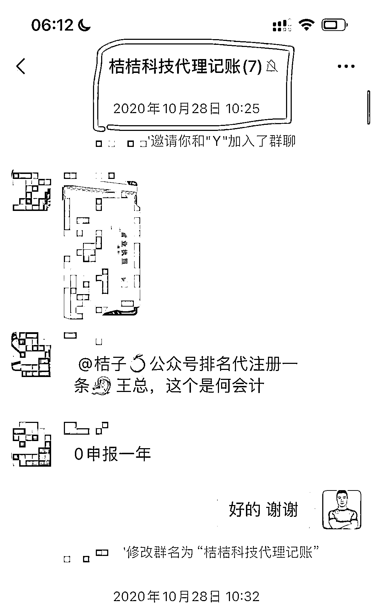
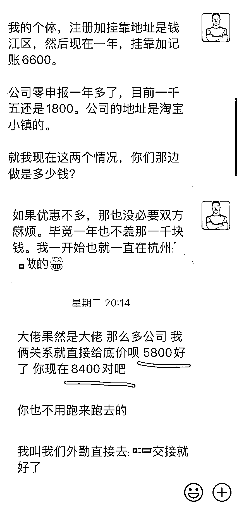

# ('公司-个体开对公+挂靠+代记账的那些坑，避开后，我一年省了 2000+', (2, 37))

拿下执照、开对公账户、挂靠地址、代理记账……这一整套流程里，到底藏着多少“隐形消费”？我用真金白银帮你探了路，看完也许能一年省下几千块，这话一点都不夸张。

先说说我的背景：2020年9月底，我从健身教练岗位离职，次月就注册了人生第一家公司执照。当时目标很单纯——批量注册公众号。用公司执照注册公众号，只要不封号，最多能拿下50个。有位启蒙大哥指点我，花2000左右找代办，注册公司加开对公账户。我甚至专门跑了一趟宁波去对接财务公司，折腾两天，结果因为一些我控制不了的原因，对公账户没开成，只能退款回杭州，心里那叫一个憋屈。

但事情还得办啊。杭州注册公司或个体户，必须有经营地址。那会儿项目做得还算顺手，我脑子一热，直接租了间办公室，想着大胆试错。

不出所料，几个月后工作室就关门了，押金两三个月，一分钱没退。现在想想，在稳定月入10万之前，我是真不想再碰线下实体了。顺便一提，第一家公司的注销，又花了我1500。

后来我又陆续办过几个外地个体户，成本才几十块钱一个，主要为了注册小程序、申请微信商户号。那时候个体小程序能批量注册几十个，但外地的个体户我不敢多办，够自己用就行——毕竟注销麻烦，办的时候还得把个人信息交给别人，还要扫脸认证。

接下来才是重头戏，关于杭州公司、杭州个体的办理和记账费用，如果你从没接触过地址挂靠，看完再去操作，可能直接省下几千块。

有了第一次的教训，第二次办公司执照时，我特意查了大量资料、横向对比。果然，在生财星球里发现了一个信息差：在杭州办公司执照，其实可以不提供地址——也就是说，压根不用花挂靠费！我之前淘宝上比价，杭州地址挂靠普遍都要3000以上。这次我零成本搞定了执照，一年至少省了3000挂靠费。

几个月后需要开对公账户，我自己跑了几家银行，一点用没有，最后还是得靠财务公司。开对公意味着必须有记账，所以我就用1800一年代理记账0申报的套餐，换来免费帮我开对公账户+代账服务。当时觉得太划算了，挂靠费省了3000多，1800的代账根本不贵。但后来才知道，这价格别说行业底价，连平均水平都没够着。

要注意，我的第二家公司，也就是现在正常运营的这家，是0申报、0挂靠费，代记账一年1800。

再说说我的杭州个体户，当初注册它，是为了提现腾讯流量主。个体对公账户每个月有10万左右的额度能直接转到个人卡，而公司对公如果没足够发票，直接转个人卡要扣20%个税。所以当时我选了个体户一条龙服务：注册、开对公、挂靠地址、代记账，一年6600。流量主收入确实不错，我觉得能干得长久，个体对公又比公司对公好用，脑子一热就办了。这样一来，杭州公司代账1800，加上杭州个体代账和挂靠6600，一年光这些费用就8000多。

人做项目的时候，真的容易冲动，觉得差不多就冲了，花钱也不心疼。后来我才知道，我的价格不是偏高，而是相当高！可费用都是一年一交，加上公司、个体确实都离不开，注销也不现实，只能认了。

幸运的是，省钱的机会还是被我等到了。一次杭州生财线下聚会，我认识了一位开财务公司的圈友。她给我讲了正常财务服务的价格，我才发现自己冤大头当得多彻底。不过话说回来，做互联网永远别为之前的冲动或失误懊悔——干了就干了，只要不违法，亏点钱算什么？她提议把业务迁到她们公司，员工一条龙搞定所有迁移事项，完全不用我操心。

这里说明一下：我的公司已经0申报一年多了，不能一直0申报下去。而她给的价格，已经包含了公司不再零申报的代理记账费。换句话说，两个公司合计下来，一年省了2600块。

至此，我开对公的公司/个体之路彻底讲完了。有对公、挂靠、代理记账经验的小伙伴，一定懂我在说什么；没弄过的可能听着有点懵，这很正常。分享的目的，就是让大家有个概念，第一次别被高价坑到。

最后给个实在建议：如果你的一条龙服务超过4000一年，真该去找更划算、更靠谱的渠道了。要是还没办过对公公司或个体，更要擦亮眼睛，多维度对比财务公司的规模和报价。钱是你的，省下来就是赚到。

