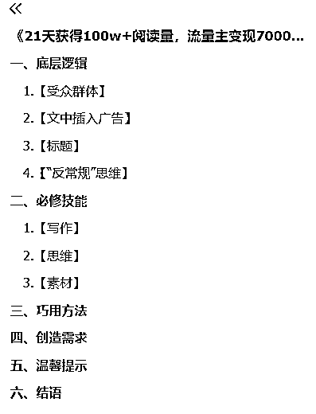

# 21 天获得 100w+阅读量，流量主变现 7000+
作者：龙哥

新年好！开工大吉！我是龙哥，一个专注拆书的写作者。今天想跟你聊聊我在12月航海里的收获。

其实刚进赚钱那会儿，我也跟很多新手一样，面对海量信息完全懵圈，不知道选什么项目，不知道怎么开始，更不知道如何变现。那种迷茫感，相信你懂。

但后来我明白，犹豫才是最大的坑。就像坏脾气的小可爱老师说的：犹豫就会败北。一直不下场，只会越来越焦虑，白白把时间耗光。赚钱里那句话我很喜欢：何以解忧，唯有实战。你只有把手弄脏，躬身入局，才知道自己能走多远。

所以我选择下场写👸号爆文。21天里，我靠流量主赚了7000+，后面月入过万，写了多篇原创10W+，稳定日阅读3W+，单号累计阅读破100W。还引流了100多人到私域，这还没算后续转化。更开心的是，我写的日志被龙哥老师点赞，还作为唯一压轴船员在航海大群做了分享。航海结束后一周，我新开的号也顺利进池，日均阅读冲上1W+。

你看，只要迈出第一步，很多惊喜就会接连发生。新手最怕“努力了没结果”，可试错本身就是成功的垫脚石。没有那些掉过的坑，哪有后来上坡的路。

最后分享几个实操要点：日更不能停；盯紧受众和标题；一个号每天至少2篇，最多6篇。坚持做，你也能拿到结果。

