# 半年进账20万，普通人的朋友圈到底该怎么发？

大家好，我是公子正。

上个月，运气不错，在粥左罗老师的万元产品【顶峰会】分销榜上拿了个第一。

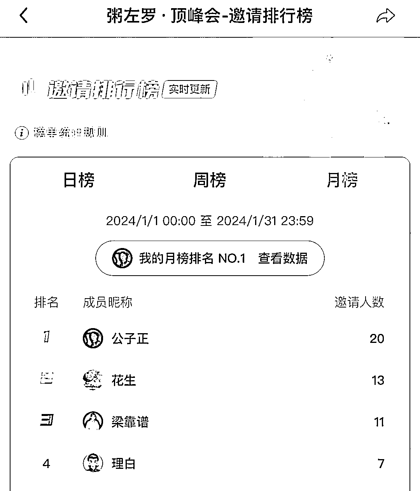

从去年9月加入顶峰会到现在，我在粥老师这边累计领了15个W，再加上自己社群和合伙人的收入，半年下来总计超过20万。

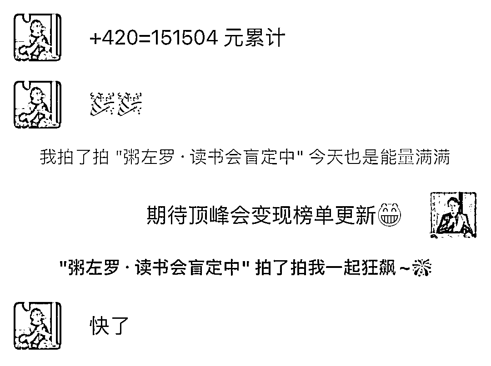

这些钱，靠的就是我雷打不动地天天发朋友圈。正如刘德华先生说的：“得到的要给人，学到的要教人。”今天就毫无保留地把我的玩法拆给你听。

下面分三块讲：朋友圈的三大价值、强变现的底层逻辑、具体搭建方法。

## 一、为什么劝你认真经营朋友圈？因为它值得

2019年我开了家小超市。起早贪黑一整年，刨去房租水电，也就赚个十来万。

问题也很明显：人必须整天守在店里，客流基本固定，一天最多四五十人，收入天花板一眼望得到头。这还算好的，不少开店的朋友更惨，奶茶店、餐饮店、服装店，加盟装修进货几十万砸进去，疫情一来全打了水漂。

所以我就琢磨，有没有一种生意能满足这三个条件：

**第一、不用被店面绑死；第二、上不封顶能持续累积；第三、风险小到不会伤筋动骨。**

答案是：经营朋友圈。

一部手机加一张能上网的卡，随时随地都能开张。随着微信里精准好友越来越多，你的专业技能、口碑、案例都在复利增长，理论上没有上限。最坏的结果，也就是搭上点电费网费和时间。

所以，把朋友圈当成一家店铺来养，这是性价比极高的长期生意。这就是它的三大价值。

## 二、为什么你的朋友圈卖不动？底层逻辑在这

先给“强变现朋友圈”下个定义：**能持续让用户仅仅因为看了你的朋友圈，就买下高客单价产品。**

很多人听完直摇头：朋友圈点赞都没几个，让人掏几千上万，疯了？

其实一点也不玄。两千多年前《邹忌讽齐王纳谏》就把这事说透了：

“吾妻之美我者，私我也；妾之美我者，畏我也；客之美我者，欲有求于我也。”

翻译过来就是：妻子夸我是因为爱我，小妾夸我是因为怕我，客人夸我是因为有求于我。

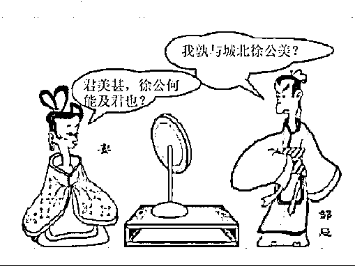

说白了——**别人关注你、认可你、选择你，只有两个原因：要么是喜欢你、信任你，要么是觉得你有价值。**

当喜欢、信任、价值积累到一定程度，而对方恰好有需求，付费就成了水到渠成的事。

经营喜欢？太难了，咱们又不是人民币。塑造价值？性价比不高，圈里总有比你更强的大佬，你很难靠价值碾压别人。

**所以普通人最好走的路，是经营信任。**

你想想，朋友圈里的房产中介和保险代理不少吧？可真到了买房买保险的时候，你多半还是先问亲戚朋友。

不是因为亲戚更专业，而是因为他们更值得你信任。

想清楚这一点，你就抓住了强变现的命门。

## 三、具体怎么搭？从门面和内容两头抓

所谓搭建强变现朋友圈，本质就是和用户建立信任。而信任在互联网上是一种感觉，当对方觉得你可靠、愿意和你互动时，信任就产生了。

### 第一招：门面包装要到位

这是个看脸的世界，朋友圈也一样。人都倾向于信赖那些看起来更专业、更有质感的人。空姐和普通服务员相比，大家天然对空姐更买账，就是包装和气质赢了。

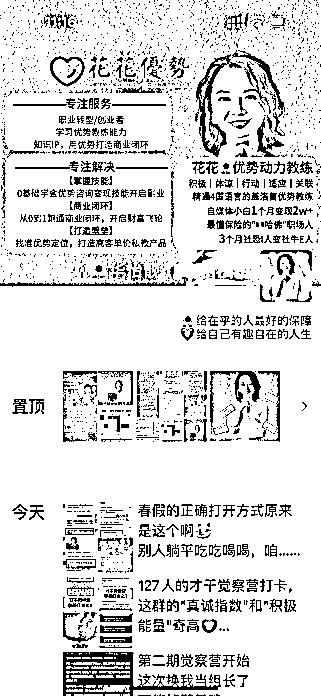

比如之前有位同行加我，她是做优势动力教练的，具体干啥我不太懂，但一看头像封面就觉得这人挺专业，你一眼就知道她能提供什么、价值在哪儿。再看看咱自己，信任值高下立判。

门面包装很简单，就三样：头像、昵称、封面。

先说**头像**。头像是社交第一张脸。如果头像模糊、不专业、没特征，比如这种：

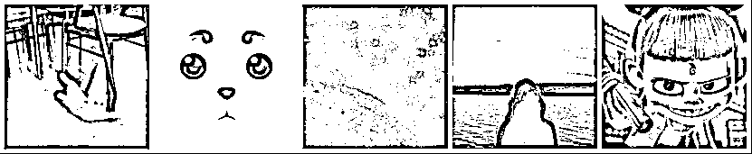

你能放心给一个刚加的陌生人打钱吗？反正我做不到。

因为未知＝风险。头像上感受不到专业和可靠，心理上就难以相信对方。一个真人专业的形象，远比卡通、风景更让人安心。比如：

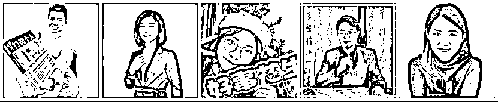

选头像的5个建议：
①用真人近照，别放P得连亲妈都不认识的照片。
②有条件就去影楼拍一张清晰的专业形象照。
③表情要轻松自然，别端着，别凶神恶煞。
④穿着要得体，可以像粥老师那样拿本书当道具。
⑤颜色风格要有辨识度，然后长期用同一个头像，让用户记牢你。

接下来说**昵称**。昵称是你线上生意的招牌。好昵称通常满足这几点：
①一看就知道你是谁，靠什么吃饭。
②简单好记。
③不用生僻字、特殊符号或外文，方便别人搜索和口语传播。

来看两个反例：

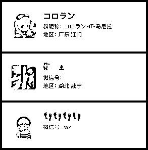

这三个昵称，你能猜出他们是干嘛的吗？就算猜出来了，想联系他们，连搜索框都不好打字。

再看三个正面例子：

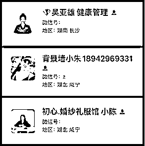

业务一目了然，又好记又好找。

最后说**朋友圈封面**。封面就是你店铺的招牌，用户点开你朋友圈，第一眼看到的就是它。好的封面不需要多华丽，但至少包含几个要素：个人形象照、个人定位、主营业务、成绩背书。不用全堆上去，把它当一张名片来设计就好。

注意一个关键细节：微信背景上传后部分区域会被遮挡，设计时要分清哪些是可视区，哪些是不可视区。这个可以私信我拿模板，也可以直接用“稿定设计app”里的朋友圈封面模板。

我自己就是个例子。原来封面就一张个人照片，没任何信息量。后来重新设计一版，一眼就能看出我是谁、能干什么：

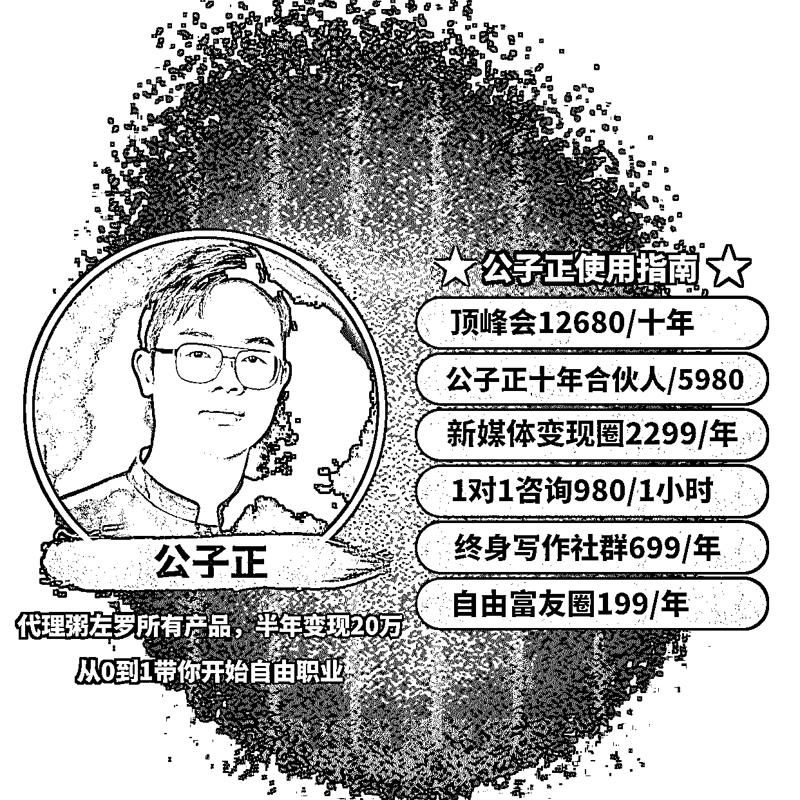

光这一个动作，至少帮我少解释上千句话，而我只花了10分钟。所以这件事性价比极高，赶紧检查一下你的封面。

### 第二招：内容搭建要有节奏

前面说过，经营朋友圈就像开店。既然是开店，就要思考怎么招客、怎么出货。我有个“夜市理论”：**微信就是一个大夜市，朋友圈就是你的摊位。你发的每条内容，都是在招呼路过的用户。吆喝得好，摊位有意思，人家才愿意停下来，进而买单。**

具体吆喝什么？给你四个方向：

**1. 自律打卡**

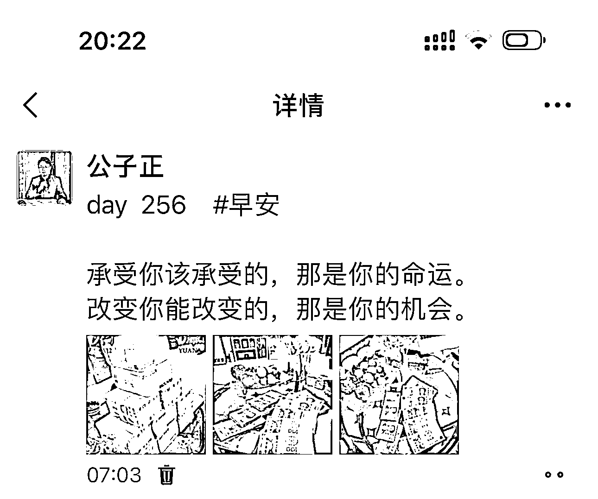

每天固定时间发布一条打卡内容，打卡的内容不重要，早起、健身、读书、写作都行，重要的是“每天固定”。这会让好友看到你长期坚持做一件事，传递出“自律”“靠谱”“一直在”的信号。自律是自带信任感的品质。

**2. 价值展示**

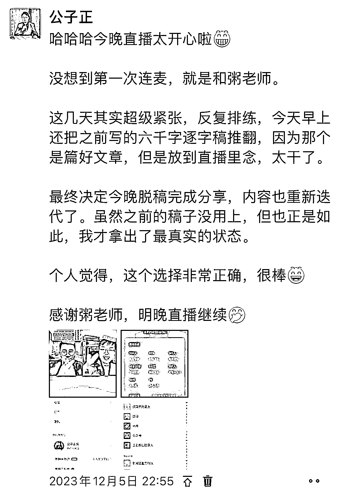

分享你的成绩、经验、人脉圈子、专业知识，重点是你能帮用户解决什么问题。这是软营销，不直接卖货，而是吸引那些刚好被戳中的人主动来找你。哪怕这次没成交，以后你有需求，他第一个想起的就是你。

**3. 产品广告**

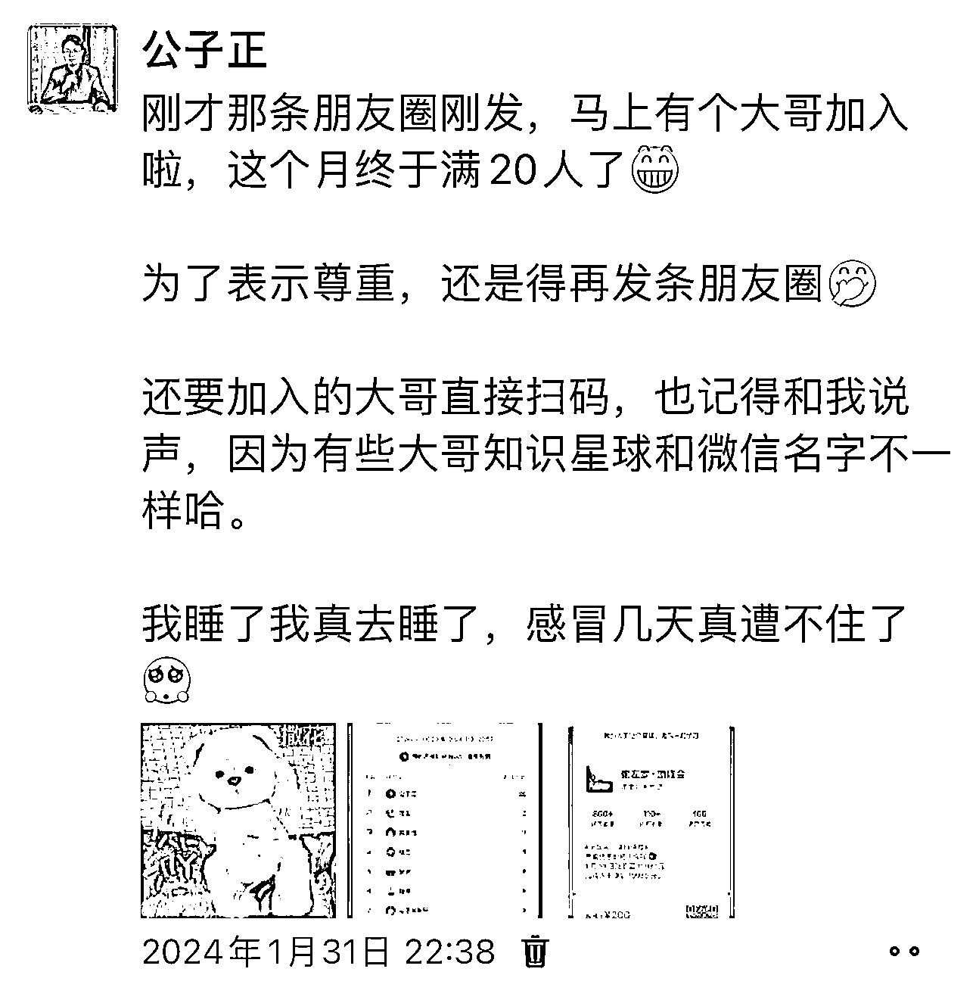

夜市摆摊，不能光吆喝不给看货。朋友圈也一样，想变现就必须发广告。但广告有很多发法：晒收款截图、晒用户故事、晒反馈、晒成绩、晒涨价倒计时……形式可以灵活。

新手能不能一上来就发广告？当然可以。但卖不卖得动，取决于两点：你的产品是否满足用户需求，以及用户对你的信任度够不够。建议新手先从低客单价、能解决具体问题的产品入手，比如大佬的几块钱引流课。这样既容易拿到正反馈，又能攒下第一批种子用户。买过你一次的老客户，只要服务到位，后续复购的机会远高于新用户。

**4. 袒露自己**

这年头最不缺的就是产品，缺的是能被信任的人。而信任来自确定性——你得让对方足够了解你，确定你们是同频的人。所以，大胆真诚地展示自己吧，具体可以从四个方面露：

- 露出你的三观。一个三观鲜明的人，才能吸引同频的人靠近你。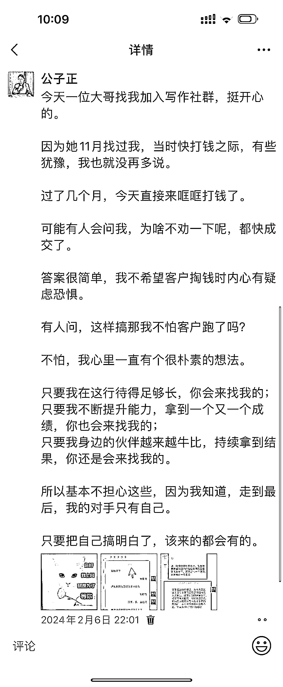
- 露出你的圈子。你的朋友是谁，很大程度上映照出你是谁。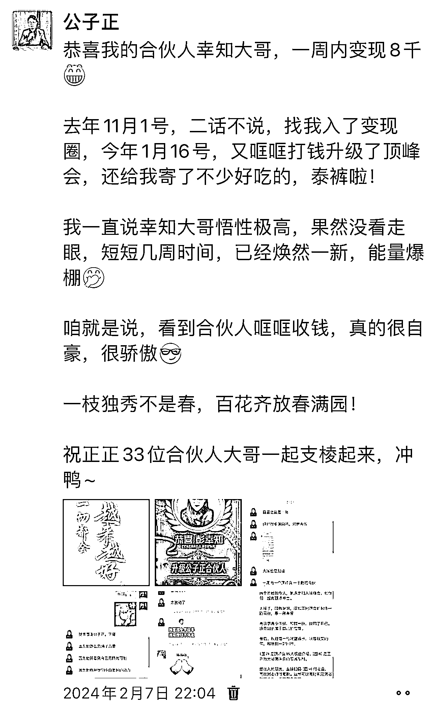
- 露出你的生活状态。人们愿意追随的，是自己渴望成为的人。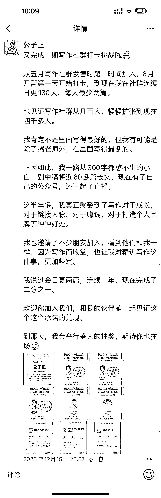
- 露出你的成就。结果主义者很多，有结果的人更容易被选择。就像大家买东西，总爱选销量高、评价好的店铺。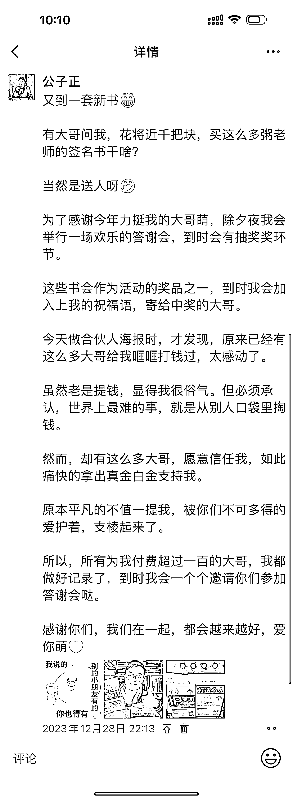

以上就是我半年变现20W的朋友圈完整打法。

希望对你有用，欢迎来报喜。

评论区已经有朋友说“喜欢，求多多分享”：

* * *