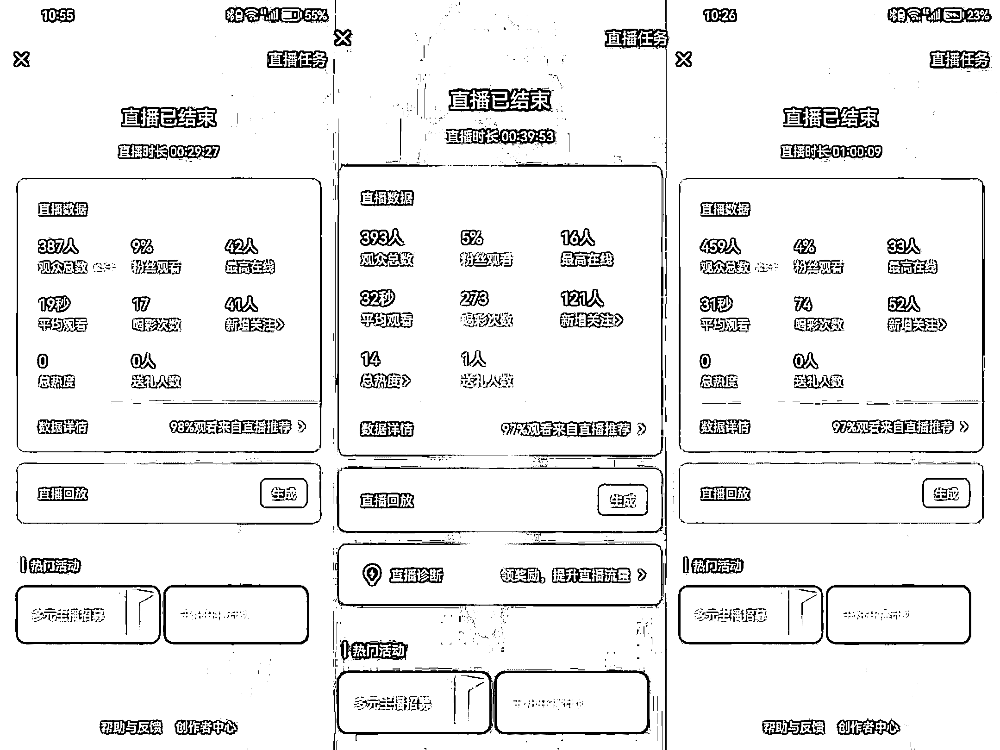

# 视频号“电台模式”直播，一场就能涨几百上千粉的操作拆解

## 视频号电台直播，单场吸粉数百上千的实操复盘

作者：辰风

日期：2024-02-18

视频号电台直播，单场涨粉几百、上千的流程玩法复盘

最近语音直播在视频号上很火，身边不少人都在做，数据回馈也很漂亮。

我认识的一个朋友靠一天的电台直播就涨了1000多个粉丝，我自己试播了三场，每场稳定涨粉上百。

玩法要点大致如下：

视频号当下对电台直播的推荐力度很大，入场的人越来越多。场内观众规模大的能到两三千，少也能有几百人围观。

不必担心账号冷启动，我们吃的是平台的推荐量。

打法很直接：用语音电台形式开播，挂上福袋引导互动，边聊边做氛围留存，核心目的就是吸粉。

主要想达成两件事：把人拉到私域，以及给视频号涨粉。

粉量到了1000后就能开通橱窗做带货；粉丝破百达到门槛就能开通创作分成计划。

后续的变现逻辑是靠私聊和朋友圈成交，借助这个直播项目、副业项目来赚钱。

更多内容请移步飞书：[`k874t2qh8w.feishu.cn/docx/OjmfdzO4HoJPnJxJypOcKtKenPg`](https://k874t2qh8w.feishu.cn/docx/OjmfdzO4HoJPnJxJypOcKtKenPg)

* * *

评论区：

BLUE : 电台直播带货，效果如何，有测吗？

辰风 : 电台状态下挂车这个倒是没有尝试

BLUE : 测测呢？

* * *