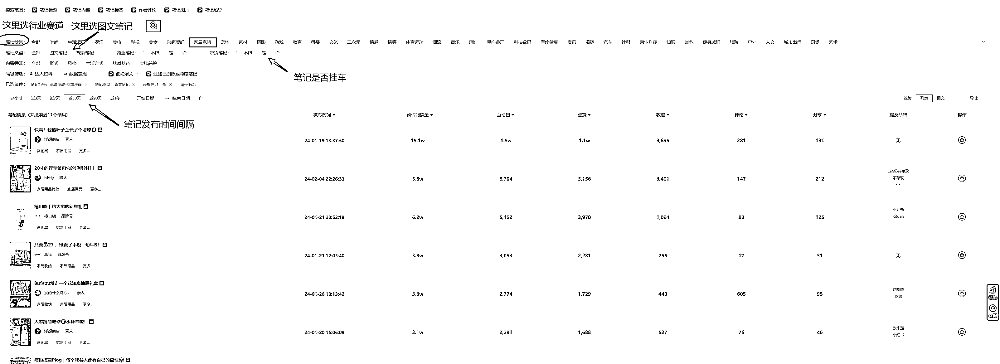
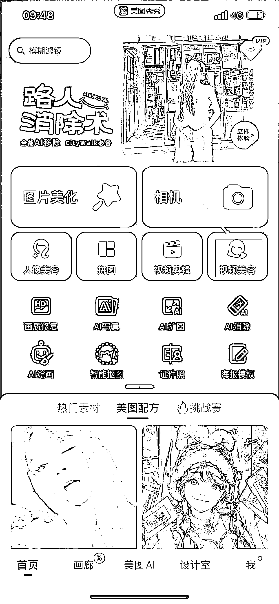
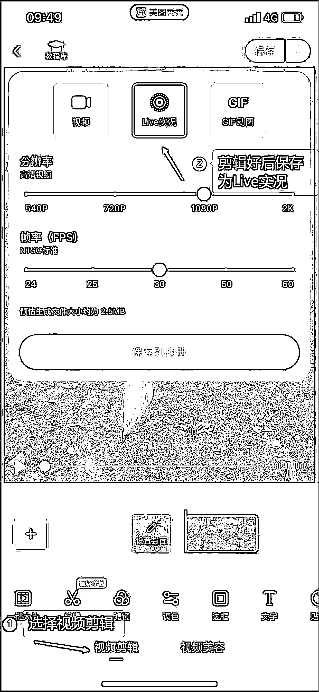
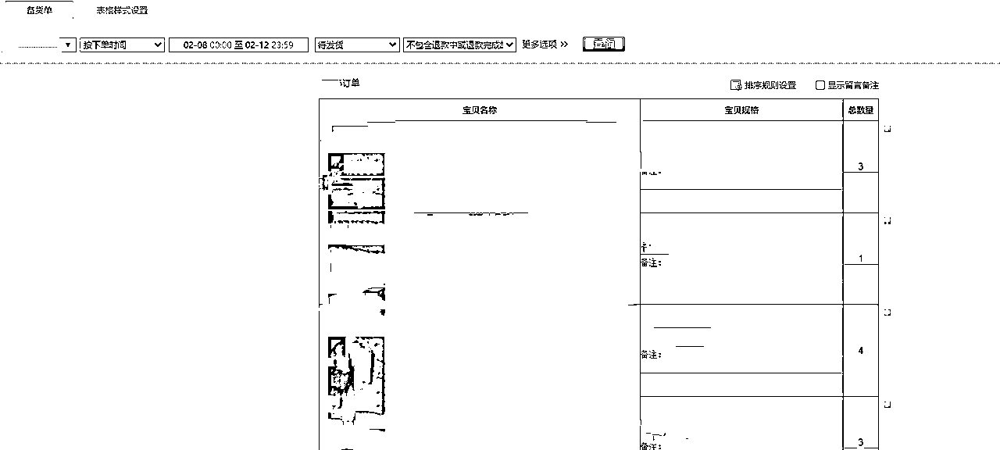
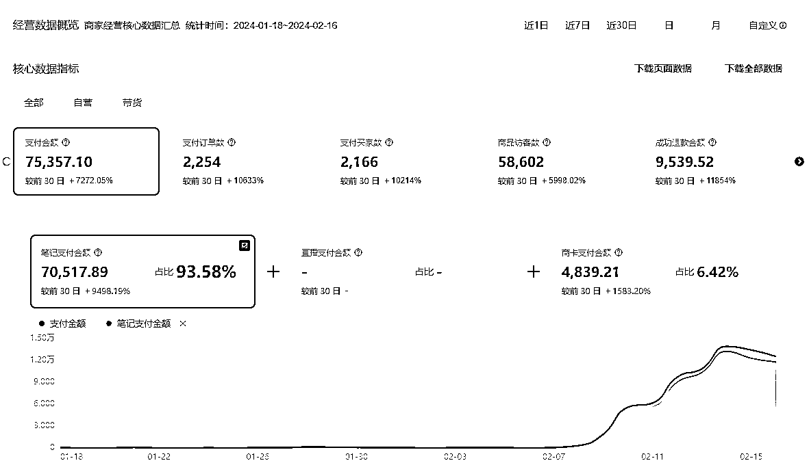

# 春节10天卖爆，新手在RED平台跑通的全流程复盘

> 分享人：北瑜 | 2024年2月18日

各位朋友好，在下北瑜。去年9月报名了坤哥的RED卖货培训班，才算把整套平台的规则、基础操作和盈利模式弄明白。早前我做过淘系虚拟商品，对电商不算陌生。做图片是我的老本行——当初在淘宝做虚拟产品，商品描述图经手了不知多少张，哪种风格更精致、更抓眼球，心里大概有数。后来还跟坤哥跑过抖音上的男装图文项目，虽然没有大卖，但完整走了一遍0到1流程。所以11月培训班结束，我就铁了心要在RED上卖货。

## 选品思路：数量上去了，爆款自然会来

坤哥反复强调：选品比运营重要，试品比选品更关键。RED上找货基本靠自己摸索，常见路子有三条：用灰豚这类数据App去筛，去抖音的图文热卖榜翻笔记，直接逛RED首页信息流找低粉高销笔记。哪条顺手就走哪条，也能混着用。我的习惯是先用灰豚挑一些顺眼的商品，再顺着这些商品找出几个对标号，拿小号给他们点赞和留言，把号喂熟后再刷信息流，平台便会推来一大堆相似内容。春节那款爆品就是靠这招挖到的。

### 灰豚工具怎么用

灰豚的会员卡去闲鱼收也行，周卡折扣几乎没有，月卡以上越买越便宜，年卡最划算。大家按自身情况选。

拿我的操作举例。打开灰豚后，选定‘家居’分类，勾选‘低粉高销’‘挂车图文’‘近30天’，就会列出很多数据漂亮的带货笔记供参考。假如筛选周期设得太短，比如只筛7天，这类笔记大概率为零，那就把范围放宽到30天。另外，平时多刷信息流也能收获惊喜，只要勤快，总能刷到意想不到的品。RED的算法实在太懂选品人。

## 复制之前，先做调研

遇到爆款先稳住，别太过兴奋。赚钱之道在于复制，谁赚到钱就学谁，但动手前得先花心思摸底。有人会担心：慢一步，过季风险高的产品热度过了该如何应对？这种顾虑实在不必。商品千千万万，不同类目之间差别极大，不摸清成本、利润、退货比例、成交数据、内容制作难度高不高、对标是否投流和直播，直接开跑多半是缴学费。我们只需心里大致有个数，确定自己有实力复制，并且试错成本能接受，就足够了，花不了多少时间。一旦判断能做，立刻用多账号试。选品说到底是为了找到真正的爆品，在这种模式下，爆款才拥有一切。

## 测品实操：货源提前定

挑中商品后，是否要马上对接货源？我的答案是：要。虽然也能等出单后再联系商家，但太耽误事，万一找不到合适的货源，退款、投诉、平台处罚全来了。不如事先把货源确定，再发笔记，整个节奏才顺畅。

图文笔记的复制成本极低，甚至能1:1照搬，所以强烈建议实拍，最好从第一刻就实拍。眼下主流平台都在严打搬运和混剪，顺着平台规则来，做内容不用提心吊胆，爆了也不怕被限流。实拍用的样品，从PDD或1688都能买。买样品一方面为了内容制作，另一方面也能借此检验商家产品质量。PDD里许多商品带退货运费保障，基本等于零成本拿样，试爆了就多号加推，试不动就止损，没有囤货负担。1688的大多数商家不包退货运费，因此假如PDD有同款且包运费，优先从PDD买，尤其是两家货品差距不大时。

实拍要布置背景、灯光、道具，以及样品采购，总支出几百元，绝大多数人家中就能搞定。账号至少备2-3个，有条件就申个人商户执照开企业号。企业号的好处是能批量化，一张执照对应2个号，方便多账号扩张。坏处是成本高，单号600元认证费用，略心疼。当然，手头有私人实名账号的话，直接用就好。

## 拍摄：iPhone + Live图

拍摄设备首选iPhone，它自带的Live实况模式能捕捉大约2秒的动态画面，拍得好的话非常加分。以某款产品为例：去年年底有一款卖爆的透明摆件，内部是液体加闪粉，轻晃一下如同星河流动，用Live模式拍摄时相当惊艳，拍成短视频也好看；但拍成静态图，那份灵动感就消失了。

假如Live图拍完效果不理想，或者修图后失去了动态效果，有办法挽救。

打开任意修图App，以‘美图’为例，在首页点‘视频美容’。

进入剪辑功能，调整颜色、加滤镜，也能添加文字与水印。改完后点击界面右上方的保存按钮，选择存进相册。原理其实简单：把Live照片当视频修，再输出成新Live。

## 发笔记的频率：量大出奇迹

测品阶段，单号每天至少发5篇，我见过不少号日更十篇以上，数据依然亮眼。爆款是概率游戏，数量不够，爆款难出。春节那几天，我每天发10到20篇。按一周测3-5个品、每号每天5-10篇、三号同时跑，单月能产生600篇笔记，体量惊人。据说@木易 曾经在短视频红利期靠多账号每日产出600条视频，这效率与执行力，便是差距所在。

我个人的感觉是，颜值型产品和图文是天生一对，美不美一眼即知，比文字描述更直接。所以发布笔记优先选这类产品，标题和文案不必复杂，十来个字足够。

## 各赛道避坑

RED上女性用户占比超过八成，女装、美妆、护肤、穿搭、饰品这些赛道热度极高，竞争也惨烈。女装的痛点众所周知，退货比例高得离谱，@书豪 说过一句：‘廉价女装，狗都不做。’话俗理不俗。女装当中有特定功能的单品有机会，但极其考验货源组织能力，换季时容易出现象级爆款，到时供货能不能跟上，直接决定成败。没有硬核供货资源的话，女装还是别碰。有单没货、被平台扣钱扣分，想想都头皮发麻。

选品时我也见过很多卖爆的手串饰品，调研后才清楚，大多属于原创自制，不适合代发。但要是你手巧、有原创能力和审美，那是另一条路。从销量与利润看，这个类目配合图文和直播，年收入做到六位数甚至更多都不夸张，代价是自己制作、囤货、发货。

百货赛道适合新手出单。要是把外观好看、实用功能和新鲜感集齐，很容易跑出爆品。应季又好看的百货，例如日历、暖手用品、中秋节的礼品、新春招财饰品，从来就不缺爆款。甚至连偏男性向的数码产品，前一年的中秋也出现过图文爆款。可见颜值、应季、新奇这个公式，在RED上相当通用。

## 爆单之后怎么对接发货

我的品从9号开始爆发。那天早上打开后台，访客数比平时多出一大截，心里咯噔一下，赶紧补发笔记。春节的流量实在太猛，随手拍的数据都是日常数倍，每隔15分钟左右便下一单。到了10号，几乎两分钟一单，我彻底看呆了。这股热度一直延续至现在才回落。这波能爆，有同行休假、竞争减少的原因，也有新春流量红利，但最关键的还是每日坚持的测品，以及按部就班执行。

爆单之后我联系了1688上的商家，恰逢春节，仅两户商家加了我微信，最后找到靠谱的那家。回头想其实有风险，若没能对接上，单量这么大，逾期发货罚款会非常肉疼。因此，强烈建议大家测品时就把商家敲定，别等笔记爆了再慌慌张张找货源。

和1688商家对接不复杂。他们通常用ERP系统跑大批量代发，零散订单则手工拍。先确定双方用哪款ERP，再把店铺订单通过ERP推给他们，他们开好RED发货票据就能打单。若商品是多规格，颜色、型号、款式繁杂，商家会要求附带拣货明细，方便挑货发货。这个明细能从ERP下载最好，下不了就到后台拉未发货清单，自行整理好颜色型号再发给商家。

货款结算是通过微信，或者到1688上拍下对应金额的总订单，走平台支付。初次合作的话，能走平台就走平台，彼此熟络后再用微信。代发合同是否要签？谨慎一点当然要，但我当时没签，等下次再跑出爆款就补上，流程已经熟了，签了更安心。

## 结尾

回头看，爆款虽然带点偶然，但更多是必然。它来自每日坚持的测品，来自每周稳定的选品节奏，也来自对内容电商的正确理解。坤哥说过，时间才是最大的壁垒，每天前进一点，岁月不会辜负坚持。很多商业常识看似平常，却最值钱。2024年，RED上依然藏着大量机会。感谢@盗坤、@木易、@书豪、@叶声 各位大哥的解惑与支持。祝大家龙年都能持续出单，越赚越多！

留言区：
YolyArk 留言：谢谢老师分享，小白受益匪浅，还有几个细节想再问问，不知能不能加您？
北瑜：要我留私信，我怕被亦仁老大拉黑……
另一位圈友：厉害，收获满满！

