# 十天卖考研资料赚了将近一万，我的公域引流私域全复盘

哈喽，我是桃子，一个在读研一的学生，手头运营着一个 17 万粉丝的公众号，同时还带着一个百人合伙人团队，平时主要研究自媒体和私域变现，靠写作这条路累计收入已经到了七位数。

今天想跟大家聊的，是我亲身跑通的一个小副业：花十天时间布局考研资料，最后收入接近一万元。听起来好像挺神奇，但实际操作起来并不复杂。

当初我考研的时候，找学姐买过资料，那时候心里就冒出一个念头：我以后是不是也能这样卖？结果初试一结束，我就真的开始动手准备了。当时我选了几个平台同时铺开：小红书发了一篇经验贴，后来因为辅导需要又顺带发了几次；闲鱼只挂了一条信息；知乎直接把小红书的内容复制了过去。前前后后加起来没花多少精力，却引来了 40 多个精准用户。人虽然不算多，但质量极高，成交率特别漂亮。其中多数是来买资料的，还有一小部分主动问能不能带辅导，最终总流水破万，把我考研花的钱翻倍赚了回来。当时因为自媒体的主业实在太忙，我没有继续加码，不然成绩肯定还能更上一层楼。

更让我意外的是，这些引过来的流量，后续在私域里也有持续成交。所以想认真做私域的朋友，一定要把“引流”放在心上，它的价值远比表面看到的要大。

眼下正好是很多大三学生备考、需要资料的时候，如果你手里刚好有这类资源，完全可以提前准备起来。

下面我就以这次考研资料变现为例，把公域引流到私域的全套玩法分享出来。从底层逻辑到平台实操，再到最后的私域成交，基本属于保姆级教学，卖产品、卖技能或者做知识付费的朋友都能直接套用。

## 一、先搞清楚：为什么你需要引流？变现怎么玩？

很多人对引流有误解，我先帮大家打破这个信息差。

第一类，你有实打实的商品，比如微商，那就需要把客户引到微信来成交；还有一种虚拟商品，比如各种资料、模板，可以复制无数份，也可以通过引流来卖。

第二类，你手上已经有付费产品，那引流的时候就要精准，最好只找“正好有需求”的那批人，千万别搞得太杂；如果你暂时没产品，也可以做分佣，去推广别人家的好东西，把流量引到私域后赚佣金。

再说说引流和变现怎么结合，其实就三种玩法：

一是卖自己的产品。比如我教写作和公众号，那我就会持续分享自己靠公众号赚了多少钱、写了哪些干货，吸引那些也想靠内容赚钱的人。

二是卖自己的技能。比如你会原画、会做 PPT、会剪辑，那就把作品晒出来，吸引想学的人来私域。

三是做分销。像推广龙哥盟这种星球，你不用自己交付产品，一样能赚钱。

前两种玩法，通常都得准备一个“小福利”，比如免费资料，用来吸引别人加你。每次小红书有人加我，我都会送两份见面礼：

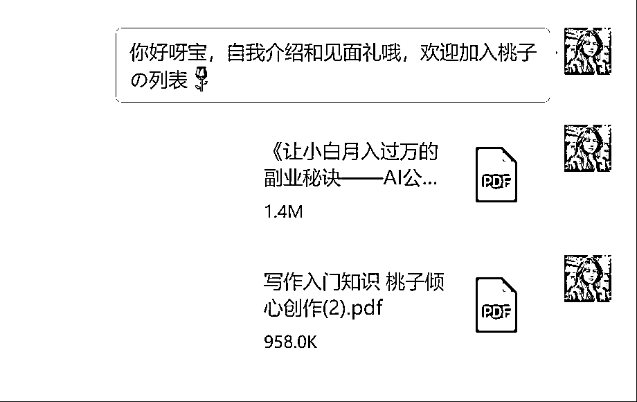

根据我的经验，那些收到礼物后会说谢谢的人，后续大概率会变成付费用户。因为愿意表达感谢，说明认知和礼貌都在线。

如果你卖的是虚拟资料，那就更简单了。比如你自己做的 PPT、画的头像、买过的电子书，以及各种考试资料——教资、计算机二级、考研初复试都可以。只要能引来对应人群，就能卖。这类产品我建议走低价路线，或者干脆不标价，让对方私信问价，但后者成交率会偏低。我更推荐前者，引流也更值。

本质上，产品也好，商品也好，都是在卖货。考研资料只是其中一个例子，你完全可以套到自己身上。

## 二、三大平台实操：小红书、闲鱼、知乎

### 1. 小红书

小红书目前对个人卖资料或卖产品非常友好，用户体量巨大，公域流量充足。但缺点是笔记很容易不被收录，也很容易违规，引流被管得很严，所以要用点技巧。

早期我做的是“硬广”，直接把资料截图发出来，标明是哪个学校。这样引来的用户基本都是搜索进来的，非常精准：

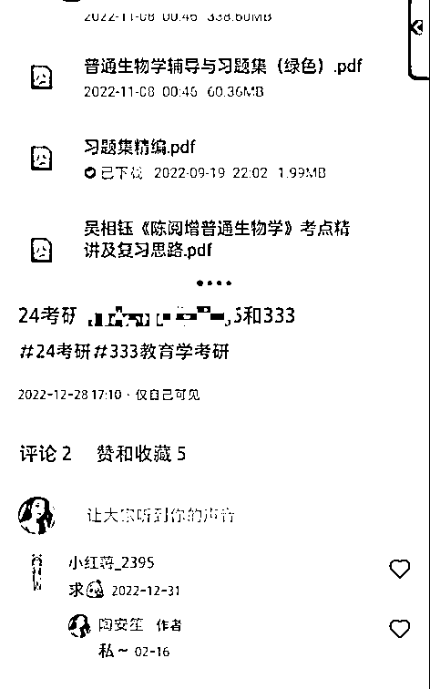

好处是省时省力、用户质量高；坏处是流量通常很少，很容易被限流。如果你是自己整理的一手资料，可以试试；但二手资料就别这么玩了，又容易被限流又容易侵权。

后来我换成写经验贴，也就是大家常说的“软广”，靠内容吸引人。当时考完研很多学妹问我经验，我就花了大概一个多小时写了一份，之后直接截图发布：

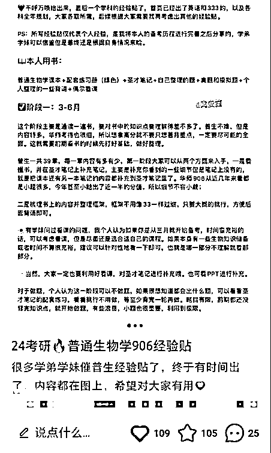

经验贴基本不会被限流，而且真正有需要的人会主动来问你资料或者能不能辅导。因为一篇经验贴会让你看起来更像真实的学长学姐，学习方法也让人觉得靠谱，信任感自然就来了。

想在公域平台卖资料，建议你至少准备一篇个人经验贴。如果运气好出了小爆款，还可以在评论区引导大家关注，增加粉丝沉淀：

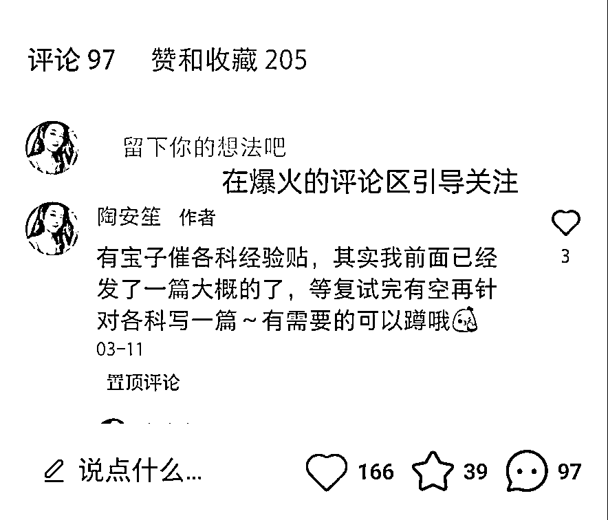

再说到卖产品，小红书上大多数人是做图文或视频介绍，最好能开个店铺，不然限流和违规的概率会高。但只要你能抓住用户痛点，把产品优势讲清楚，再踩准时间节点——比如父亲节、母亲节、儿童节这种，提前蹭一波热度，效果也不错。

还是建议大家走软广路线，用故事或者聊天记录来推荐产品。虽然不一定会爆，但来的流量很精准，转化率极高。

如果你卖的是技能，可以发自己做的 P 图作品、剪辑作品或者 PPT 成果，在简介里低调暗示可以接单。我见过一个老师把课件放小红书卖，效果也很好。知识付费也是一样，展示你的实力，说明你收徒，自然有人来。

所以你看，只要你有技能、肯钻研，什么都能卖。

### 2. 闲鱼

闲鱼本来是个卖二手闲置的平台，后来慢慢变成了卖各种新产品、资料和虚拟商品的地方，所以放资料上去卖很合适，唯一的缺点是流量不算大。

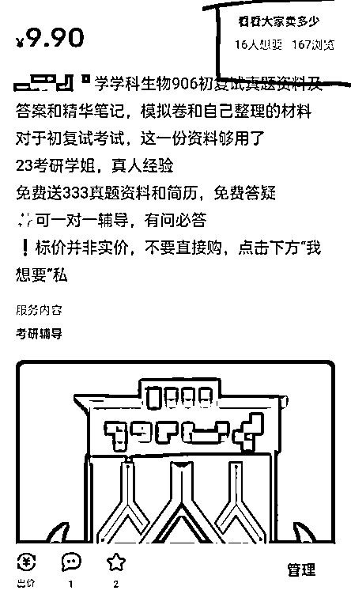

这是我顺手发的一条闲鱼，一分钟搞定，写清楚你有什么就行。大家看，167 个浏览，就有 16 个人“想要”，实际也成交了几单。我把价格标成了非实价，在描述里说明实价私信回复。因为闲鱼搜索页会把私信人数作为排名依据之一，所以私信量很重要。如果你标了实价，容易被同行比价，打开率也会降低；标虚价则成交率会偏低，看你自己更看重什么。

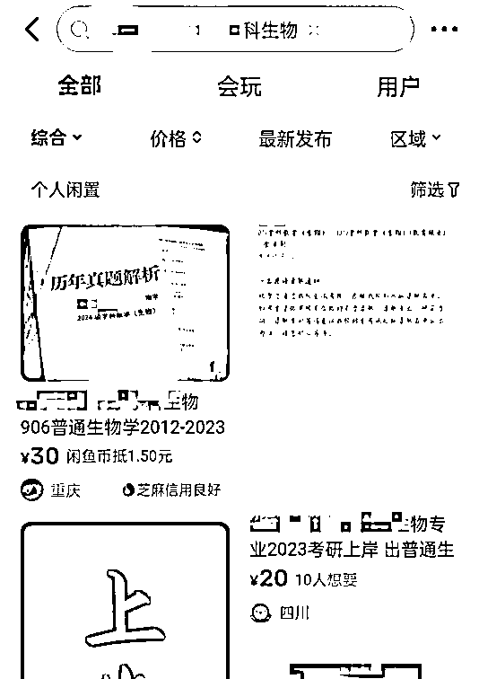

闲鱼卖资料或产品的操作步骤：

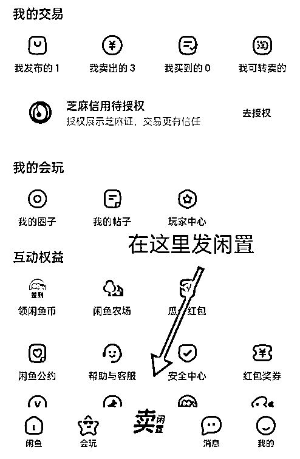

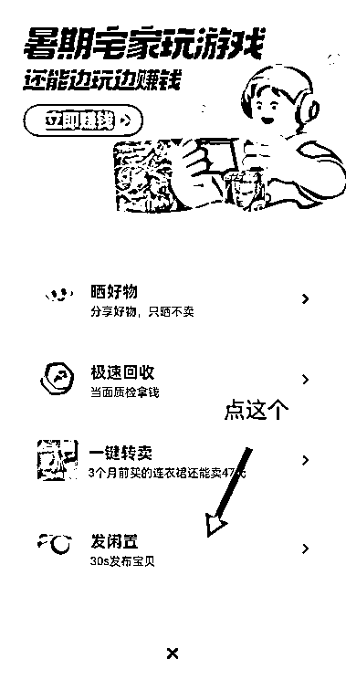

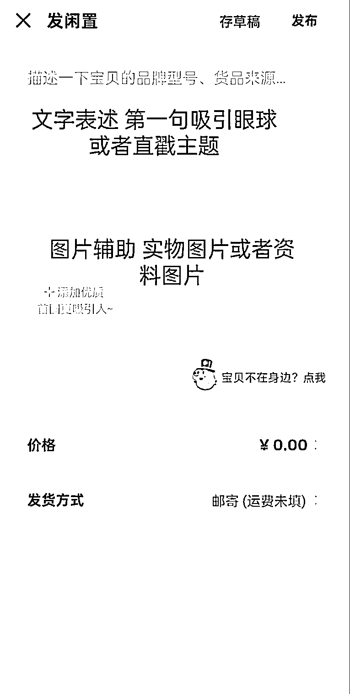

另外，发布之后记得每天去点一下“擦亮曝光”，能多拿一些曝光量。

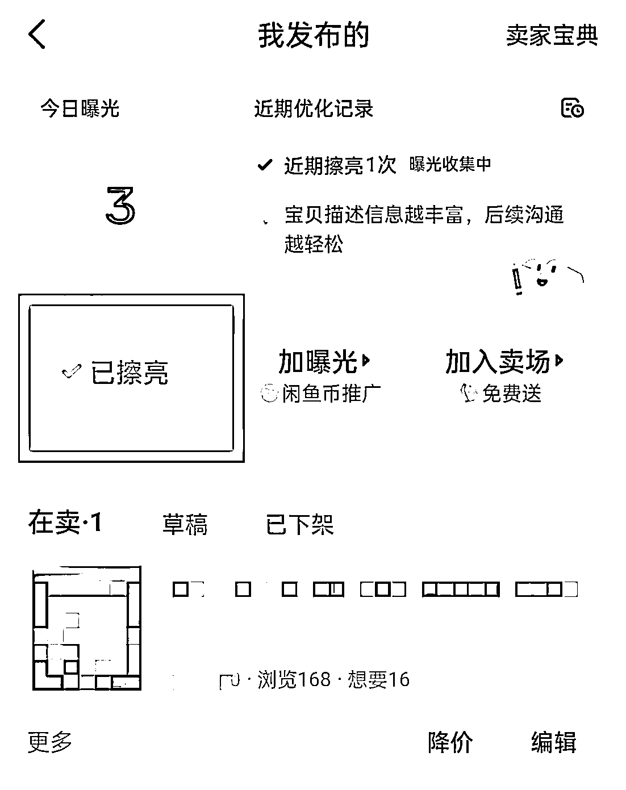

老实说，我最初在闲鱼发了好几条，结果基本都违规了，只剩一个独苗。后来才知道，二手电子资料是不能直接截图售卖的。于是我改用小红书写的经验贴，一文多用，才解决了问题。所以大家多发几条没问题，但图片和文字最好换一换。

卖产品也是一样的道理，拍不同角度的照片，直接定价就行。如果你有技术，也可以在闲鱼接单，前期价格定低点，攒一些成交权重之后再自己决定。淘宝也能接单，不过给店铺打工容易被赚差价，有条件就自己开店。

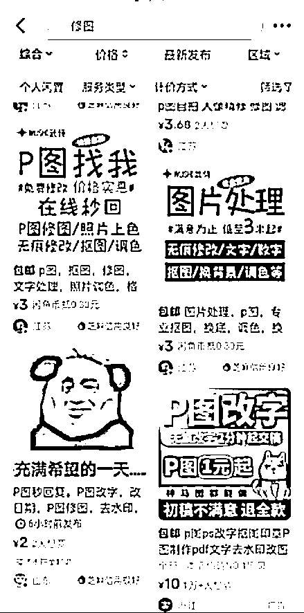

### 3. 知乎

我很早以前玩过知乎，攒了几千粉，后来因为发征稿函被封号，就一直没用了。这次为了全面撒网，我试着发了一篇考研经验贴。毕竟我自己当初也很喜欢在知乎搜经验，所以就当碰碰运气。结果隔了一段时间再登上去，发现收藏居然不少，还有学妹来私信：

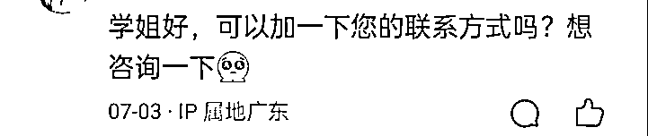

知乎的长尾效应真的非常强，而且流量基本都是搜索来的，非常精准。直到今天，还有人来问我要复试资料，等于躺赚了一波。

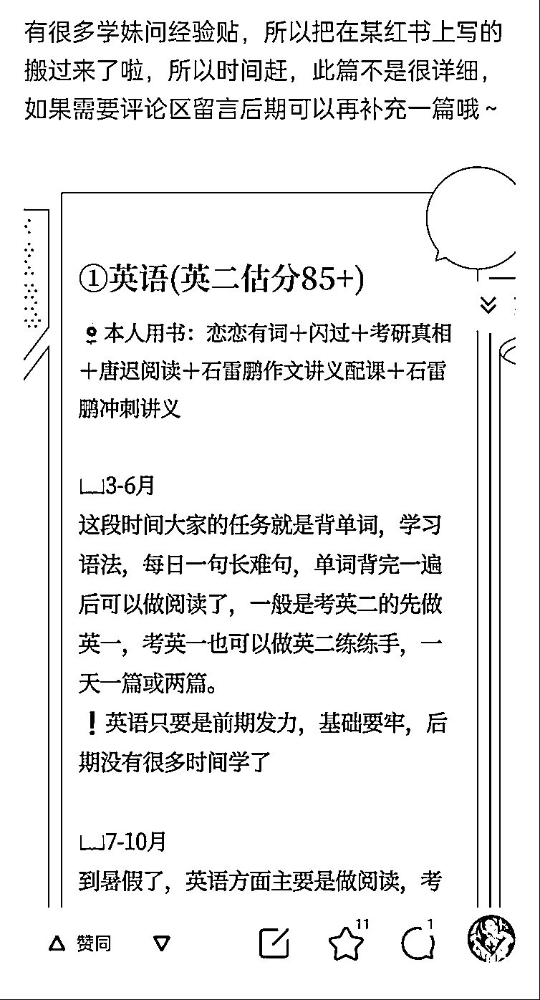

我只是把小红书那篇经验贴直接搬过来，再简单介绍一下自己，之后完全没有管理，自然流量就有这么多。如果你想卖资料或者接单，也可以把主平台的优质内容复制过来，但别太明显。

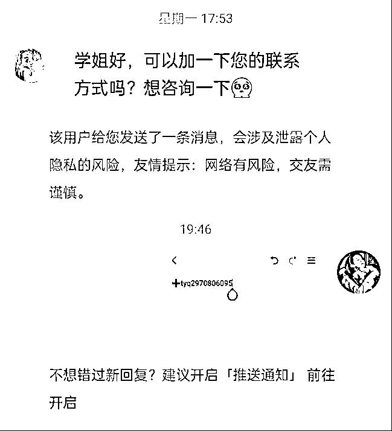

这是我在知乎回复学妹时的截图，引流用的图片，违规风险小很多。

我也试过抖音、快手这些平台，基本没什么效果，所以很快就放弃了。毕竟抖音快手都是泛流量，很少有人去那里搜学习资料。但卖产品的话可以试试商品橱窗，做点视频宣传，然后同步到视频号。

就我全网测试的结果来看，小红书、闲鱼、知乎是目前最适合卖虚拟资料的三个平台。不过每个平台都有禁止引流的规定，下面重点讲讲怎么把公域流量安全导到私域。

## 三、公域转私域：合规引流方法大盘点

其实各平台的引流逻辑都是通的，我来分享一些实操心得。

先看一个反面案例：

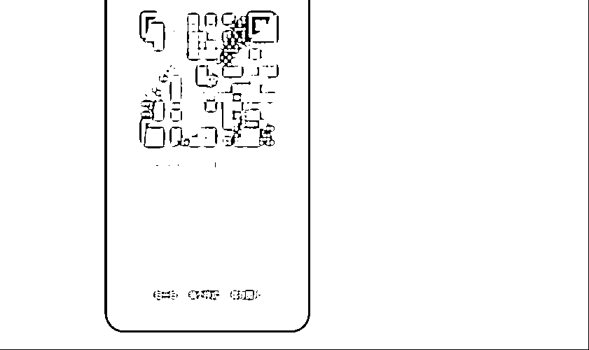

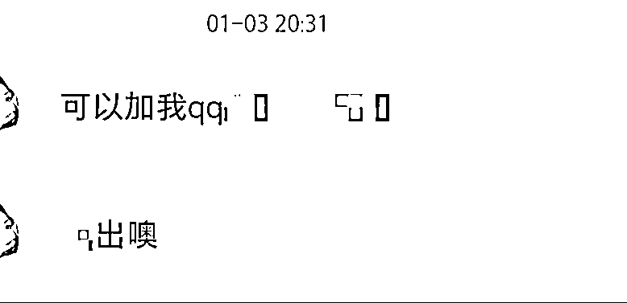

这是我当初买复试资料时，学姐发给我的操作。看起来很莽，也许一两次没事，但被系统检测出来很可能直接封号，而且多次违规会严重影响账号权重。我之前有个小红书就是因为公众号引流被彻底限流，最后只能注销。所以大家一定要谨慎，别在私信或评论里直接发联系方式。

所有公域平台都不允许光明正大往私域引流，直接发“微信”“QQ”“公众号”或者二维码，非常容易被抓。还有人用字母谐音来规避，比如下面这种：

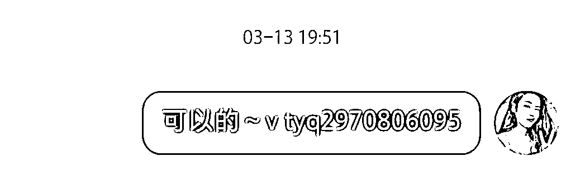

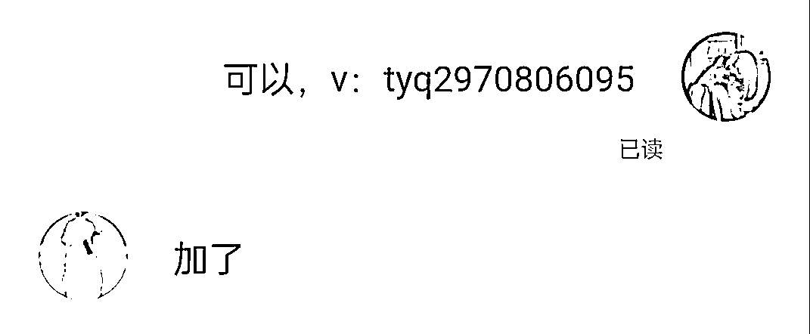

这种比直接发微信号好一些，但用多了还是会被平台识别。我被警告过好几次，所以偶尔用可以，打算长期做的话不建议。

下面推荐几个相对稳妥的方法，但也要说清楚，任何方法都不敢保证 100% 不被检测。

**1. 图片设置微信号发送**

我在知乎引流的时候，会用备忘录把微信号编辑好，然后直接发图片，文字里完全不提微信，连 vx、v 这种缩写都不碰。

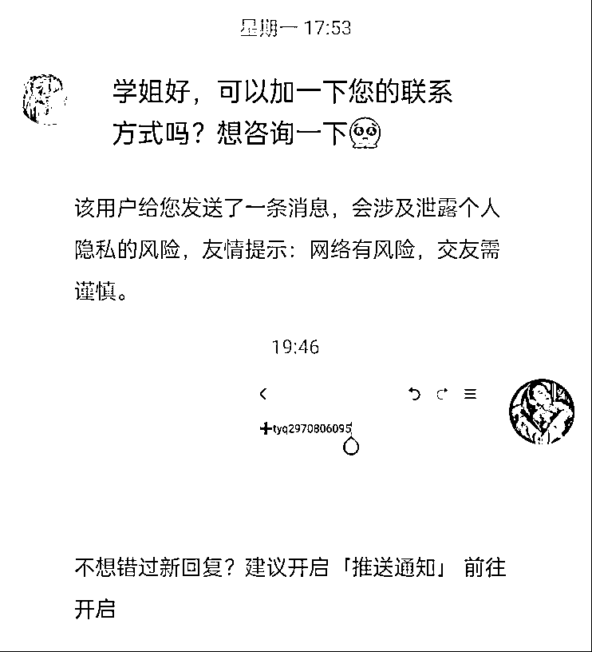

再比如我之前找简历模板时，对方专门做了一张图发过来，看起来更美观、更直观，但这种出现“v”的方式风险不小，优化一下可以尝试。

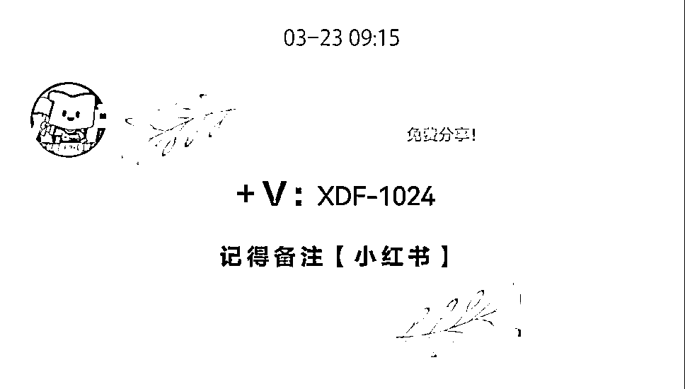

**2. 小红书号设为微信号**

自从被警告之后，我就不再提 wx 了，而是把小红书号直接改成微信号。这样别人看到我的小红书号，就等于看到了我的微信。之后我回复买资料的学弟学妹时，是这样说的：

不过也有很多人看不懂，这时候就需要靠“绿se平台”来助攻了。

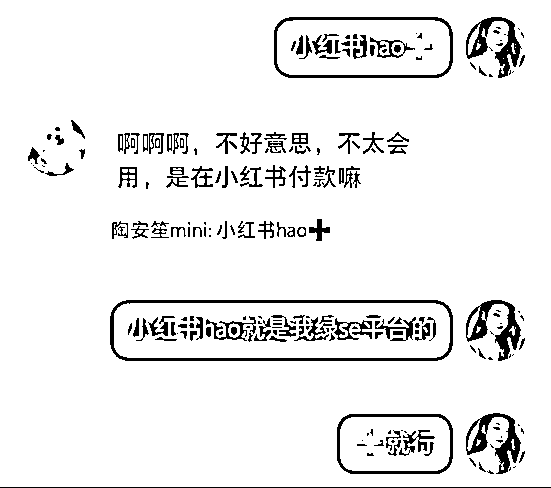

**3. 计算机式引流**

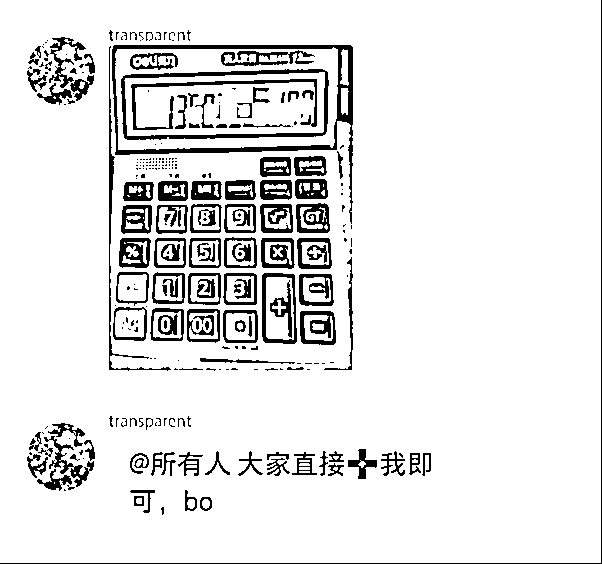

用货币符号一样的方式来表示“微信”，挺有创意的，被检测的概率也会小很多。但缺点是你的微信号必须是纯数字，如果有字母或特殊符号就用不了。（这个方法来自我合伙人辰风的社群）

**4. 群聊引流**

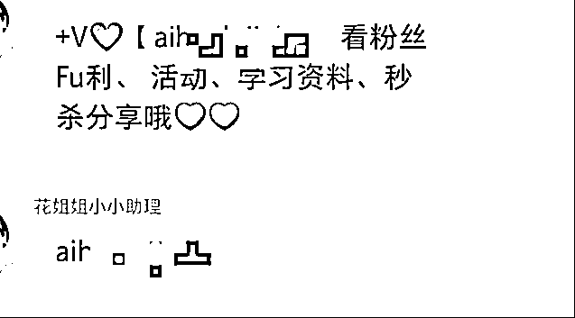

比如在小红书建个群聊，等粉丝进群之后，在群里发微信号，建议还是用图片形式。为了增加转化，可以设置一些小福利，比如进群领资料，引导大家主动去加微信。毕竟没有利益驱动，转化率会低很多。

**5. 大号引流，小号转化**

如果你的大号粉丝比较多，怕引流违规影响权重，可以开一个小号和大号做关联。很适合那些在小红书做付费产品的人，就算小号被处罚，也不会牵连大号。或者干脆设一个“助理号”，把引流对接的事交给助理，自己的主号保持安全。很多做知识付费的团队都是这么干的。

**6. 简介谐音引流**

有些博主会在简介里放公众号，但一定要用谐音，平台严的时候可能连谐音都不给发。当有人私信问怎么获取资料时，你可以引导她去简介里找，小红书发不了，就先引流到公众号，再从公众号筛选到微信。当然，前提是你有一个公众号。

我也特别建议大家，只要你想做公域平台、未来往私域发展，一定要尽早注册一个公众号。它是承接公域流量的最佳中转站，后续做招生、做转化都非常方便。

**7. 合集/群聊名称引流**

有些博主会专门建一个合集，把微信号直接放在合集内容里，粉丝不用私信就能看到，非常隐蔽。还有人会开多个社群，把每个社群的封面图连起来看，就是完整微信号，单独看却什么也看不出来。这种手法也很值得借鉴。

今天虽然聊的是小红书，但知乎、闲鱼这些平台的底层逻辑其实是一样的。像知乎和闲鱼，更适合用图片来引流；小红书就可以尝试用小红书号来做承接。所有方法都可以相互套用，你觉得哪个顺手就用哪个。

最后提醒一句：小红书私信一天最多发三次，超过了很容易被警告，警告多了就可能违规甚至禁言。所以私信次数一定要控制好。

以上就是我在虚拟资料售卖和公域引流私域方面的一些经验总结，学会之后不管换到哪个平台、卖什么产品，其实都能用。做知识付费的朋友同样可以借鉴。

最后感谢龙哥盟这个平台，也希望对大家有所启发！

评论区：

