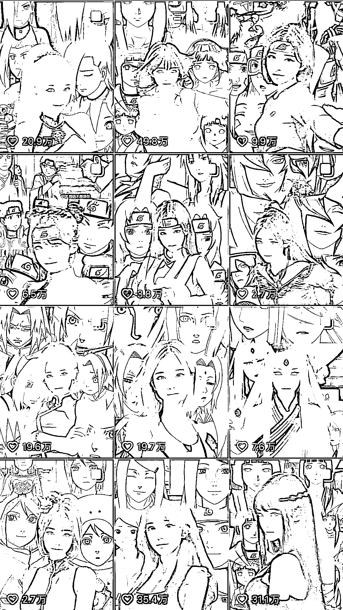
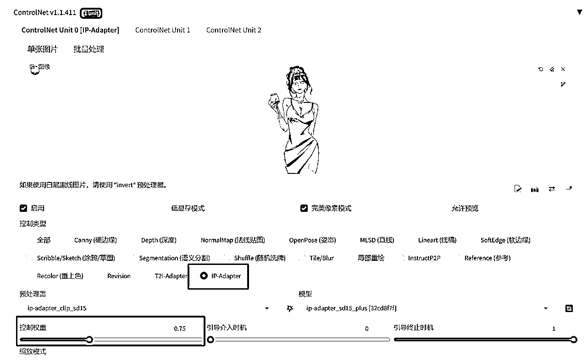
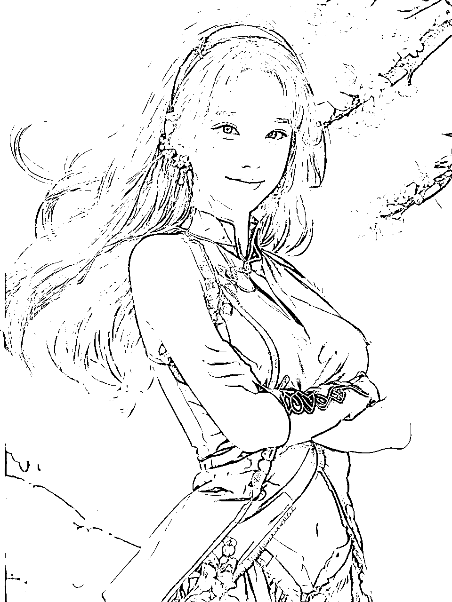
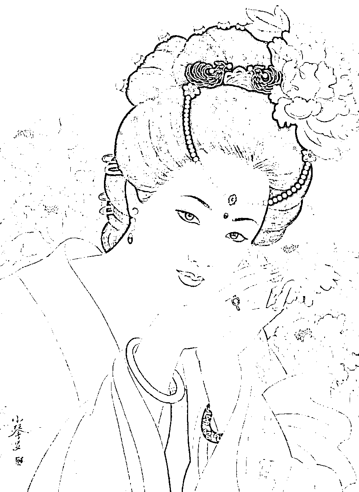
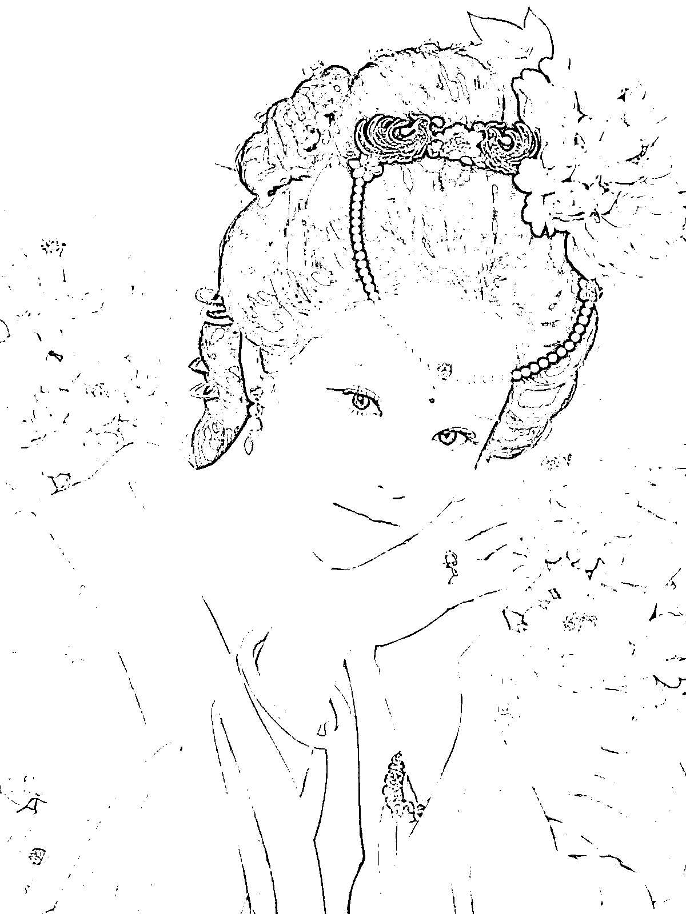
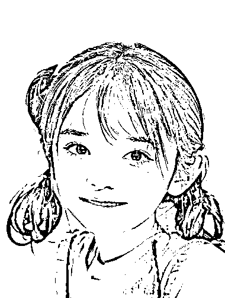

# AI二次元“穿越”现实？三步做出爆款动漫真人图，还能接音乐推广赚收益
作者：龙哥

我是龙哥。小时候看过那么多动漫、玩过那么多游戏，里面的角色清一色都是二次元模样。你有没有好奇过：如果他们真的活在现实世界里，会长成什么样？以前只能靠脑补，如今靠着AI绘画，居然真的能把他们“请”到三次元。

不只是动漫角色和游戏人物，连古画里的古人、经典二次元插图，统统都能转成写实风格。这玩法既能满足好奇心，又能拿来做文创科普、辅助教学，用处可不少。

更妙的是，把生成好的图片做成短视频发到网上，不光能收获点赞、涨粉，还能把音乐推广做成一条变现路子。

下面这份操作手册，已经把步骤拆解得很细，你只要一步步跟着走，就能复刻出同款作品。需要用到的模型文件，我也全部整理好放进文末网盘，不用再费劲四处找。整理这些真的很花时间，希望能帮到大家。

内容包括：有趣的AI真人化案例、音乐推广号的变现思路、手把手实操指南、疑难情况处理参考，全都在里面了。

评论区：
