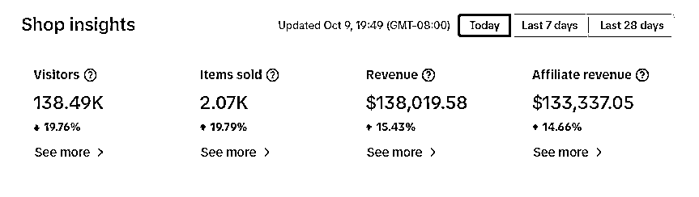
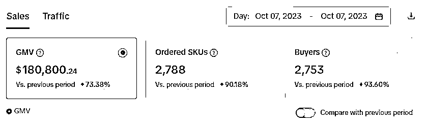
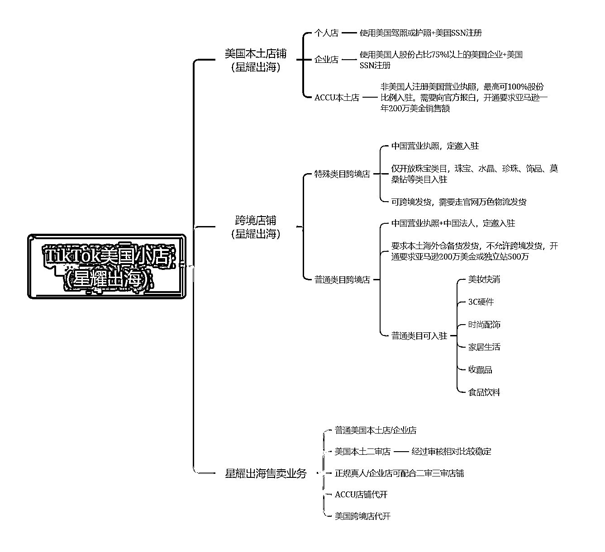
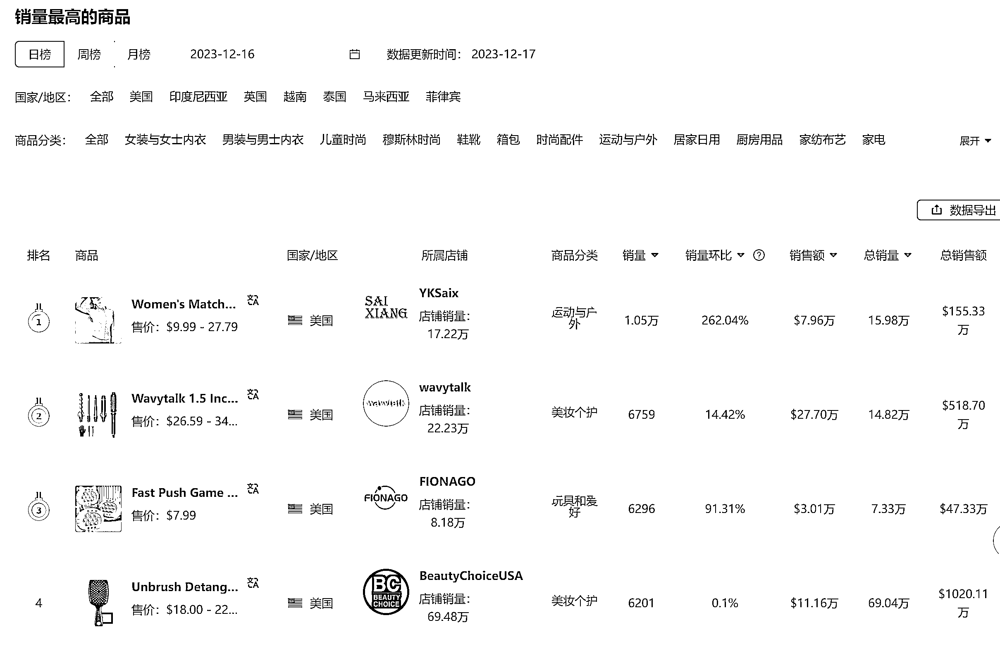
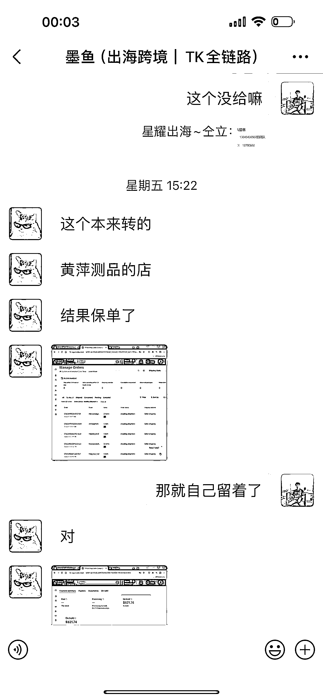
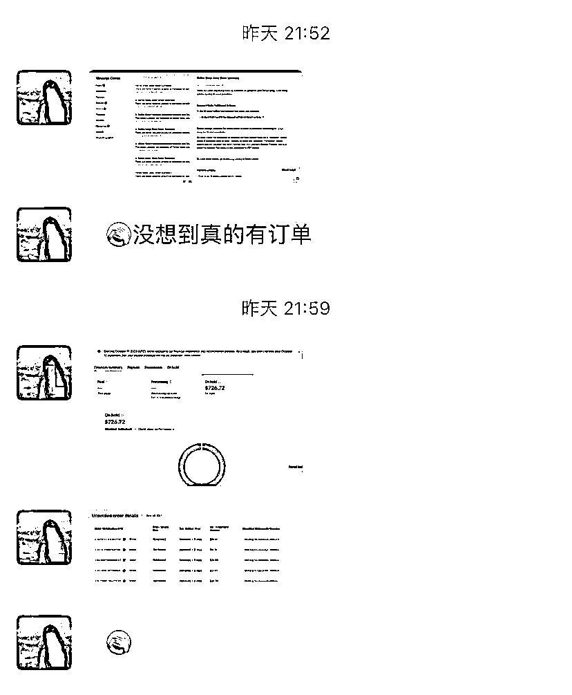

# 从没碰过跨境，靠TikTok美区两个月赚到100万：我踩过的坑和跑通的路

> 这篇文章来自我的亲身复盘，想入局TikTok美区卖货的朋友，建议认真看完。

我是众里，96年生人，双子男，算是个闲不下来的连续创业者。大学时靠给支付宝、大众点评做APP拉新，最高一个月赚了十几万。毕业后赶上餐饮SaaS的东风，吃了公众号+小程序的一波红利。2021年又赶上抖音团购的窗口，做了第一批服务商，后来自己开餐厅亏了钱，战略砍掉餐饮板块，All in字节生态。目前公司的盘子是：餐饮SaaS老业务完全放手，娱乐直播有500多个主播，主攻方向则是TikTok美国卖货，未来十年我都要深耕出海。

今年9月我加入生财，通过线下聚会第一次听说了TikTok美区小店。回来验证完，我马上用抖音和小红书找精准客户，开始卖美国本土店铺，还整理了一份《美区TikTok Shop销售手册》。9月22号在生财分享后，不少圈友买了我们的店。

随着店越卖越多，我发现很多小白上架没几天就能爆单。于是我们自己也开始自营卖货。当时只有我一个懂的人，后来招了3个运营，全是零经验的小白，就靠我们一起管30家店铺。两个月时间，利润突破了100万。

数据最好的两家店长这样，其他的要么被封，要么只出了几千美金、几万美金。 

但这段路并不太平。10月赶上一波平台封店潮，资金被冻结了一个月，卖货和卖店全部停滞。直到11月底，钱才全部回到账上。也正是这次回款，让我确认：字节现阶段不会像亚马逊那样随意收割中国卖家。

封店期，业内做店群的一批人转去搞直播、短视频，赚钱很辛苦；回款后，大家又开始玩店群。我也没闲着，一边复盘一边把开店工具化。靠自己的那点研发能力，做了几个插件，把自动采集、自动翻译、自动采购下单串在一起，现在一个人能管50到100家店。这块还在持续迭代，后面有机会再单独讲。另外，我还投了一个小团队在测试美国矩阵短视频带货，目前有一点小结果，预计1月份跑通模型再分享。

下面重点说说，一个电商小白是怎么在TikTok美区赚到钱的。

目前平台主流玩法有店铺自然流、直播、短视频、达人带货、付费投流、私域、引流独立站这几类。我们跑通的是跟爆款自然流和店群自然流。

自然流的核心，总结起来三件事：
1. 店铺便宜、稳定，网络节点安全；
2. 有高效的协同工具，能批量采集、同步、给素材去重、对接发货；
3. 用足够多的商品链接，去占商城搜索流量。

你可能不知道，TikTok美区带货每天有3000多万美元GMV，其中约两成来自店铺搜索。也就意味着每天有几千万人民币的交易，发生在搜索路径上。谁能上更多链接，谁就能被更多买家看见。甚至达人想带货时，看你链接排在前面，宁可只拿你5%的分佣，也不愿意去拿别家给的50%。

先说店铺选择。  美国本土店基本可以理解成抖音小店，只不过必须有美国身份才能开。本土店目前自由度很高，你甚至可以把它当杂货铺，上架一万个SKU都不成问题。而且平台从5月就开始发力这个市场，现在还有运费补贴。跨境店就不一样了，类目限制多，还得提供亚马逊流水，老卖家才搞得定。

然后是网络搭建。本土店在网络上的要求没有直播那么高，但也不能马虎，很多店就是栽在网络上。如果你是刚启动，手上有1到5个店，用紫鸟浏览器这种直接买网络节点就行，一个月100来块，现在还附带免费的达人邀约功能。如果走店群路线，几百上千家店再用紫鸟成本就太高了。我们是让技术自己搭美国静态住宅IP，不重复，一个IP成本大概2到3块钱，对外卖的话能到40块一个月。浏览器从战斧、紫鸟、ADS，一路试到比特和Hubstudio，目前两个都在用，方便和美国那边的同事协同注册店铺。

选品和上架，我们常用FastMoss和Tabcut两个网站。别一上来盯着首页那些一天卖几万单的超级爆款，从第10页往后翻，算上物流运费和货损，再去1688用图片搜同款比价。比如我们跟过的一个卷发棒，排在该品类第二名，卖49美金，采购价69人民币，加上虚拟仓物流费，算下来还能赚一半。我们靠它出了100多单。

这里有个关键提醒：图片一定要去重。你优化后的主图和素材，一眼看上去跟同行不一样，哪怕货是同一个，价格都可以定更高。 

1688采购之外，有些交流群会发海外货盘，但这种大多是多道贩子总结出来的，利润已经被剥到很薄，自己一定要核算成本。真要对接工厂，没有在海外仓备过货的合作方其实价值很有限。刚入行千万别自己备货——花几万块给工厂买了一批发到海外，卖不掉就全砸手里了。我建议先用虚拟仓发货，把流程跑通再说。

关于物流，很多人说虚拟仓会被封，其实核心是时效问题。TikTok美区要求本土发货，3天备货、7天妥投，大多数物流商根本做不到。再加上行业早期，物流商没跟字节API打通，虚拟订单无法回传，后台一直显示待发货，账自然算到卖家头上。

我们现在的方案是走香港货代：不用海外备货，出单后货发到深圳，2天送达，当天装上货代去香港的车，晚上飞美国，同时货代生成虚拟轨迹回传平台。好处是零库存周转，卖一单发一单；缺点是成本高，起步价都要100+，退货就等于货损。

这里必须把我踩过的坑好好说一遍。本来我们还能多赚将近100万，结果因为物流商跑水单，直接亏了7万美金。后来换了四五轮才验证出稳定的合作方。最开始的虚拟仓物流费是80+30一单，还不帮打包，我想换一家。朋友介绍了一个“段总”，报价40+30，还能垫资3个月。对于刚入行、天天把资金周转挂在嘴边的我来说，这诱惑根本挡不住。无脑把几千单发过去，结果订单没有回传、航运欺诈，店铺最后被封了，订单被退，货也没了，现在还在打官司。

说句公道话，在TikTok美国把货卖出去并不难，只要你拼命上链接，出单节奏会非常快。有个上游工厂直接找我们拿了店，刚上架两天就开单了；我们拿去测品的新店，也只用了两天就出了800多美金。 

所以我想最后强调一句：做TikTok美区，先谈风险再谈卖货。你能不能接受店铺说封就封？能不能接受货卖出去但资金冻结30天？能不能接受卖了侵权产品拿不到钱？如果这些你都能接受，那这个市场一个月赚十几万真的很容易，有资金放大后，月入百万千万也完全可能。把风险想透，就放心去冲。

感谢生财帮我破圈，让我抓住这波风口。希望每个入行的圈友，都能成为亿级卖家。

如果你也想交流，评论区见。 