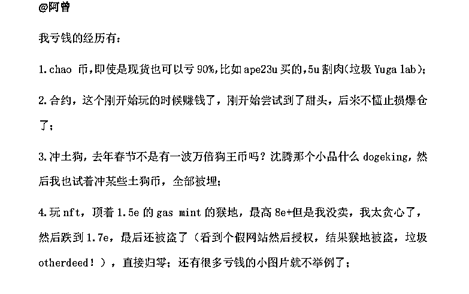
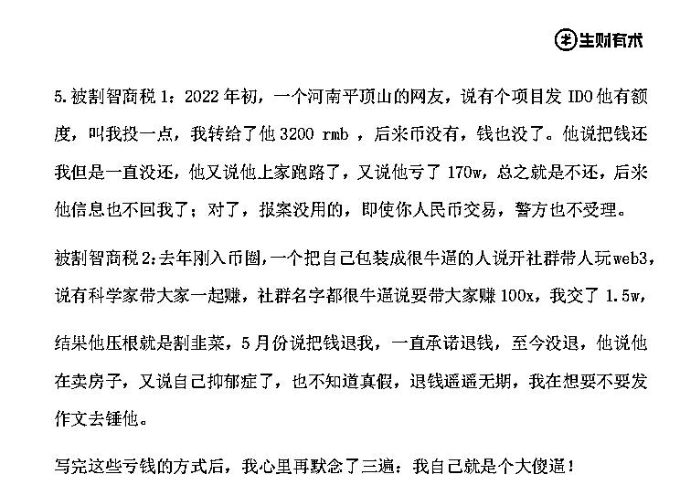
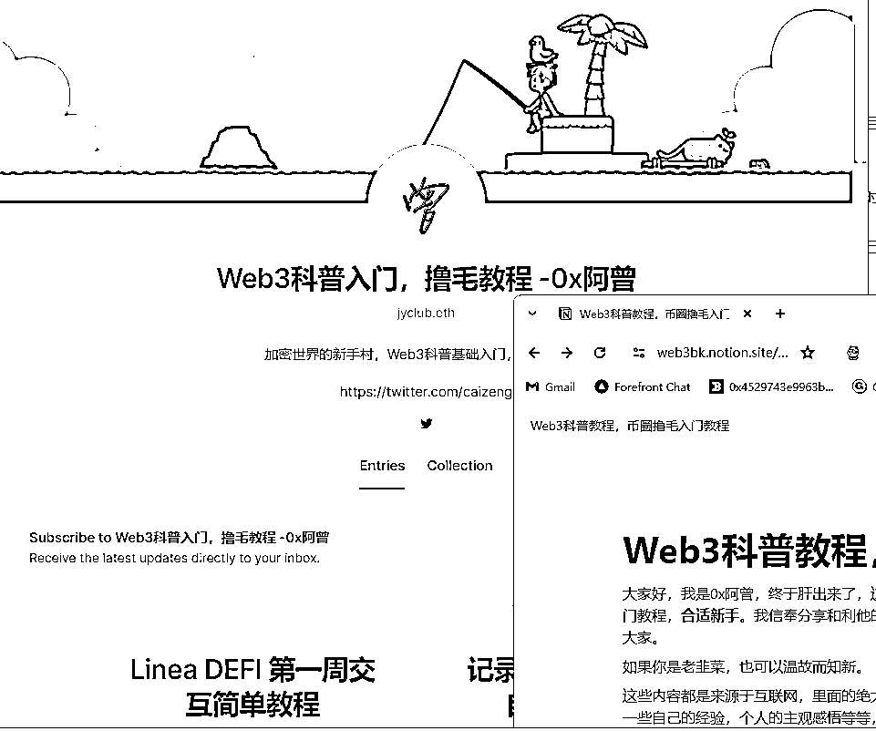

# 从归零到 A7：我这三年 Web3 撸毛实操复盘

## 怎么在 Web3 撸毛从 0 到 A7

作者： 阿曾

日期：2024-02-22

大家好，我是阿曾。最近刚吃到 $strk 的空投，这笔算得上 A7 级别的收益了。

顺带说一句，我挺看好 STRK 这条链，所以目前一个都没出，手里目标是拿住到 5U 以上。

今天就把我自己在 Web3 里是怎么从一无所有做到 A7 的路径摊开聊聊。

## 一、起步就是一场暴击

我的撸毛之路是真真正正从 0 起步的。

2021 年 21 月，带了 3w+人民币杀进圈子，结果人没选对路子没走对。现货合约乱玩，还外借杠杆，最后 NFT 被盗，直接清零，差点就彻底退出。

那段亏钱的经历我后来写过，发在龙哥盟的《人生亏钱指南》里了，像图里那样。

所以我现在特别想提醒新人：Web3 的坑比你想的多，别拿场外杠杆硬上，那种心态崩的感觉真的不想再来一次。参与的额度一定要在自己能承受亏损的范围内。

好在当时 Web2 还有点外快，亏了十几万还能兜住底。

## 二、被迫转向，找到可复制的打法

亏完之后只能自己找活路。很快我发现撸空投这件事，本质上是高概率加高赔率的玩法。

为什么概率高？因为 Web3 的底层逻辑是去中心化，权力下放就需要治理代币，就得靠发币吸引用户参与，这个机制是刚性需求。

为什么赔率高？因为链上项目融资动辄千万上亿，用户投入很小的成本，就有机会拿到几倍上百倍的空投。

但它是一件典型的延迟满足。项目从立项到上线经常要几年，中间要持续陪跑。养一个号养几年，项目黄了，前期投入的时间金钱就打水漂。

所以一开始我什么都不懂，只能自己啃。跟着头部 KOL 学着写教程，把学到的东西整理成从零基础到项目实操的笔记发出来。写到别人照着能撸到钱，我才算真的入门了。

为了逼自己学得更深，我还去申请当了 Web3 入门航海教练。带群友的同时，自己也被倒逼着把认知迭代了不少。

## 三、从 0 到 A7 的时间线

大致梳理一下我个人的收益节点：

1，2021 年 12 月，3w+入圈
2，2022 年 4 月，合约爆仓归零，正式开始研究撸毛
2，2022 年 5 月贷款 10w+mint 猴地，8 月被盗，再次归零
3，2022 年 10 月，castaways 第一桶金，累计 10+ETH
这是纯 0 撸，长期玩游戏产出 NFT 直接空投到钱包，零成本。这次经验让我敢去碰后面需要花钱的项目。
4，2022 年 10 月，APT 空投 5w+
也是零成本撸，测试网 mint NFT 就有分，单号 150 个币，当时约 1200u。
5，2023 年 2 月，blur 空投 12w+
在 blur 上做 NFT 交易积累行为数据后获得空投。
6，2023 年 3 月，arb 空投 17w+
有点可惜，当时没有多号意识，只撸了几个号，错过了更大盘子。
7，2023 年 10 月，tia 空投 3w+
意外收获，但认知不够，2.5u 就离场，至少少赚了十倍。
8，2024 年 1 月 alt 15w+
9，2024 年 2 月 strk A7+
alt 和 strk 这两波我用了多号策略，终于拿到了预期回报。
10，预计 zksync、linea、SOL 生态等后续还有机会
11，我在 Web3 依旧小心翼翼，能不能冲到 A8，还看后面。

这就是我的从 0 到 A7 的全过程。

## 四、人和事比技术更重要

在 Web3，跟对人做对事的效率差距极大。

第一笔大钱是我跟 NFT 大佬花总一起玩 castaways，他让我坚持玩两个月，结果就兑现了。

空投方法论方面我一直跟随撸毛圈的天花板丰密老师，照着他的交互思路持续执行。

方向对了，路自然就宽。

## 五、我挑项目的两个标准

看项目我基本就看两件事。

**1，看赔率和概率。**
高赔率高概率的必须重仓；高赔率低概率的，用低成本去博取大收益也值得。通常融资体量大的项目，生态确定性更强。
成本过高的项目就要掂量，本金有限，机会无限。

**2，看能不能批量上号。**
有些项目要搭节点买服务器，技术门槛高，普通人批量不了。像只要绑定三件套 dc/x/gmail 就能开的，操作成本低，100 个小号就是 100 倍放大。
以前火的 cb 打新、港股打新都是这个逻辑。

另外我之前在 Web3 入门航海分享过《Web3 撸空投打造精品号》，当时用 zksync 精品号做了演示。

链接：[`t.zsxq.com/17s9ofKiA`](https://t.zsxq.com/17s9ofKiA)

现在看热度，**Zksync 的空投窗口快到了**，之前有做过交互的老朋友坚持住，福报大概率还在路上。

除了 Zksync，Linea、SOL 生态近期也值得重点关注。

## 六、最后的话

Web3 的机会很多，但窗口期很短。错过最佳时机就容易踏空。

看到好机会就要收缩社交，全力all in。

龙哥说过一句话我常拿来提醒自己：“有钱赚的时候，要集中所有资源和精力allin，切忌小富即安。任何业务都有生命周期，不进化就会被后来者干掉，连汤都不剩。”

Web3 没有无缘无故的暴富，都是日积月累。你每刷的一笔 tx，每熬的一个夜，都是在为下一次爆发打地基。

希望这份复盘能给还在迷茫的你一点启发。2024 年冲 A7，一起冲 A8。

* * *

评论区：

才 : 完全看不懂术语

薯条 : 我也没看懂在做什么 有详细的介绍吗[尴尬]

阿曾 : 你去搜下，找一下 web3 入门航海手册

白黑 : 感觉水太深了，不敢搞

陈大小姐 : 感谢教练分享～

* * *