# TikTok出海新机会：原神“开荒号”生意怎么做？
作者：龙哥

最近在 PiPiADS 上刷数据，看到好几个独立卖家都在 TikTok 上卖《原神》的“开荒号”，把数字商品这门小生意做得风生水起。皮皮数据里类似的小众赛道还有很多，比如长期稳定跑的祝福视频、健身教学、电商培训课程。虚拟类目的核心优势在于交付简单——买家付款后邮箱直接收账号，没有物流和仓储压力。

这篇文章就用原神开荒号来拆解，最后也会聊聊如何找供货资源、如何复制玩法。

先看 PiPiADS 的搜索结果，搜 Genshin Impact 或 Genshin 会出现大量相关广告。

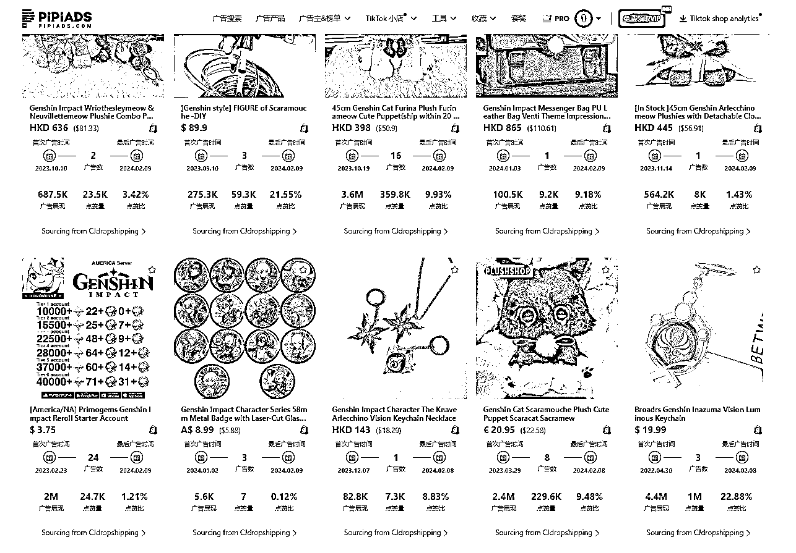

其中一家卖号的卖家，累计曝光量超过 200 万，正在跑的创意有 24 条。

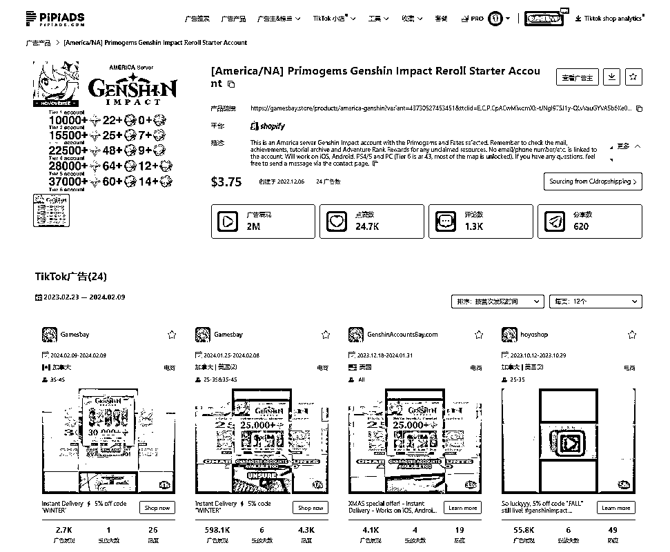

再说说原神为什么能在海外火起来。这个开放世界游戏把七国设计成七种文化符号，例如蒙德城融合了欧洲中古街巷与荷、德、英的建筑风格；璃月从画面到剧情都有浓厚的东方文化底蕴；即将开放的枫丹，光是预告就让法国和西欧玩家期待值拉满。多元化的内容策略，成功击中了不同文化背景的玩家群体。

最新月度数据是：全球下载量 200 万，总收入 1400 万美元。

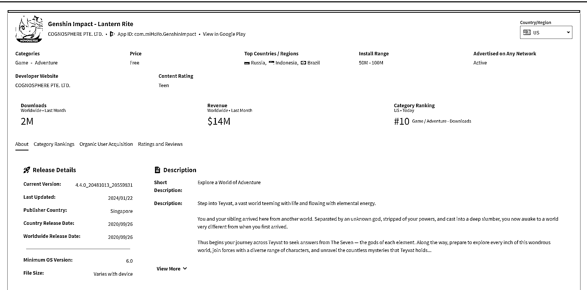

PiPiADS 上还能看到有人投放原神周边，比如手办、钥匙链、人物徽章、背包等。

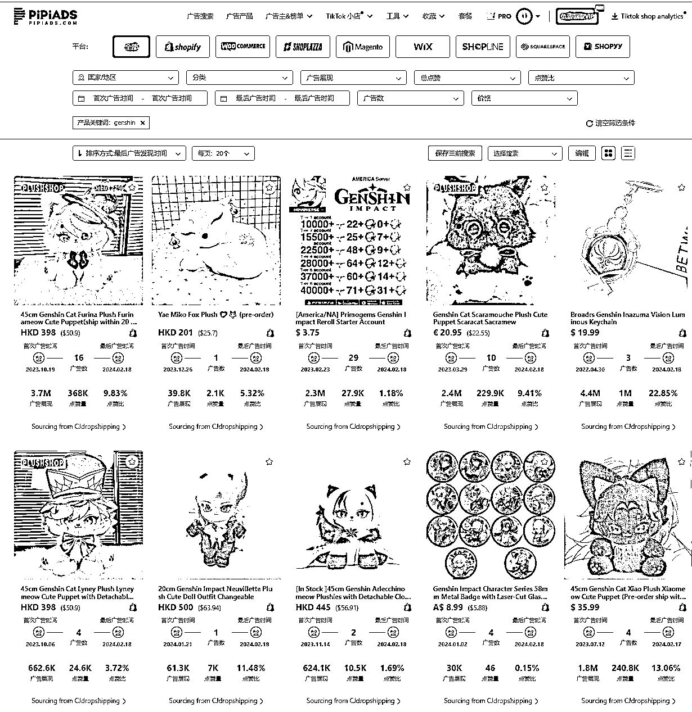

开荒号这门生意，本质是帮新玩家跳过痛苦期。新手进游戏，手里只有系统送的低星角色，推图没问题但不够爽；想要顶级五星，要么慢慢攒几个月的抽卡资源，要么赌当前卡池。于是大量玩家选择直接买一个成品开荒号，快速体验高配阵容。

所谓开荒号，行业内叫“自助领奖号”，本质是利用游戏给新人的福利反复建号，把领到的资源囤起来再出售。

这种号的价格从五毛到几百块都有，贵一些的甚至能自选五星人物。例如开服头两天的刻晴角色号曾被炒到上千元，后来行情回落，一个无绑定信息的刻晴单角色号只要 200 元左右。

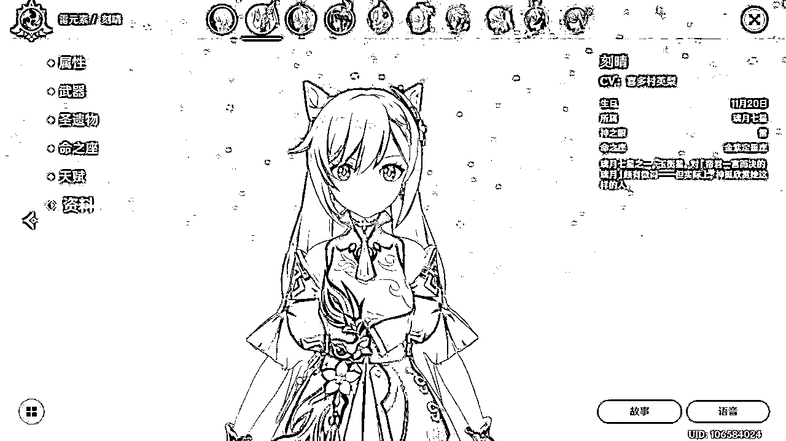

不过，这类号的账面资源与实际价值往往不对等。市场上大部分开荒号都是靠自动化脚本批量搞出来的：脚本自动扫荡地图上的宝箱、神瞳和各种信物，再用外挂打通深渊8-3，攒够抽卡资源后搭配指定五星角色一起卖。普通玩家愿意慢慢探索的话，这些资源其实也能靠自己积攒到差不多的水平。

这类账号大多出自小工作室的批量生产线，最终在 TikTok 上被推给目标玩家。

在 TikTok 上输入 Gamesbay / Genshin Impact / Genshin 这几个关键词，就能刷到不少卖号视频。

把视频文案丢进 PiPiADS 反查，也能找到同一个卖家。

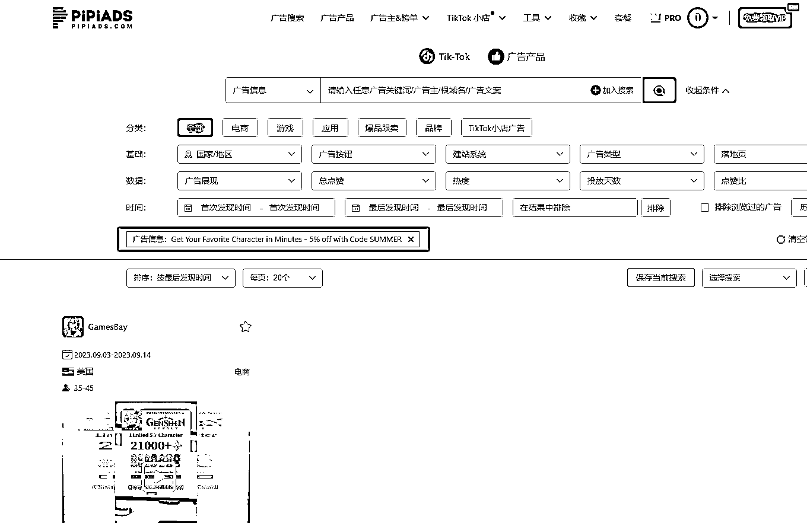

看一个典型卖家：总曝光 635.8k，推广计划 10 个，跑量周期 217 天，运行时段 2023.04.13 至 2023.09.24。

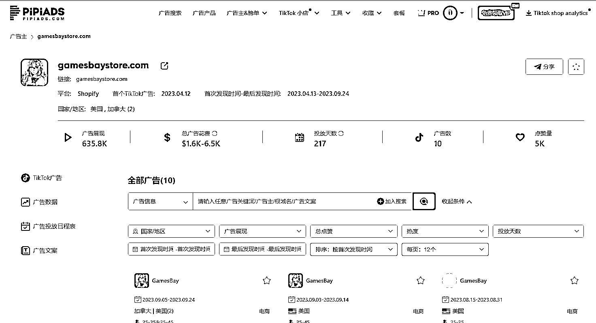

其中一条跑得最好的视频，单条曝光 312.4k。因为飞书限制，这里贴不出视频画面，详情可在 PiPiADS 的广告主分析页查看。

另一位卖家累计获得 2.4M 曝光，素材量 29 条，时间线从 2023.02.23 一直拉到 2024.02.19。

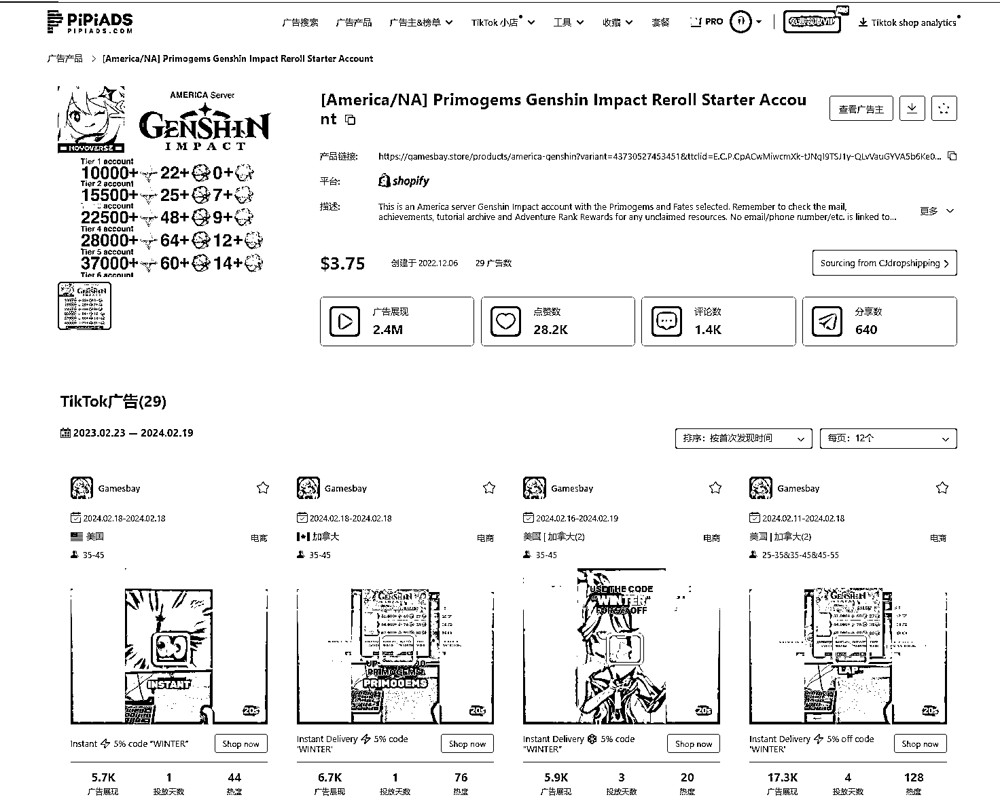

再看视频模板，本质就三步：游戏录屏、角色与装备展示、文案说明，然后批量复制。跟普通电商广告比，这类游戏向视频能跑很久，一条素材往往可以持续投放好几个月。

落地页那边：

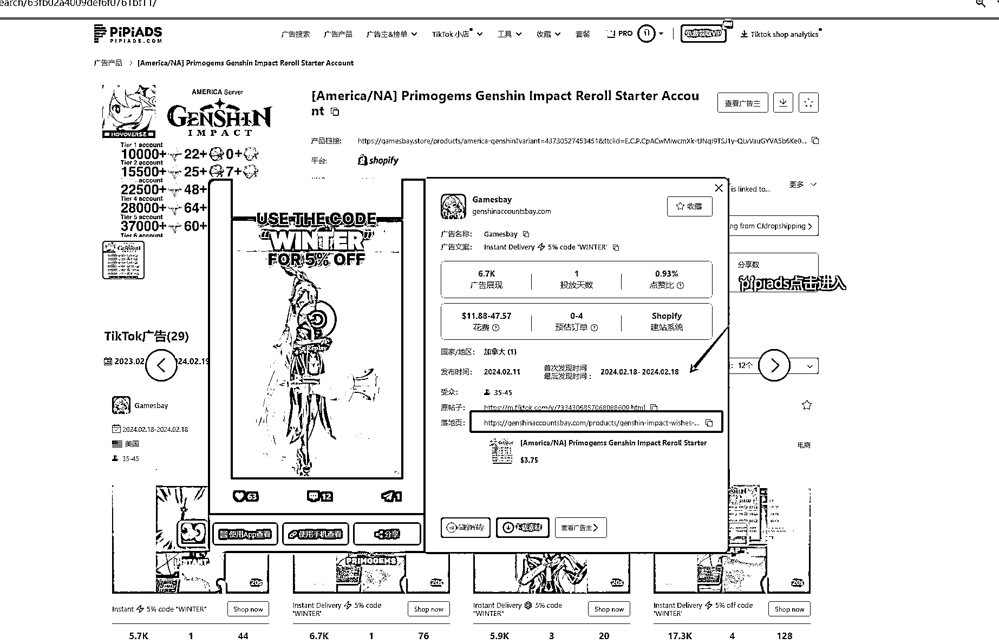

页面走简洁路线，价格区间在 4.75 到 37.95 美元。玩家买号的心理大多是“要买就买顶配”，于是实际成交往往偏区间上部，利润空间也因此能覆盖广告成本。

货从哪里来？

虚拟生意成不成，很大程度看供货稳不稳。我整理出三条路：

第一招：借助 etsyshop.ai 找货。这能帮你从 Etsy 的海量数字商品里筛出合适的供应商，出单后去 Etsy 下单发给客户就行，全程不压库存。

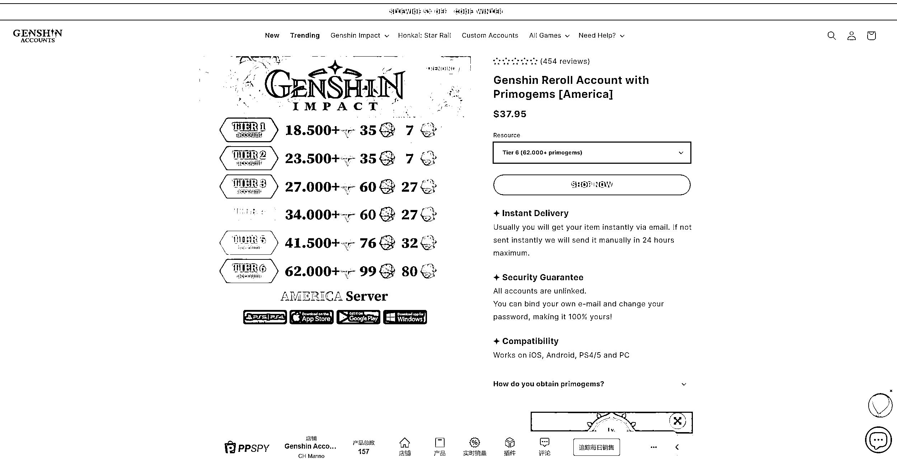

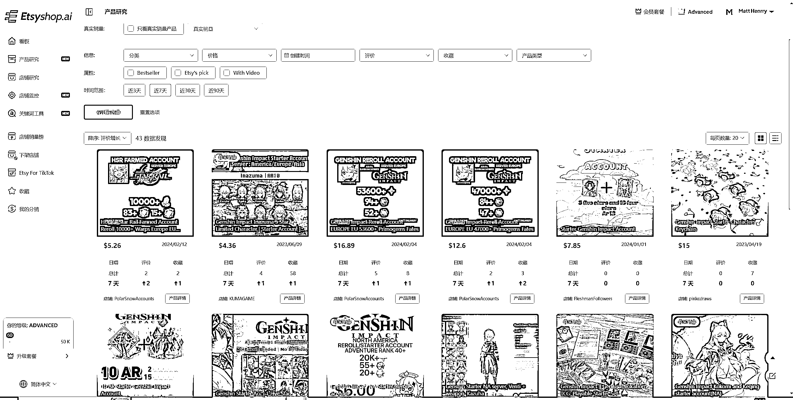

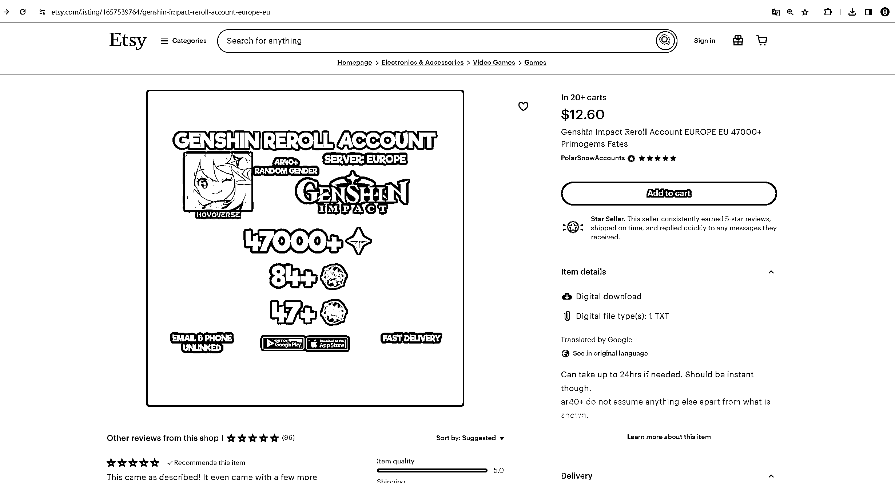

第二种：自己用 Google 找源头供应商，谈好价格转手赚差价。

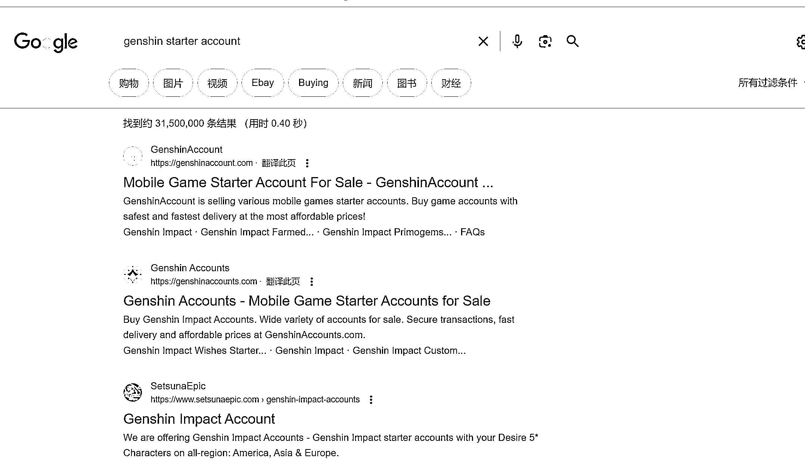

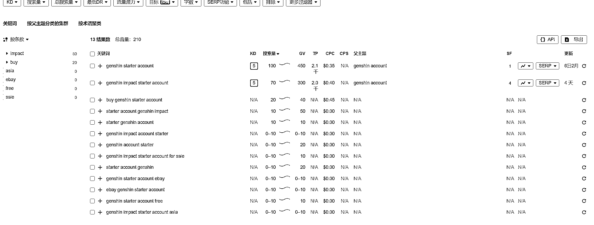

第三个选择：在 eBay 上采购，同样可行。

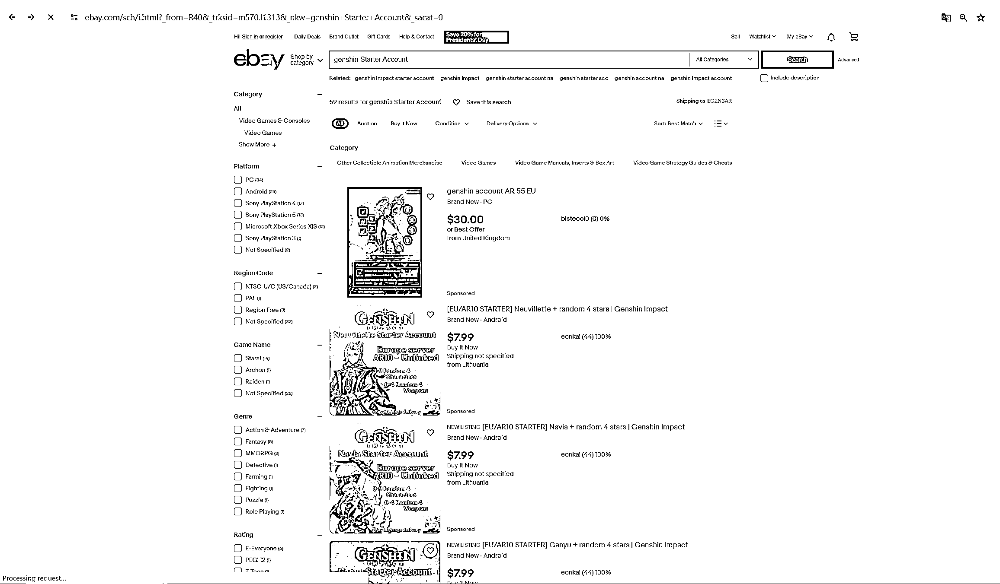

这套逻辑放在任何热门海外游戏或 App 上都成立。出海小生意本来就适合轻资产、快试错，越小越美。想找方向，多去 PiPiADS 刷短视频创意，利基市场就藏在数据里。

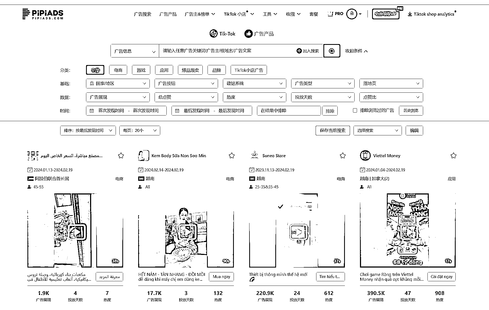

货源不稳定，是做出海商家永远绕不开的坎。数字类目不需要仓储和物流，门槛低、管理轻，未来入局者只会越来越多。

我最近在持续更新 TikTok 实战经验，选品、投流、工具、技巧都有涉及，具体玩法可以参考我之前写的文章。体系化内容我也整理成了飞书上的《TikTok广告知识库》，欢迎查阅。

评论区：

小马哥 xy50：海外短剧有操作的朋友没？

