# 2024 年巴西 TikTok 半闭环探路报告

## 2024 巴西 Tik Tok 半闭环调研报告

作者： 阳光杉木

日期：2024-02-23

近期 TikTok 在巴西启动了半闭环模式的招商内测，目前采用邀请制，已有商家拿到邀请码进入试水阶段。

所谓半闭环，指借助第三方建站工具如 Shopify 等插件与 TikTok 完成联动，消费者在视频内的购物车或主页橱窗点击后，被导流至独立站完成下单支付。

市场概况

巴西作为拉美第一大经济体，电商正迎来高速爆发期。移动互联网渗透加深叠加社交媒体影响力攀升，TikTok 等内容平台已成为连接品牌与买家的关键通道。国内超过七成网民依赖移动端上网，用户结构偏年轻、好奇心强，对新品类接受度高，电商土壤十分肥沃。

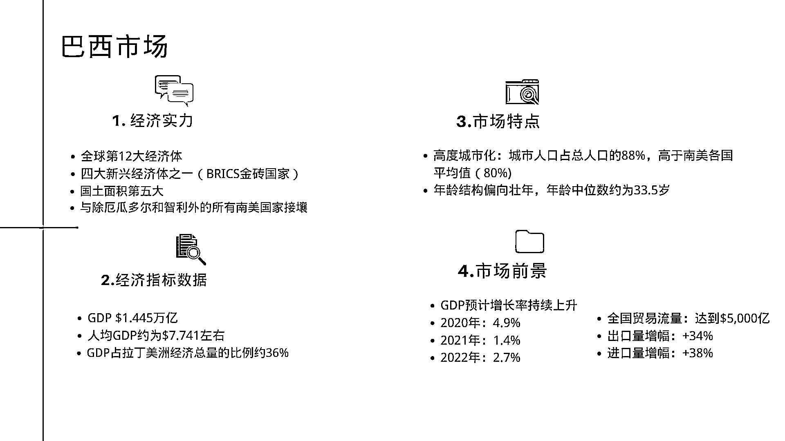

Statista 数据显示，TikTok 在巴西社交媒体市场占据约 50% 的用户份额，平台热度位列前五。

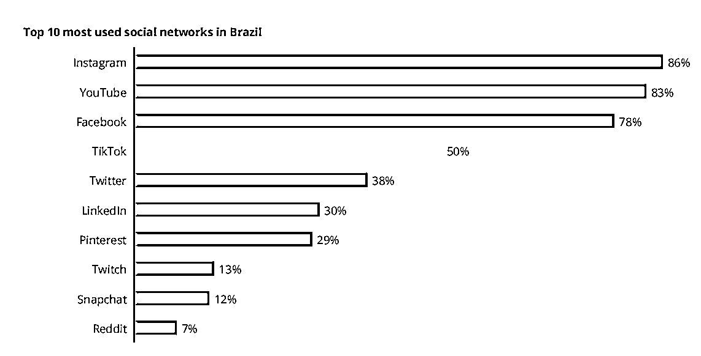

pipiads 监测数据显示，截至 2024 年 2 月，全球 TikTok 广告受众规模排名中，美国以 1.58 亿位居第一，印尼以 1.4 亿位列第二，巴西以 1 亿受众排名第三。环比 1 月，巴西广告受众新增约 180 万。

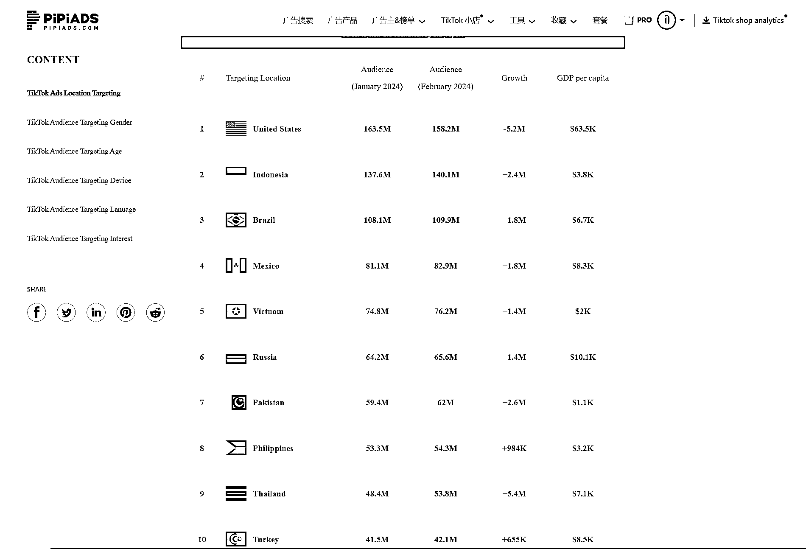

### 用户行为洞察

巴西 TikTok 用户活跃度高、参与度强，偏爱新品探索、品牌故事与创意种草内容。消费兴趣集中在时尚美妆、健康健身、家居园艺等方向。把握这些偏好，有助于商家更精准地做品类定位与内容策略。

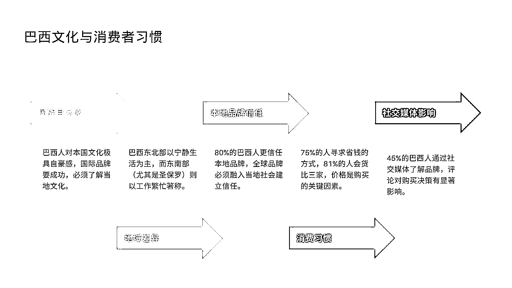

### 选品方向

巴西市场对以下类目需求尤为突出：

1.  时尚与美妆：国人重形象，服饰、配饰、彩妆护肤类目持续走强。

2.  健康与健身：健康意识抬头，营养补充品、有机食品、健身器材受欢迎。

3.  家居与园艺：居家时长增加，家居装饰、改善及园艺用品需求上升。

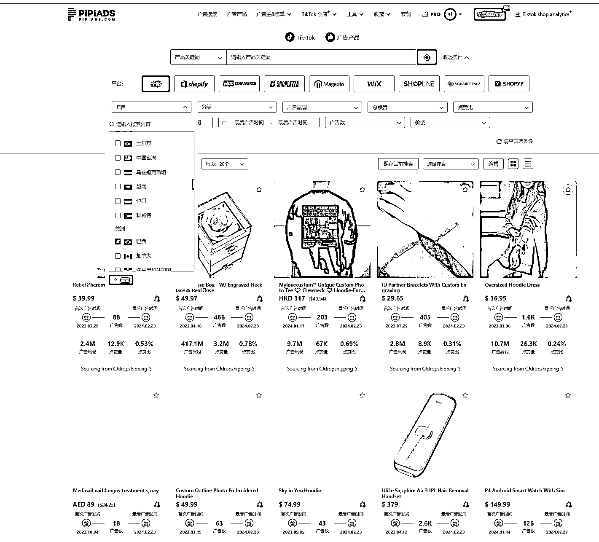

### 市场调研工具推荐

理解巴西市场离不开有效的数据工具，建议使用：

1.  Google Trends：捕捉搜索热度，感知消费者兴趣变化。

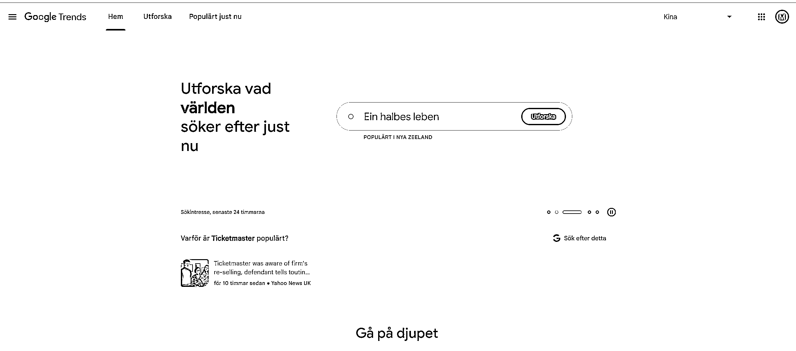

1.  pipiads：洞察投放情况、流量来源与用户行为轨迹。

2.  巴西本土电商平台：挖掘信息差与趋势差异。

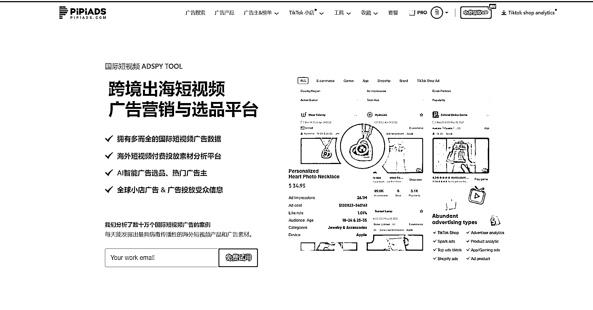

### 核心电商平台

除 TikTok 社交电商外，以下平台是观察选品与本地化需求的重要窗口：

1.  Mercado Livre：拉美最大综合电商，品类覆盖极广。

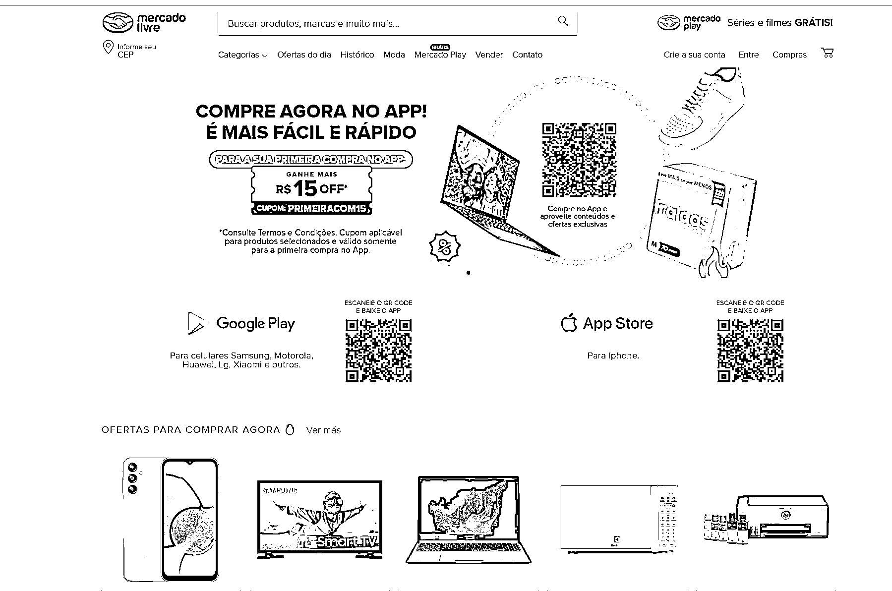

1.  Americanas、Magazine Luiza：主营电子产品、家居等品类。

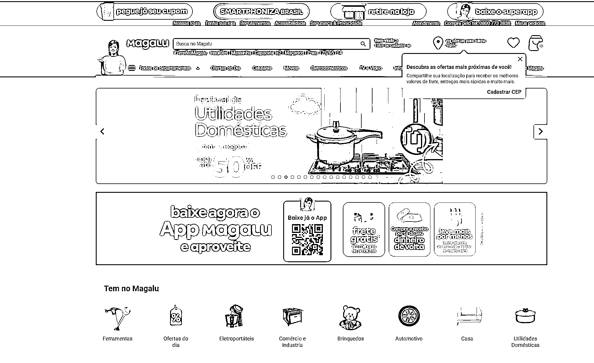

1.  OLX：二手交易平台，覆盖多品类。

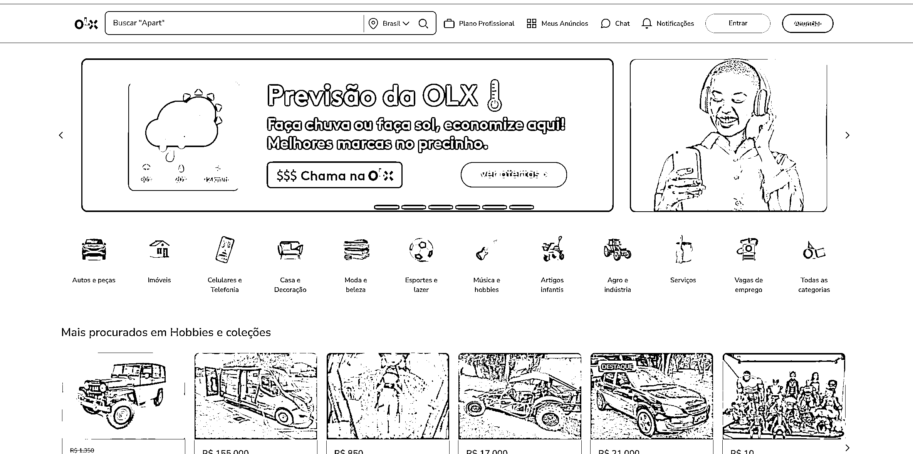

### 营销节点

节日、体育赛事、文化活动及重要经济日历，都是集中引流的窗口。

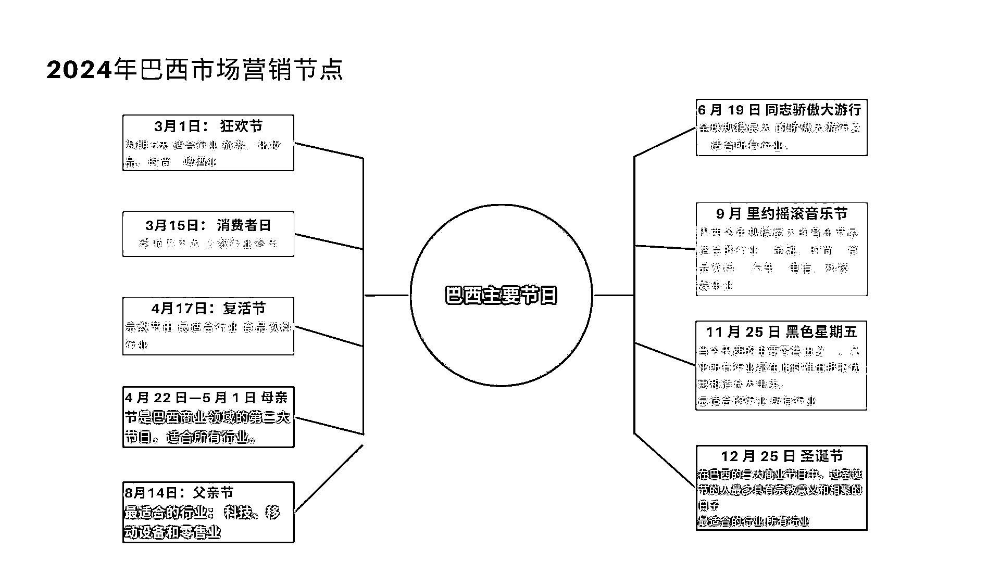

挑战与应对

#### 物流与供应链

1.  挑战：物流成本高、时效慢。巴西当前普遍面临清关难、配送慢、退货丢件率高的问题，是卖家痛点。

2.  解决方案：布局或合作本地仓、优化履约网络。据调研，安骏物流数年前已打通巴西跨境小包直邮专线，为国内轻小件提供更快捷通道。专线上线前货物时效为 30 天-90 天，上线后巴西主要城市 80% 的货量可实现 9 天-14 天送达，中西部地区约 14 天-25 天。

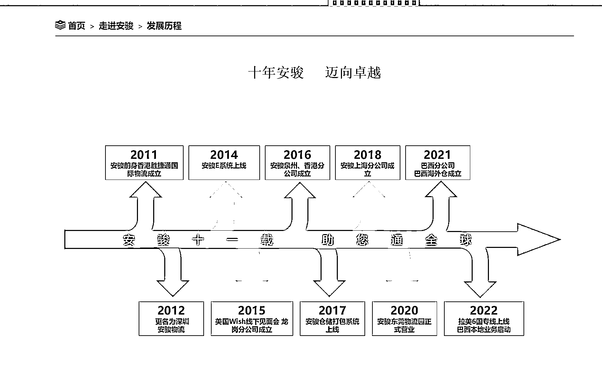

#### 支付方式

1.  挑战：支付习惯多元，巴西消费者多习惯月付分期，大多站点会同时展示全价与分期金额。除信用卡、银行转账外，本地主流方式包括 Boleto Bancário 和 Débito Online。Boleto Bancário 需生成付款单线下支付，Débito Online 支持从银行账户直接在线扣款，Pix 更是迅速增长的即时支付方式，由央行主导，通过动态二维码或代码完成支付，零手续费即时到账，用法与国内支付宝/微信支付相近，目前约 70% 的成年巴西人使用过 Pix。

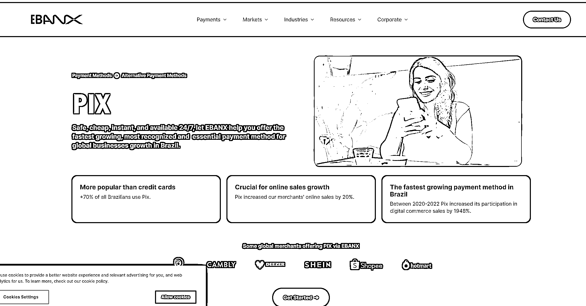

1.  解决方案：对接多种本地支付，打造灵活结算体验。

#### 文化差异

1.  挑战：市场与文化差异显著。

2.  解决方案：参考美国小店爆发经验，巴西电商未来大概率仍以达人内容带货为主，携手本地达人是破局关键。

#### 法律法规

1.  挑战：税制与进口政策复杂。巴西国税局于 2022 年起陆续发布规范文件，2022 年 12 月 21 日出台 RFB 2124/2022，对跨境电商入境包裹申报做具体规定，给予 6 个月过渡，要求 2023 年 7 月 1 日起生效。2023 年 6 月 29 日发布 RFB 2146/2023，确定自 2023 年 8 月 1 日起对所有入境跨境电商包裹征收 17% ICMS 进口流转税。2023 年 7 月 25 日发布 DOU 130/2023，规范入境包裹申报与缴税的 PRC 合规缴税计划。因文件出台临近新政生效，联邦税局与口岸海关给予缓冲期，鼓励平台在过渡期内完成 PRC 备案并取得编号。

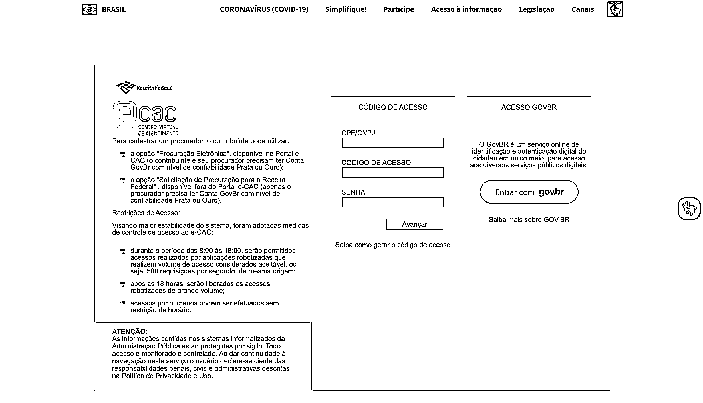

1.  解决方案：寻求本地法律顾问指导，确保合规运营。

巴西市场机会点：

巴西电商用户覆盖全年龄段，从 Z 世代到熟龄群体，平均年龄约 36~50 岁；女性占比偏高，约 58.9%。

案例一：美妆-护发素

广告累计曝光 2.4 亿次，售价 12 美元，预估到手成本不足 5 元

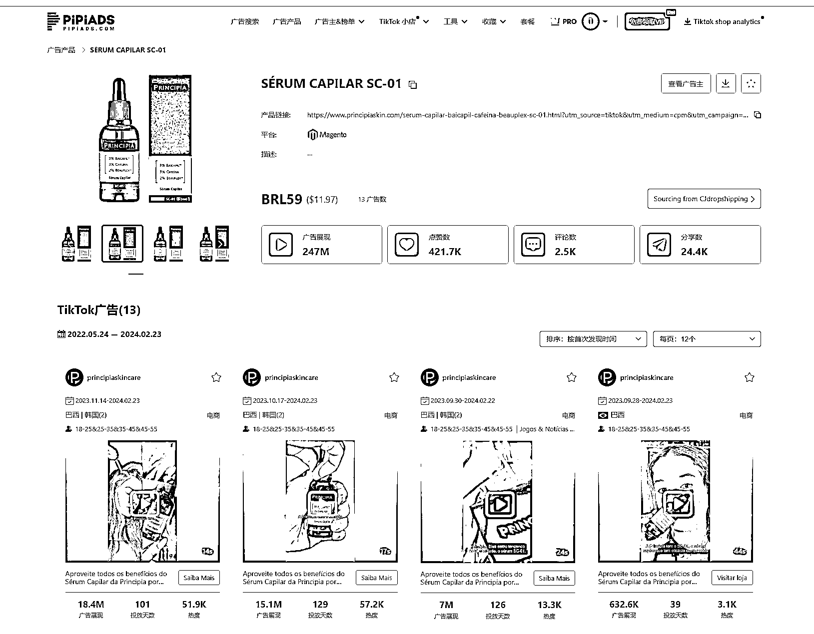

[`www.pipiads.com/zh/product-search/63983bac5602e34654467b24/`](https://www.pipiads.com/zh/product-search/63983bac5602e34654467b24)

1800 万播放量广告素材：

达人出镜讲解+场景化刺激

暂时无法在飞书文档外展示此内容

极简站点设计

产品图+说明+youtube 红人背书

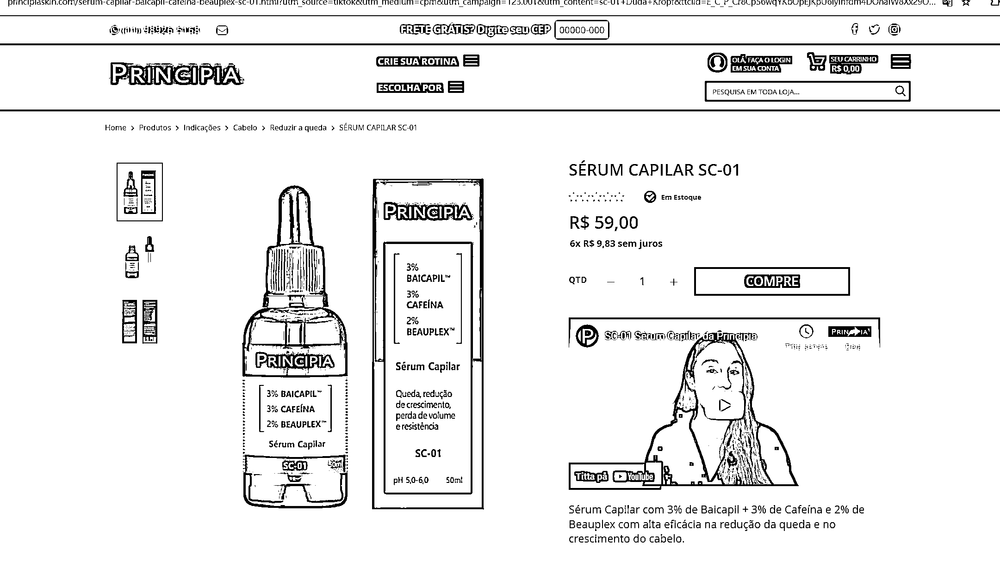

案例二：男装-纯色男士短袖

2022 年投放至今，累计曝光 1.1 亿次，126 条广告

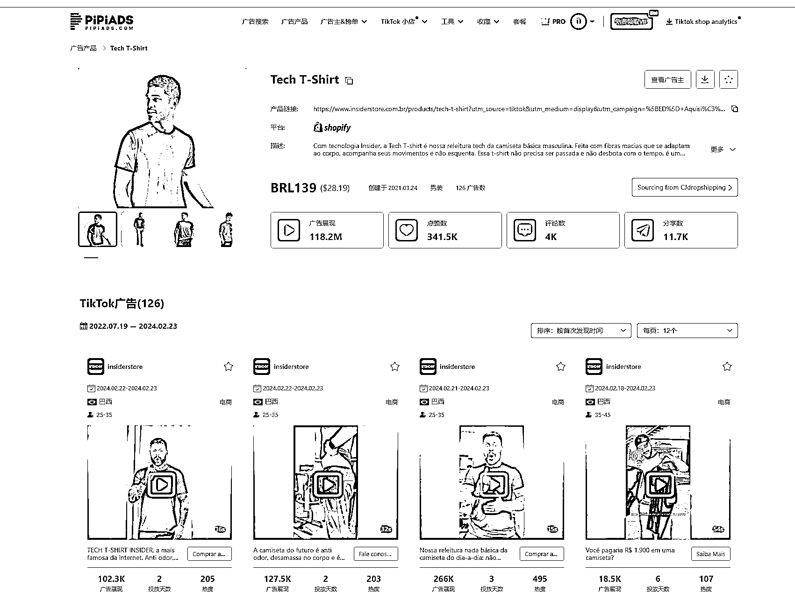

[`www.pipiads.com/zh/product-search/63078d3eaccc4615a5247375/`](https://www.pipiads.com/zh/product-search/63078d3eaccc4615a5247375)

1100 万播放广告素材：

本地达人出镜+场景代入

暂时无法在飞书文档外展示此内容

138 个 SKU，已售卖三年

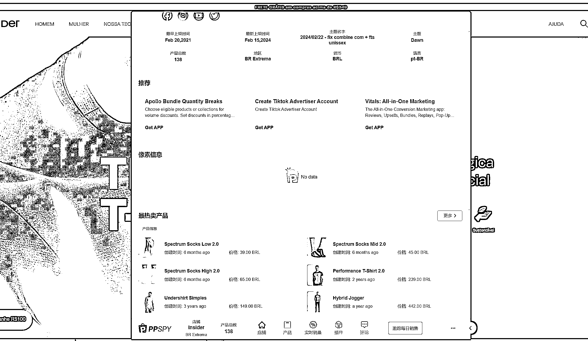

案例三：3C 电子-蓝牙耳机

1688 拿货价 9.6 元，售价 BRL168，约合 34 美元

广告累计曝光 4100 万次

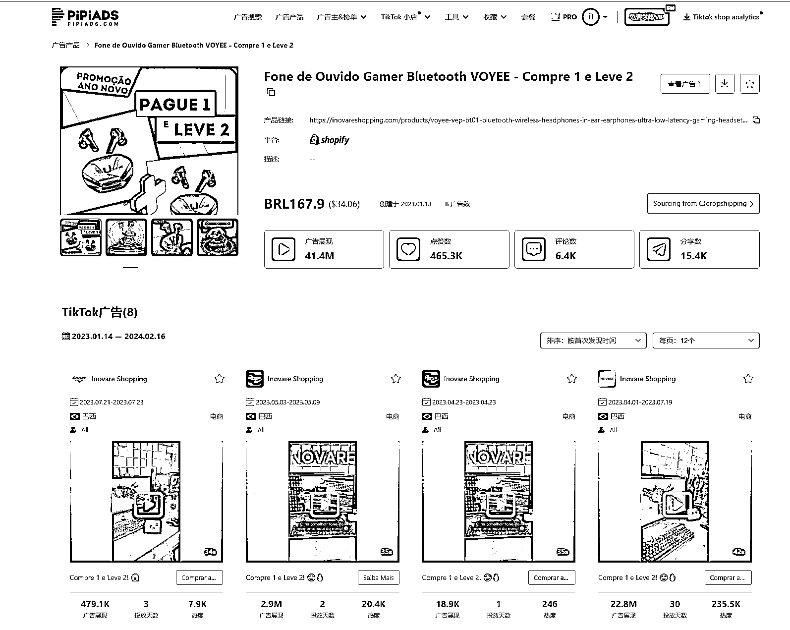

560 万播放广告素材

痛点呈现+种草+解决方案+实物展示

暂时无法在飞书文档外展示此内容

案例四：宠物用品-狗便盆

广告累计曝光 4800 万次，广告数量 21 条

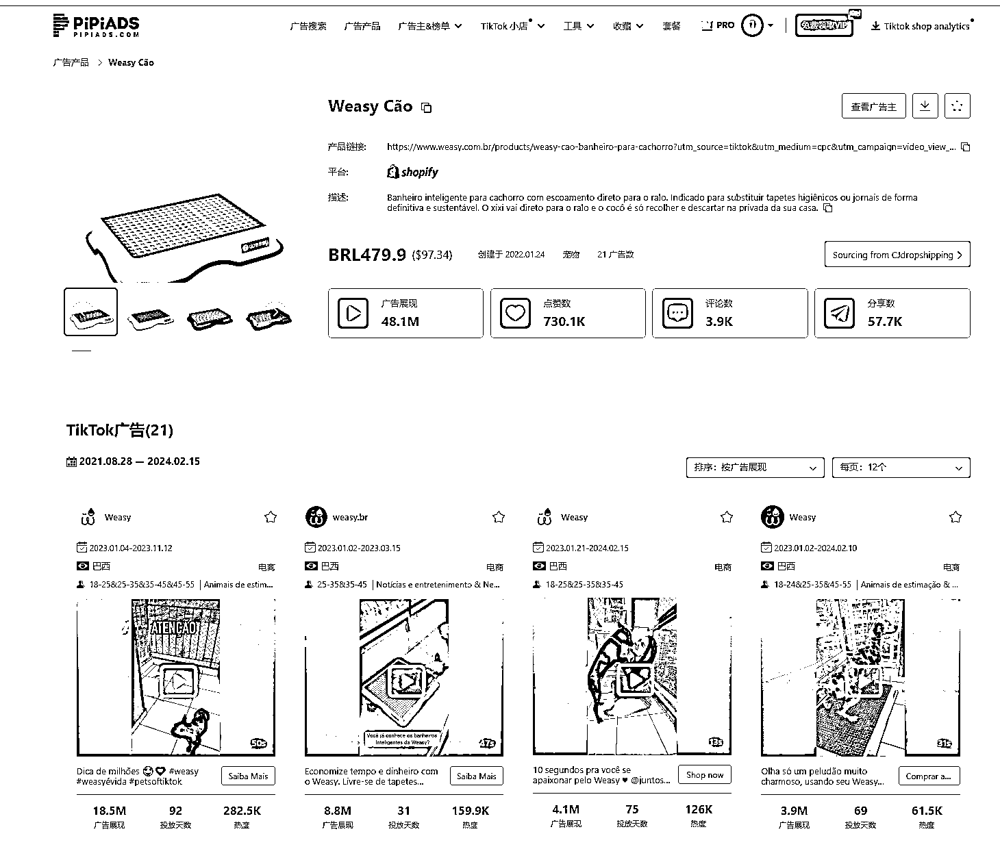

1850 万播放广告素材

痛点场景展示+解决方案

暂时无法在飞书文档外展示此内容

案例五：时尚-卷发器

广告累计曝光 2600 万次，广告数量 131 条，利润高但竞争激烈

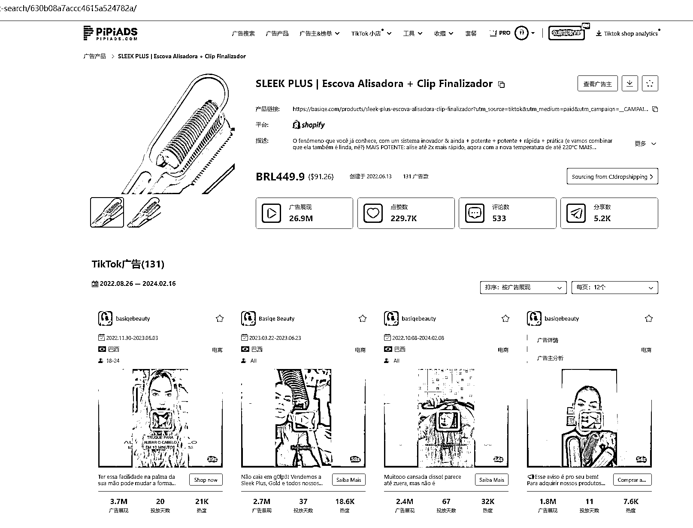

370 万播放广告素材：

利他视角+达人出镜+对比演示

暂时无法在飞书文档外展示此内容

总结：

巴西电商潜力巨大，市场热度高企。

不过目前 TikTok 半闭环仍处于内测阶段，并非能一进场就轻松获利。独立站并非巴西主流履约形态，也不是平台未来发展的主线，卖家仍需解决本土化难题，如支付、税务、语言、消费习惯等。

建议让子弹飞一会儿，等待全闭环成熟。新市场带来新机会也伴随新挑战。

2024 年核心投入仍可聚焦美国，行业趋势可持续关注 PiPiADS 平台。

视频可移步飞书文档查看

[`za6kyadmdr.feishu.cn/docx/QKQ7dxu2DoLxCgxCX06cJOABn9b?from=from_copylink`](https://za6kyadmdr.feishu.cn/docx/QKQ7dxu2DoLxCgxCX06cJOABn9b?from=from_copylink)

* * *

评论区：

暂无评论

* * *