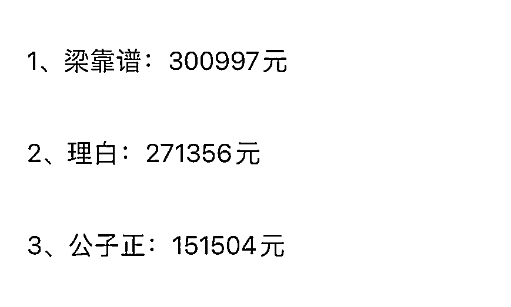

# 从零起步半年收款21万：普通人也能做到被动成交的底层逻辑
作者：龙哥

## 公子正：自媒体小白半年入账21万，被动收钱的实操拆解

作者：公子正

日期：2024-02-20

大家好，我是龙哥。

很开心和大家分享一个数据：去年9月我加入粥左罗老师的顶峰会，截止发文的变现已达16万，在老师的变现榜上排到第三。

算上自己产品的收入，自媒体起步到现在累计变现已超21万。

让我更在意的是，这笔钱来的方式很干净。每一位付费的客户都是带着欣喜主动转账，没有讨价还价，没有纠结计较。

很多人问我，为什么你能做到让客户心甘情愿掏钱？

我的偶像刘德华说过：“得到的要回馈社会，学到的要分享给人。”

下面，我把自己从0基础做自媒体到半年实现21万变现的“高能收钱”方法论拆开来讲。

全文分为三块：

第一块，销售的三个层次

第二块，客户愿意爽快付费的两个基础条件

第三块，达成高能收钱的五步法

**第一块，销售的三个层次**

第一层，是挣钱。

挣钱的心态是去抢不属于自己的钱，费力不讨好，还容易搞得自己很累。

典型的表现就是，产品还没吃透，就急着成交。有人选择拼命降价返佣，有人干脆硬推给身边人下单。

降价返佣看似拿下订单，实则破坏市场，知识付费这类非标品尤其致命。客户若真认可价值，正价也会买；若不认可，你返佣让他占了便宜，交付后问题全算你头上，最后白忙一场还背锅。

向熟人硬推更不可取。生意靠价值交换，不靠人情。就算这次卖掉了，信任透支后还能做几次？

想挣钱，苦且没尊严。

第二层，是赚钱。

赚带有哄的意思，是靠套路和话术把钱从客户口袋里掏出来。

市面上这类人很多，精通包装和承诺，用高明的说辞让客户掏钱，过程像斗智斗勇。

林肯说过，你可以暂时欺骗所有人，也可以永远欺骗一部分人，但不能永远欺骗所有人。

这种模式能有短期收益，绝撑不起长期。

第三层，是收钱。

收是容纳、聚集和接受。

你需要做的，是成为目标客户付款时的默认选项。客户主动聚拢过来，你只需要安静地接受转账。

客户开心付款，你从容收款，双赢。

**第二块，被动收钱的两个前提**

客户为什么会主动、高兴地付钱？其实只要两点成立。

第一，客户有强烈且迫切的付费痛点。

第二，客户是有目标、有梦想、有未来的成长型人群。

先说第一点，人为什么愿意花钱解决麻烦？

举两个场景：

一个单身很久的人，为什么愿意给婚恋平台付费？

一个做销售做不下去的新人，为什么愿意给我付费？

因为前者想脱单，自己找太慢，拖得越久越难受；后者想赚钱，自己摸索要饿死，扛不住。

核心是：

1，他正承受痛苦，渴望回到理想状态；
2，他靠自己要花极长时间才能达成，或根本达不到。

需求由此产生，有合适的解决方案，他就会主动拿钱交换。

收钱的关键从来不是你多厉害，而是你能帮他更快更省力地抵达理想状态。

举个极端例子：一个人想喝冰淇淋，不知道哪有买。你不需要会做冰淇淋，甚至不需要买机器，你只需要告诉他去哪买，或者直接买一杯递给他，就能收回合理报酬。

因为你省了他的时间和精力。

时间不可再生，钱是可以再生的工具。现代社会运转的本质，就是用各自的时间精力去满足他人的理想状态。

当你能帮客户从不满意快速跳到满意，且这个改变他自己很难完成时，收钱就是顺理成章。

这是前提一：客户真的想花钱解决问题。

再说前提二：客户必须是想往前走的人。

对人生没希望、只想混一天是一天的，不会是你的客户。

恨不得所有东西都白嫖，能自己造就不花钱的，也不是你的客户。

为了吃一口冰淇淋，花几十年研发机器的人，也不是你的客户。

道德经讲“天之道，损有余而补不足。人之道，损不足以奉有余。”

社会靠创造和交换价值运行。无贡献、无交换的人，注定活在边缘。

你把精力放在这类人身上，只会消耗自己，就算卖出去也服务不下去，最后退费、闹心全是他们。

刘润说过，别赚难赚的钱。

好赚的钱来自什么样的人？

有目标，所以想快点实现；有梦想，所以愿意确认投入；有未来，所以舍得现在花钱。

记住一条铁律：要帮助本该成功的人更快成功，而不是去当谁的救世主。

只有这类人，才会爽快付费，你也才能潇洒收款。

**第三块，实现高能收钱的五步**

很多新手的误区是：觉得没专业背书、没销售技巧、没福利就卖不出去，于是拖延自我否定。

其实问题不在要求太高，而在你不会卖。

收钱是有路径的。掌握路径，就能从门外汉变成吃收钱这碗饭的高手。

第一步，确定高能主张。

客户买的不是产品，而是通往理想状态的路径。你的主张，就是这条路径的承诺。

古代招兵买马，领袖靠主张驱动别人抛头颅洒热血，比掏钱难多了。

刘备靠“匡扶汉室、保国安民”聚拢人；李自成靠“闯王来了不纳粮”让百姓开门迎。

商场同理，你要用一个清晰的主张，让一部分人付款时第一个想到你。

比如火车站那家“12块吃饱吃好”的快餐店。主张一出来，隔壁再好的热干面也黯然失色。周边店可能同价同质，但没主张，客户记不住。

主张越贴近用户理想状态，竞争力越强。

第二步，建立高能流程。

收不到钱，多半是流程不清。

把成交当成攻克客户的游戏，要么拼话术，要么不敢开口，最后身心俱疲。

高手做法是确认默契，等信号出现再收。

就像谈恋爱，不是一上来就表白，而是不断校准关系，水到渠成。

筛选出能买且愿意买的人，引导咨询，你负责诊断问题、描绘理想状态、给方案、引导付款。

流程可控，就不会尴尬、不敢开口，也不用为下一顿饭焦虑。

第三步，打造高能能量场。

如果每次都要你主动找客户建立信任，太累。

被动收钱的核心是搭建能量场，用内容批量建立信任。

可以是电商详情页+评论区，几百块产品一个页就能成交；可以是👸号文章矩阵，几千块产品十几篇文就能转化；可以是朋友圈高频动态，上万产品几十条就能让客户主动转账。

能量场是你的收钱结界。用户进来后信任自动累加，屏蔽竞品，需求一来就说服自己掏钱。

第四步，搭建高能获客渠道。

没有精准流量，再好的能量场也没用。

群发广告、小广告、盲目裂变引来的都是低价值流量，要么潜水，要么白嫖。

要选能持续带来精准、能半自动化复制的渠道，更重要的是让客户带着需求主动来找你。

第五步，不断高能提升自我。

孔子说，德不配位必有灾殃。

你赚不到认知的钱，即使靠运气拿到也守不住。

月入过万和月入十万的人，硬件可能差不多，思维和格局天差地别。

收钱是手段，不是目的。最终要靠钱实现理想生活。

用钱持续升级眼界、圈层和个人品牌。

周易云“同声相应，同气相求”。层次越高，你吸引的人、遇到的事、做成事的难度都会不同。

到最后，客户会主动求着跟你合作，觉得能成为你的客户是他的幸运。

这条路没有终点，但每一步都在帮你摆脱狭隘和自我怀疑，走向自由富足。

最后送你一句话：

“将欲取之，必固与之。”

当你把爽快付费当成常态，就会吸引爽快付费的客户；当你习惯成就他人，也会吸引成就你的贵人。

愿你也能做到哐哐收钱，期待你的好消息。

* * *

评论区：

小凯 : 受教了！

小凯 : 我二刷了下，收获更大[呲牙]

* * *