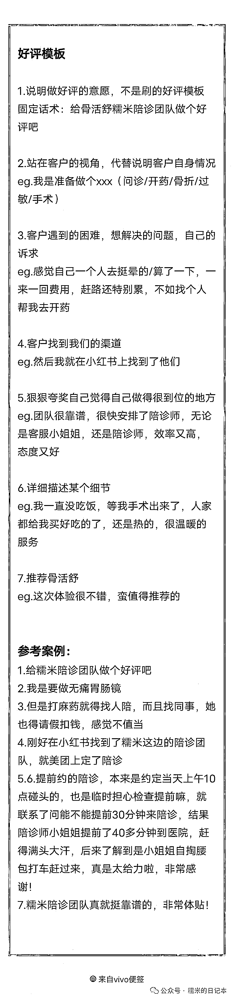

# 《糯米的陪诊实战手册》——如何教会你的陪诊师做美团好评
作者：龙哥

陪诊这行，现在该去哪儿找客户？糯米最近一直在用美团系统接单，下单自动化已经跑通，每天还能白得不少曝光。他有个大胆的判断——在美团上早早扎根，绝对有机会。

为什么是美团？因为它的底色是本地生活。陪诊又是典型的本地需求，不管你是本地人还是外地人，给自己还是给亲戚朋友下单，美团都是最顺手的入口。头一回找陪诊的人，可能先去抖音、📕这些自媒体平台刷功课，但只要在美团上体验过一次，大概率会“回笼”——自媒体平台靠的是新鲜感，美团靠的是习惯性复购，信任度完全是两码事。

当一个行业还没成为大众日常，大家都会去更新快的平台搜索。可一旦陪诊变成常规消费，美团的优势就出来了：流量会沉淀，用户要的是稳定、靠谱、可重复的服务。所以，在美团等风来不是守株待兔，而是提前蹲守红利。等陪诊消费习惯在美团养成了，店铺爆发是迟早的事，关键是你得先占坑。

那怎么把美团店铺做起来？排名看评分，评分最狠的影响因子就是好评。陪诊是线下一对一，这正好是当面拿好评的黄金场景。糯米要求陪诊师在服务快结束时，尽量盯着客人把评价做了。话术也不复杂，比如：“现在等报告，闲着也是闲着，您要是今天还满意，就赏个好评呗。文案图片我们全都备好，您直接粘贴就行。” 等报告、等拿药、等结账的时候，顺手把物料递过去，客人连打字都不用。

客人最怕什么？麻烦。就算你服务再好，要让他自己组织语言写好评，他可能就算了。咱们要做的就是把麻烦全揽到自己这边，让客人零负担。

真正跑起来后，糯米发现不少陪诊师自己写不好好评，或者说根本不愿意好好写。办法也简单：直接给模板，让他们照着发。这套路其他行业也能用——给员工备好评模板，评价质量一下就稳了。

要是员工还是不积极，糯米有句话很好使：“要不我帮你写？可我替你干了活，得分我点钱哈，狗头。”再补一刀：“你写两次就顺手了，其实超简单。”基本就能把人推起来。

下面就是糯米的好评模板，拿走不谢：

说实话，这些操作一点不难，难的是人太懒，被畏难情绪困住，一想到还得做一堆细节和文书，立刻想躺平。别慌，这情绪人人都有，关键是学会跟它和平共处，学会哄自己玩：把行动链缩短，把启动门槛降低，让自己轻轻松松开始。不然再多好点子，不动手也是零。你说对吧？

