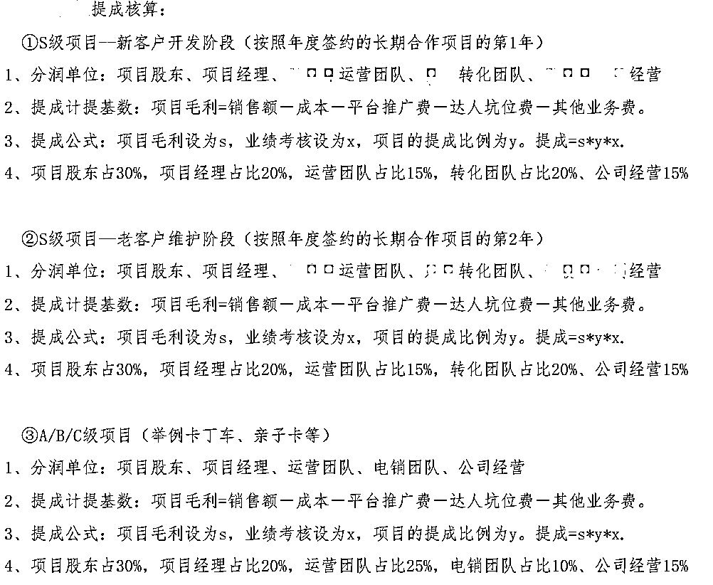
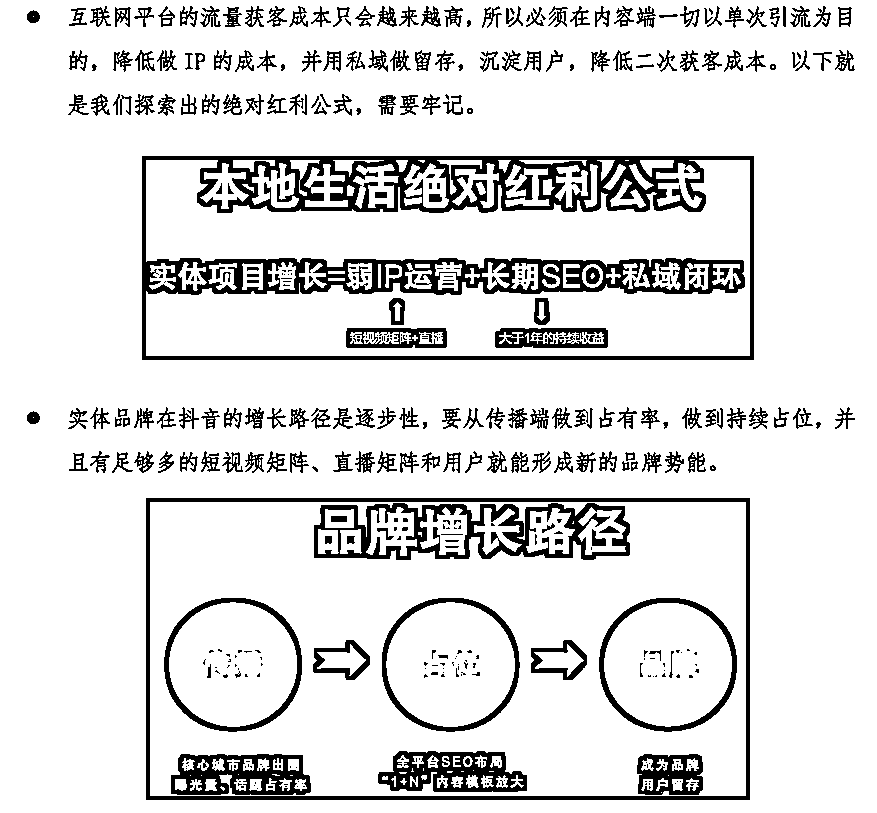
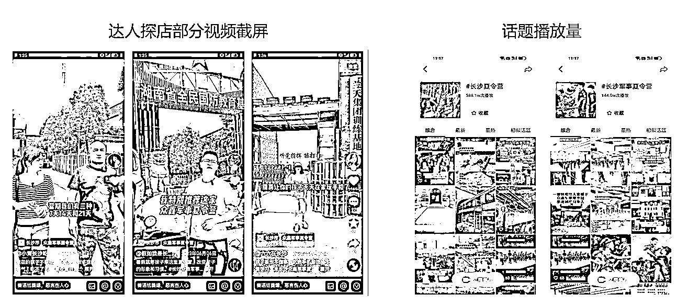
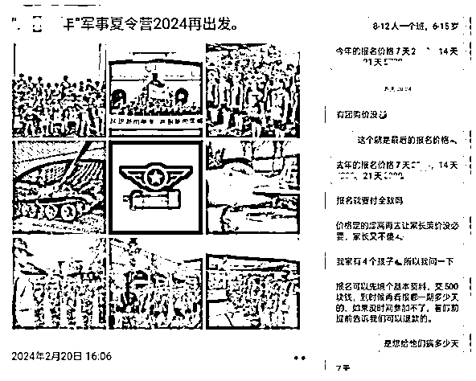
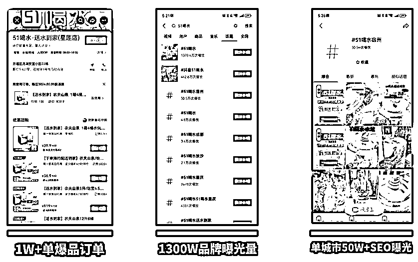

# 别只盯着流量了，2024抖音同城生意的真正打法在这

我是楚川。从2020年下半年开始碰抖音同城，到现在服务过超5000个实体商家与品牌。这篇文章不短，但请你先收藏，回头静下心看几遍，大概率能少走几年弯路。

2023年一过，我对抖音同城的感受彻底变了。以前觉得这行很难赚到钱，现在只觉得遍地是机会，区别在于——你用什么样的姿势去做。这篇复盘，就把我们踩过的坑和验证过的路一次性说透。

## 一、交过学费的认知：先选对人，再谈流量

去年我们干过最狠的一件事：把餐饮客户全砍了。哪怕我们自己投过两个餐饮品牌，也依然改变不了这个判断——餐饮在同城生态里的红利期已经过去了。

在酒旅方向，我们把景区、亲子乐园、旅游路线、网红城市、夏令营全试了一遍，最后留下来的只有夏令营和亲子乐园，因为这两个品类能绑定三年以上的深度合作。家政是意外的惊喜，做天鹅到家这个项目时，单月冲到7133万，彻底改变了大家对家政赛道的看法。之后在小华总的点拨下，我们又陪跑了送水到家、上门洗车，都给了不小的正反馈。

但这一年也交了不少学费。盘过亏损的5次项目，其中4次是熟人开场，不好意思收前置费用，最后做成“先干活后结钱”。项目跑起来后发现，运营根本没有问题，回款却难如登天——要钱的难度是搞流量的100倍。这期间我们试过好言相劝、发律师函、每天追着讨账，甚至被合作方翻脸不认人，累计损失300万以上。以前我们总抹不开面子，别人哄两句就闷头干活，酒一喝就答应事，最后退让到无路可退。后来想明白了：与其纠结沉没成本，不如抓紧时间找新机会。

所以从2023年底开始，我变成了一个间歇性“翻脸”的人。第一，坚决不做零前置费的纯佣项目，钱到位才开工；第二，碰到白嫖的客户，直接回怼，拒绝要干脆利落；第三，尊重他人命运——一个品牌如果内部或高层烂掉了，流量方就算逆天改命，也只能拿到阶段结果，最后不是被踢出局，就是公司内耗到崩盘。

## 二、供应链才是最后的王牌

在选择品牌方和供给端时，我们如今有五个筛选标准：

第一，前置流量费由我们支配，我们包品牌、策划、获客，合作方只负责接住流量和做好留存；第二，合作方必须有基本盘，不需要我们再开城、招人、开店去搭基建；第三，供应链能力要在行业前两梯队，有定价、控量、放大的能力，能在某个环节做庄；第四，合作期内要做项目价值评估，任何一方违约都要赔违约金；第五，正式确定合作后，周期收益要大于100万。

这套标准筛下来，客户范围清晰了很多。但供应链考核上也曾失手：去年7月保洁供应商扛不住突然放大的单量，我们果断止损；11月两个城市的水站，第二周就从2小时达变次日达，也被叫停了。

这里有个很重要的判断：抖音同城的竞争，早已不是流量层面的争夺，而是优质供应链的组织力与网格能力。2020到2022年我们做爆过很多餐饮客户，大流量涌进来后，投诉和差评基本来自服务跟不上、菜品缺失，全是供应链的问题。后来我们甚至用自己的供应链去介入，也解决不了流量和供给的矛盾。到2023年索性换到供给更有优势的O2O项目，天鹅到家是最好的例证——近10年的直营沉淀，在平台流量越来越精准之后，竞对根本接不住量，而天鹅到家却能稳稳接住，利润跟着涨。反过来，如果供应链做不了庄，类目空间会被压缩，订单成本被推高，利润就被掏空了。平台生态越完善，信息差和野路子越没有活路，能拼的只有这条硬线。

## 三、15个人，如何扛住亿级项目？

我们这行毛利低，还要看核销率，每一分人力成本都必须花在刀刃上。过去两年，我们把所有可外包的岗位全外包了。

主播是最早外包的。2021年底就解约了所有达人，到现在长沙合作过的带货主播超过400人，按能力分层定价、按时结算，灵活机动；摄影也按项目外包——职人视频找达人补素材，IP视频和高级云剪辑找专业团队批量采集；技术开发从2020年就整体外包，橙子带着团队做二次开发和优化，尤其是抖音小程序、批量化剪辑和发布工具，每月都要跟外包团队同步升级。

所以团队两年多一直保持在15人以内，人效却拉到极致，百万级到亿级的项目都能接，核心能力都在运营层面。能力壁垒怎么建？“无他，唯手熟耳。”抖音同城的每个环节、每个后台子菜单，我们基本能背出来。

团队内部走阿米巴式小单元作战，小伙伴定期轮岗，逼着每个人成为多面手。项目一旦落地，有全员认可的分钱机制，按岗位细化，杜绝大锅饭，保证项目良性推进。

2024年是我们做同城生态的第五年。现在培养人的速度是：3个月搭起一个有战斗力的品牌团队，6个月带出真正的项目操盘手。这个赛道利润率摆在这，持续提人效、用规模换取利润，才是长期解法。

## 四、方法论：实战、基建、放大器

先讲最核心的：一定要在一线。平台规则变得太快，任何方法论都必须从实操里长出来。过去四年，我们的核心框架没变，但落地细节更新超过50次。我们也一直对同行和品牌方开放分享，因为固有打法不能在抖音持续拿结果，每个月都要迭代，不怕被人学。

我自己有切身体会：公司人最多的时候有220人，我脱离一线做指挥，结果全年亏了1500万。我还见过一个电商大盘转型同城，CEO只在作战室遥控，我教的东西他们没有亲手验证过，最后转型失败；还有曾经的合作技术商，创始团队离开战场后，不到10个月被另一家兄弟公司超越。三个反例都在说同一件事——负责人不亲自撸袖子，必败。

接着讲短视频基建。2024年的商家经营已经是阵地战，必须建立自己的山头。当大宗流量结束后，你能不能靠日常运营继续吃到推荐和搜索流量？

**商家IP的本质，一切为了成交。**我们一直打“弱IP”，不迷信“一个超级IP养活一家公司”，而是把品牌账号当成日常对外窗口，不管流量大小，每次曝光都以成交为目的。它与职人矩阵、宣发视频共同构成流量转化入口，承接SEO流量的主要部分。

**职人矩阵：在抖音发传单不丢人，没有流量才丢人。**未来两三年，这是所有商家的必修工程。当达人流量不稳定、预算收紧的时候，职人视频就是降本增效的答案。我们要求把职人视频做成日常工作，每天至少更新3条，厚积薄发。与其仰望几个爆款，不如铺开成千上万条内容。

**抖音SEO：当没有大宗流量进来时，搜索流量就是持久战的护城河。**抖音搜索的体量已经超过百度，2024年大概率是抖音SEO元年。我们有的项目每月吃搜索流量产出千万级别，表面看是机械地铺视频、埋关键词，但价值长尾超出预期。供应链和夏令营项目，一年后还在接咨询电话，这就是搜索流量的后劲。

**POI建设：好的门面是成交与触达的第一环。**POI过去是平台治理的重灾区，虚假POI和占用问题层出不穷。但背后的机会在于，POI像蜂窝煤一样铺开，密度上去了就有群集效应，获取流量的效率更高；统一装修能提升质量分，还有平台流量加持；命名后缀加类目，既吃搜索流量，又是品牌形象的规范管理。

**达人不是大爷，只是你销售军团里的一部分。**职人和素人像“传单员”，每条视频都在发传单；KOL和KOC是不同等级的“销售员”。想清楚这个逻辑，就知道怎么按场景配资源：首次宣发要先发传单再开张，让销售员跟进；老店做长线经营就直接安排销售动作，流量枯竭后再加传单触达。另外，不同流量属性有不同价值，单看ROI就是耍流氓。职人和素人的ROI就是低，但它们是营销基建里不可缺少的环节，不能因为产出数字难看就一刀砍掉——我经常为这事跟合作方急眼。

直播是放大器，能爽到，也能照出弱点。

我坚持了四年的观点：没把短视频玩好，别急着开直播。本地生活运营团队的能力层级普遍不如电商，这是行业里不争的事实。短视频红利期就该全力吃透短视频：ROI正向、核销率在行业平均值之上、区域搜索和推荐位排进前五，说明流量已经有了统治力。直播的作用，是把短视频矩阵挖来的用户集中促成交。视频和直播同频共振，才有1+1大于2的效果，否则效率低下。同城生意容错率不高，每一步都得走扎实。

**产品质量是生命线。**抖音放大流量的能力很恐怖，反面的代价也很恐怖——一条差评，可能需要美团10倍的代价来弥补。太多餐饮合作伙伴在质量上打马虎眼，2到3天就能看到流量反噬，ROI直线下跌，再想起量时成本翻几倍，直接亏损。

**货盘要针对抖音用户重做。**很多品牌把线下套餐或美团、小程序套餐直接搬进抖音，很快会发现抖音用户跟原有用户完全不一样。我们做送水到家时，80%是25到40岁女性用户，和美团、饿了么完全不同；传统桶装水的押金模式，第一次下单很难被接受，因为用户预期完全不一样。所以从下单到履约，都要提前调研人群喜好，按用户习惯调整货盘。

**主播的产品解读能力是流量密码。**抖音探店达人已经超过1000万，不同标签的主播对应不同用户圈层。同一款产品，有的主播能讲透卖点，有的就讲不到下单点上。商家需要跟达人深度沟通，激发他们对产品的理解——这也是为什么真正靠达人直播拿大结果的品牌这么少，核心卡点就在这里。

**直播形态也有讲究。**平台对无人直播的识别能力极强，只是会在增长和治理之间权衡。无人直播间的最佳定位是消化真人直播溢出的流量，用最低成本完成转化，而不是当基本盘。平台推荐流量时会考核进直播间的转化效率，真人和无人，一定要分清楚主次。

**达人直播可以当破局工具。**同城头部主播刷量的问题，从核销率远低于正常值、退款率远高于正常值就能看出来。我们也很长时间不想碰达播，但对比后发现，在项目爆破阶段，最有爆发力的达播能带动整个大盘的势能，拉动品牌整体销量。哪怕ROI有缺陷，必要时刻可以切进去。

最后给一个长效公式：不断做用户新增，沉淀价值用户，把一件事坚持做到长期，品牌势能自然就出来了。

## 五、案例：一场夏令营的获客全链路

用两个获客方向来收尾：客咨转单，以及平台直接打单卖货。这两个项目结果不算特别亮眼，但方向值得参考。

军事夏令营案例：2023年4月签约湖南的国防教育基地，接待能力和课程软实力都是区域顶级。我们选择联合运营，流量端用自有矩阵分发，坚持“大力出奇迹”，把获客成本压到行业最低，视频覆盖面做到最广。

项目里，基地独家承接线上流量。我们签了独家合作，提前避免了大流量涌进来后，基地服务能力跟不上的情况。因为是第一年操盘，我们把销售环节也承包了，基地只要专心做交付。流量进来以后，整个链路是：电话沟通—转私域—邀约到基地参观—签合同。

这个案例和前面的方法论是打通的：POI铺好、职人矩阵铺满、搜索流量占住，再靠私域承接，最后线下转化——每一步都要求稳，不能跳级。

写这篇复盘的时候，我们团队已经在为2024年全力冲刺。同城生态还在持续变化，但核心逻辑已经越来越清晰：组织能力、供应链能力、内容基建能力——这三个能力，才是接下来真正值钱的东西。

把动作做扎实，别急着追风口，风口也会追你。

以上是楚川团队的复盘与展望，希望能给正在做或准备做抖音同城的你一些参考。少踩一个坑，就多赚一分钱。

第二，借助 POI 流量分发去拿区域线索。我们一共孵化了 17 个抖音职人账号，从 4 月份就开始准备，经过素材收集、养号、剪辑发布等环节，5 月正式进入投放阶段，到 7 月底才结束投放。POI 的选用上，所有内容都挂载 POI，以区域为核心做大盘吸量。职人号每天均值发 10 条左右，同时搭配少量外部云剪账号矩阵分发，整个周期下来视频总量接近 8 万条。线索获取完全依赖用户主动咨询和评论，销售再跟进沟通拿到联系方式后拉入私域，累计私域新增超 2000 人。由于首年定价在全省都是最高梯队，转化相对吃力，最终营收仅 200 万出头，但这条路径具备长期可验证的价值。

第三，抖音 SEO 的长线复利。在 2023 年 8 月停止投放招生后，SEO 的效果开始显现，每天依然能稳定带来 5-10 条进线咨询，这样的势头一直延续到寒假。到了 2024 年 2 月团队重启筹备夏令营，刚开始做朋友圈运营时，上一年的老用户就主动找上门来，侧面证明项目具备可长期运营的潜力。

#### （2）到家行业：POI 矩阵+职人矩阵+抖音 SEO+KOL+KOC

这次到家赛道的案例分享，往常多讲家政，今天换一个刚上线的品类，给大家拆解水行业。当初锁定水行业，是看中了刚需和高频这两个特质，即便毛利率偏低也值得尝试。接下来分享的是我们 2023 年 10 月在“送水到家”上的爆破打法。目前我们已从水厂、水站、水品牌、平台公司四个视角去探索这条赛道的商业价值，以及如何在抖音实现变现，后续会做更细的拆解，现在先聚焦送水到家的获客方法。

第一波爆破，先选定爆品作为流量入口。我们用农夫山泉和怡宝做价值锚点引流，虽然客单价高于线下便利店和社区团购，但抖音的下单人群结构与传统水行业不同，前者以女性为主，后者以企业男性为主，对价格的敏感度存在差异。首轮流量放量后转化超出预期，首月曝光 1300 万，带来约 150 万销售额。

第二波打法上，POI 店铺的装修和名称完全贴合用户搜索习惯，提升点击和下单转化；同时绑定一线水站送水工的个人号做职人矩阵，降低投放成本；SEO 布局覆盖平台词、水品牌词、业务词、场景词和城市词，共 5 个维度长期占位，带来约 30% 的成交占比；在职人素人视频铺量后，再引入具备快消品带货能力的 KOL 和 KOC，订单出现明显拉升。

第三，从长期运营看，水行业大部分企业必须自建运营团队。毛利率太薄经不起再加一层服务商，必须自己掌握运营能力，并持续迭代升级。

## 二、面向 2024 年的思维转变

### 1、全面拥抱新的 O2O 浪潮

#### （1）短视频的爆发力为商家起盘提供了土壤

2015-2016 年的 O2O，本质是用地推和小广告密集触达用户，在几个城市打样后复制到全国。现在抖音做的，就是把这套打法搬到短视频里，实现高频触达、品类卡位，最终目的仍是成交和获客。

我们在做抖音家政时体会不算深刻，但 2023 年维修、按摩、上门洗车、送水到家等赛道相继跑通，让我确信短视频正在推动中国 O2O 的二次崛起。

#### （2）传统且可坐庄的供应链迎来了新机会

抖音上的 O2O 新机会，前提是供应链具备可爆破、可场景化、可传播的特质。到了 2024 年，供应链还必须满足“可坐庄”。怎么理解？

第一，传统 O2O 供给长期缺流量，饥渴已久。2023 年抖音本地生活类目放开，半路杀出的品牌和服务商靠乱拳打出月几千万规模，让很多人觉得传统品牌没机会了。但我认为现在是最佳入场期。抖音本地生活已过野蛮增长期，4000 亿体量已能挑战美团，平台在 2024 年会更需要优质供给。而半路出家的供应链因掌控力和行业沉淀不足，会逐渐失势被平台淘汰，这正是传统供应链的翻盘窗口。

第二，可坐庄意味着掌握控价权、供给量、服务质量等核心要素。供应链协同度不够、坐庄能力不足，就会被大玩家快速吞并。2022 年我们做生鲜供应链配合餐饮品牌做抖音流量时就发现这个致命缺陷，于是 2023 年果断止损退出。

### 2、抖音 SEO 红利进入显性期

文章里多次提到，抖音 SEO 必须长期布[position]。目前电商和生活服务生态已成熟，用户停留时长提升直接推高搜索量，2024 年起搜索流量将迎来爆发式增长。

### 3、商家短视频能力是持久战

品牌短视频能力不是速成项目，核心在于 IP 运营、职人矩阵、达人视频。达人视频流动性强，花钱就能合作，不构成真正壁垒。真正的壁垒在 IP 与职人矩阵的共建：职人矩阵负责批量化内容生产和分发占领心智，品牌 IP 作为承接口完成转化的闭环。

### 4、全域整合营销将成为最大考验

抖音率先切入本地生活，证明了赛道空间。未来 5 年内，其他新媒体平台必然跟进分食。IP 能力、短视频能力等底层能力具备跨平台通用性。商家要持续增长，就必须构建全域新媒体的整合营销能力，这将是本地生活从业者未来最大的挑战，也是增长的关键。

## 三、穿云团队的未来定位

#### 1、深耕到家赛道，把流量能力打磨到极致

2023 年我们完成团队重塑，明确了未来 20 年都要把穿云做下去。方向继续聚焦到家赛道，把获客能力做到极致。过去一年的经验是，聚焦之后利润提升、团队更轻，也有更多时间复盘思考，这会成为我们的核心武器。

#### 2、只服务具备供应链优势的品牌，追求 3 倍以上增长

接下来穿云会保持一线实操，相信只有实战才能沉淀方法论。作为领路人，我仍会持续尝试新方向并做复盘分享，好的坏的都会摊开。伴随团队进化，合作门槛也在提高：只聚焦到家赛道内具备供应链优势且有 3 倍以上增长潜力的品牌商家。以上是对 2023 年的复盘和对 2024 年的展望。

* * *

评论区：

江南 style : 感谢分享，看了 2 遍，很有收获。

木紫 : 怎么联系大佬

楚川 : 有缘在赚钱见到[偷笑]

周先生 : 核心：别做餐饮

楚川 : 有钱，但是难度有点大

* * *