# 风向标拆解第3期｜小红书手串爆品的流量玩法拆解 — 安妍

> 来源：[https://p8rx5phwj1.feishu.cn/docx/AEGXdPZ2VoywS4xUH8ccb4UnnTh](https://p8rx5phwj1.feishu.cn/docx/AEGXdPZ2VoywS4xUH8ccb4UnnTh)

# 小红书手串赛道爆款案例拆解

大家好，我是安妍，今天聊聊小红书饰品手串赛道里一个高销量账号的变现思路。

先说明一下我的角度，我在小红书前端流量这块有一些实操观察，所以这期重点放在前端笔记如何起爆、如何复制爆款上。关于后端产品成本和供应链，我没有一手数据，只能做个粗略的推演。做生意的朋友看一眼就能get到，没入局的伙伴建议先把眼光放在流量笔记这部分。

为什么会挑这个号来拆解

*   品类极度聚焦，账号全程只做手串一条线。
*   内容工业化程度高，封面是套模板化图文，产出效率非常快。
*   单品拉满，爆款手串的成交量能做到4.4万件，在同价位手串里属于头部水平。

* * *

# 账号整体表现

核心做法概括一句话：
先测爆款，再复制爆款，直接挂小店链接，把一个爆款的流量吃干榨净后，立刻换模板再薅下一个。

## 1.账号基本盘

我的切入点是从小红书商城搜索“手串”，找销量榜头部单品，反推到所属账号。

账号画像如下：5.4万粉丝，448篇笔记，总互动赞藏约46.8万。账号起号时间至少一年以上，内容以视频为主，图文较少。

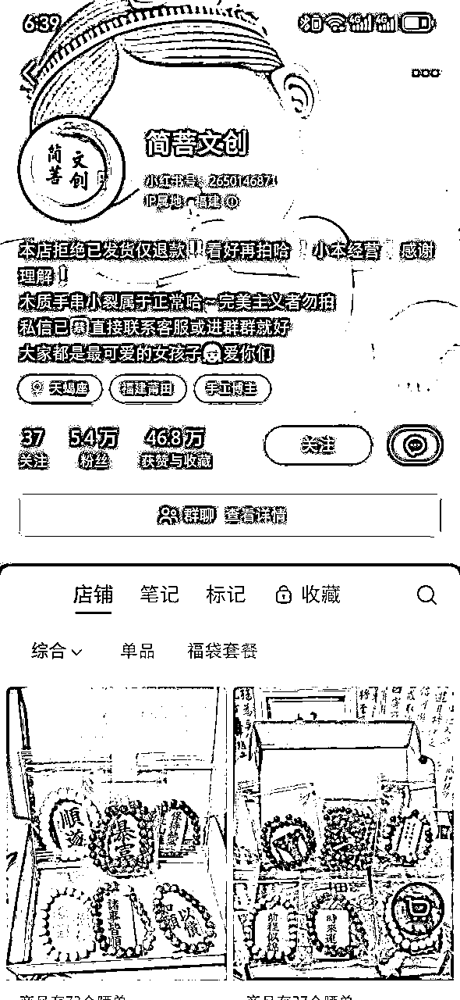

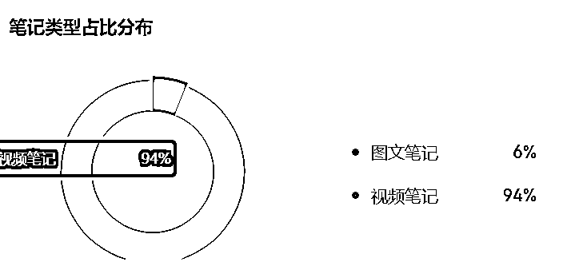

置顶的那条爆款笔记数据很猛：7.9万点赞、2.9万收藏、2767条评论，且笔记里直接挂了手串商品链接。

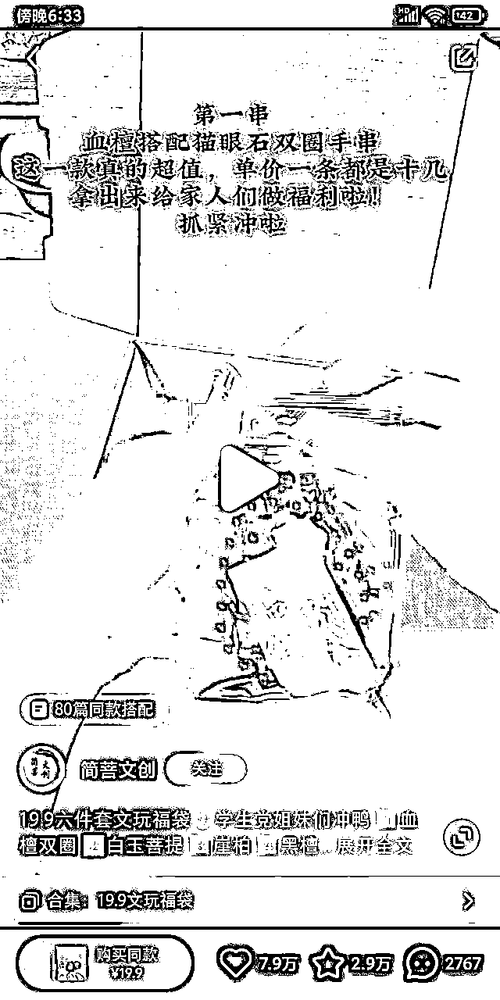

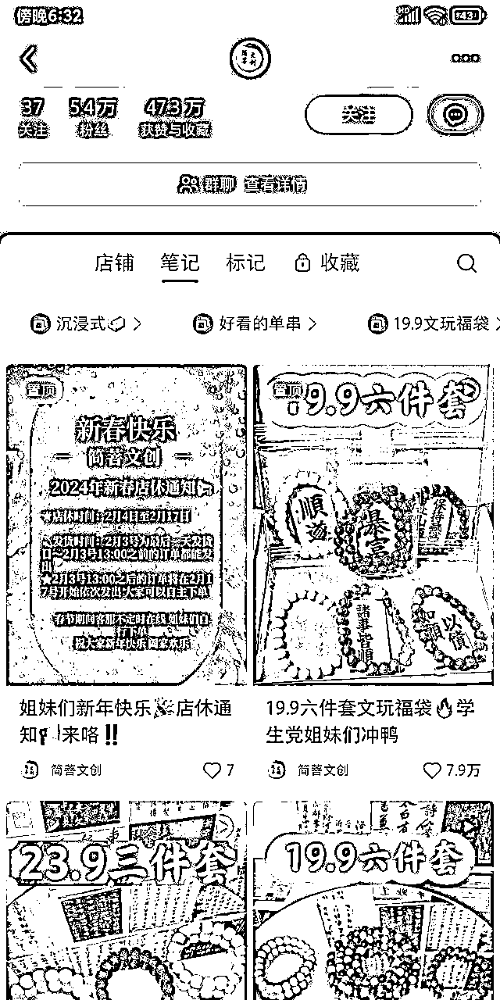

店铺里卖得最好的是一套19.9元六件套文玩福袋，累计销量4.4万+。同款福袋用相似标题和封面换皮后，也有过万的成交。

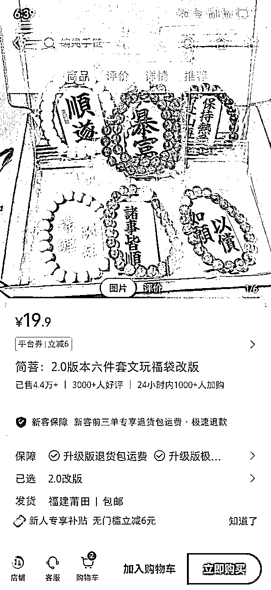

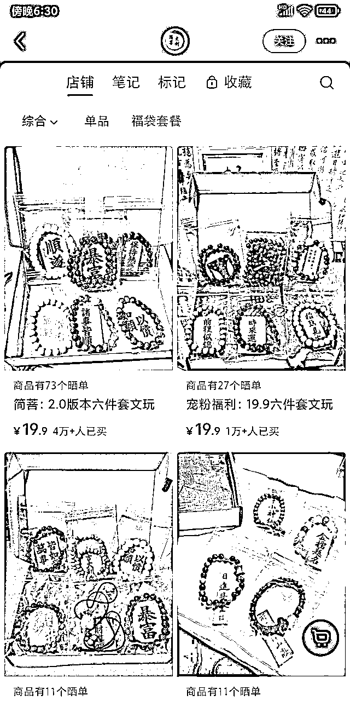

## 2.爆款笔记的演化路径

这个号的视频都是短视频形式，回溯时间线能清楚看到爆款是试出来的。

内容大概分三个阶段：早期探索期、第一次爆款期、现阶段模板化期。

早期作品很杂，封面就是手持产品或上手佩戴的普通展示，没什么记忆点。

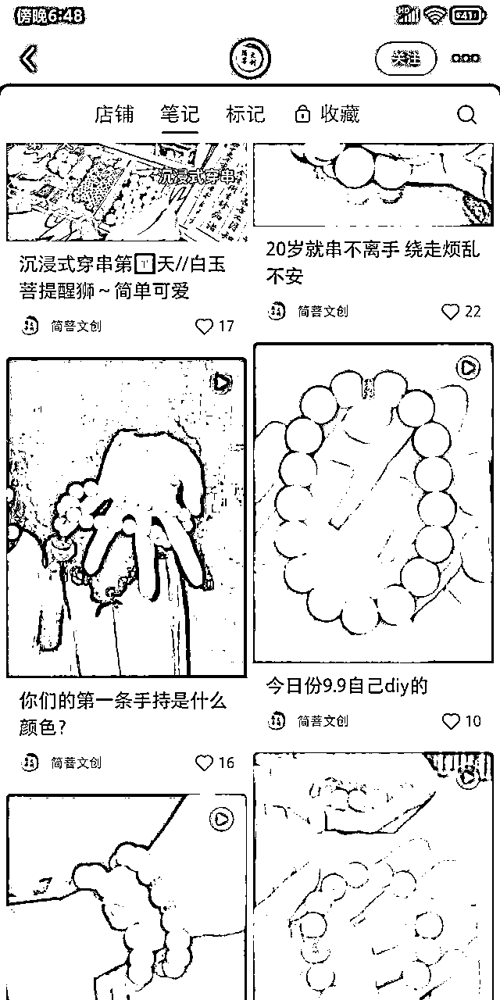

第一次出现明显爆款时，内容形态变了：开始是手串出库打包的实拍，配合口播讲解。往前扒视频，会发现打包类内容早有尝试，只是封面没做区分，但数据已经开始起量。

数据一上来，封面就开始上价格+福袋的强刺激文案，紧接着第一条真正的大爆笔记诞生了。它的核心要素是：价格锚点、福袋、祝福语+打包发货的仪式感。

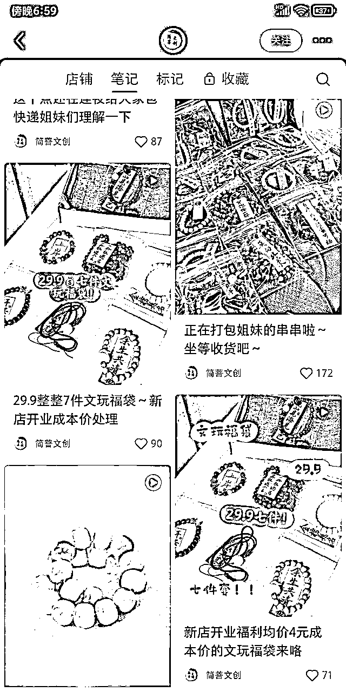

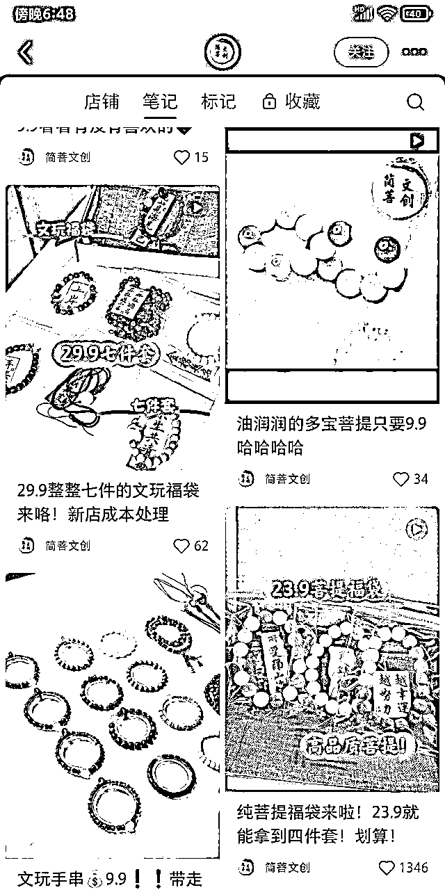

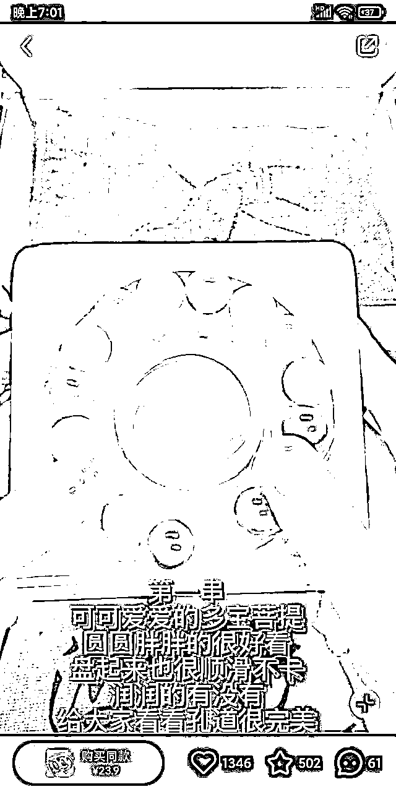

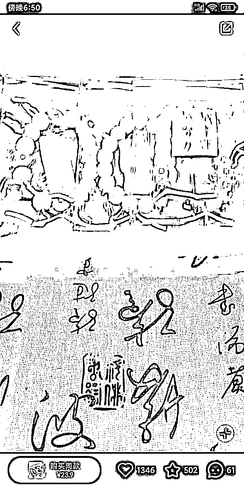

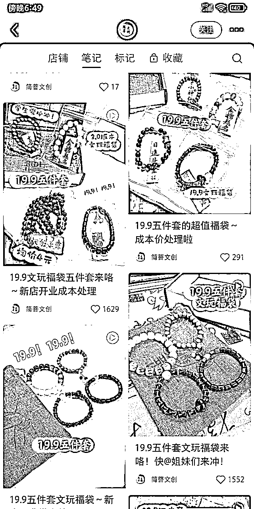

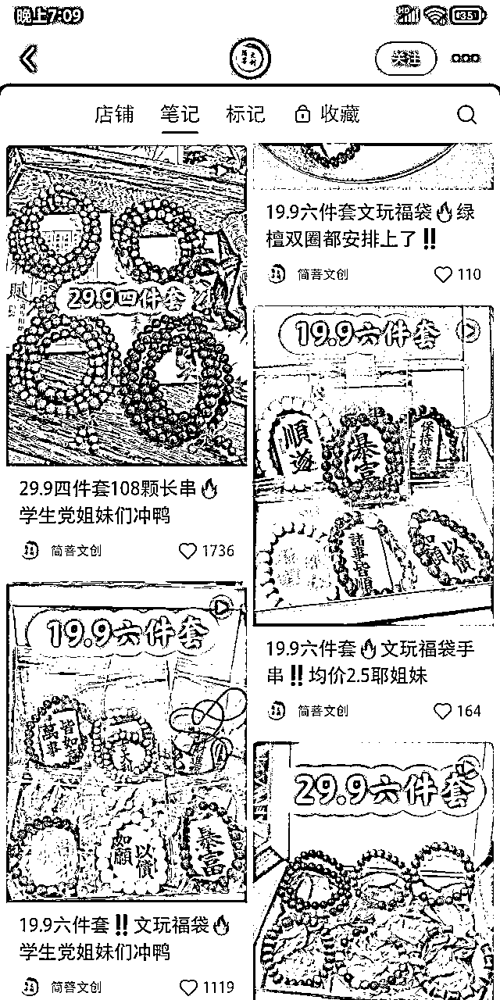

第一个爆款跑通后，后续封面一直在微调场景和呈现方式，但核心要素始终保留。

到近期，账号已经找到稳定模板，封面高度统一，生产效率大幅提升。

拍摄逻辑就是打包时顺手用手机录一段，5-6分钟录完一套，一天能稳定产出四五十条。批量上稿去找下一个流量模板，找到后就把封面、标题、19.9的价钱反复使用。

这套方法最典型的是19.9福袋合集，十条同系列视频全部拿到不错的自然流量，属于找到密码就猛薅。

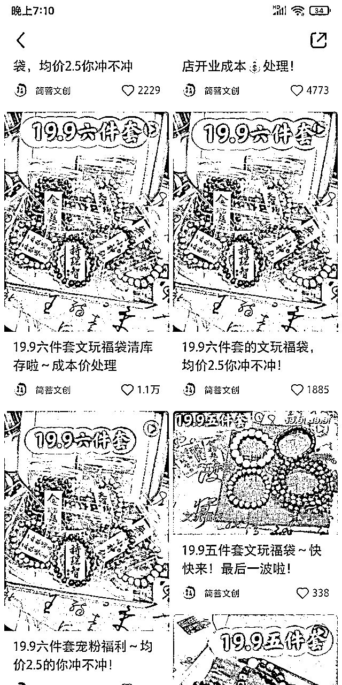

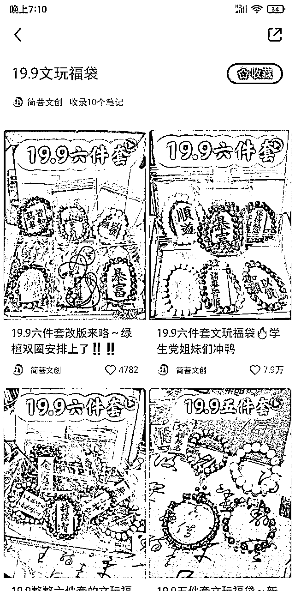

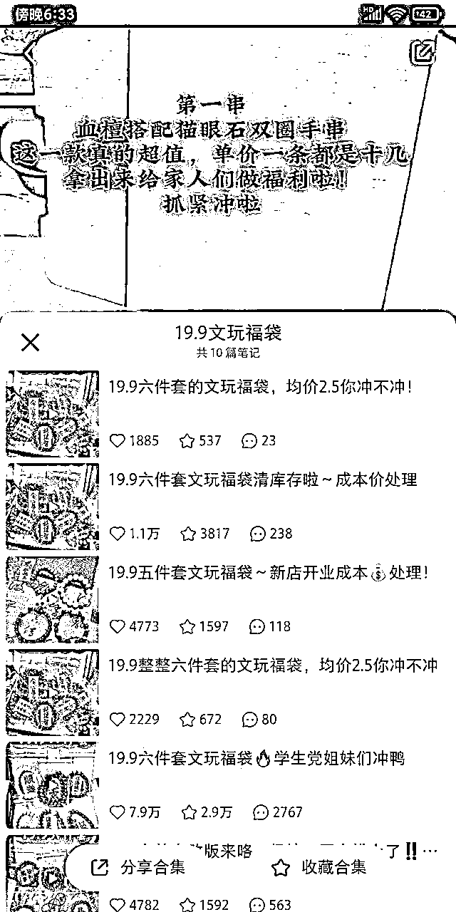

低价爆款单条就能带来不少转化，多条爆款叠加，店铺整体成交转化率自然被拉高。

# 产品与价格策略

爆款定价走的是极致低价路线，覆盖人群从大学生到入门级文玩爱好者。价格低到不需要思考，下单门槛几乎为零。

店铺梯度价位有52、39.9、23.9、19.9。真正能稳定卖动的集中在23.9和39.9区间。

就19.9的文玩手串来看，累计销量70997单，销售额约1412840元。

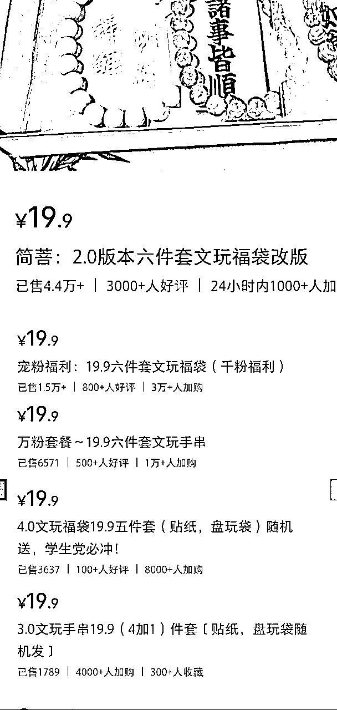

# 成本与利润测算

利润空间取决于货源。主要有两种情况：自家有工厂直供，或有成熟的文玩拿货渠道，拿货价都能压得很低。

市场上对19.9六件套的拿货价有讨论，圈内有人提到做到1元/条甚至更低。具体我不确定，下面算的是保守假设。

假设一套六条只赚1元/条，一套赚6元，70997单就是425982元的毛利，月均约3.5万。还没算快递和打包成本，压低这两项还能剩下利润。这还是按最低利润算的。

实际上义乌片区的手串按毛、按斤批发，一串几毛到1元都常见。23.9到39.9价位的产品也各有上千单销量，进一步拉高利润。

# 这种模式适合谁做

结论很直白：最适合手里有工厂或有稳定低价手串货源的人入局。

纯流量玩家也能玩，就是前端负责做内容、测模板、挂车，后端找有资源的人代发代发。对个人来说，前端笔记能力+后端供应链分工是最轻的切入方式。

这是我第一次做小红书赚钱案例的完整拆解，前后端数据和利润部分可能不够精确，有不足的地方欢迎补充指正，也希望有经验的前辈多多交流。