# ('风向标拆解第3期-小红书爆款，售卖件数50W+的店铺到底是怎么赚钱的-沐一', (2, 39))

先上结论：垂类视频矩阵配合爆款逻辑，在小红书上确实能跑通。单店每月净利润稳定在300万到330万区间。一天发多条视频，加上矩阵号铺量，效果立竿见影；但供应链能力决定了产能和成本，是真正的胜负手。

我们拆解的这家店，是个只卖“光腿神器”和打底袜的小红书女装账号。为什么选它？一是垂类定位非常清晰，二是靠视频笔记+素人种草起号，门槛低，三是有一款“光腿神器”已经卖出74万+件，非常夸张。

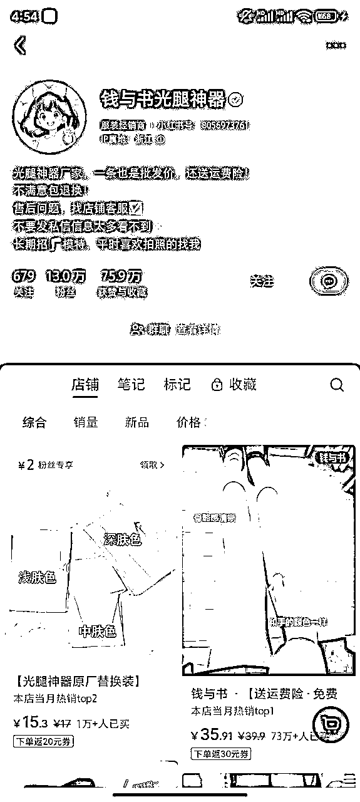
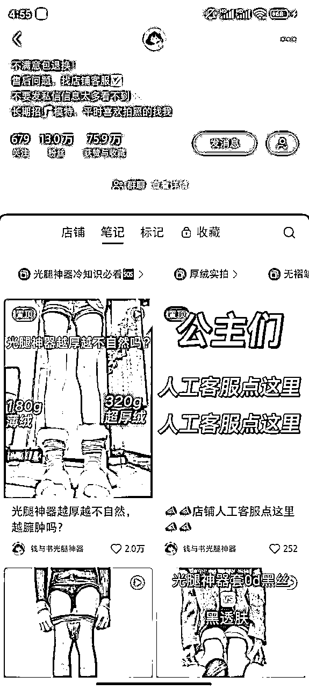

流量端怎么做？账号每天雷打不动更新2~3条视频笔记，基本每条都挂购买链接，尽量把流量导向下单。发布时段集中在晚上21点和22点，以量取胜。从整体数据看，差不多每发30条图文，就能冒出一个点赞几百的小爆款。视频内容全是上身穿搭实拍，叠加大字文案，精准狙击年轻女性用户。

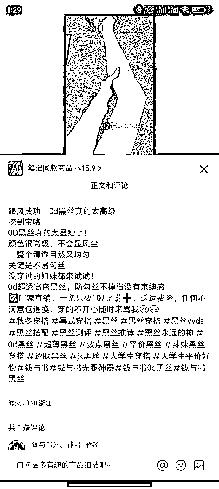
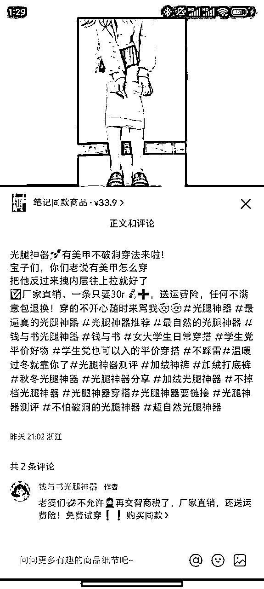

素人合作也玩得很溜。大量找素人博主铺笔记，形成堆量，打造爆款氛围；同时首页公开招募模特，用货品置换来代替现金。另外还养了多个小号持续发笔记，进一步加重密度。

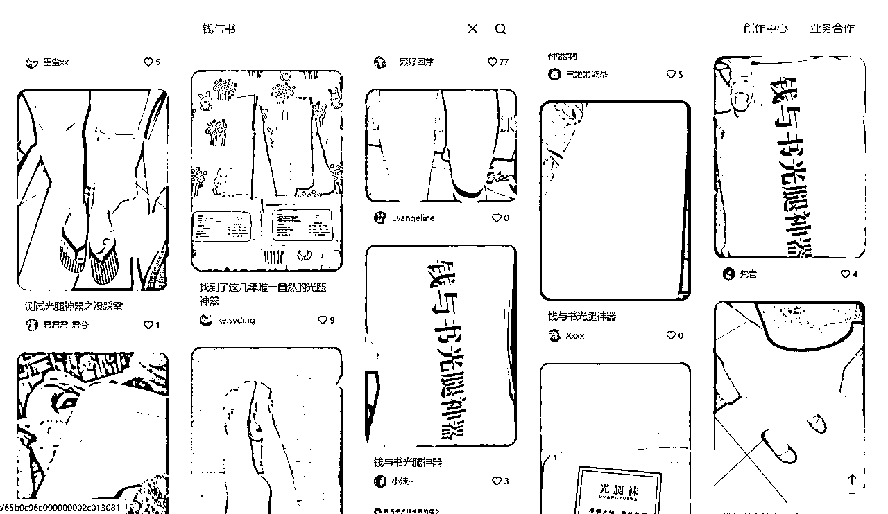
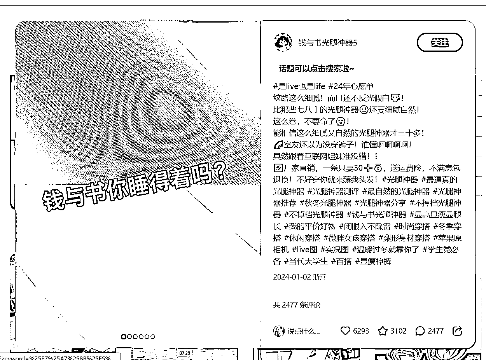

价格策略更是直击人心：定价在同类目里属于极低档，学生党毫无压力，穿坏了也不心疼。低价之外还发粉丝专属优惠券，甚至提供免费试穿和退货运费险。社群也做得很细，既有门槛群也有无门槛群，靠日常运营维护粉丝黏性。

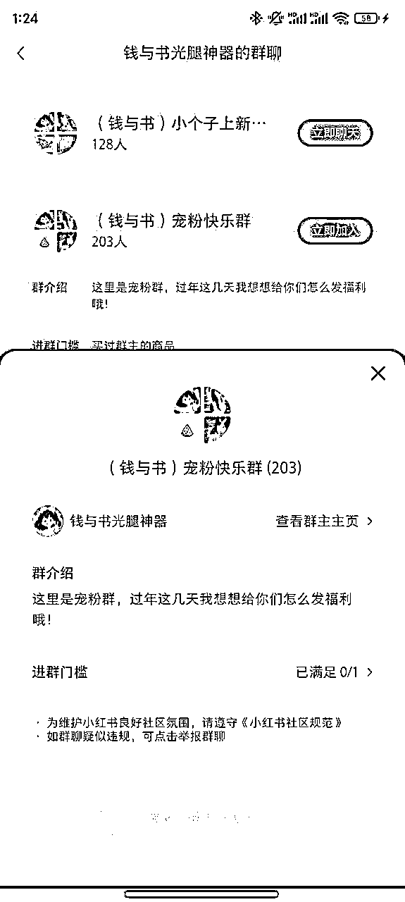
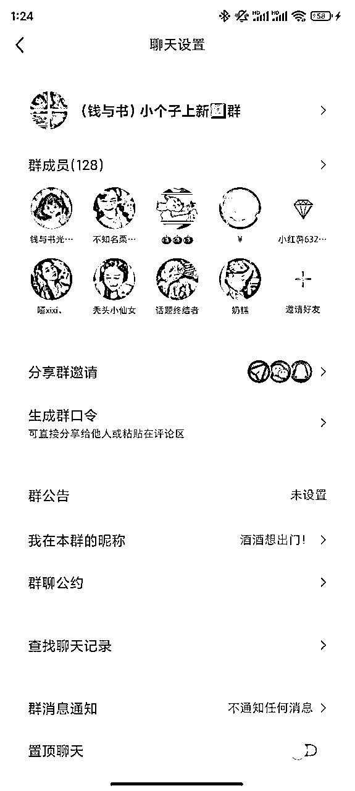
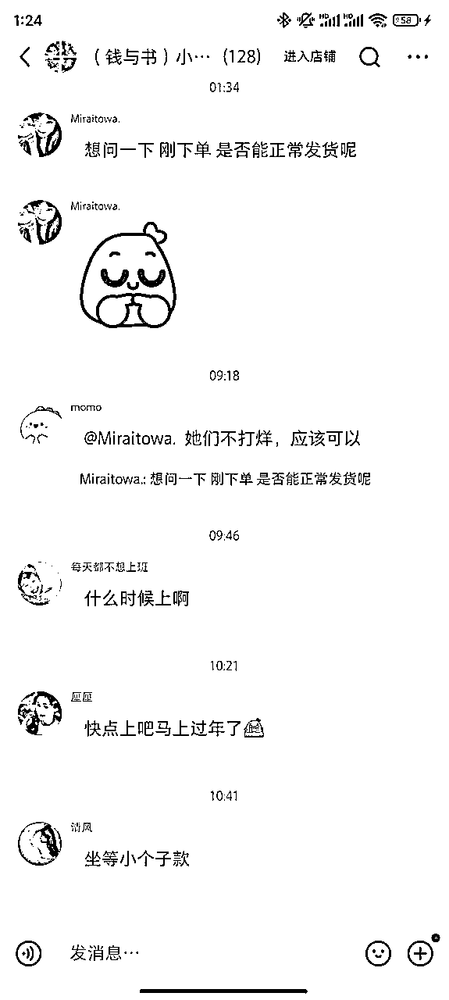

货从哪来？合作工厂直接发货。既要卖得便宜又要保证质量，这非常考验供应链管控能力。

利润怎么算？1688上同款光腿神器最低拿货价大约12元。即便扣除活动福利，按一单30元的客单价算，单件利润仍有18元。按73万销量计算，总利润约1314万元。账号最早笔记发布于2023年11月，到拆解时差不多4个月，折算下来月利润约328.5万元。如果工厂是自有的话，利润空间还能再往上走。

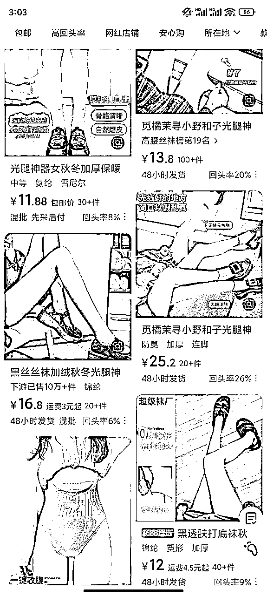

项目能不能放大？这个店铺在小红书已经跑出大爆款，创始人又把同样的模式复制到了淘宝、抖音等平台。

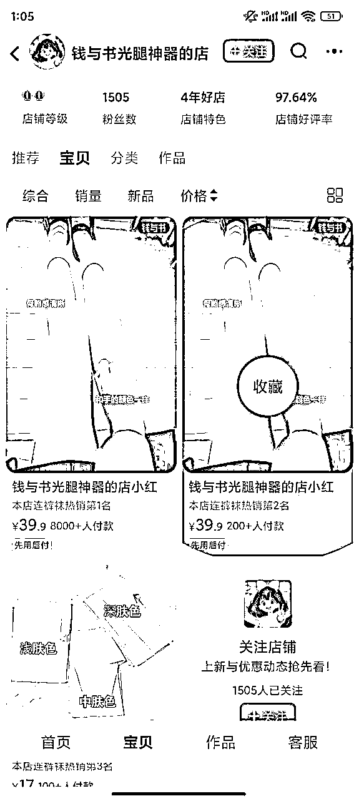
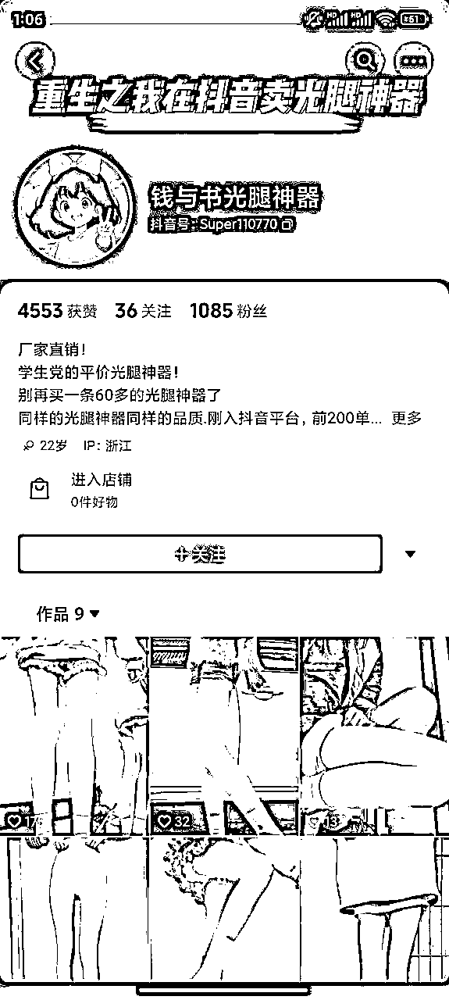

快手暂时还没有店，但完全可以照搬同一套打法去快手、闲鱼等平台，定价保持一致，起量难度并不会太大。核心还是那两个字：供应链。