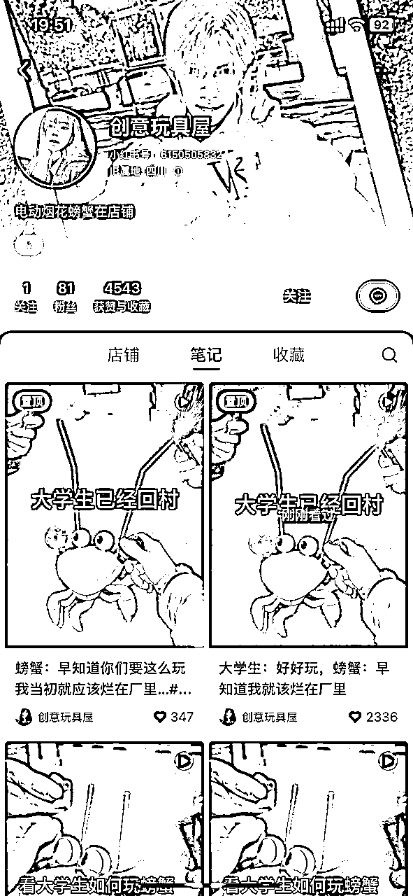
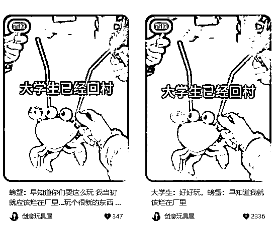
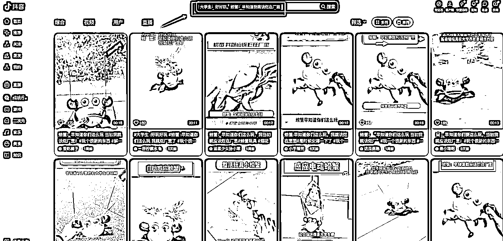
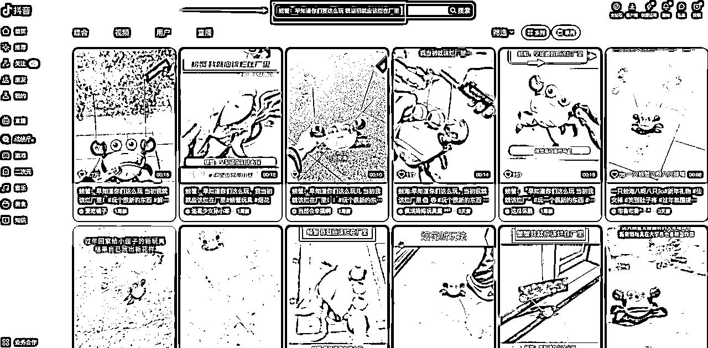
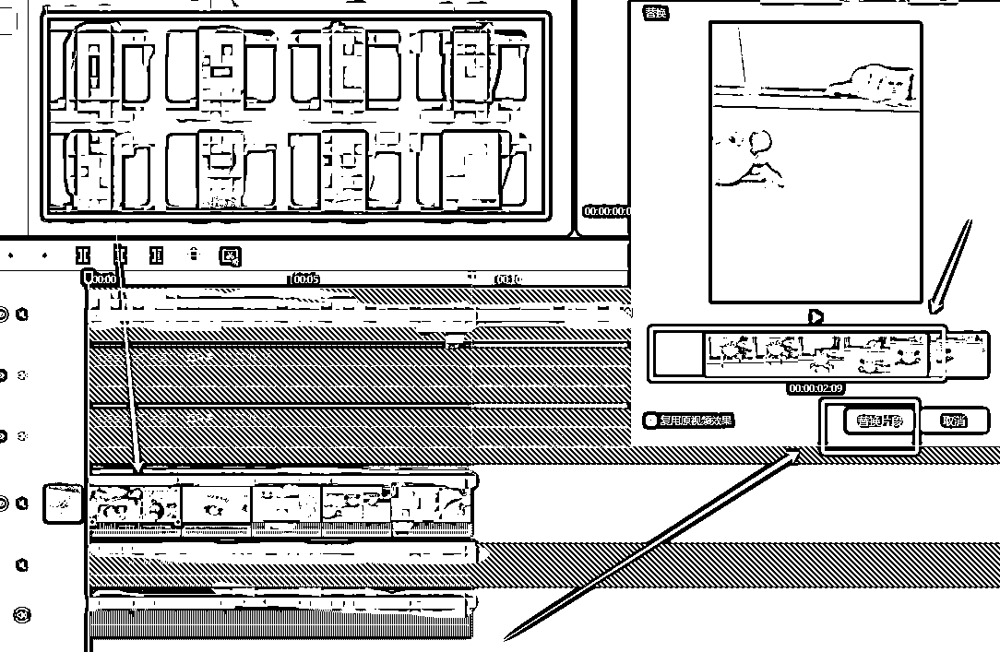
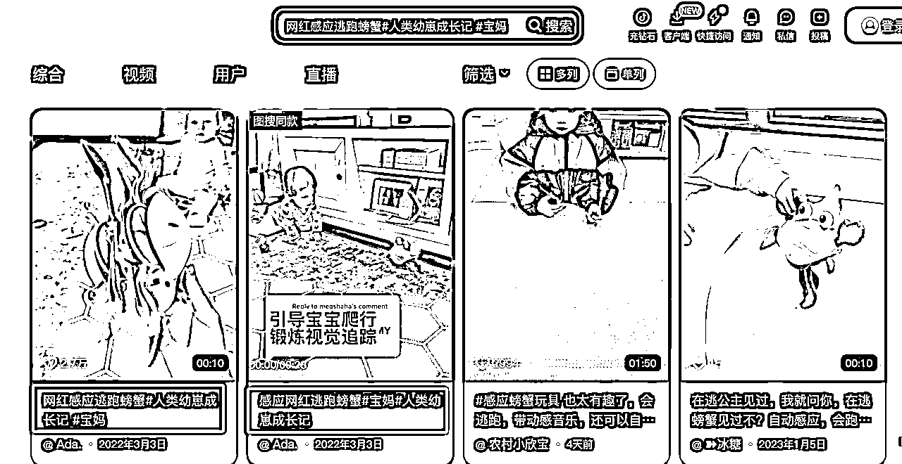
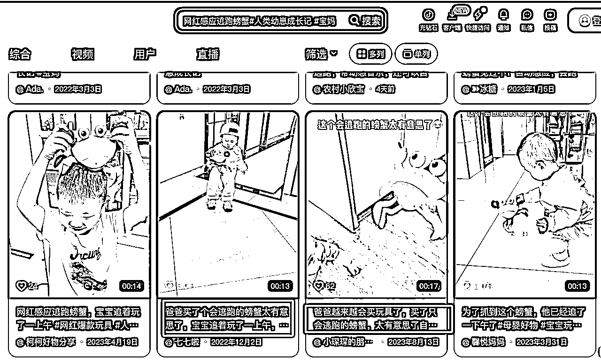

# 风向标拆解第3期 | 月销50万+件的玩具爆款店铺，赚钱逻辑全拆解

## 一、项目缘起

此前在跟进📕店铺运营的航海社群，重点在玩具赛道。刷到一个玩具赛道的新品异常火爆，📕的互动数据很亮眼。账号首条内容发布于1月23日，之后保持日更1-2更的频率，整个店铺目前只在卖一个SKU。

## 二、账号与内容拆解

**账号画像**
头像是位年轻女生，背景图是帅气男生。昵称叫「创意玩具屋」，简介写着「电动烟花螃蟹在店铺」。账号粉丝数只有81。

**产品核心卖点**
好玩又解压，螃蟹可以夹住烟花在地上爬行，既新奇又和过年氛围强相关。

**目标人群**
主打大学生群体，正值寒假，空闲时间多，爱玩爱分享。

**内容打法**
爆款标题方向：
1. 大学生：好好玩，螃蟹：早知道我就该烂在厂里
2. 螃蟹：早知道你们要这么玩 我当初就应该烂在厂里…

挂载话题：#玩个很新的东西 #解压玩具 #玩具 #玩具推荐 #大人也要玩玩具

视频开场文案：
1. 大学生已经回村
2. 看大学生如何玩螃蟹

**视频结构**
爆款封面：

开头3秒：点燃烟花，把夹着燃烧烟花的螃蟹放到地面上爬行。
中后段：持续呈现夹着烟花螃蟹来回走动的画面，强化视觉冲击。

**素材获取方式**
抖音上可以直接搜索📕同款爆款文案，找到调性相近的视频拿来参考。

快手、📕、视频号等平台都可以用同款思路去找素材库。

**剪辑思路**
先把爆款素材按场景拆解。

找到画面近似的素材片段，把核心场景做替换即可。

也能自行拍摄，整条时长控制在15秒左右，重点突出螃蟹夹烟花爬行的画面，拍摄门槛很低。

## 三、利润拆解

| 产品版本 | 拉线款 | 电池款 | 充电款 |
| 📕售价 | 29.8 | 39.8 | 49.8 |
| 拼多多参考价 | 14.79 | 24.5 | 27.6 |
| 毛利估算 | 15.01 | 15.3 | 22.2 |

单品毛利稳定在15元以上，充电款利润更高。

## 四、可复制的延伸玩法

**人群拓展**
宝妈群体：可以买给孩子当玩具。

奶爸群体：同样适合买给孩子玩。

**投放与矩阵**
新账号做付费投流首单有优惠，利于冷启动。
可以多号矩阵并行操作，提升爆款概率，同时把内容同步分发到抖音、快手、视频号，放大流量。