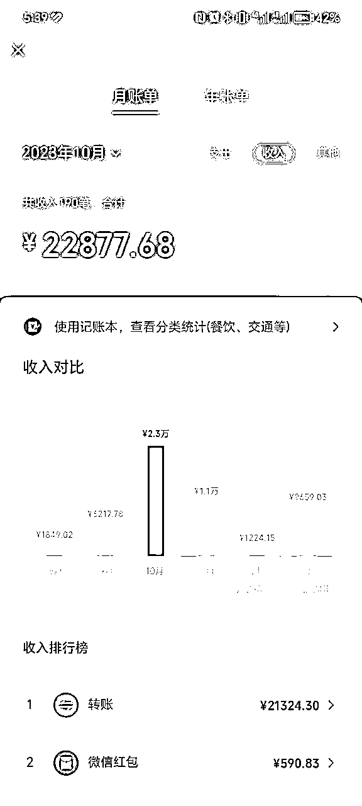
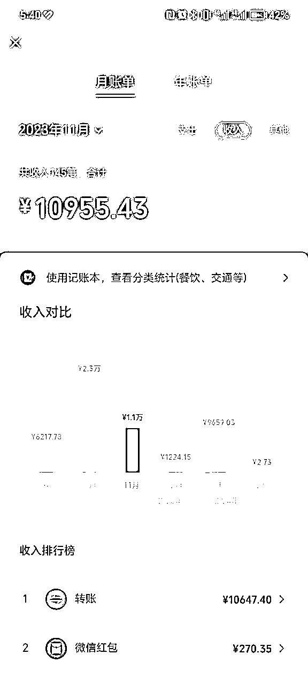
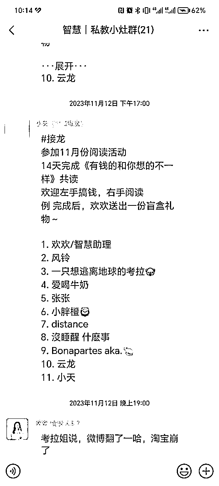
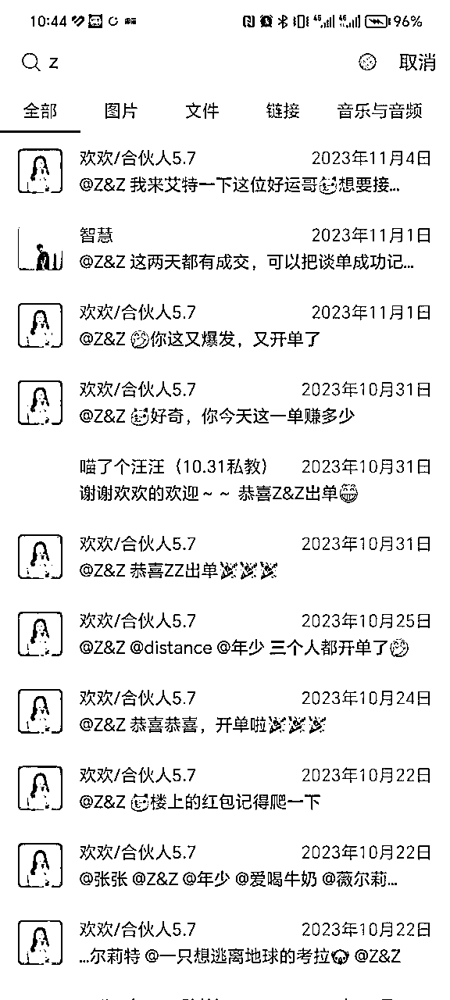
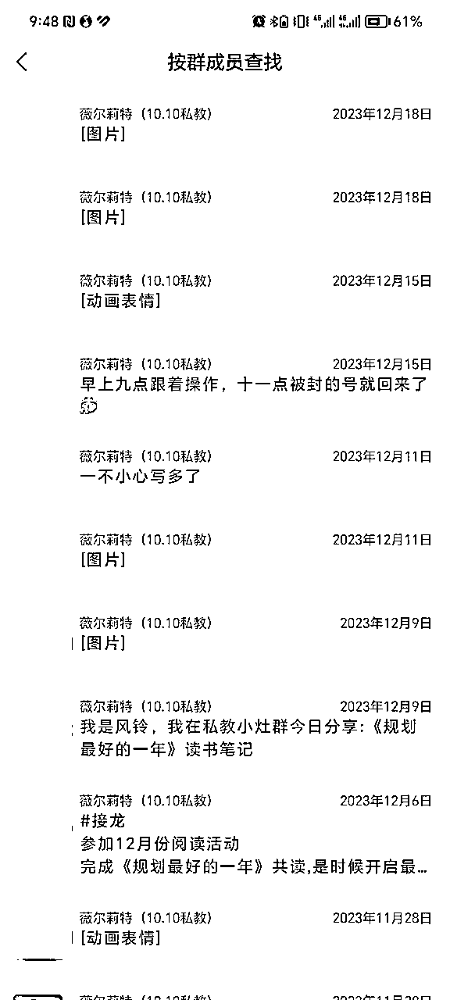
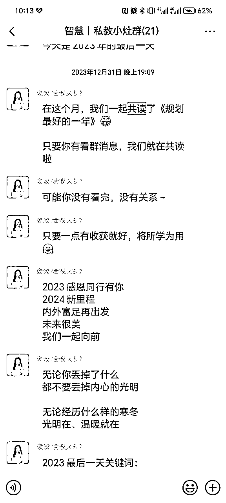
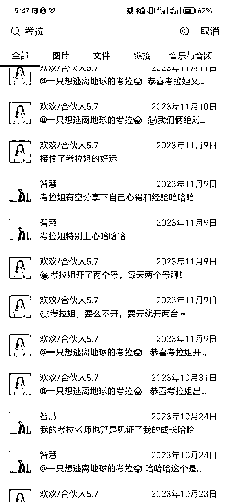
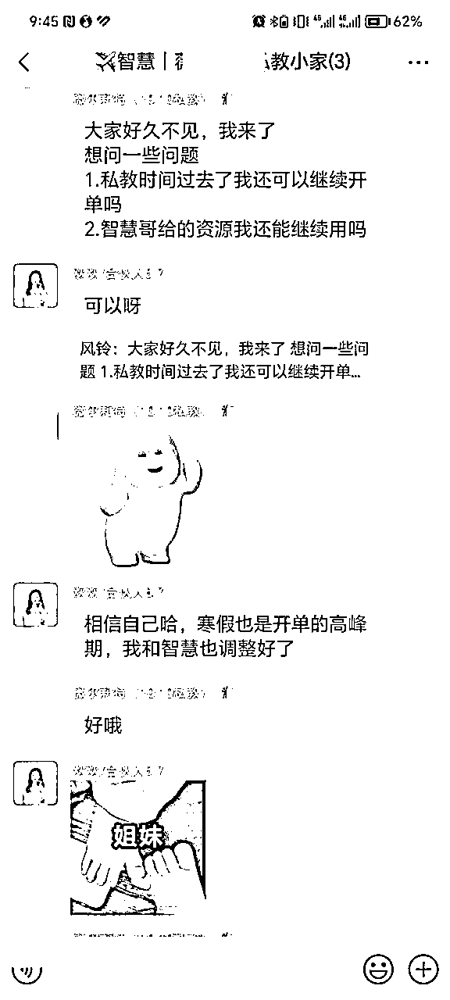
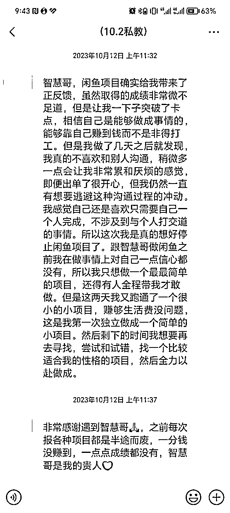
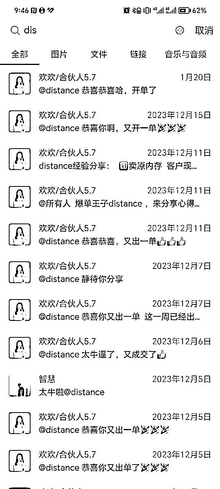

# 第一次尝试知识付费就做到月入过万，我的5点实战复盘
作者：龙哥

赚钱的伙伴们好，我是龙哥，目前大三在读飞行员，副业做闲鱼iPad电商运营，也在带iPad电商私教陪跑。十月、十一月，受赚钱邀请发了在赚钱的第一篇精华帖后，顺势推出了年度知识社群和首期私教服务。社群招满90人，私教首期收了20位，知识付费单月营收就破万了。

说实话我挺意外的。因为我一直觉得自己的闲鱼iPad项目在赚钱里很不起眼，自己单做的话，一个店铺月入四千左右，三店并行也才过万，顶天了。

但没想到依然有大量圈友主动来找我、为我付费。更关键的是，学员在我的陪跑下拿到了第一份正反馈。这让我真正明白了白哥那句话的意思：100分可以教80分，80分可以教50分，50分可以教30分。每个赛道都有匹配的人群，只要你能解决痛点、交付价值，就能做知识付费。

我的项目赚不到大钱，但对刚入局自媒体的新人而言，它足够简单直接，能帮他们轻松拿到互联网上的第一桶金，这个价值是真实存在的。

下面是我首期闲鱼iPad电商私教的营收截图和学员正反馈证明：

废话不多说，直接分享第一次做知识付费的五条心得，希望能帮到还在犹豫的你。

一、听会做事的人，而不是听自己乱想

我2023年2月加入赚钱，一开始什么都新鲜、什么都想试。贵人老师芷蓝姐、靠谱姐、白哥一上来就建议我深耕闲鱼iPad电商。因为我在这上面已经沉淀一年，实打实做出了五六万的成绩。

但我自己总觉得项目太low、太不起眼，不配做知识付费。于是我偏偏不听劝，到处瞎折腾，项目换了又换，最后七个月时间晃过去，还是发现自己最适合的就是闲鱼iPad电商。

九月份阴差阳错开启了私教陪跑，才发现原来每个赛道都有自己的受众，没有高低之分。能解决用户问题就能变现。所以一定要听有结果的人给的定位，别用自己的偏见浪费时间，这七个月的试错成本很贵。

二、先动起来，问题在路上才会被解决

行动是破局的关键。不动，想法再多也是零。说实话我早想做私教，但一直卡在怕：没带过学员怎么办？交付跟不上怎么办？招不到人怎么办？

尤其是飞行理论最后一个学期还在读，学业和交付怎么兼顾？我脑子里的问题能排成队。

真正开始后才发现，难题都在推进中被化解了。比如在行动中我遇到了欢欢，5月在赚钱做志愿者认识的，有五年社群运营经验。我们一拍即合，三七分成一起负责私教交付。压力瞬间被分摊，学业也没耽误，交付效果反而更好。

所以别被想象里的困难吓住，先上车再买票，在实操里找解法。

三、用真诚链接，用利他换信任

首期20位私教学员的来源很分散：有看完精华帖主動付费的，有大一暑假打工认识的老师，有训练营认识的同学，有老学员转介绍的，也有社群分享后链接上的。

他们付费的原因也不同：认可我的分享真诚，有过线下接触觉得人靠谱，觉得服务负责愿意介绍。正是广结善缘、真诚利他的积累，让第一期自然成交。

做知识付费，口碑和人缘是复利。越利他，越容易被记住，也更容易被贵人看到。

四、圈子决定上限

如果没有来赚钱，我大概这辈子都只会埋头做闲鱼。一个店铺几千块，寒暑假开三店能过万，但回消息从早到晚，像个机器人，累又没成长。

来到赚钱后，在芷蓝姐、靠谱姐、白哥的影响下，我看到了社群、私教这条第二收入曲线。看着身边同龄大佬的节奏，我很难再回到原来摆烂的状态。心态被拉高，行动被带动，一年时间就把赚钱门票赚了十倍回报，还交到了一群志同道合的朋友。

好的环境会悄悄重塑你，选择比努力重要。

五、坚持就是结果

这是我今年最深的体会。加入赚钱快一年，刚开始收入并没有立刻起飞。作为一个很需要正反馈的人，低迷期真的很难熬。

但靠谱姐说的“每天五条朋友圈、真诚链接五个人、回访五位老朋友”我一直做到。很多人坚持不住就放弃了，而我作为知识付费新人，靠一年如一日的深耕，拿到了小成绩，也拓宽了认知和视野。

选对方向后，深度投入和长期主义会让你慢慢看到花开。

总结

以上是我第一次做知识付费的复盘。能在首期取得不错成绩，离不开踏实交付、遇到好搭档欢欢的合伙、以及前期一年的项目积累。更重要的是，我真的希望学员能变好，而他们也确实获得了成长和增收。

最后特别感谢我的贵人老师靠谱姐、理白哥、芷蓝姐，是你们带我进入赚钱这个高质量圈子，让我完成了认知和收入的升级。希望我的经历能给同样在路上的人一点力量。