# 风向标拆解 Vol.3：小红书月销50W+的裤装号，靠什么赚钱？

拆解任何生意，最后都会落到两个关键环节：流量怎么来，货怎么解决。
把这两件事摸清，再算算进货成本和毛利空间，就能判断值不值得下场；再拆出可行路径和放大打法，就能判断自己能不能做、能做到多大。

所以本篇围绕四问展开：
✅ 流量怎么持续获取？
✅ 货源怎么解决？
✅ 利润怎么算？
✅ 落地动作和放大方式是什么？

# 案例：一周无休

## 账号基本面
- 账号名：一周无休
- 类目：女装裤装
- 带货方式：短视频+图文混合起号，日常更新，在短视频里挂商品链接
- 商品定位：百元以内、休闲感运动长裤、主打舒服

## 拆它的理由
- 全店只做裤子，垂直度很高
- 用视频就能冷启动，门槛低
- 单条裤装售出超10万件，爆发力强

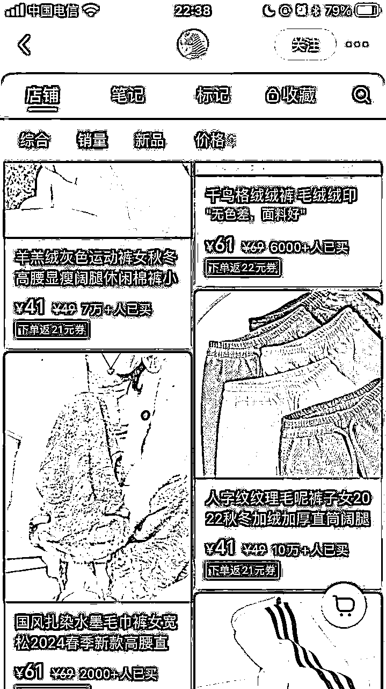
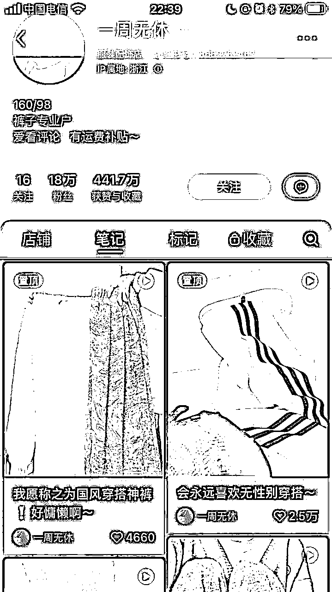

## 1 流量怎么拆？

这号的自然流量基本全靠短视频。下面先把视频内容拆开看，再用三方工具确认付费买量占比，最后给完整结论。

### 起量前的测试期：人字纹宽腿裤

该产品首次上架是2023年11月2日。

#### 1月6日 · 灰色款
- 笔记方向：标题突出“49元”“雪尼尔”“质感好”；话题围绕人字纹、垂坠感、雪尼尔、秋冬季、灰色系。
- 互动表现：赞30 / 藏8 / 留言0
- 内容要点：裤子的纹理清晰有质感，灰色显白，能挡胯宽、拉长腿，梨形身材和小个子女生可以放心入。
- 人群定位：梨形、小个子。

#### 1月12日 · 灰色款
- 笔记方向：标题主打“冬天早春都能穿”；话题沿用上一组；内容开始强调通勤党适用，显瘦且垂顺。
- 互动表现：赞14 / 藏3 / 留言0
- 人群定位：早八通勤党。

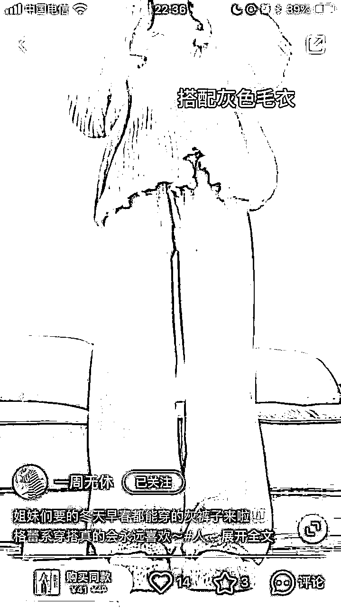

#### 1月14日 · 灰色款
- 笔记方向：标题强调“穿不腻、版型显瘦”；新增格雷系风格话题；内容突出慵懒感、腿部线条更好看、内里加绒。
- 互动表现：赞24 / 藏12 / 留言0
- 卖点升级：加绒与显腿型。

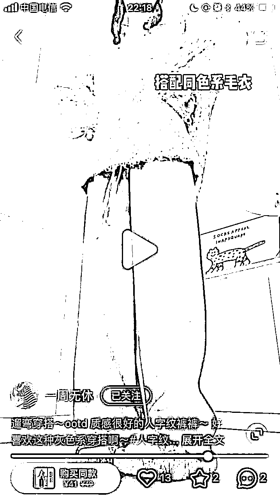

#### 1月15日 · 灰色款
- 笔记方向：标题称它为“早春神裤”；内容继续打梨形身材、遮肉、不挑腿型，并带上通勤场景。
- 互动表现：赞20 / 藏8 / 留言0
- 备注：8.01

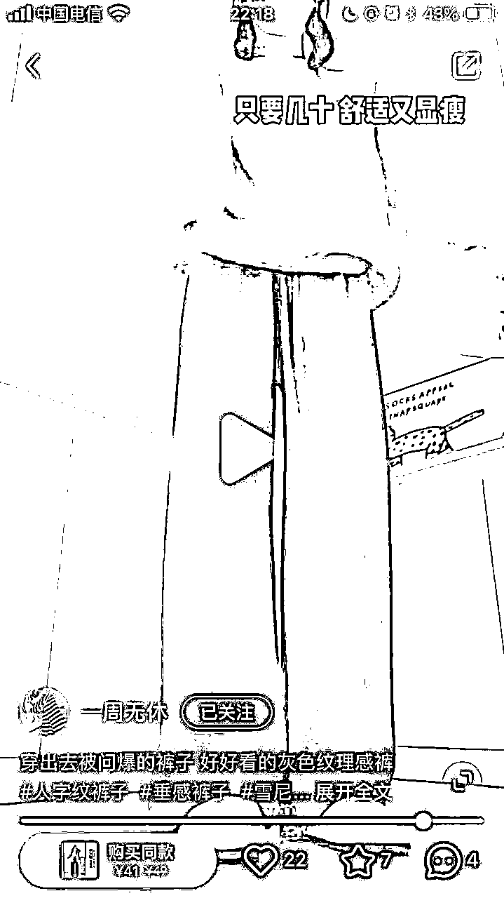

#### 1月17日 · 灰色款
- 笔记方向：重复使用“人字纹”“显瘦百搭”等关键词；视频素材与1月14日相同，只是口播换了一套说法。
- 互动表现：赞15 / 藏3 / 留言0

到这里，互动数据都比较平淡。真正的转折在1月24日。

### 1月24日爆发：单日连发24条

当天，卖家围绕同款裤子的另外两种颜色，一口气发布了24条笔记。每条内容基本逻辑一致：换不同上装拍同一条裤。结果，留言区不断有人求上装链接，这很快变成了新的需求信号。

#### 走红款A：灰色款（共发9条）
互动表现：
赞2681 / 藏846 / 留言48
赞3128 / 藏1393 / 留言139
赞1671 / 藏569 / 留言64
赞1768 / 藏552 / 留言84
赞2316 / 藏889 / 留言99
赞2580 / 藏747 / 留言88
赞1941 / 藏798 / 留言199
赞1.1万 / 藏4513 / 留言297
赞5.5万 / 藏2.3万 / 留言1272
话题概括：人字纹、雪尼尔、秋冬季、灰色系。
要点：为什么突然走红，卖家自己也说不准；但内容明显更聚焦学生党、早八通勤党，并把“49元”价格点放大。走红后她继续换上衣拍同款。

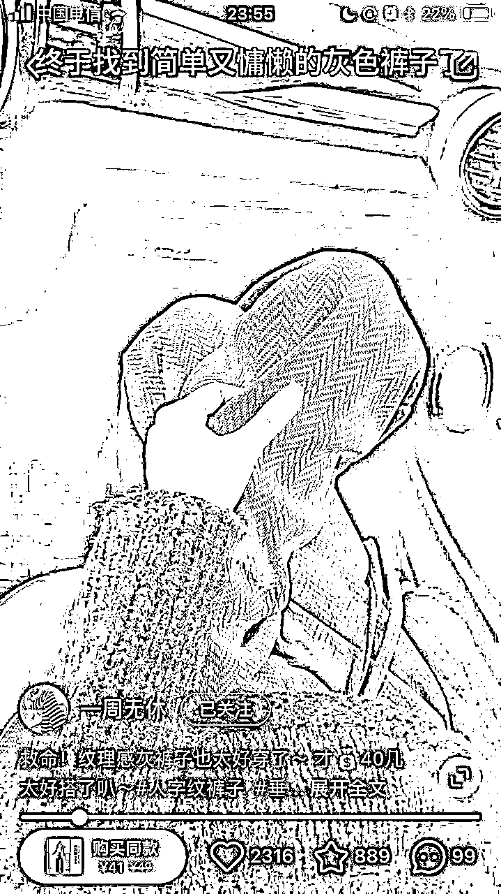

#### 走红款B：棕色款（共发12条）
互动表现：
赞1387 / 藏623 / 留言108
赞1523 / 藏484 / 留言10
赞1992 / 藏622 / 留言40
赞2624 / 藏942 / 留言164
赞9207 / 藏3869 / 留言449
赞1936 / 藏830 / 留言109
赞1.7万 / 藏8639 / 留言1123
赞1178 / 藏561 / 留言78
赞6583 / 藏2253 / 留言188
赞1248 / 藏384 / 留言77
赞7123 / 藏3764 / 留言495
赞3769 / 藏1182 / 留言110
话题概括：人字纹、雪尼尔、秋冬季、棕色系。
要点：留言区问毛衣链接的人很多；还有用户反馈里绒可否去掉或加厚、没有兜袋、裤长不合适等问题。

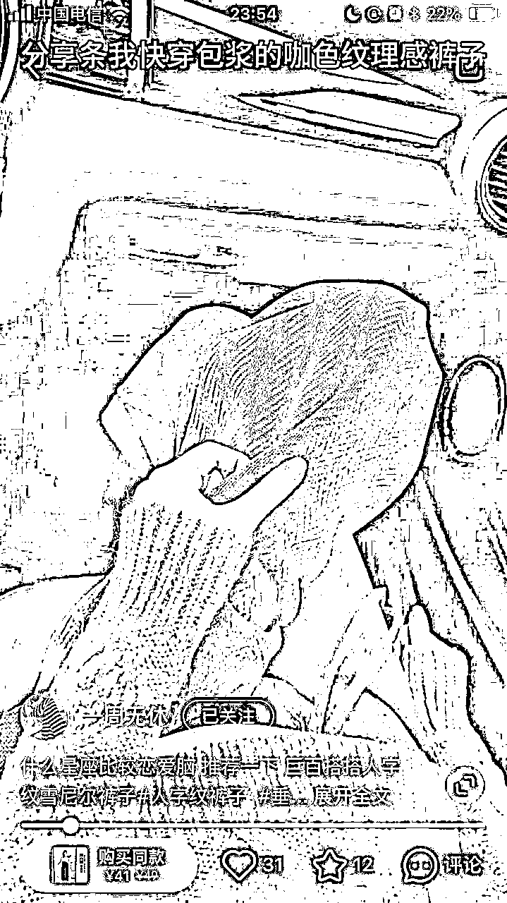

#### 走红款C：黑色款（共发3条）
- 笔记方向：标题强调慵懒时髦、49元起、质感版型都在线；话题覆盖黑色系和全身黑造型。
互动表现：
赞5758 / 藏1860 / 留言117
赞1856 / 藏579 / 留言42
赞3190 / 藏1090 / 留言19
要点：依旧是换不同上装拍视频，标题反复提通勤党；连带效果是上装也被问爆。

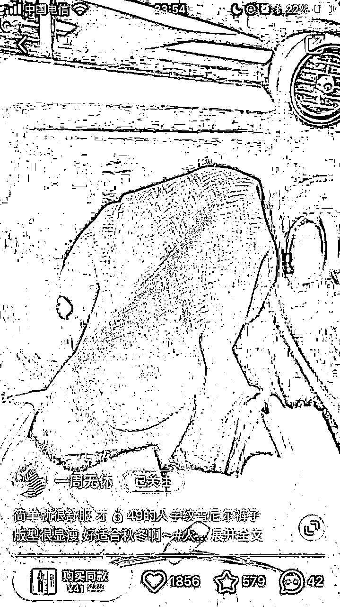

### 走红后的继续更新

#### 1月27日 · 灰色款
- 操作：复用1月15日的视频素材，但封面、标题和口播全部重做。
- 互动表现：赞22 / 藏7 / 留言4
- 内容要点：强调必入、对腿型友好、基础好搭、几十元就能拿下。

#### 1月28日 · 灰色款
- 操作：复用1月14日的视频素材，换封面、把场景改成散步穿搭，背景音乐也换掉，并新增春季穿搭话题。
- 互动表现：赞13 / 藏2 / 留言2
- 互动亮点：有男性用户留言想买，另有人提到平台抽盒活动。

#### 1月30日 · 同款粉色款
- 操作：视频安排在21:00发出，内容主打春天适合穿、质感版型好、配白色上装很韩系温柔。
- 互动表现：赞8 / 藏1 / 留言0
- 话题概括：新增春季穿搭、温柔风。

#### 2月1日 · 灰色款
- 操作：视频安排在01:00发出，内容强调好看、舒服，版型修饰腿型，材质软且有垂坠感，搭配同色系紧身上衣显气质。
- 互动表现：赞14 / 藏4 / 留言0

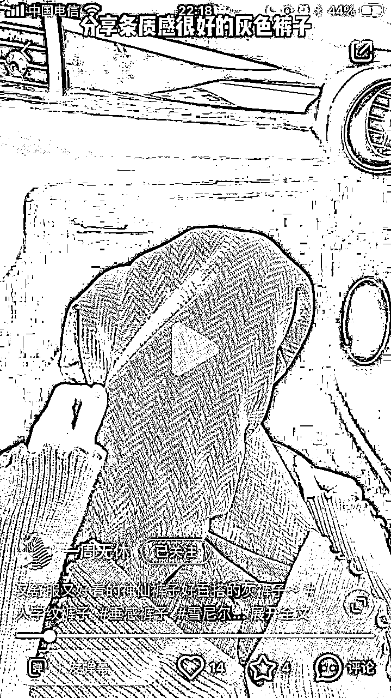

### 运营手法小结

1. 当季主推款做置顶，优先放数据好、留言多的内容，引导用户下单。
2. 留意异常需求：留言区反复出现的反馈和“求上装”的声音，往往就是下一款产品的机会。
3. 在评论区置顶购买链接，缩短用户下单路径。
4. 学会复制成功内容：某款单品跑起来后，沿用它的标题结构和拍摄思路去连发；再拿这个单品反向带其他近似款，用数量搏概率。

## 2 货源怎么解决？

从几个平台看同款货源：
- 1688：24-31元
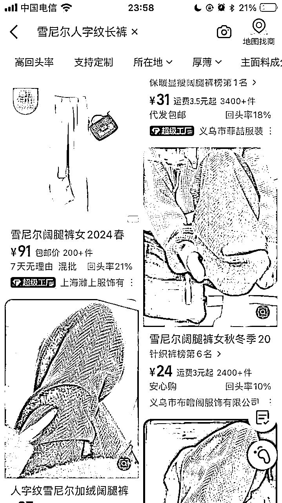
- 淘宝：26元
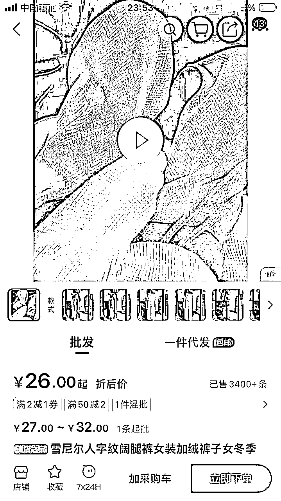
- 拼多多：22-49元
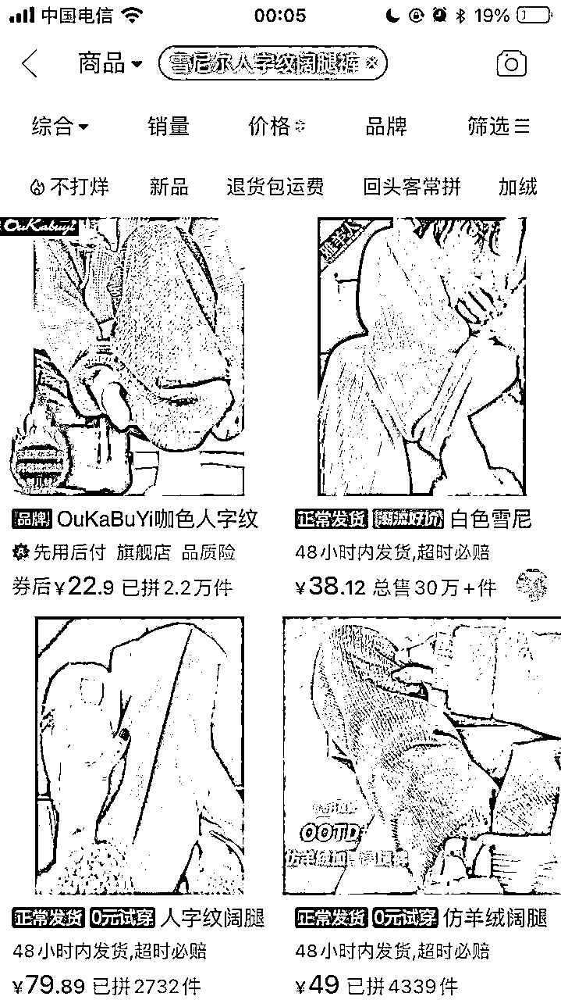
- 京东：71-77元
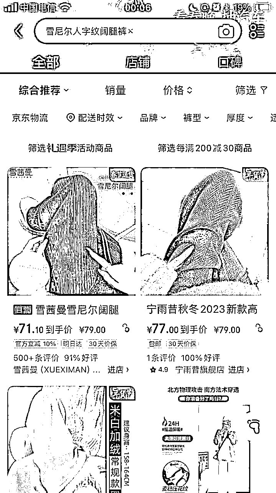

## 3 落地动作怎么做？

1. 赛道越垂直越好，比如全店只做裤子。
2. 靠第三方选品软件去发掘蓝海产品。
3. 参考近半个月内起量特别快的同行新账号。
4. 图文+视频同时起号；画面清楚、内容有意思是最低要求。测出热卖款后要敢于重复投放，像1月24日那样：当天发24条，覆盖同款另外两色，靠换上衣做差异，并从留言中发现了“上装”这个新增量点。

## 4 拆解结论

第一次做拆解，时间分配没把控好，也缺少数据层面的支撑；后面会持续拆更多案例，多向高手学习，丰富自己的方法库。