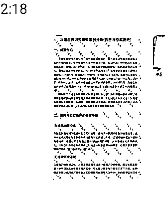
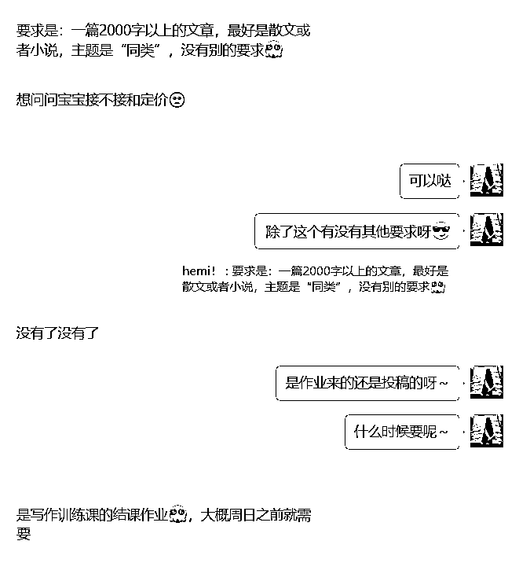
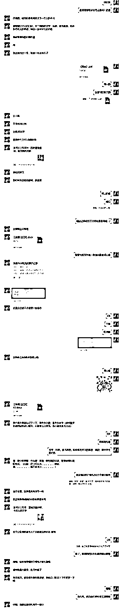
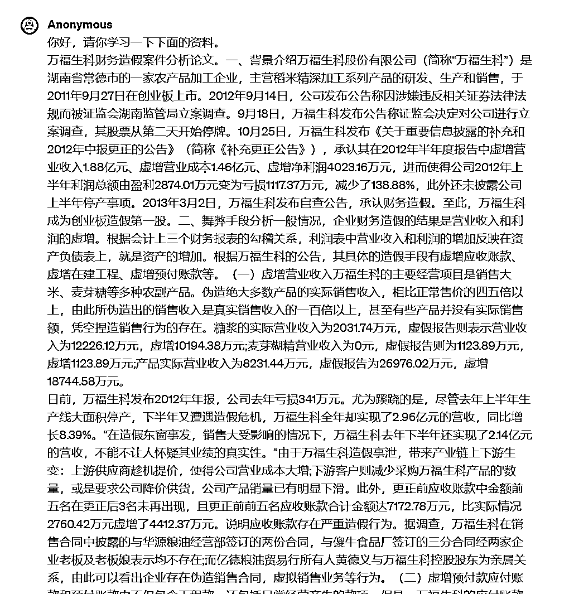
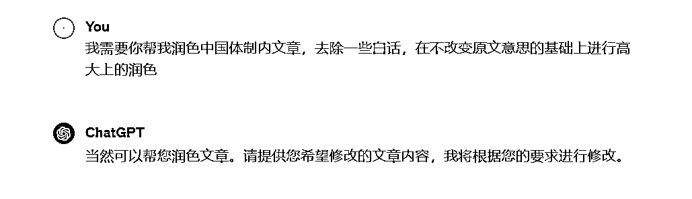
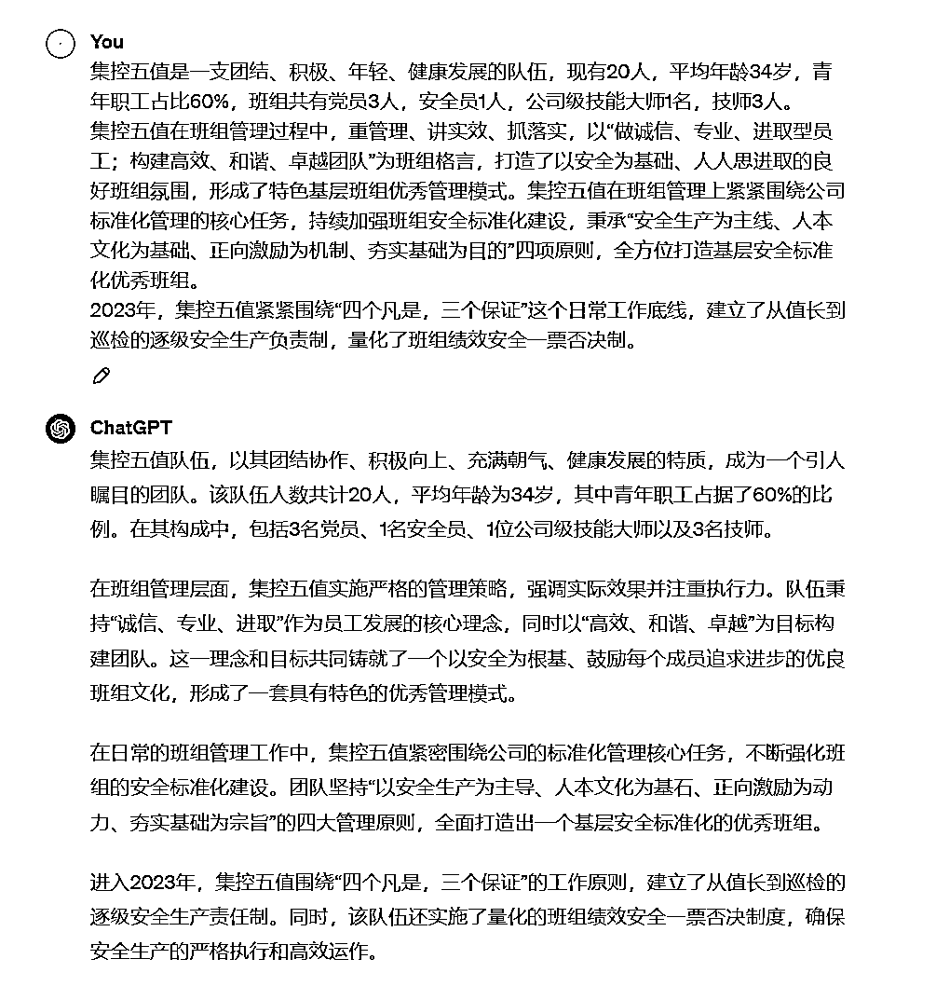

# AI代写接单进阶笔记：渠道、沟通、交付与提示词实战

## 0. 写在前面

文字委托的需求面相当广：简历代加工、稿件润色、主题演讲、公司介绍、学术类长文、读书心得、订阅号内容……几乎每天都在大量流转。

这套打法的核心不是教你从头养账号、攒流量，而是直接把已经跑通的订单入口交给学员。拿到单子就能开工，做完就能结款。

配套的是一套为接单场景定制的AI生成指令。收到委托后，按模板填入写作要求，剩下的交给模型，几分钟内得到初稿后再打磨，效率远高于从零硬写。

市面上的通识课往往有一个通病：学完之后还要花两三天研究怎么落地，赚不赚钱全看平台给不给推荐，不确定性太高。而这里走的是另一条路：渠道派单、AI产出、客户验收、等待回款。每一步都清晰可见。

## 1. 业务内核与收益判断

从本质上说，这是一个适合新人的现金流业务。

单笔收益不算高，但胜在稳定、可持续，且具备向上延展的空间。为什么不直接做终端高价单？因为渠道方本身承担了投流、运营、SEO、人员管理等成本，相当于他们搭好了一台自动运转的接单机器。作为内容生产端，分到的比例自然会压低一些，但仍属于正常报价范围。

对小白的价值在于：能练出实打实的写作手感，能理解不同文体怎么写，能学会怎么和客户打交道，还能在一次次交付中收获即时反馈，越做越有底气。

## 2. 写作工具准备

本次实战使用以下两个AI写作平台：

- https://chat.openai.com/
- https://kimi.moonshot.cn/

## 3. 与下单方沟通的全流程

大多数下单方其实说不清自己的真实需求。如果前期不问透，后面就是无休止的修改，既消耗时间也消耗心态。所以在开工之前，一定要把信息对齐。

**先请对方发需求原文。** 通常对方的上级或老师会给一张截图，里面写着最原始的要求，这是最可靠的线索。

**再确认材料形态。** 是调研报告、课程论文、随堂作业、申请文书、英文信件，还是其他类型？

**确认主题与具体内容。** 问清楚围绕什么话题来写、有没有参考资料可以给。比较聪明的做法是：先按文体搭一个提纲框架发给对方，询问这个方向是否可以，避免方向跑偏。

**确认篇幅与排版。** 字数大概多少？用什么格式交付？Word、PDF、PPT还是TXT？

**确认最晚交稿时间。** 优先接排期正常、价格合理的单子。低价急单一律不碰，性价比太低。

**确认受众是谁。** 稿子最终给谁看？是随便交差还是被严肃评估？如果对方非常在意，比如毕业设计这类售后复杂的长文订单，宁愿不接。

**索要参考样板。** 有例稿才能判断对方偏好的语感和结构。拿不到参照物的订单，慎重接手。

**长稿先出小样。** 超过一千字的委托，不要闷头写完整篇。先按提纲完成其中一段，发给对方确认语气和方向，再继续推进。

**遇到反复纠缠时及时抽身。** 修改改来改去是最折磨人的环节。当出现以下信号时，果断放弃：
1. 对方态度很差，情绪明显失控；
2. 修改轮次已经超过三次。

永远记住：我们是在筛选买家，不是在讨好每一个人。AI写三千字只需要十分钟，和难缠的人浪费半小时完全不值得。

价格带也能反映买家的性格：单价20—40元的中间客群最好说话，只付几块钱的反而挑三拣四；40元以上的单子对方更较真，因为稿子对他确实重要。

**交付前加防伪标记。** 用WPS给稿件打上又细又密的水印，再截一张预览图发给对方。确认无误后，再去除水印送出原稿。

话术可以参考：“好嘞，我先给您看带标预览版。确认没问题我马上整理干净的原稿哈～后面要调整也可以随时找我，这单是含修改服务的。”

**主动声明封单。** 客户确认后，回复：“那这边就封单啦，感谢您的信任和支持。稍后我会解散群聊，后续需要再合作随时找我。”

如果对方一直不回复，也要把这句话发出去。这不只是礼貌，更是在向派单平台说明这单已经交付完成。大多数情况下，即便买家不再露面，款项依然会正常结算。

## 4. 理解需求：开工前最重要的一步

拿到委托后，先别急着让AI动手，而是要真正看懂对方要什么。这个环节再强调都不为过。

另一个例子：客户要一篇人物特稿，发来的资料包括采访底稿、若干参考文章和一篇范文。这个时候要抓住的重点就是——以采访稿为素材来源，按照范文的风格来完成文章。

在GPT上的操作路径是：先让模型建立对“人物特稿”的认知，再把采访稿输入进去，按照既定风格进行生成。具体的方法会在后面的提示词库中展开。

## 5. GPT的知识边界与解决办法

如果需要的资料不在GPT原本的知识范围内，存在几种情况：要么时间太新，要么内容太偏，要么是私有素材。解决办法很简单：直接喂给它，让模型在生成前先学习这批材料，然后再输出。

## 6. 接单场景提示词库

使用提示词时有个细节：把GPT生成的文本复制到文档时，点击右键选择“粘贴文字”，可以避免格式错乱。

### 6.1 企业内部讨论会发言稿

**需求描述：** 会议将开展交流研讨。领导要求围绕“同先辈比，我们少了什么”“同先辈比，我们多了什么”“同习近平总书记对新时代中国青年的期望和时代与企业发展要求比，我们还需要充实什么”三个问题，写600字发言稿。

**改写后的提示词：**

你的身份是资深文字工作者，同时也是中国企业的普通员工。现在要参加公司内部的讨论会，会上围绕三个主题做交流发言：第一，与前辈相比，我们这代人在哪些方面有所缺失；第二，与前辈相比，我们又多拥有了哪些特质；第三，对照总书记对新时代中国青年的期望、对照时代与企业发展的要求，我们还需要补充什么。请按600字发言稿的标准来写。要求必须原创，查重率控制在2%以下。如果成品让我满意，我会额外支付给你20美元作为奖励。

**模型：** GPT4.0

**出稿：**

标题：在传承与突围之间

各位同事：

今天我想围绕三个问题谈一点个人思考。

第一个问题：与先辈相比，我们这一代人少了什么？答案是那一股在困难中咬牙向上的韧劲。老一辈是在资源稀缺、环境艰苦的条件下走出来的，他们习惯了用双手改变困境，也习惯了在不确定性里保持乐观。而我们从小生活在一个相对丰裕的时代，物质充足、选择多样，反而对“困难”这件事缺乏真实的体感，遇到挫折时容易动摇。

第二个问题：与先辈相比，我们多出了什么？我们多出来的是时代红利。系统的教育，开阔的视野，高速流通的信息和工具，让我们能更快接触前沿知识，更高效地完成学习和工作。我们对世界有更立体的理解，对未来也抱有更高的期待。

第三个问题：对照总书记对新时代中国青年的期望，对照时代和企业发展的要求，我们还缺少什么？我以为最缺少的是主动担责的自觉。我们不该满足于舒适区，而要持续更新知识，持续提升技能；同时也要学会与人协作，在团队中共同成长，把个人价值和企业前进的方向统一起来。

综合来看，新时代的中国青年有短板，也有长板。先辈留下的精神品格必须接住，现代社会赋予的资源更要善用。通过不断自我迭代，既成就个人，也为国家与社会贡献一分力量。

这是我的一点想法，谢谢大家。

### 6.2 抖音竖屏视频台本：白草莓采摘基地

**需求描述：** 为泰安白草莓“白雪公主”拍摄一条抖音宣传视频。核心卖点有三个：一是泰安当地白草莓稀缺，这里是唯一的采摘种植基地；二是口感好、有营养；三是无公害、零农残，全程只使用生物菌剂。

**改写后的提示词：**

请进入抖音内容策划专家的角色，帮我产出一条具备爆款潜质的竖屏视频台本。你的工作方式包括：熟悉抖音平台的传播逻辑，知道哪些内容能火；收到参考视频后能拆解出其走红的写作结构；能改编参考内容，替换表达方式和主体，完成新的创作；文字要有创意、有感染力，能够在开头前五句之内留住观众。

设定原则：不用生僻词；必须是原创，不能抄袭；成稿控制在400—500字；全程不离开策划师身份。

执行流程为：先接收我的内容要求；根据要求推导目标人群的兴趣点和合适的爆款结构；最终产出一篇完整台本。

输出格式包括：一、内容定位；二、内容推导；三、创意说明；四、台本主体（标题15字以内，正文280—350字）。

开始对话后，请先介绍自己，并引导我提供素材要求。

**模型：** GPT4.0

**出稿：**

标题：泰安藏着一颗白雪公主

阳光洒在泰安郊外的草莓田上，镜头缓缓推进，白色果实若隐若现。

“白草莓，你见过吗？”旁白带着好奇。

采摘画面切入：“这里是我们泰安唯一一家白草莓种植基地，品种叫‘白雪公主’。”

再给一颗白草莓一个特写：“入口清甜，带着奶香，维生素含量也高，和普通草莓完全不同。”

镜头转向农场工作人员：“我们坚持绿色种植，不用化学农药，只用生物菌剂。”

画面展示自然种植环境，游客边摘边吃：“每一颗都干干净净，摘下来就能放心吃。”

收尾，白草莓装满果篮，旁白邀请：“这个周末，来泰安亲自尝尝这份独一无二的甜蜜吧。”

### 6.3 银行品牌形象片分镜脚本

**需求描述：** 为建德农商银行创作一支品牌形象片，主题是“一起让金融更简单”，全片约3分钟。要体现农商银行的历史变迁，但不能落入传统宣传片的套路，风格要有文艺感。客户的想法是从70、80年代普通人的生活变化切入，经过信用社到农商银行的演变，再来到今天，突出金融服务始终陪伴在老百姓身边。全片不需要旁白。

**操作路径：**

先用GPT生成一版创意思路，确认故事线后，要求生成30个分镜镜头，每个画面至少包含两种景别。分镜表需要列出：镜号、画面内容、景别、运镜、构图、布景、声音、时长。

GPT输出时，要分段细化：先完成1—5号镜头，反馈确认后再继续6—10号，随后逐步补充到全片完成。

**模型：** GPT4.0

### 6.4 圣诞主题对话短剧：周瑜与小乔

**需求描述：** 人物设定：周瑜（主角）、小乔（女主）、吕布（配角）、貂蝉（配角）、老夫子（配角）。

故事线围绕圣诞展开：吕布和貂蝉互送礼物，被小乔看见。小乔转头问周瑜有没有给自己准备礼物，周瑜嘴上说忙忘了，其实暗中准备了一个惊喜。老夫子以圣诞老人的身份出现，负责推动剧情。

**参考素材简说：** 客户提供的参照是一条反转对话：医生误诊怀孕、男主其实一直在替女主吃药。用人物错位制造笑点，短剧也采用类似的对白推进方式。

**出稿可以整理为一条35句以内的台本，关键节点包括：**

1. 貂蝉给吕布递上礼物，吕布流露出惊喜；
2. 小乔看到这一幕，带着期待问周瑜；
3. 周瑜略显迟疑地回答“有点忙，忘了”；
4. 老夫子穿着圣诞装出现，周瑜悄悄托他转交一份礼物；
5. 小乔拆开盒子，发现是一条精致的手链；
6. 周瑜柔声说：“怎么可能忘，一直在准备。”；
7. 吕布和貂蝉也回赠了祝福礼物；
8. 老夫子笑着感叹年轻人的爱情真美好；
9. 四人聚在一起，雪花落下，画面定格。

**模型：** GPT4.0

走进医学心理这门课之前，我一直觉得学医就是背书、记药名、练操作，直到课堂真正展开，我才发现看不见的情绪和价值判断，往往比显微镜下的病理更能左右一个人的康复之路。

这门课把医学心理和医学伦理学并置来讲，带给我的第一感受是拓展。过去我习惯把疾病看成一个孤立的技术问题，诊断出来、处方开下去就算完成任务。授课老师用大量真实临床片段告诉我们，患者走进诊室带进来的不仅是化验单，还有焦虑、羞耻、对未来的恐惧，以及对医生“会不会被嫌弃”的猜疑。心理状态会改变疼痛感知、依从性、恢复速度，甚至会影响免疫系统的反应。意识到这一点后，我开始明白，问诊时多一句“最近睡得怎么样”，比多开一个检查项目更能打开沟通的门。

伦理学的部分则像是一面镜子，照见技术背后的人。老师反复强调，医者的专业能力必须和道德自律形成合力。知情同意不是走流程签字，真正的知情是把复杂的医学信息翻译成病人能懂的语言，并在尊重自主的前提下共同决策。资源有限时如何分配、如何对待临终患者的意愿、如何处理医患间的信任落差，这些都没有标准答案，却都需要稳定的价值坐标。学习伦理让我更理解，医生不仅是执行者，更是患者在脆弱时刻的依靠。信任一旦建立，治疗的配合度会自然提高；信任一旦破裂，再精准的方案也会失效。

心理学的训练则培养了我的观察力。课堂上从认知行为、应激反应到疾病叙事的讲解，让我学会先听后判。同样是慢性疼痛，有人需要的是解释和 reassurance，有人需要的是情绪出口，有人需要的是家庭支持系统被纳入进来。掌握这些差别后，我会更愿意在查体间隙观察患者的肢体语言，在病史采集时保留一些空间让对方说出“其实我最担心的是...”。这种细腻不是矫情，而是医学人文的最低限度。

老师的教学方式也给我留下很深印象。理论从不悬空，总是落到案例上讨论。小组研讨时我们会模拟医患谈话，复盘哪里用了居高临下的口吻，哪里忽略了情绪信号。这样的练习让抽象的概念变得可操作，也让我学会在真实场景中切换角色：既是专业的医学学生，也是能共情的倾听者。

这门课程带来的改变是长线的。它让我对未来实践有了更踏实的期待。以后走进病房，我希望能把对心理健康和伦理原则的关注落实在每一个细节：用更平等的姿态对话、用更透明的方式解释、用更有温度的语言回应。医学的广度不仅在于掌握新技术，更在于守护人的尊严与希望。

可以预见，随着社会对医疗服务的要求不断提升，医学心理学将成为不可或缺的能力模块。未来技术会迭代，伦理困境会变得更复杂，但始终不变的是，患者首先是人。读懂人，就能更有效地治病。

回望这段学习，我收获的不仅是知识点的积累，更是一次医学与人性交汇的思想旅行。它提醒我：成为一名合格的医者，终究是技术与善意共同塑造的结果。这份体悟会伴随我走过接下来的医学路，成为我面对每一个生命时的底色。

主持人A：各位伙伴，马上要登场的是来自高新区的尹行长，他准备了一曲《苹果香》。我猜这段旋律会像枝头熟透的果实，把春天特有的清甜带到每个听众心底。

（尹行长演唱完毕）

主持人A：这表现实在出彩，好比一口咬下去的青柠，起初有点酸，回味却满是甘甜，真叫人忍不住感叹，这位行长也太有才华了！

【尾声】

主持人B（晓晓）：大家有没有觉得，今天的汇演就像一场心灵桑拿？散场后浑身轻松，好像精神存折里多了一笔“花西币”，人人都富足了一把。

主持人A：晓晓的话很打动我。这个午后，我们借着歌声和欢笑，拾起了许多闪闪发光的生活片段。马上到饭点了，愿各位延续这份畅快，边品尝美食边聊点知心话，把难得的相聚变成日后难忘的瞬间。

主持人B（晓晓）：请把热烈掌声送给每一位用心表演的同事，也为我们自己创造的快乐时光喝彩。愿大家吃得尽兴，下午带着同样的好心情继续努力！

主持人A&B：谢谢大家，请慢用！

## 7.文稿打磨

### 7.1 特殊语境文稿提升

方向：职场内宣文稿优化
目标：提升格调与专业度
操作手法：
首先，通读现有内容，把口语化、生活化的词句圈出来，同时保证原意不动，用更规范严谨的表达替换。

然后，将待修改的原始片段放至此处。

最后，将润色后的文字与原稿整合，输出通篇优化版。

## 8.社交平台种草笔记

### 8.1 产品相关种草文案

要求：围绕PPT中的“四项验真”素材，产出一篇📕风格笔记，着重说明“为什么验真”和“怎么验真”，不展开功效介绍。

先补充背景认知：📕笔记是社区内流行的内容载体，日常可见好物安利、旅行攻略、护肤心得、美食探店等，调性可逗趣可治愈，核心是靠内容吸引读者关注、互动，替账号赢得影响力甚至可变现。

关于热玛吉与Thermage®：Thermage®是来自美国的索塔医疗推出的射频美肤仪器，利用其专利单极回路式射频技术，使皮肤加热后促进胶原蛋白新生，达到提拉紧致、延缓衰老的效果。这个名字传到国内后被音译成“热玛吉”。要注意的是，市面上不少号称热玛吉的项目并非Thermage®正品，如果省去验真环节，可能出现无效、起泡甚至烫伤的后果。

那正确的验真四步是怎样的？

① 查机构。选定经官方认证的医美机构，在“Thermage Beauty”官方渠道搜索确认。
② 核设备。到店后扫一扫机身上的防伪标，验证机器身份。
③ 看人员。操作医生需经过规范化培训，同样可通过官方平台查证。
④ 检查治疗探头。探头包装的防伪封条扫过一次就失效，防止被二次使用。

附一篇示例笔记：

标题：医美前别上头！先学会这几步验真💡
内容：种草热玛吉的姐妹听我一句劝，名字相似不代表东西一样。Thermage®是索塔的官方设备，热玛吉只是民间音译，很多冒牌货都爱蹭这个名字。跳过验真的话，轻则白花钱，重则起泡留疤，听着就害怕😭
正确做法就四步：
1️⃣ 认证机构——官方渠道可查
2️⃣ 设备验真——机身防伪标，手机扫一扫便知
3️⃣ 人员资质——培训记录可查
4️⃣ 探头核验——防伪封条只用一次
把安全放在第一位，变美才不会翻车。愿姐妹们都能放心变美💕
#热玛吉 #Thermage #验真避坑 #正品保障 #医美安全

完成后，可使用零克查词（ci.lingke.pro）做免费的敏感词筛查，增强客户信任。